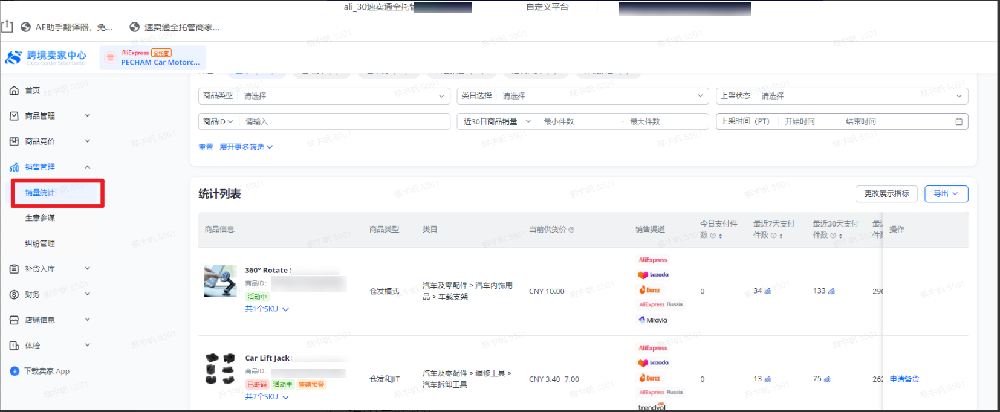
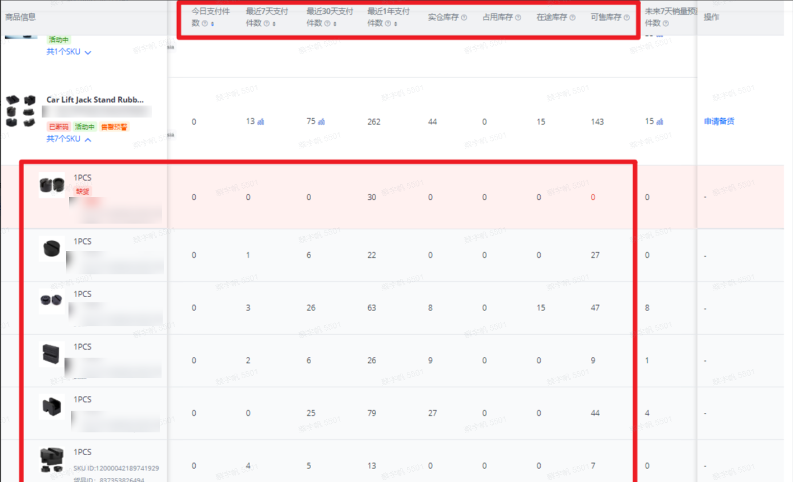
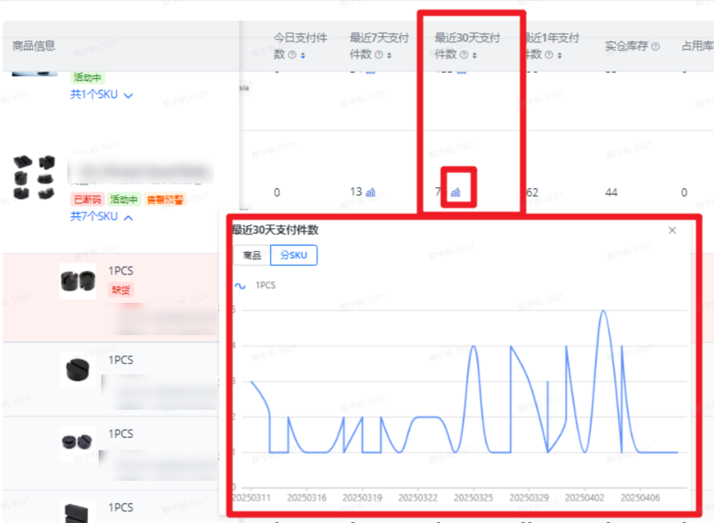
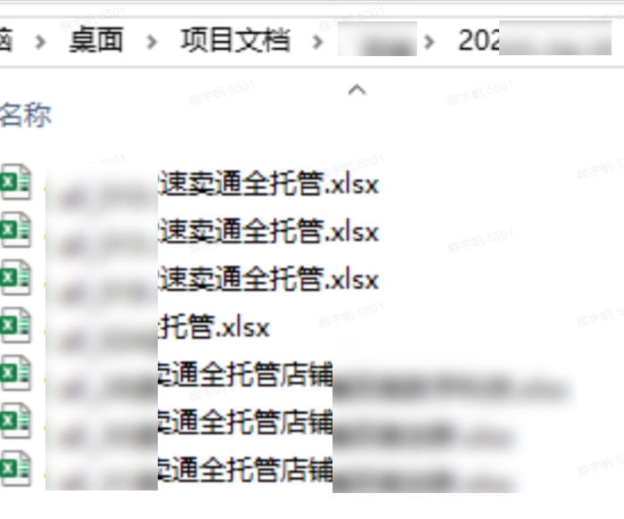
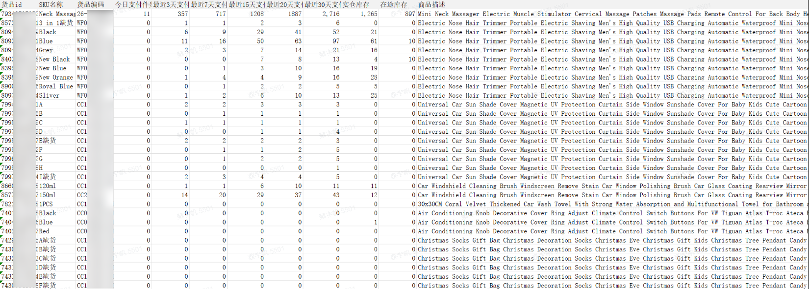

> 该公司运营负责人：
> “以前总觉得抓销量数据是个简单但烦人的活，现在机器人比我点得还快，而且从不出错。多店铺管理终于不头疼了。”

| 衡量指标 | 使用前 | 使用后 |
|-|-|-|
| 处理耗时 | 约 1.5 小时/天 | 缩短至 8 分钟（多店铺并行） |
| 数据准确率 | 人工记录易漏采、错行、格式混乱 | 零漏采、零错行 |
| 店铺覆盖 | 逐个登录 5-10 个店铺 | 多店铺自动并行采集 |
| 人力投入 | 每天约 1 小时“搬运数据” | 每天多出 1 小时用于数据分析与运营策略 |

> **Agent 自动化需开通企业功能**：点击申请1个月免费权限 [ 点击申请 → ](https://skieer.feishu.cn/share/base/form/shrcnFwMayykP5iaL38fnZKTbrg)

---

## 1.客户信息

该公司主营速卖通全托管模式，同时运营多个店铺。运营人员每天需要登录每个店铺的后台，查看销售统计数据，用于补货、调整广告和评估爆款趋势。

过去这些数据全靠人工逐个店铺登录、逐项复制，每天耗时约 1.5 小时，且容易漏采、错行。引入紫鸟浏览器 + 八爪鱼 RPA 后，机器人自动完成多店铺销量数据抓取与分类保存，整个流程无人值守、完成后自动通知运营人员，耗时至 8 分钟。

---

## 2.业务问题

### 01.业务背景

该公司主营速卖通全托管模式，同时运营多个店铺。运营人员每天需要登录每个店铺的后台，查看销售统计数据，用于补货、调整广告和评估爆款趋势。店铺多、维度多、重复度高，人工采集既慢又容易出错。

- 主要平台：速卖通（全托管）
- 采集内容：销售额、订单数、访客数等列表页指标，以及“近3日”“近15日”“近20日”销量趋势
- 原处理方式：人工逐个登录店铺后台、逐项复制并整理到 Excel

### 02.流程与问题

销量数据采集链路全靠人工，重复操作、数据维度与准确率三头承压：

#### 店铺多、重复操作
每天要手动登录 5-10 个店铺，逐一进入“销售统计”页面，复制表格数据。

#### 数据维度多
除了列表页的默认指标，还要分别点击折线图获取“近3日”“近15日”“近20日”的销量趋势。

#### 易出错、效率低
人工记录容易漏掉某天数据，整理到 Excel 时也常出现格式混乱，每天耗时约 1.5 小时。

| 人工操作流程 | 具体步骤 | 问题 |
|-|-|-|
| 店铺登录 | 逐个登录 5-10 个店铺后台 | 店铺多，重复操作耗时长 |
| 进入销售统计 | 逐一进入“销售统计”页面 | 重复点击，效率低 |
| 采集指标 | 复制列表页销售额、订单数、访客数等默认指标 | 人工复制易漏、易错 |
| 采集趋势 | 依次点击折线图获取“近3日”“近15日”“近20日”销量趋势 | 维度多，逐项记录费时 |
| 整理归档 | 手工整理到 Excel | 格式混乱、易遗漏某天数据 |

### 03.客户需求

- 多店铺自动采集：自动按店铺清单登录并抓取销售统计数据，不再人工逐个店铺操作
- 多维度一次取齐：列表页默认指标与“近3日”“近15日”“近20日”销量趋势一并采集
- 数据准确可追溯：结果自动分类保存，按店铺和日期命名，历史数据随时可查

---

## 3.解决方案

该公司引入紫鸟浏览器 + 八爪鱼 RPA 机器人，实现多店铺销量数据的全自动抓取：机器人按预设店铺清单自动登录、进入销售统计、采集指标与趋势数据并分类保存，整个流程无人值守，完成后自动通知运营人员。

### 01.概述

|  | 说明 |
|-|-|
| 覆盖平台 | 速卖通（全托管）、紫鸟浏览器 |
| 处理环节 | 循环店铺列表 → 进入销售统计 → 采集数据 → 保存结果 |
| 核心能力 | 多店铺自动登录 / 列表页指标与折线图趋势自动抓取 / 结果自动分类保存 / 完成后自动通知 |
| 涉及系统 | 紫鸟浏览器、速卖通卖家中心、Excel、八爪鱼 RPA |
| 运行节奏 | 每日自动执行，多店铺并行 |

**循环登录店铺**

机器人读取预设的店铺账号清单，自动按顺序登录紫鸟浏览器中的对应店铺环境，无需人工逐个切换。

**进入销售统计**

自动导航至紫鸟后台“跨境卖家中心”的“销售统计”页面，定位到需要采集的数据区域。

**采集数据**

抓取页面列表中的默认字段（销售额、订单数、访客数等），并依次点击折线图上的“近3日”“近15日”“近20日”按钮，分别记录对应的销量数值。

**保存结果**

自动分类保存至 Excel，整个流程无人值守，机器人完成后自动通知运营人员。

### 02.方案优势

1. 效率提升 90%：原来 1.5 小时的工作缩短至 8 分钟（多店铺并行）。
2. 数据零漏采、零错行：不再出现漏采、错行、格式混乱等问题。
3. 解放人力：运营人员每天可以多出 1 小时用于分析数据、制定运营策略，而不是单纯“搬运数据”。
4. 可追溯：每天生成的 Excel 文件按店铺和日期命名，历史数据随时可查。

### 03.涉及解决方案

**数据报表 ｜ 速卖通经营日报 Agent 自动化**

> 为速卖通卖家团队打造的经营日报方案（老板驾驶舱，多店铺汇总），由智能体调度多个工具汇总各采集场景底表（订单/结算/罚款/资金/绩效），生成“一页纸”经营日报。方案链接：[数据报表 ｜ 速卖通经营日报 Agent 自动化](https://skieer.feishu.cn/wiki/HWXKwHR4si1HUbkFt85cLZQWnGf)

---

## 4.落地效果

| 衡量指标 | 使用前 | 使用后 |
|-|-|-|
| 处理耗时 | 约 1.5 小时/天 | 缩短至 8 分钟（多店铺并行） |
| 数据准确率 | 人工记录易漏采、错行、格式混乱 | 零漏采、零错行 |
| 店铺覆盖 | 逐个登录 5-10 个店铺 | 多店铺自动并行采集 |
| 人力投入 | 每天约 1 小时“搬运数据” | 每天多出 1 小时用于数据分析与运营策略 |

**效率提升 90%**

原来 1.5 小时的工作缩短至 8 分钟，多店铺并行执行，重复的“搬运数据”工作被完全替代。

**零漏采、零错行**

不再出现漏采、错行、格式混乱等问题，补货、广告调整与爆款评估始终基于最新、最准的数据。

**解放人力**

运营人员每天可以多出 1 小时用于分析数据、制定运营策略，而不是单纯“搬运数据”。

**可追溯**

每天生成的 Excel 文件按店铺和日期命名，历史数据随时可查，多店铺管理不再头疼。

---

原文：[查看原文](https://skieer.feishu.cn/docx/F17cdM6f1oyNJUxOUCccSF4qnEc)
