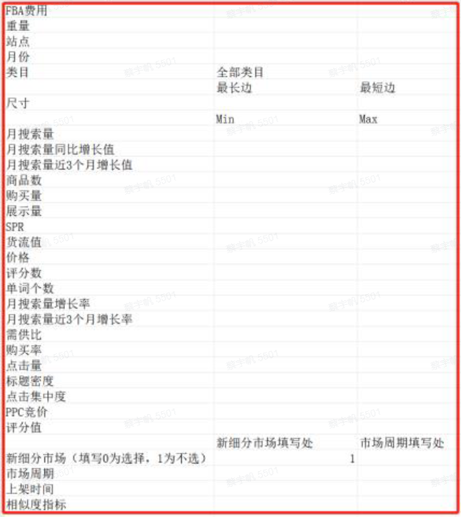
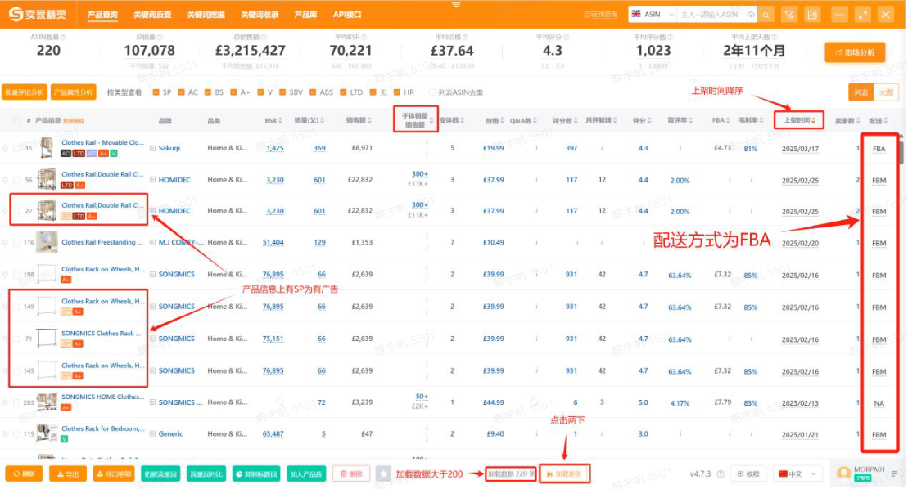
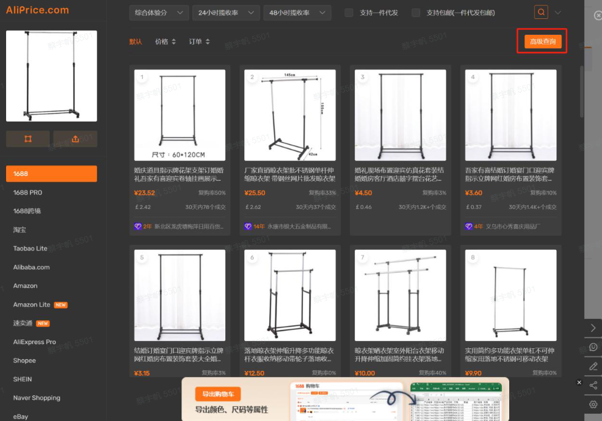
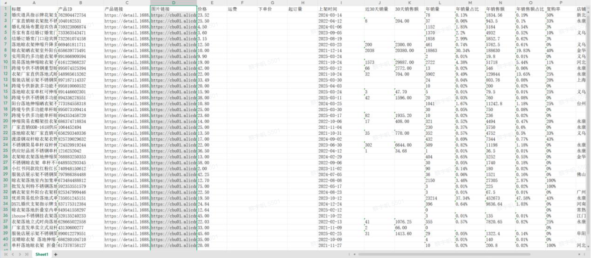

> 该卖家选品负责人：
> “以前靠经验选品，现在靠数据选品。机器人帮我从海量商品中捞出真正能赚钱的，而且每一步都可回溯，心里有底。”

| 衡量指标 | 使用前 | 使用后 |
|-|-|-|
| 选品耗时 | 整套流程需 半天 | 缩短至 30 分钟 |
| 选品分析量 | 人工逐个关键词、逐款商品查看 | 每日 200+ 关键词、数千个商品 |
| 选品质量 | 人工核对，易遗漏潜力新品 | 按 FBA 费用、尺寸等硬性指标自动筛选 |
| 利润测算 | 人工估算，毛利率凭经验 | 自动核算利润率，并比对 1688 最低采购价 |

> **Agent 自动化需开通企业功能**：点击申请1个月免费权限 [ 点击申请 → ](https://skieer.feishu.cn/share/base/form/shrcnFwMayykP5iaL38fnZKTbrg)

---

## 1.客户信息

该卖家主营亚马逊美国站，SKU 众多，选品与采购长期依赖人工——逐个关键词搜索、手动分析商品、再去 1688 找同款比价，效率低、易遗漏，且难以保证利润率。

为把选品从“靠经验”变为“靠数据”，该卖家引入八爪鱼 RPA，搭建覆盖“关键词筛选 → 商品初筛 → 新品机会识别 → 1688 比价 → 利润率测算”的全自动选品流程：原来需要半天的工作缩短至 30 分钟，每日可分析 200+ 关键词、数千个商品。

---

## 2.业务问题

### 01.业务背景

该卖家主营亚马逊美国站，SKU 众多。选品长期依赖人工——逐个关键词搜索、手动分析商品、比价 1688。整个过程效率低、易遗漏，且难以保证利润率；数据量大时，还经常错过有潜力的新品。

- 主要平台：亚马逊美国站
- 选品环节：关键词筛选、商品初筛、新品机会识别、1688 比价、利润率测算
- 原处理方式：人工逐个关键词搜索、手动查看商品数据、跨平台比价

### 02.流程与问题

选品与采购链路全靠人工，效率、覆盖与利润测算三头承压：

#### 关键词筛选靠人工
每天要筛选上百个关键词，每个关键词要查看前 20 个商品的 FBA 费用、尺寸、新品表现等，人工逐个核对耗时费力。

#### 跨平台比价耗时
还要去 1688 找同款、比价、算利润，整个过程耗时 3-4 小时/天。

#### 易漏潜力新品
因数据量大，人工逐条核对容易遗漏，经常错过有潜力的新品。

| 人工操作流程 | 具体步骤 | 问题 |
|-|-|-|
| 关键词搜索 | 逐个关键词在卖家精灵中搜索并筛选 | 每天上百个关键词，人工逐个查看 |
| 商品初筛 | 逐个查看前 20 个商品的 FBA 费用、尺寸、新品表现 | 人工逐条核对，耗时且易漏 |
| 1688 比价 | 到 1688 找同款、比对采购成本 | 跨平台手动搜索、记录，效率低 |
| 利润测算 | 结合汇率、头程、佣金、税率、推广费估算利润 | 人工计算易错，毛利凭经验估算 |
| 选品决策 | 汇总数据后凭经验拍板 | 数据分散，难以及时抓住新品窗口期 |

### 03.客户需求

- 全流程自动化：从关键词筛选、商品初筛到 1688 比价、利润测算一次跑通，替代人工重复操作
- 硬性指标过滤：按 FBA 费用、尺寸、新品出单等硬性指标自动筛选，避免人为遗漏
- 利润可控：自动核算利润率并比对 1688 最低采购成本，确保毛利率达标

---

## 3.解决方案

该卖家引入选品机器人流程，一键自动完成设置筛选条件、抓取关键词、初步筛选商品、识别新品机会、1688 比价与利润率测算，把选品从“靠经验”转为“靠数据”。

### 01.概述

|  | 说明 |
|-|-|
| 覆盖平台 | 亚马逊美国站、1688、卖家精灵、AliPrice 购物助手 |
| 处理环节 | 关键词筛选 → 商品初筛 → 新品机会识别 → 1688 比价 → 利润率测算 |
| 核心能力 | 按条件批量筛选关键词 / FBA 费用与尺寸硬指标自动判断 / 新品出单识别 / 1688 同款比价 / 自动核算利润率 |
| 涉及系统 | 卖家精灵、AliPrice 购物助手、1688、八爪鱼 RPA |
| 运行节奏 | 每周跑一次流程，及时抓住新品上架窗口期 |

**关键词自动筛选**

在 Excel 输入表中填写站点（美国站）、类目、月搜索量、增长率、商品数、价格、评分等参数，机器人打开卖家精灵关键词选品界面，按条件筛选出 200 个关键词。

**商品初筛，锁定合规商品**

对每个关键词的前 20 个商品逐一判断——FBA 费用 ≤3 美金、尺寸合规（最长边 &lt;35cm，最短边 &lt;6cm）；若前 20 个里有 10 个以上满足，则进入下一步。

**识别新品机会**

用卖家精灵插件加载数据，筛选近几个月内有新品上架，且子体无广告出单 ≥15、有广告出单 ≥30 的商品，保存其 ASIN、标题、售价、尺寸、FBA 费用等。

**1688 比价与利润率测算**

打开 AliPrice 购物助手，导出 1688 前 20 个同款商品，图片相似度 ≥80% 的保留，记录采购成本、主图、链接，并按成本升序排序；再自动关联汇率、头程运费（重量×50）、佣金 15%、税率（售价/1.2×0.2）、推广费等，得出每个商品的利润率。

### 02.方案优势

1. 一键跑通全流程：从关键词筛选到 1688 比价、利润测算一次完成，原需半天的工作缩短至 30 分钟。
2. 硬指标自动过滤：自动筛选出符合 FBA 费用、尺寸、新品出单等硬性指标的商品，避免人为遗漏。
3. 利润可控：系统自动算利润率，并比价 1688 最低采购成本，确保毛利率达标。
4. 快速响应：每周跑一次流程，及时抓住新品上架窗口期。

### 03.涉及解决方案

**选品 ｜ 亚马逊利润与货源测算 Agent 自动化**

> 为亚马逊卖家团队打造的利润与货源测算方案，由智能体调度多个工具统一取数、定期自动核算利润、按需验证货源，只推送亏损与高毛利机会。方案链接：[选品 ｜ 亚马逊利润与货源测算 Agent 自动化](https://skieer.feishu.cn/wiki/Vu4UwcupKio9S6kvsPucfhs3nPc)

**采购供应链 ｜ 亚马逊供应商寻源比价 Agent 自动化**

> 为亚马逊卖家团队打造的供应商寻源比价方案，由智能体调度多个工具统一取数，按需或每周定时比价，输出报价对比清单与推荐供应商。方案链接：[采购供应链 ｜ 亚马逊供应商寻源比价 Agent 自动化](https://skieer.feishu.cn/wiki/Psixw9FoNiEQk3kzYfMcM85Enhb)

**选品 ｜ 亚马逊市场机会发现 Agent 自动化**

> 为亚马逊选品团队打造的市场机会发现方案，由智能体调度工具统一取数、输出机会报告，一次性给出蓝海方向、潜力关键词与捆绑组合的候选清单。方案链接：[选品 ｜ 亚马逊市场机会发现 Agent 自动化](https://skieer.feishu.cn/wiki/ItYBwSwvXiYFo9kHctLcOcBqnhf)

---

## 4.落地效果

| 衡量指标 | 使用前 | 使用后 |
|-|-|-|
| 选品耗时 | 整套流程需 半天 | 缩短至 30 分钟 |
| 选品分析量 | 人工逐个关键词、逐款商品查看 | 每日 200+ 关键词、数千个商品 |
| 选品质量 | 人工核对，易遗漏潜力新品 | 按 FBA 费用、尺寸等硬性指标自动筛选 |
| 利润测算 | 人工估算，毛利率凭经验 | 自动核算利润率，并比对 1688 最低采购价 |

**效率大幅提升**

原需半天的工作缩短至 30 分钟，每日可分析 200+ 关键词、数千个商品，选品不再受人工精力限制。

**选品质量提高**

自动筛选出符合 FBA 费用、尺寸、新品出单等硬性指标的商品，避免人为遗漏，把真正符合硬性条件的商品交到运营手中。

**利润可控**

系统自动算利润率，并比价 1688 最低采购成本，确保毛利率达标，避免“上架后才发现算错毛利”。

**快速响应**

每周跑一次流程，及时抓住新品上架窗口期，从“凭经验选品”转变为“靠数据选品”。

---

原文：[查看原文](https://skieer.feishu.cn/docx/P3g2drfCqoqI0Ux0ogOcwtXTnVd)
