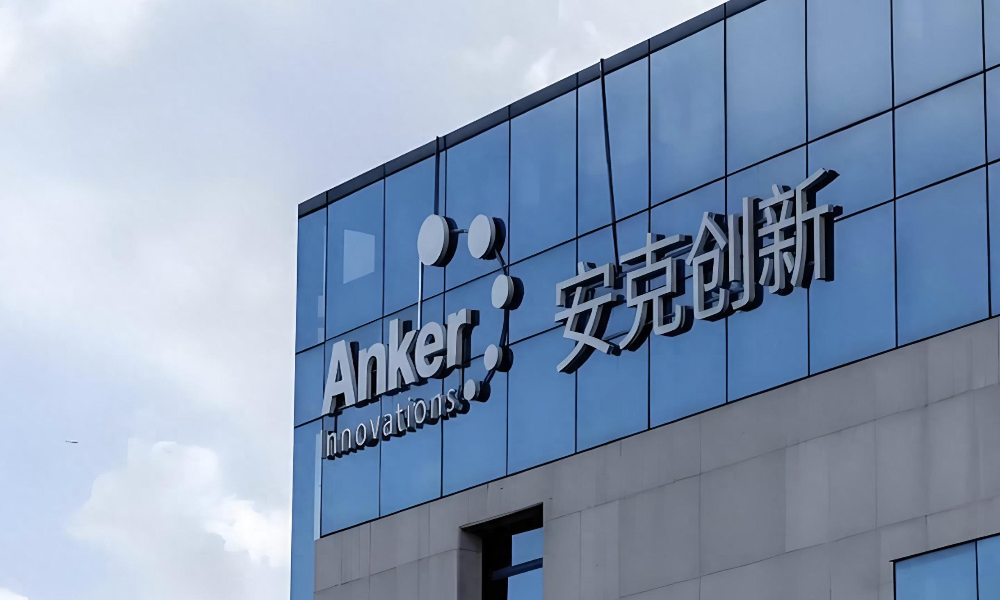

> 安克创新：
> 八爪鱼RPA不仅把客服团队从繁重的‘算薪算绩效’中解脱出来，确保了数据的100%准确，更为公司每年节省了超20万的隐性人力成本。

| 衡量指标 | 使用前 | 使用后 |
|-|-|-|
| 团队统计耗时 | 1小时+/次 | 降低至 10分钟 |
| 个人统计耗时 | 每人5-10分钟/天 | 0 (全自动采集) |
| 数据准确率 | 易错漏、常滞后 | 0人工干预，零差错 |
| 成本优化 | 隐性损耗大 | 年省20万+成本 |
| 单次统计耗时极限压缩 | — | 降低至 10分钟 |
| 年度隐性成本节省预估 | — | 降低至 20万+ |
| 跨平台跨页面数据零干预 | — | 增加至 0人工 |
| 专属RPA流程协同运作 | — | 增加至 5个 |

> **Agent 自动化需开通企业功能**：点击申请1个月免费权限 [ 点击申请 → ](https://skieer.feishu.cn/share/base/form/shrcnFwMayykP5iaL38fnZKTbrg)

---

## 1.客户信息

安克创新（Anker）是中国跨境电商领域的绝对领军者与全球知名的智能硬件出海品牌。作为中国品牌全球化的标杆，安克创新旗下拥有Anker、Soundcore、eufy等多个享誉海外的智能硬件品牌，业务覆盖全球100多个国家和地区。凭借卓越的自主研发与全渠道销售能力，安克在亚马逊等全球主流电商平台占据领先市场份额。

随着全球电商业务的飞速扩张，安克创新在国内外多平台运营着众多店铺，其客服部门需处理来自全球的海量用户咨询与服务请求。为精准考核客服团队效能，团队与个人维度的绩效数据统计成为日常运营刚需。然而，庞大且分散的多店铺后台数据、复杂的排班日均计算逻辑，以及全员参与复制数据的低效现状，对客服数据管理的时效性与准确性提出了严峻挑战。

安克创新面对多平台、多店铺的海量客服考核数据，需耗费客服Leader大量精力跨页面复制拼接，并下放全员每日手工统计个人数据。安克与八爪鱼RPA深度合作，成功构建多平台客服绩效自动化采集与核算体系。

借助5个专属RPA流程，替代人工完成多店铺跨页面数据抓取、飞书表格写入及排班日均数据核算。实现周/月度团队数据与每日个人数据T+1自动化沉淀，大幅提升考核时效与准确性。

---

## 2.业务问题

### 01.业务背景

安克创新在多平台运营众多店铺，客服团队效能考核需按团队与个人两个维度统计绩效数据。业务背景如下

- 安克创新（Anker）是中国跨境电商领域的领军者与全球知名的智能硬件出海品牌，旗下拥有 Anker、Soundcore、eufy 等多个享誉海外的品牌。
- 随着全球电商业务的飞速扩张，安克创新在国内外多平台运营着众多店铺，客服部门需处理来自全球的海量用户咨询与服务请求。
- 为精准考核客服团队效能，团队与个人维度的绩效数据统计成为日常运营刚需，但数据分散在后台多个页面，人工统计耗时且易滞后。

### 02.流程与问题

#### 数据分散
多平台多店铺客服数据散落在后台2-4个不同页面，人工跨页面复制拼接极易出错，导致每周一数据经常滞后，无法准时考核。

#### 核算复杂
需根据客服排班表计算日均数据，人工核算逻辑复杂、耗时极长，极易出现排班与绩效错位的情况。

#### 耗时下放
个人服务数据量极大，Leader无法独立完成，只能下放给每个客服每天花5-10分钟复制，严重占用一线业务时间。

| 人工操作流程 | 具体步骤 | 问题 |
|-|-|-|
| 多平台客服数据采集 | 人工跨页面复制拼接团队周/月/季统计与个人日业绩数据 | 数据散落在后台 2-4 个不同页面，极易出错，每周一数据经常滞后，无法准时考核 |
| 排班日均数据核算 | 人工按排班表计算出勤天数，再与绩效汇总数据相除求均值 | 核算逻辑复杂、耗时极长，极易出现排班与绩效错位 |
| 个人业绩统计汇总 | 下放给每个客服每天花 5-10 分钟复制个人服务数据 | 严重占用一线业务时间，Leader 无法独立完成 |

### 03.客户需求

- 多平台多账号客服数据批量抓取，自动跨页提取并清洗汇总，一键写入飞书数据表格。
- 按排班表自动统计出勤天数并核算日均数据，无需人工计算。
- 定时采集每个客服的业绩统计，自动更新至飞书个人统计表格。

---

## 3.解决方案

在引入八爪鱼 RPA 后，上述人工环节由机器人自动完成，无需人工参与。

### 01.概述

|  | 说明 |
|-|-|
| 覆盖平台 | 国内外多主流电商平台多店铺后台系统。 |
| 覆盖数据 | 团队周/月/季统计、排班出勤天数、日均均值、个人日业绩统计等核心客服绩效指标。 |
| 覆盖团队 | 客服部门全员（客服Leader、一线客服人员）。 |
| 未来规划 | 安克创新计划将RPA应用从客服绩效统计延伸至客服质检、客诉标签自动分析等更深层场景，结合AI能力实现服务情绪识别与实时预警，推动客服运营体系向“数据驱动智能化”演进。 |

针对上述人工流程，八爪鱼 RPA 部署 5 个专属流程，覆盖多平台数据抓取、排班日均核算与个人业绩采集。

- 部署4个RPA流程针对不同平台多账号进行批量数据抓取，自动跨页提取并清洗汇总，一键写入飞书数据表格。多平台团队绩效批量抓取
- 部署1个专属日均核算流程，RPA自动读取排班表统计出勤天数，抓取绩效汇总数据相除，自动算出均值并更新至表格对应位置。排班日均数据自动核算
- 针对各平台配置专属RPA流程，定时登录后台采集每个客服的业绩统计，自动更新至飞书个人统计表格，彻底替代人工复制。个人客服业绩定时采集

### 02.方案优势

1. **多平台团队绩效批量抓取**：4 个 RPA 流程针对不同平台多账号批量抓取，自动跨页提取并清洗汇总，一键写入飞书表格。
2. **排班日均数据自动核算**：专属流程自动读取排班表统计出勤天数，抓取绩效汇总数据相除，自动算出均值并更新。
3. **个人客服业绩定时采集**：各平台配置专属流程，定时登录后台采集每个客服的业绩统计，自动更新至飞书个人统计表格。
4. **效能跃升：从「全员统计」到「一键直出」**：团队统计耗时从 1 小时+/次 压到 &lt;10 分钟/次，个人统计人工归零。

### 03.涉及解决方案

**售后服务 ｜ 客服绩效日报自动生成 Agent 自动化**

> 自动采集多平台客服接待、响应、转化等绩效数据，按日生成客服绩效日报并推送。方案链接：[售后服务 ｜ 客服绩效日报自动生成 Agent 自动化](https://skieer.feishu.cn/wiki/W7QGw2TjRimkoUkbXX4cf9AznPi)

**数据报表 ｜ 跨平台营销与客服数据自动采集入库 Agent 自动化**

> 跨平台采集营销与客服数据，清洗去重后统一入库，输出可分析的数据底表。方案链接：[数据报表 ｜ 跨平台营销与客服数据自动采集入库 Agent 自动化](https://skieer.feishu.cn/wiki/ZoYewOOxEiaACmkrcd8c5R4MnHd)

---

## 4.落地效果

| 衡量指标 | 使用前 | 使用后 |
|-|-|-|
| 团队统计耗时 | 1小时+/次 | 降低至 10分钟 |
| 个人统计耗时 | 每人5-10分钟/天 | 0 (全自动采集) |
| 数据准确率 | 易错漏、常滞后 | 0人工干预，零差错 |
| 成本优化 | 隐性损耗大 | 年省20万+成本 |
| 单次统计耗时极限压缩 | — | 降低至 10分钟 |
| 年度隐性成本节省预估 | — | 降低至 20万+ |
| 跨平台跨页面数据零干预 | — | 增加至 0人工 |
| 专属RPA流程协同运作 | — | 增加至 5个 |

**多平台团队绩效批量抓取**

安克创新多平台多店铺的数据过去散落在不同后台页面，人工跨页复制极易错漏。八爪鱼RPA部署了4个专属抓取流程，模拟人工路径自动登录各大电商后台，跨2-4个页面精准提取团队周、月、季度的服务数据。机器人将抓取的原始数据自动清洗并写入飞书绩效统计表，原本客服Leader需耗费1小时以上的统计工作，现仅需触发流程，10分钟内即可完成全量数据汇总，周一考核不再滞后。

**排班日均数据自动核算**

日均绩效计算是客服考核的痛点，需结合出勤天数得出均值。八爪鱼RPA部署了1个核算流程，机器人首先自动读取客户排班表，精准匹配每个店铺客服团队在指定日期区间的出勤天数。随后，RPA自动进入飞书表格读取已汇总的各项绩效数据，执行除法运算得出日均值，并将结果自动写入表格的均值字段。全流程无需人工核对算式，彻底杜绝了人工核算的错漏风险。

**个人客服业绩定时采集**

过去因数据量庞大，个人业绩统计被迫下放给每个客服每天花5-10分钟手动复制，严重消耗一线精力。八爪鱼RPA针对各平台配置了个人统计专属流程，设定每日定时触发。机器人自动登录电商后台，逐一采集每个客服的业绩统计指标，并自动更新至飞书个人统计表中。一线客服无需再操心数据上报，每天0人工干预即可实现个人数据的精准留档。

**效能跃升：从“全员统计”到“一键直出”**

RPA上线后，不仅释放了客服Leader每周数小时的统计压力，更让全体一线客服告别了每日抄写数据的低效负担。团队将精力全面聚焦于服务品质提升与业务复盘。凭借精准且高效的数据流转，这套RPA方案每年为安克创新节省了超20万的隐性人力成本，真正实现了“业务零干预、数据零差错、效能指数级跃升”。

---

原文：[查看原文](https://skieer.feishu.cn/docx/JfpUdrOEloVR9jxcDltc2MOQnfe)
