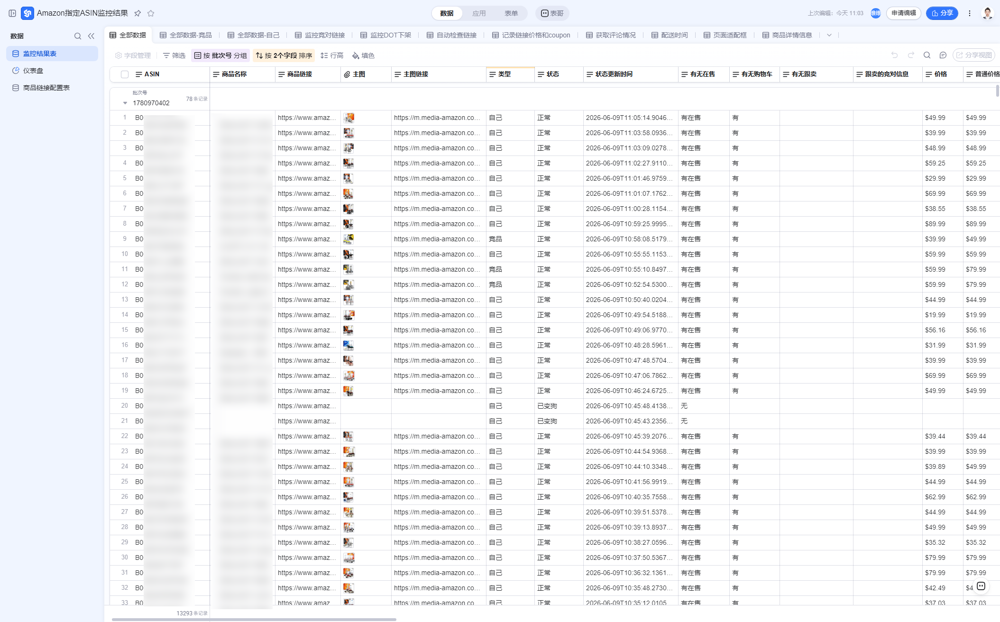
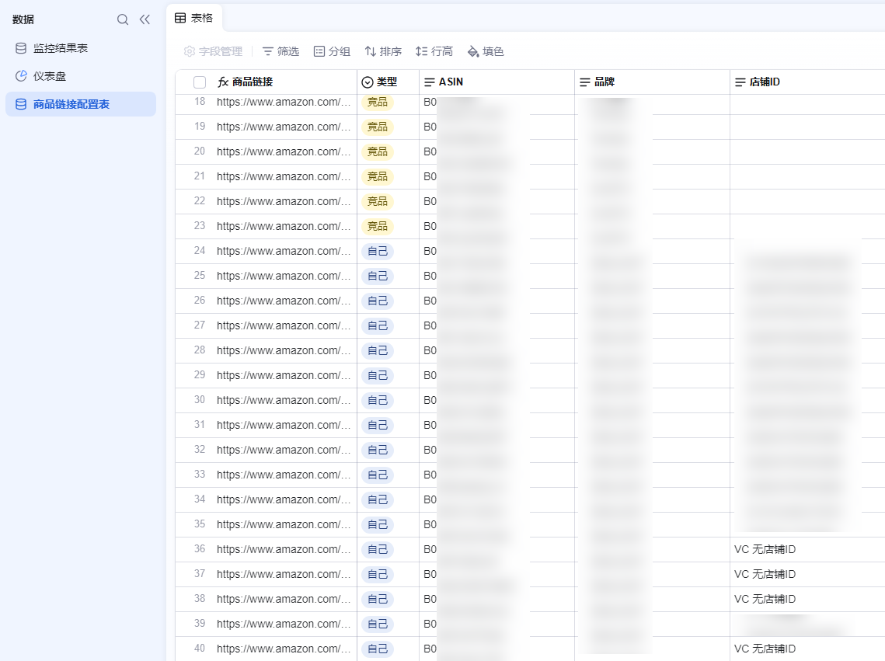
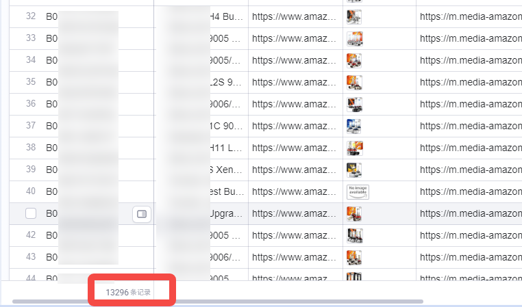
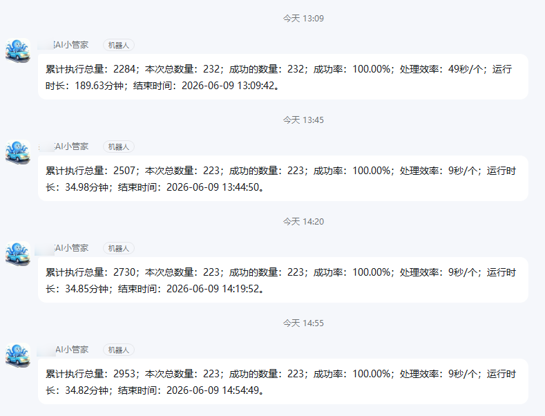
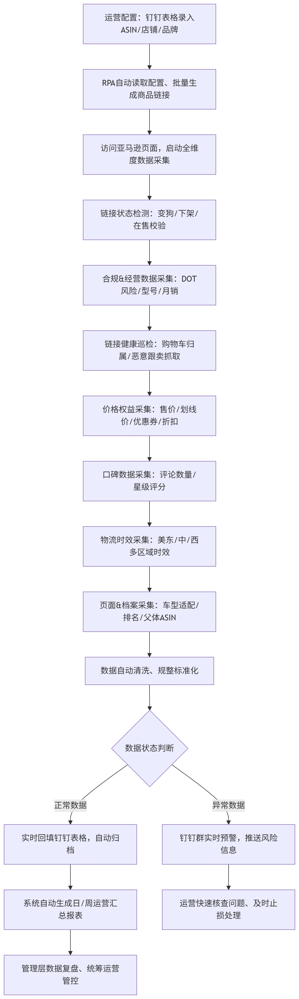
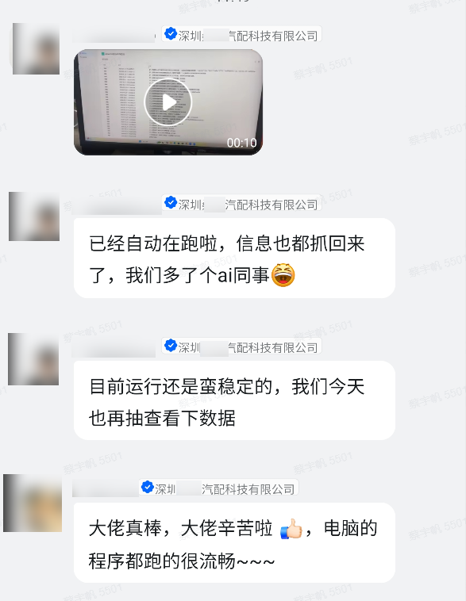

> 深圳某汽配科技有限公司 RPA 项目负责人：
> “目前RPA运行十分流畅、状态稳定，已经实现全自动运行，所需数据信息都能正常抓取回来，相当于为我们团队新增了一位AI同事，有效助力日常运营工作。”

| 衡量指标 | 使用前 | 使用后 |
|-|-|-|
| 稳定监控 ASIN 数 | 人工随机抽查部分链接，做不到全量覆盖 | 228 个（可支撑 500+） |
| 单商品综合处理耗时 | 人工肉眼核验，单条耗时且不完整 | 30 秒/个 |
| 累计抓取链接次数 | 巡检数据零散，无常态化留痕 | 1W＋ |
| 风险发现时效 | 人工抽检，漏检滞后 | 7×24 小时高频巡检，异常实时推钉钉 |
| 数据沉淀 | 巡检数据零散，无法追溯历史波动 | 全维度数据自动入钉钉 AI 表格，可追溯 |

> **Agent 自动化需开通企业功能**：点击申请1个月免费权限 [ 点击申请 → ](https://skieer.feishu.cn/share/base/form/shrcnFwMayykP5iaL38fnZKTbrg)

---

## 1.客户信息

某科技公司作为汽车后市场全球化品牌企业，汽配出海头部大卖，主营品类包括汽车照明（车灯线为核心）、汽车用品、改装配件、汽车电子等。

旗下品牌 S\*\*\*\*T 作为北美汽配第一梯队，占有率约 28.89%，服务 500 万+ 海外车主，也是该汽配龙头旗下的第一大核心品牌及营收支柱。

---

## 2.业务问题

### 01.业务背景

作为北美车灯品类绝对龙头，S\*\*\*\*T 对亚马逊商品链接监控面临着极高的要求，其监控背景如下：

- 对内：运营团队每天要管理几百个核心 ASIN，需实时掌握每条链接状态；车灯属于美国 DOT / FMVSS 108 强监管类目，随时可能无预警下架，一旦发生恢复周期极长、难度大，还可能影响整个店铺安全
- 对外：团队需要持续监控大量竞品链接变化，及时掌握市场动态，保持竞争优势
- 办公工具限制：全公司只用钉钉，所有链接异常必须第一时间在钉钉提醒，并自动形成每日/每周汇总

### 02.流程与问题

最开始该企业都靠人工巡检，看起来每个步骤都合理，实际处处是坑：

#### 人工巡检粗放低效
日常运营仅能人工随机抽查少量 ASIN，没有固定巡检频次，经常出现漏检情况，很容易导致店铺违规、链接降权、订单流失，给业务带来损失。

#### 无标准化数据沉淀
自有商品、竞品的各类核心数据都无法批量采集和沉淀，管理层看不清整体运营情况，风险无法提前预判，难以支撑精细化运营与科学决策。

#### ERP & IT 行不通
市面通用跨境 ERP 能力有限，无法大批量监控 ASIN；而内部自研 ERP 高度依赖 IT 支持，ASIN 变动都需要排期改代码，跟不上业务快速迭代的节奏。

| 人工操作流程 | 具体步骤 | 问题 |
|-|-|-|
| 多链接批量核查与页面访问 | 平时只能抽空抽查部分 ASIN 链接，没有固定巡检频次，全程靠肉眼快速扫视核验 | 做不到全量覆盖检查，大量链接长期处于无人核查的漏检状态 |
| 链接风险逐项排查校验 | 人工只能发现链接下架、变狗这类直观明显的问题 | 很难察觉购物车丢失、竞品悄悄跟卖等隐性风险，日常漏检、误检十分常见 |
| 全维度商品数据人工采集 | 仅靠肉眼简单浏览页面 | 无法批量统计销量、价格、评论、物流、排名等精细化数据，无法沉淀完整可参考的运营数据 |
| 数据整理与表格手动录入 | 人工巡检数据零散不全 | 无法常态化录入钉钉 AI 表格，无标准化数据留存，无法追溯链接数据历史波动 |
| 异常问题识别与手动记录 | 仅记录重大显性异常 | 隐性风险、价格波动、竞品动态均无留存，无统一风险台账，问题无法复盘溯源 |
| 每日数据汇总与风险同步 | 无标准化日周汇总机制 | 仅口头同步突发问题，运营状态不透明，风险无法提前预判，易造成订单流失、店铺违规 |

### 03.客户需求

- 全量高频监控：几百个核心 ASIN 需 7×24 小时不间断监控，覆盖 DOT 下架、链接变狗、丢失购物车、恶意跟卖、价格/活动变动等风险
- 运营自主零代码：监控清单变动频繁，运营可自行新增、删除、调整 ASIN 与品牌/店铺信息，不依赖 IT 排期改代码
- 数据入钉钉可追溯：数据实时录入钉钉 AI 表格，异常第一时间在钉钉群提醒并自动形成日/周汇总

---

## 3.解决方案

经过内部评估，团队发现 RPA 是最贴合实际业务、可行性最高的方案。八爪鱼RPA为该汽配龙头量身打造专属自动化监控方案：全程适配公司钉钉办公体系，依托钉钉AI表格实现零代码自主运维，无需技术支持，就能全自动批量完成亚马逊海量ASIN监控、全维度数据采集工作。

### 01.概述

[查看原视频](https://skieer.feishu.cn/wiki/ZZsTwbsHsi5UJykMwX9c6zoLnmh)

|  | 说明 |
|-|-|
| 覆盖平台 | 亚马逊（北美站），覆盖自有品牌核心 ASIN 与竞品链接 |
| 监控维度 | 链接状态（下架/变狗/丢购物车/跟卖）、价格与活动、销量、评论、物流、排名等全维度数据 |
| 巡检规模 | 可同时支撑 500+ 核心 ASIN 大批量高频巡检，7×24 小时不间断值守 |
| 落地形态 | 无缝对接钉钉 AI 表格，运营零代码自主维护清单；异常实时推送钉钉群并自动形成日/周汇总 |

**深度联动钉钉AI表格，适配全员办公习惯**

全员使用钉钉办公，整套RPA方案无缝对接钉钉AI表格。所有商品数据、风险状态、竞品动态都会自动同步归档，不用人工手动填表、汇总，数据全程可追溯，日常查台账、对数据都非常方便。

**运营自主维护清单，彻底不用依赖IT**

日常该企业的监控ASIN清单变动非常频繁，这套工具支持运营自主零代码操作。随时可以新增、删除、调整监控链接和店铺信息，不用等待IT排期、改代码、发版，完全跟上该企业快速迭代的业务节奏。

**大批量高频巡检，实现全量链接无死角监控**

解决了传统ERP监控数量少、更新慢、字段少的短板，可同时支撑500+核心ASIN大批量高频巡检，7×24小时不间断值守。既能守住自有商品的合规与链接风险，也能持续监测竞品动态，真正实现全量链接全覆盖监控。

**实时提醒，异常不遗漏**

告别人工肉眼抽查、漏检、滞后跟进的问题，一旦系统识别到链接异常、合规下架、购物车丢失、恶意跟卖、价格波动等问题，会第一时间推送钉钉群提醒，可快速介入处理，及时止损，规避店铺违规和订单流失风险。

### 02.方案优势

1. **全量高频覆盖**：可同时支撑 500+ 核心 ASIN 大批量高频巡检、7×24 小时不间断值守，自有链接与竞品动态一起盯。
2. **零代码自主运维**：运营可自行新增、删除、调整监控 ASIN 与店铺信息，无需 IT 排期改代码发版。
3. **钉钉体系无缝衔接**：数据自动归档至钉钉 AI 表格，异常实时推送钉钉群并生成日/周汇总，全程可追溯。
4. **隐性风险也能抓**：不止下架、变狗这类显性问题，购物车丢失、恶意跟卖、价格波动等隐性风险同样识别预警。
5. **数据可沉淀**：全维度商品数据批量采集入表，为精细化运营与科学决策提供数据支撑。

### 03.涉及解决方案

**店铺运营 ｜ 亚马逊ASIN跟卖与竞品监控 Agent 自动化**

> 为亚马逊卖家团队打造的 ASIN 跟卖与竞品监控方案，由智能体调度多个工具统一取数，新跟卖与重要变化才推送，无异常不打扰。方案链接：[店铺运营 ｜ 亚马逊ASIN跟卖与竞品监控 Agent 自动化](https://skieer.feishu.cn/wiki/Yjh3wy8jzijNkpkNdR0cIO1QnXc)

**店铺运营 ｜ 亚马逊竞品异动监控 Agent 自动化**

> 为亚马逊卖家团队打造的竞品异动监控方案，由智能体调度多工具统一取数，每日扫描，有异动才推送，无异常不打扰。方案链接：[店铺运营 ｜ 亚马逊竞品异动监控 Agent 自动化](https://skieer.feishu.cn/wiki/Njaaw7gEAi130ekxGv2cOytynxh)

---

## 4.落地效果

| 衡量指标 | 使用前 | 使用后 |
|-|-|-|
| 稳定监控 ASIN 数 | 人工随机抽查部分链接，做不到全量覆盖 | 228 个（可支撑 500+） |
| 单商品综合处理耗时 | 人工肉眼核验，单条耗时且不完整 | 30 秒/个 |
| 累计抓取链接次数 | 巡检数据零散，无常态化留痕 | 1W＋ |
| 风险发现时效 | 人工抽检，漏检滞后 | 7×24 小时高频巡检，异常实时推钉钉 |
| 数据沉淀 | 巡检数据零散，无法追溯历史波动 | 全维度数据自动入钉钉 AI 表格，可追溯 |

**228 个 ASIN 稳定监控、30 秒/个**

方案稳定监控 228 个核心 ASIN，单商品综合处理耗时仅 30 秒/个；累计抓取链接次数达 1W＋，从原来的人工抽查变成全量高频巡检。

**异常实时推钉钉，风险不遗漏**

识别到链接下架、变狗、购物车丢失、恶意跟卖、价格波动等问题后第一时间推送钉钉群，运营可快速介入止损，规避店铺违规与订单流失。

**数据全维度沉淀**

全维度商品数据自动入钉钉 AI 表格并自动形成日/周汇总，数据全程可追溯，管理层据此提前预判风险、支撑精细化运营。

**改造前 vs 改造后**

改造前：运营靠人工随机抽查少量 ASIN，无固定巡检频次，只能发现下架、变狗等显性问题，购物车丢失、跟卖等隐性风险难察觉；数据零散无法入表沉淀，通用 ERP 监控数量少/字段少/更新慢，自研 ERP 又依赖 IT 排期改代码。

改造后：RPA 依托钉钉 AI 表格实现零代码自主运维，7×24 小时批量高频巡检 228 个核心 ASIN（可支撑 500+），全维度数据自动入表、异常实时推送钉钉群并生成日/周汇总，运营自主增删改监控清单无需 IT 介入。

---

原文：[查看原文](https://skieer.feishu.cn/docx/QFKzdd7oPodz5BxhpAGcLO70n6d)
