> 关于北鼎：
> 某品牌以“实用生活美学”为设计理念，围绕养生、饮水、烹饪、咖啡等核心饮食场景，打造了涵盖养生壶、蒸炖锅、饮水机、烤箱、珐琅锅及汤包茶饮等一系列高颜值、高品质的厨房小家电与配套产品及服务，并通过美食社群与增值服务，构建起一个从工具到内容、从烹饪到分享的全方位饮食生活生态。

| 衡量指标 | 使用前 | 使用后 |
|-|-|-|
| 月平均运行时长 | 对账与申报全靠人工处理 | 167 h 由机器人承接 |
| 月平均运行次数 | 逐系统、逐主体手工操作 | 167 次 自动执行 |
| 应用数量 | 无 | 120 个 RPA 应用在跑 |
| 对账场景覆盖 | 天猫、京东、B2B、官网、视频号、仓配出入库逐个手工导出核对 | 从资金对账到出入库核对全场景自动 |
| 税务申报主体 | 几十个分公司主体 + 27 家门店，逐户手工填表申报 | 多主体一键申报、零差错运行 |

> **Agent 自动化需开通企业功能**：点击申请1个月免费权限 [ 点击申请 → ](https://skieer.feishu.cn/share/base/form/shrcnFwMayykP5iaL38fnZKTbrg)

---

## 1.客户信息

某品牌以“实用生活美学”为设计理念，围绕养生、饮水、烹饪、咖啡等核心饮食场景，打造了涵盖养生壶、蒸炖锅、饮水机、烤箱、珐琅锅及汤包茶饮等一系列高颜值、高品质的厨房小家电与配套产品及服务，并通过美食社群与增值服务，构建起一个从工具到内容、从烹饪到分享的全方位饮食生活生态。

该企业作为国内小家电行业的龙头企业，其天猫旗舰店粉丝数160万＋，线上电商渠道（包括天猫、微信、京东、官网等）贡献了绝大部分营收。公司总部位于深圳，但各地区的店铺以当地分公司为主体进行注册和运营，线下共有27家门店，每家门店都是独立的企业主体。

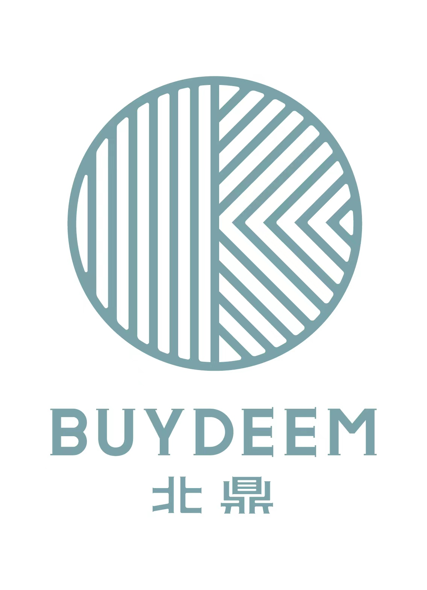

---

## 2.业务问题

### 01.业务背景

随着该企业科技财务共享中心建设推进，各资金平台积累了大量需下载、核对的数据。以往人工从SAP下载处理数据表的方式，效率低、质量不稳，既拖慢业务执行，也耗费人力。为此，结合财务建设与集团数字化要求，拟引入RPA自动化处理流水。借助机器人技术，可简化流水获取与处理流程，提升财务及共享中心效率，节约成本，支撑企业长远发展。

- **销售渠道：**覆盖天猫、京东、视频号、官网、B2B 等多个平台，每个平台还开设多个子店铺
- **税务主体：**总部在深圳，各店铺以当地分公司为主体注册运营，线下 27 家门店为独立主体
- **原处理方式：**人工从 SAP 下载数据表，逐笔匹配订单、资金与库存，逐户填表申报

### 02.流程与问题

财务共享中心的两条主线——资金对账与税务申报——都卡在"多"字上：平台多、字段多、主体多、税种多。

#### 多渠道财务对账难
销售渠道多/店铺多：企业业务覆盖天猫、京东、视频号、官网、B2B等多个平台，且每个平台还会开设多个子店铺。各平台账单格式、结算周期、资金流水字段、平台费用扣款规则均不统一，财务人员需人工下载并逐笔匹配订单、资金与库存数据，每月对账耗时长、易遗漏。尤其在大促期间，交易量激增，人工核对难以保证及时性与准确性，资金差异与库存异常往往滞后发现，存在较大财务风险。

#### 多主体税务申报难
公司主体多：该企业作为国内小家电行业的龙头企业，其天猫旗舰店粉丝数160万＋，线上电商渠道（包括天猫、微信、京东、官网等）贡献了绝大部分营收。公司总部位于深圳，但各地区的店铺以当地分公司为主体进行注册和运营。正是由于这种多主体、多店铺的运营模式，其财务部门需为每个分公司主体分别完成独立的税务申报，每月申报表数量成倍增加；各主体申报期限、属地税务机关要求不一，极易出现漏报、迟报或填报口径不一致的问题，整体申报效率和准确性难以保障。

#### 税务种类多
除了主体繁多之外，企业日常涉及的税种也极为庞杂，包括个人所得税、企业所得税（小规模）、增值税（小规模与一般纳税人）、印花税等，且需按期报送财务报表。不同税种的申报周期（月/季/年）、计税依据、适用税率及申报表格式各不相同，财务人员需在多个系统间频繁切换、重复填表，极易混淆或遗漏，整体税务管理成本高、效率低。

| 人工操作流程 | 具体步骤 | 问题 |
|-|-|-|
| 平台数据导出 | 逐平台登录天猫、京东、官网、视频号、B2B 后台，下载结算单、资金流水、订单与售后数据 | 账号多、字段不统一，下载耗时长 |
| SAP 取数 | 从 SAP 导出应收、发票、记账与库存明细 | 手工导出易漏项、格式不统一 |
| Excel 匹配核对 | 用 Excel 逐项匹配订单、资金与库存，定位差异并人工归因 | 每月耗时长、易遗漏，大促期更难及时 |
| 中台工单流转 | 在中台系统手动创建、提交、审核工单并完成验货完结 | 跨平台操作繁琐，效率低易出错 |
| 税务申报 | 逐主体从 SAP 取数、手工算未开票收入与减免税额，逐户填表申报缴款 | 申报表成倍增加，漏报迟报风险高 |

### 03.客户需求

- **对账自动化：**多平台资金对账与仓配出入库核对自动完成，规则整理、差异归因、企微通知与中台工单全流程无人化
- **申报自动化：**多主体、多会计准则下的报表报送与各税种申报自动完成，含跨系统核对、优惠计算、风险扫描与缴款
- **质量可追溯：**替代手工复制粘贴与反复算税填表，缩短关账周期，降低漏报、迟报与口径不一致风险

---

## 3.解决方案

针对集团多平台、多系统的资金对账及物流核对需求，八爪鱼RPA实现了从天猫、京东、B2B、官网、视频号到京东/菜鸟仓出入库的全场景自动化，并覆盖从财务报表自动报送，到企业所得税、增值税（小规模与一般纳税人）、印花税的全流程自动化申报。

### 01.概述

| 说明 | 内容 |
|-|-|
| 覆盖平台 | 天猫、京东、B2B（分销）、官网、视频号，以及京东/菜鸟仓配 |
| 覆盖系统 | 各平台后台、支付宝/微信支付、SAP、共享盘、中台、数据库、Excel/WPS、企业微信、电子税务局 |
| 对账场景 | 天猫、京东、B2B、官网、视频号资金对账 + 京东/菜鸟仓出入库核对，共 7 大场景 |
| 申报场景 | 财务报表报送、企业所得税、小规模纳税人增值税、一般纳税人增值税、印花税，共 5 大场景 |
| 运行节奏 | 按月/季自动执行，差异自动归因并企微通知，全程无人值守 |

**一、线上门店：线上销售渠道资金自动对账、出入库自动核对**

针对集团多平台、多系统的资金对账及物流核对需求，八爪鱼RPA实现了从天猫、京东、B2B、官网、视频号到京东/菜鸟仓出入库的全场景自动化。每月财务人员无需再手动导出各平台流水、结算单、订单、售后、应收/发票及记账明细等海量数据，也无需用Excel逐项匹配、归因差异或在中台系统手动创建工单。八爪鱼RPA自动完成数据导出、规则整理、核对表与差异表生成、差异类别归因，并支持企业微信通知及中台工单创建、提交、审核、验货完结全流程，彻底替代手工操作，大幅提升对账效率与准确性，缩短关账周期。

**场景1：天猫资金自动对账**

**涉及系统/软件：**天猫平台 支付宝平台 SAP 共享盘 中台 Excel WPS 企业微信。

**背景痛点：**每月需从天猫、支付宝、SAP、中台等多系统导出数据手工对账，数据量大、维度多、规则复杂，差异难定位，耗时易错，影响关账效率。

**RPA方案：**八爪鱼RPA机器人自动导出天猫平台价保数据、天猫平台权益金数据、天猫平台微信支付明细、支付宝平台流水明细、SAP发票明细、SAP应收明细、中台记账明细，根据规则整理以上导出的数据得到所需核对表以及差异表文件；再根据差异归因规则进行类别归因。

**场景2：京东资金自动对账**

**涉及系统/软件：**京东平台 SAP 共享盘 中台 Excel WPS 企业微信。

**背景痛点：**每月一次的京东平台资金对账，需从京东、SAP、中台等多系统导出数据手工匹配核对，差异归因繁琐易错，占用财务时间。

**RPA方案：**八爪鱼RPA机器人自动导出京东平台资金单数据、京东平台结算单数据、SAP发票明细、SAP应收明细、中台记账明细，根据规则整理以上导出的数据得到所需核对表以及差异表文件；再根据差异归因规则进行类别归因。

**场景3：B2B（分销）资金对账**

**涉及系统/软件：**数据库 SAP 共享盘 中台 Excel WPS 企业微信。

**背景痛点：**该集团分销业务扩大，每月需与多家分销商进行B2B资金对账。涉及期初/期末余额、加款、返利、支付、退款、订单、售后、SAP应收/发票、中台记账等十几种明细数据，手工导出Excel逐项匹配、归因差异，流程繁琐易错，对账周期长。

**RPA方案：**八爪鱼RPA自动导出所有相关明细数据，按规则生成核对表与差异表，并自动完成差异归因，替代手工匹配，提升对账效率与准确性。

**场景5：官网资金对账**

**涉及系统/软件：**官网平台 支付宝平台 SAP 共享盘 中台 Excel WPS 企业微信。

**背景痛点：**每月官网资金对账，需从官网、支付宝、SAP、中台等多系统导出资金报表及流水明细，手工匹配核对，差异归因繁琐耗时，易出错，影响财务关账效率。

**RPA方案：**八爪鱼RPA自动导出各系统数据，按规则生成核对表与差异表，自动完成差异归因，并通过企业微信发送通知至相关干系人，实现全流程自动化。

**场景6：视频号资金对账**

**涉及系统/软件：**SAP 共享盘 中台 Excel WPS 企业微信 数据库。

**背景痛点：**每月视频号资金对账，需从视频号小店、SAP、中台、数据库等多源头导出资金流水、应收/发票及记账明细，手工匹配繁琐，差异归因费时费力，影响对账效率。

**RPA方案：**八爪鱼RPA自动导出各系统数据，按规则生成核对表与差异表，自动完成差异归因，并通过企业微信发送通知，实现全流程自动化。

**场景7：京东、菜鸟仓输入库核对**

**涉及系统/软件：**SAP 共享盘 中台 Excel WPS 企业微信 数据库。

**背景痛点：**每月需从京东物流、京麦、菜鸟、中台等多平台导出流水、退货、订单、配货、待验货等表格，手工整理分表及汇总表，再在中台系统手动完成工单创建、提交、审核、验货完结，跨平台操作繁琐，效率低易出错。

**RPA方案：**八爪鱼RPA自动导出所有平台数据，按预设规则一键生成全部规则分表与汇总表，并自动登录中台系统完成工单创建、提交、审核及验货完结，全程无人值守，大幅缩短对账验货周期。

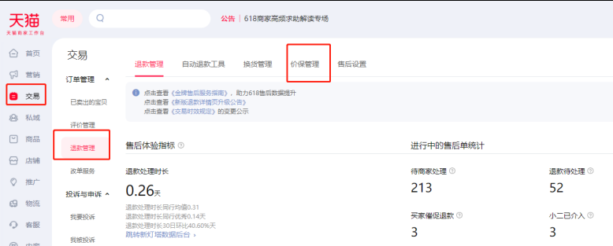

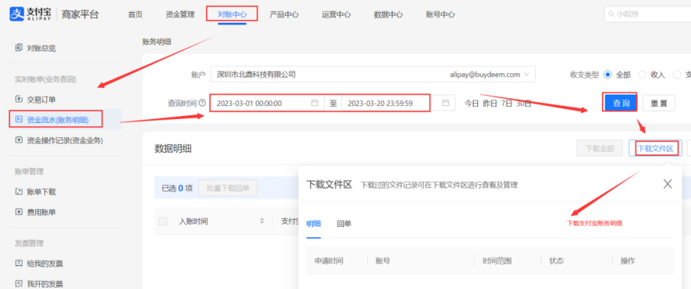

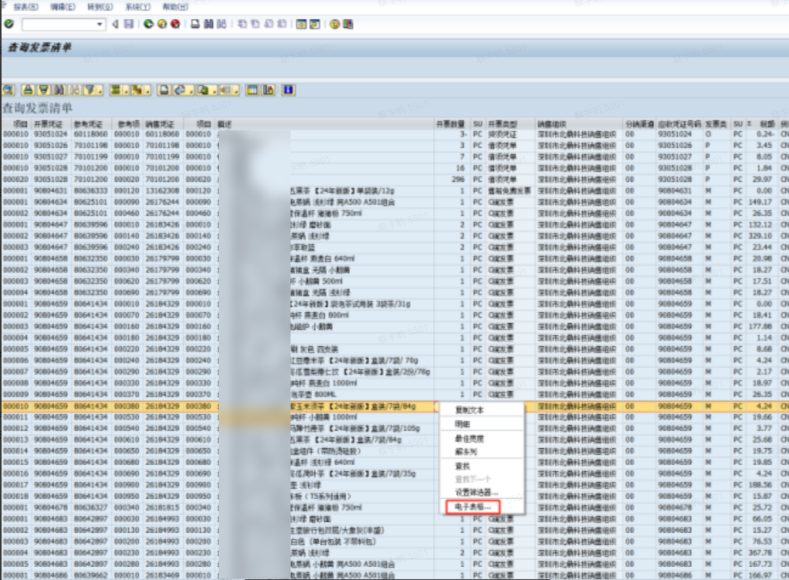

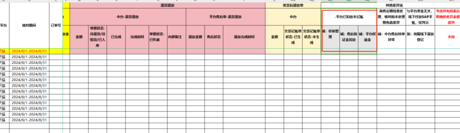

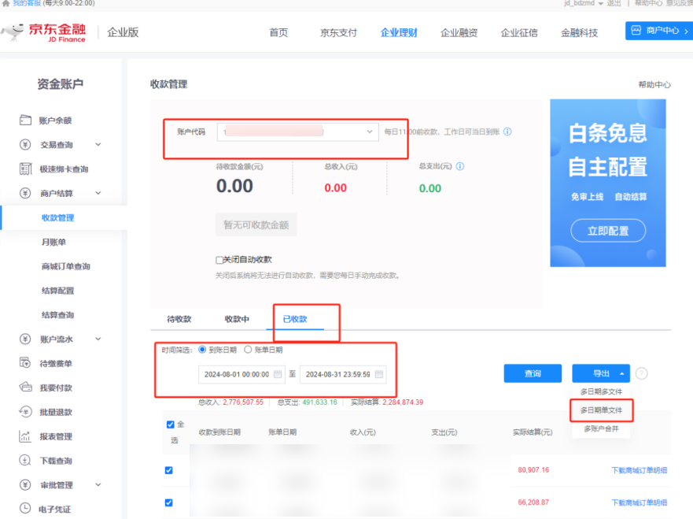

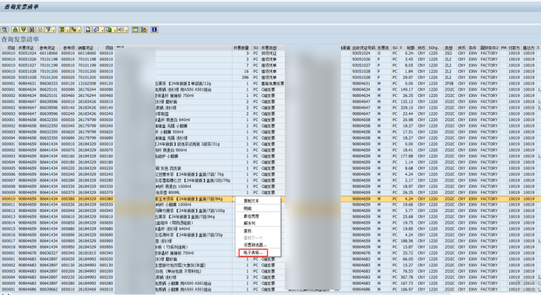

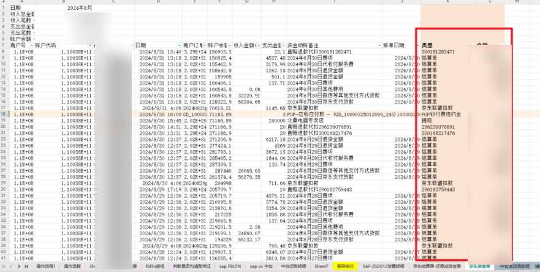

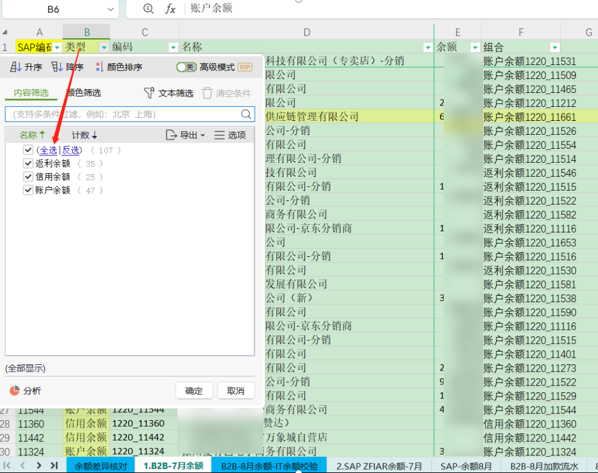

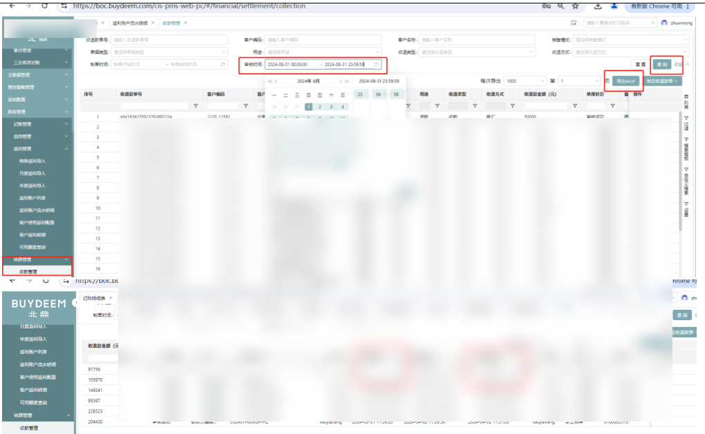

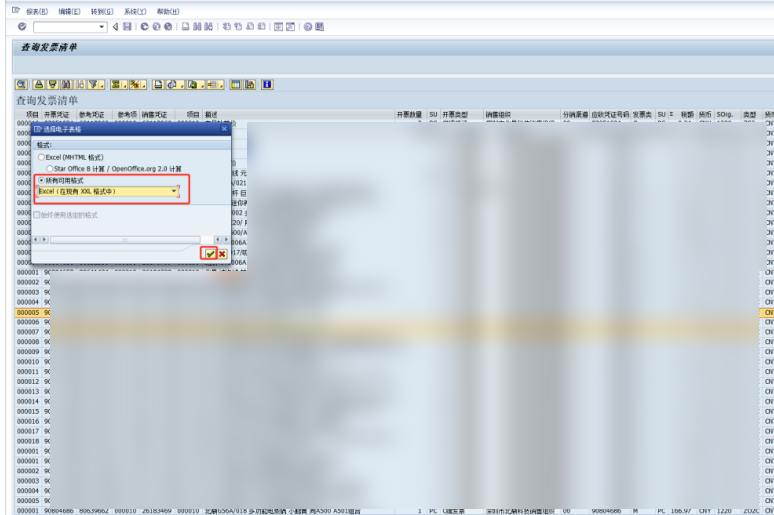

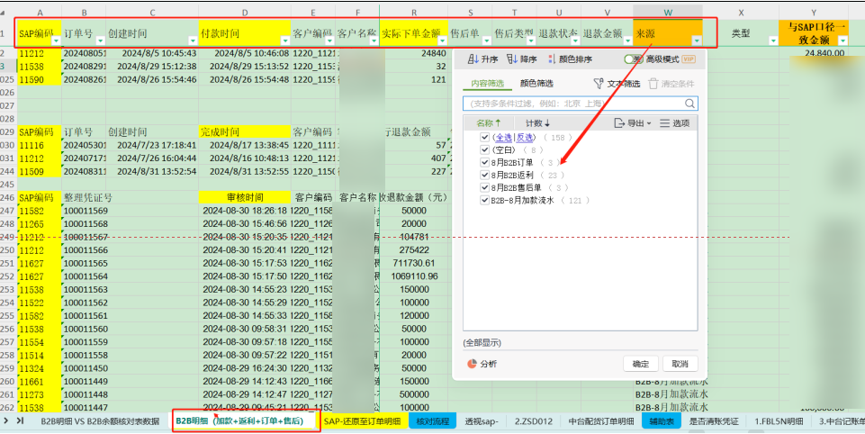

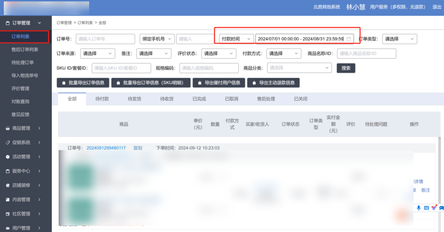

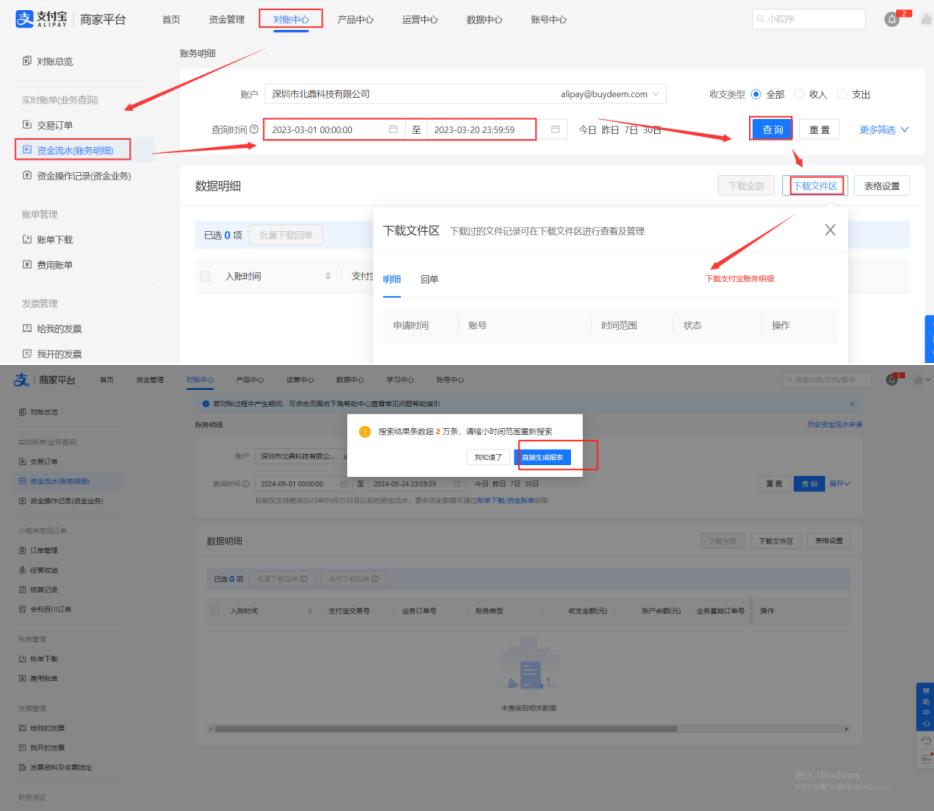

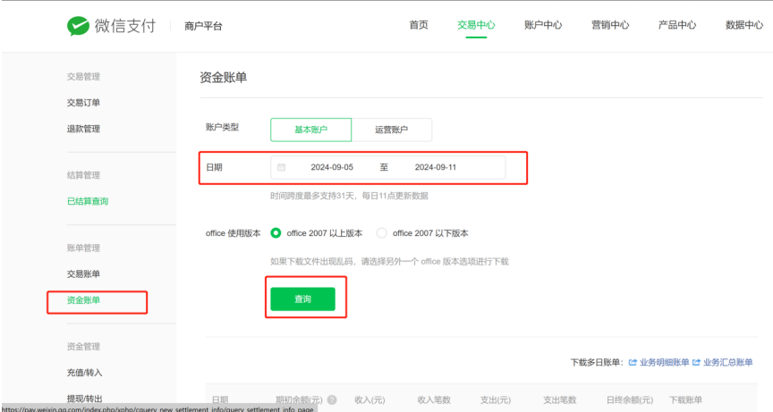

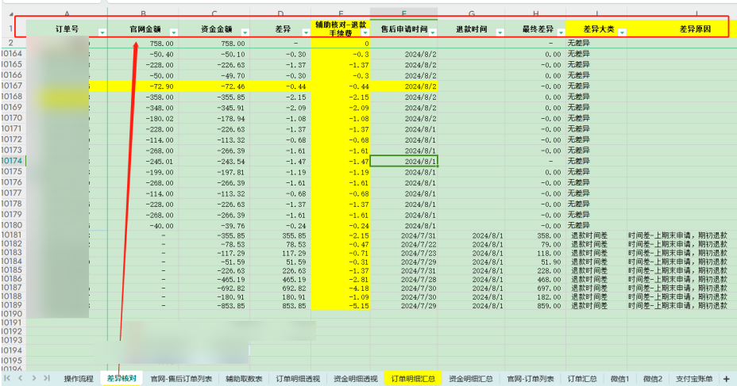

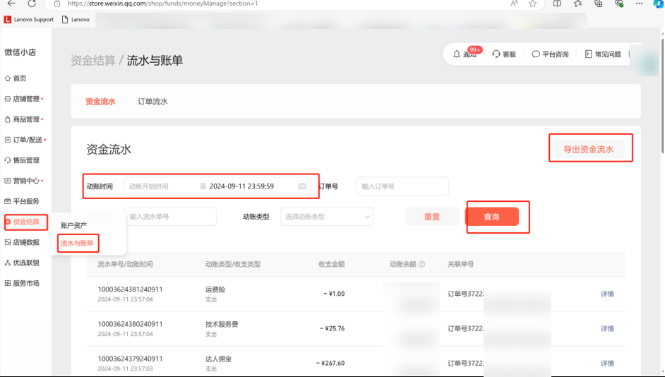

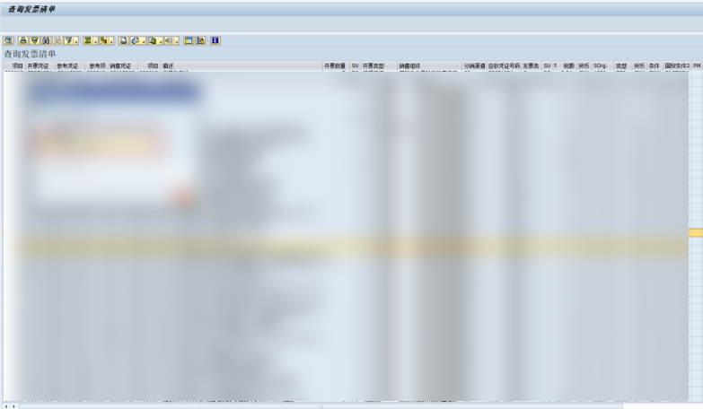

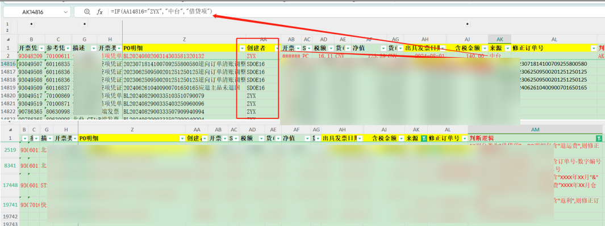

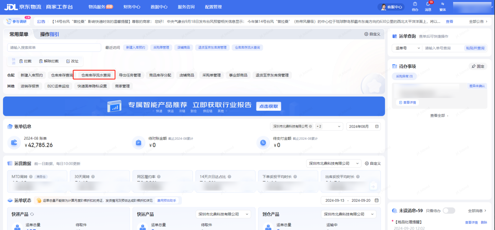

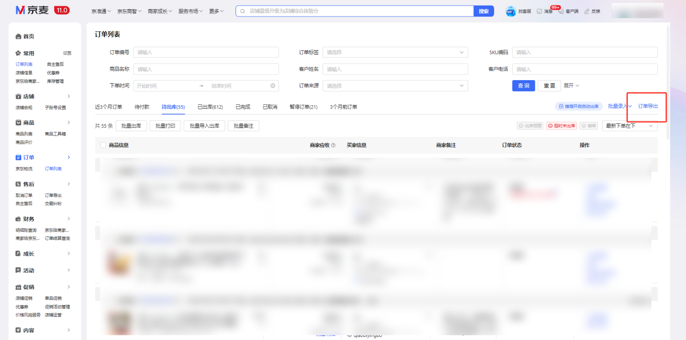

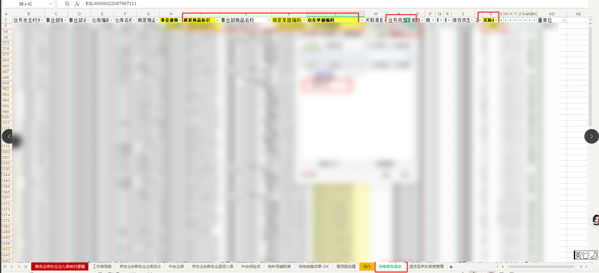

**二、线下门店：多税种、多主体财务自动申报**

针对集团及旗下多主体、多会计准则下重复繁琐的财税申报工作，八爪鱼RPA实现了从财务报表自动报送，到企业所得税、增值税（小规模与一般纳税人）、印花税的全流程自动化申报。八爪鱼RPA自动登录SAP与电子税务局，完成数据导出、报表填列、跨系统核对、优惠计算、风险扫描、申报缴款及完税证明下载等操作，彻底替代了财务人员手工复制粘贴、反复算税填表的重复劳动，显著提升效率与准确性，让每季度的多主体申报工作一键完成、零差错运行。

**场景1：财务报表自动报送**

**背景痛点：**该集团旗下有几十个分公司主体，每个主体每个季度都需要向税务局报送资产负债表、利润表、现金流量表。财务人员面临多主体、多会计准则、多张报表的手工取数、填表、稽核、申报流程，重复性高、易出错、效率低，严重占用财务人员时间。

**RPA方案：**八爪鱼RPA自动登录SAP系统，按不同会计准则（企业/小企业）分别导出三张报表（资产负债表、利润表、现金流量表），再把数据填到税务局的报表模板里，自动核对两边数字是否一致，最后帮财务人员把报表提交给税务局。整个过程不需要人工手动复制粘贴，每个季度自动跑一遍。

**场景2：企业所得税自动申报**

**背景痛点：**多个主体每季度都要重复登录税务局、核对数据、计算优惠、申报缴款、下载证明，流程繁琐且容易出错，财务人员疲于应付。

**RPA方案：**八爪鱼RPA在完成财务报表报送后，自动登录电子税务局进入企业所得税（季）度申报模块，读取系统自动带出的数据，并与资产负债表、利润表核对资产总额、营业收入、营业成本、利润总额及应补税额；随后点击风险提示服务，扫描通过后提交申报，下载申报表并按规则保存，接着通过三方协议自动缴款，最后开具并下载纳税证明存放至公共盘，全程无需人工干预。

**场景3：小规模纳税人增值税自动申报**

**背景痛点：**该企业共有27家线下门店，每家门店都是独立的企业主体，每季度都要从SAP导数据、手工算未开票收入、核对减免税额，再逐户填表申报缴款，计算复杂且极易出错。

**RPA方案：**八爪鱼RPA自动从SAP系统导出季度收入数据，并按税率整理好；然后登录税务局网站，下载已开票的数据，自动算出“未开票收入”和减免税额；核对无误后，自动填好增值税申报表并提交，接着用三方协议缴税，最后下载完税证明和申报表保存。整个过程财务人员只需一键启动，不用手动算数、填表、交税。

**场景4：一般纳税人增值税自动申报**

**背景痛点：**该集团每月需处理海量进项发票认证、销项数据匹配及软件退税计算，手工操作繁琐且易错。

**RPA方案：**八爪鱼RPA每月自动登录税务局系统，为北鼎科技总公司完成全部增值税申报工作：先筛选并认证本期可抵扣的进项发票（包括专用发票、农产品发票、出口退税发票），再与公司内部SAP系统的收入、税费数据进行双向匹配核对；自动完成软件产品增值税退税的复杂计算；随后自动填好增值税申报主表及所有附表（包括未开票收入、免税收入、即征即退项目等）；核对无误后提交申报，通过三方协议缴款，最后下载完税证明和申报表保存。整个过程无需财务人员手动操作。

**场景5：印花税自动申报**

**背景痛点：**按次或按季申报时需分别从SAP取数并手工填表，容易漏报或填错计税金额。

**RPA方案：**八爪鱼RPA自动从SAP系统取数——按次申报时取当天的销售收入和注册资本金额；按季申报时取当季度三个月的销售收入合计。然后自动登录电子税务局，进入印花税税源采集页面，将取到的数字填入对应的买卖合同和营业账簿税目中，提交申报，通过三方协议缴款，最后下载完税证明和申报表保存。按次和按季两种申报模式，RPA都能自动区分并执行，财务人员只需一键启动。

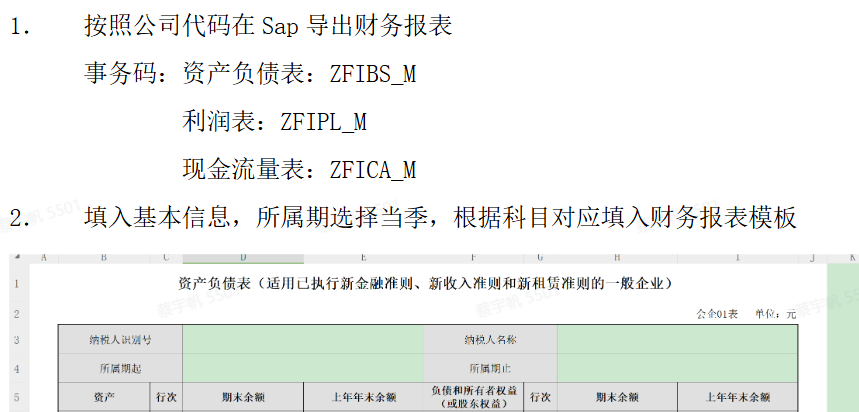

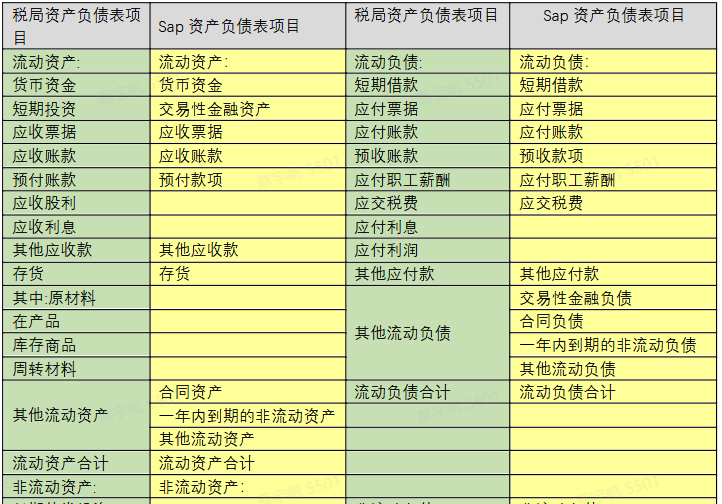

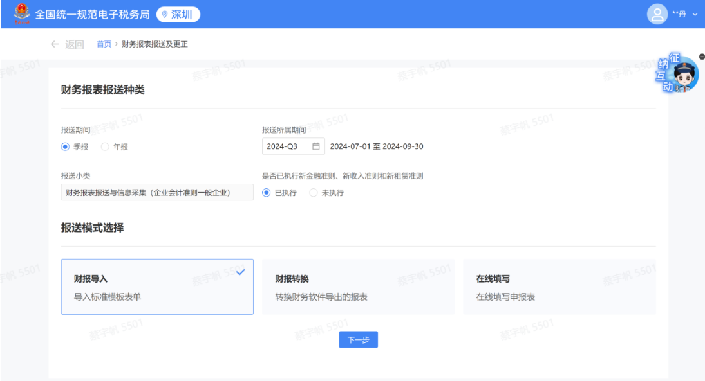

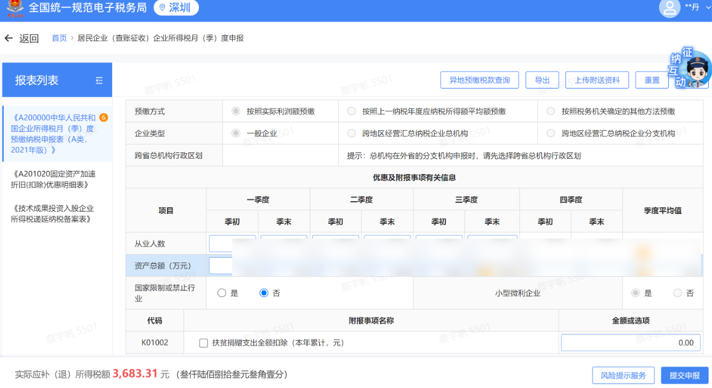

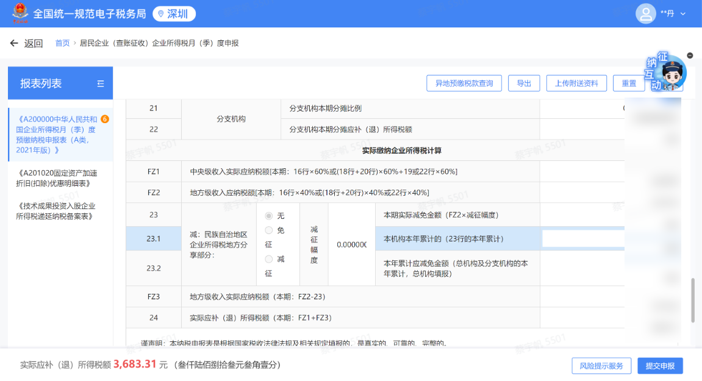

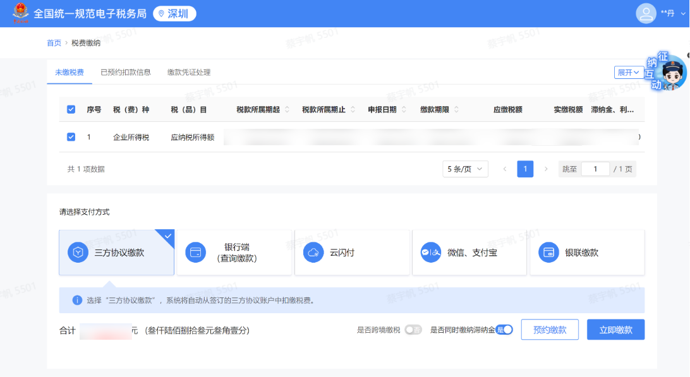

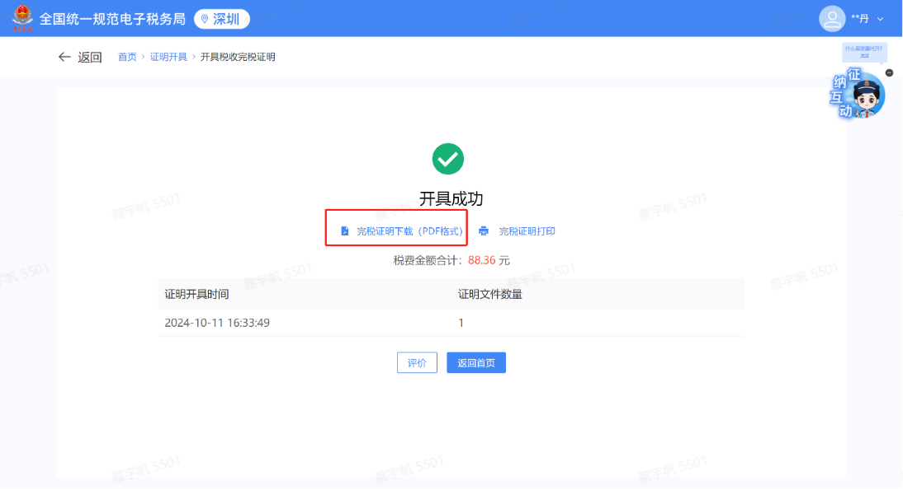

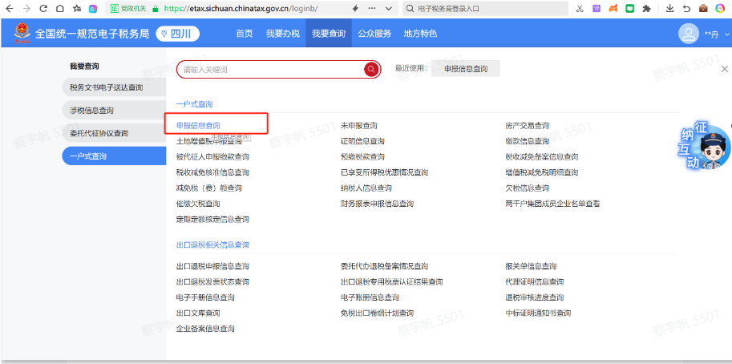

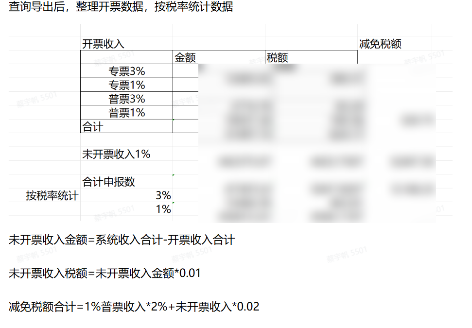

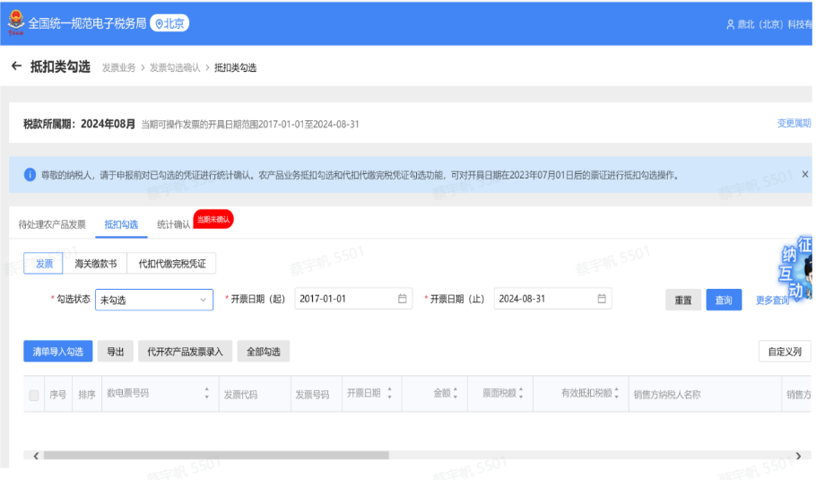

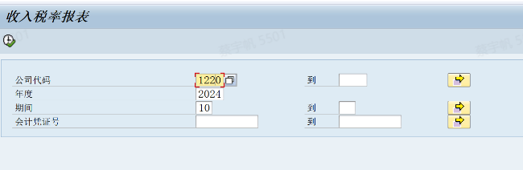

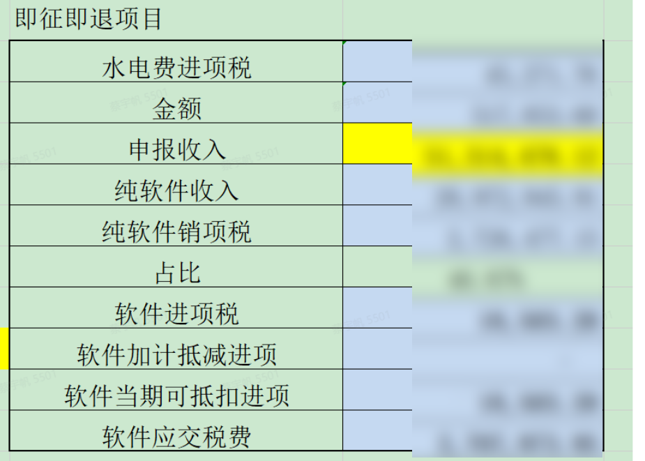

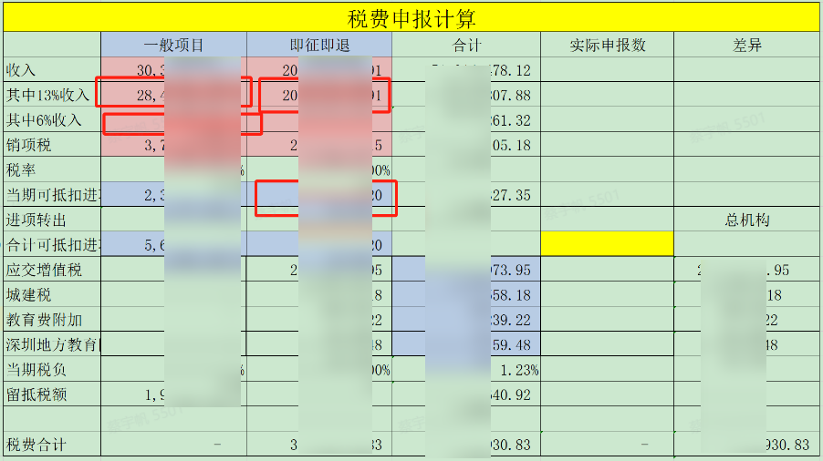

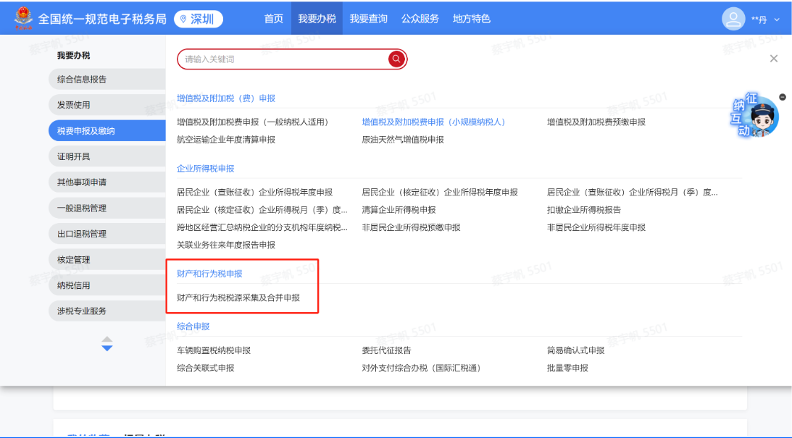

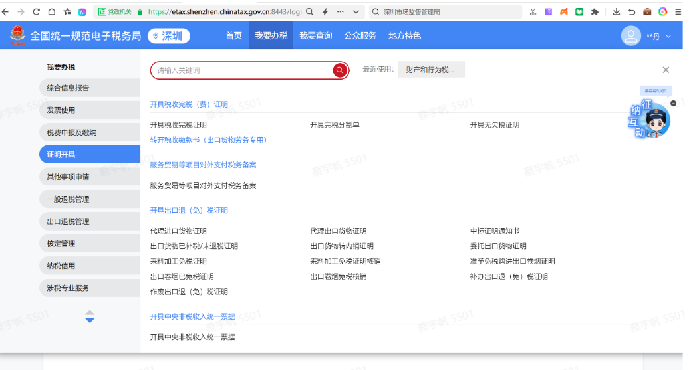

### 02.方案优势

- **全场景自动对账：**天猫、京东、B2B、官网、视频号与仓配出入库 7 大场景自动导出、整理、生成核对表与差异表，差异自动归因。
- **工单全流程无人化：**对账结果通过企业微信通知，中台工单的创建、提交、审核、验货完结全自动，跨平台操作不再靠人工。
- **多主体一键申报：**财务报表报送与企业所得税、小规模/一般纳税人增值税、印花税申报全部自动完成，含跨系统核对、优惠计算与风险扫描。
- **缴款与归档闭环：**三方协议自动缴款、完税证明与申报表自动下载并按规则保存，申报链路一次跑通、全程留痕。

### 03.涉及解决方案

**店铺合规 ｜ 亚马逊税务合规检查 Agent 自动化**

> 为亚马逊卖家团队打造的智能体驱动税务合规检查方案，解决申报与实际数据比对靠手、差异归因靠猜、风险后置的问题。方案链接：[店铺合规 ｜ 亚马逊税务合规检查 Agent 自动化](https://skieer.feishu.cn/wiki/Fxfow7B6bi5uLQkAAtOcMVJenJc)

**店铺合规 ｜ 速卖通税务与关税合规管理 Agent 自动化**

> 为速卖通卖家团队打造的税务与关税合规管理方案，巡检税务政策与成本测算，智能体按目标市场输出合规建议。方案链接：[店铺合规 ｜ 速卖通税务与关税合规管理 Agent 自动化](https://skieer.feishu.cn/wiki/RQ1SwLJgOiKVq5kvbXMc30k6nAg)

**财务对账 ｜ 多税种多主体财务自动申报 Agent 自动化**

> 为多主体电商集团打造的多税种多主体财务自动申报方案，自动完成取数、申报表填列、跨系统核对、优惠计算、风险扫描、申报缴款与完税证明归档全流程。方案链接：[财务对账 ｜ 多税种多主体财务自动申报 Agent 自动化](https://skieer.feishu.cn/wiki/OFk9wKKymier7Zkn4rjcz2zvnbh)

---

## 4.落地效果

| 衡量指标 | 使用前 | 使用后 |
|-|-|-|
| 月平均运行时长 | 人工处理 | 167 h |
| 月平均运行次数 | 人工处理 | 167 次 |
| 应用数量 | — | 120 个 |
| 关账周期 | 每月人工比对、差异滞后发现 | 自动对账+差异归因，周期缩短 |
| 申报质量 | 逐户手工填表，易漏报迟报、口径不一 | 多主体一键申报、零差错运行 |

**月均运行 167 小时、167 次**

RPA 应用月平均运行时长 167 小时、月平均运行次数 167 次，把原先人工从 SAP 下载与 Excel 匹配的时间整段承接过来。

**120 个应用在跑**

财务共享中心累计落地 120 个 RPA 应用，覆盖资金对账、出入库核对与各税种申报，形成可复用的自动化资产。

**关账周期缩短、对账自动归因**

各平台数据自动导出、按规则生成核对表与差异表并完成差异类别归因，企业微信通知与中台工单全流程自动，大促期资金差异与库存异常不再滞后发现。

**多主体申报零差错**

几十个分公司主体与 27 家门店的报表报送与各税种申报一键完成，跨系统核对、优惠计算、风险扫描、缴款与完税证明下载全程无人干预。

**实践成效**：财务共享中心从"人工从 SAP 下载 + Excel 逐项匹配 + 逐户手工申报"转为"RPA 自动对账 + 自动归因 + 一键申报"——月平均运行时长 167 h、月平均运行次数 167 次，累计 120 个应用在跑；7 大对账场景与 5 大申报场景全部自动化，关账周期缩短，多主体申报零差错运行。

**改造前 vs 改造后**

改造前：财务人员逐平台下载结算单与资金流水，从 SAP 导出应收、发票与库存明细，用 Excel 逐项匹配订单、资金与库存并人工归因差异，再在中台手动创建、提交、审核、验货完结工单；报税则逐主体从 SAP 取数、手工算未开票收入与减免税额后逐户填表申报缴款。

改造后：RPA 自动导出各系统数据、按规则生成核对表与差异表并完成差异归因，企业微信通知与中台工单全流程无人化；报税自动登录 SAP 与电子税务局，完成报表填列、跨系统核对、优惠计算、风险扫描、申报缴款与完税证明下载，多主体一键完成、零差错运行。

---

原文：[在飞书查看本案例](https://skieer.feishu.cn/docx/NzWbdz0gXodG60xqFj0c1sd7nsc)。
