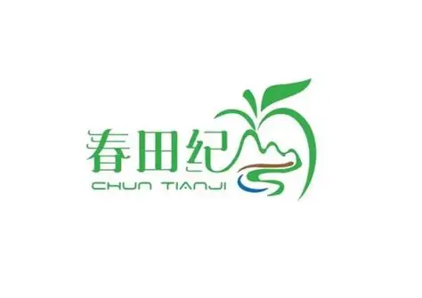

> 春田纪 数据部负责人：
> “八爪鱼RPA帮我们把售后、差评、客服、舆情、品退这5块数据全部自动抓回来了，舆情还能实时推飞书群。以前要专人盯各个店铺，现在数据自动入库，分析团队直接用，效率提升太多了。”

| 衡量指标 | 使用前 | 使用后 |
|-|-|-|
| 数据采集方式 | 逐个店铺登录、逐个模块导出 Excel，一套流程大半天 | RPA 自动切换店铺，5 大数据维度一键采集 |
| 数据时效 | T+1 及以上 | 实时自动入库 |
| 舆情响应 | 天级（人工巡检），容易错过最佳处理时机 | 每 2 小时扫描推送飞书群，2 小时级告警 |
| 人工耗时 | 数小时/天，依赖人工操作 | 0（全自动） |
| 数据准确率 | 人工合并整理，格式不统一、易出错 | 100%（机器采集） |

> **Agent 自动化需开通企业功能**：点击申请1个月免费权限 [ 点击申请 → ](https://skieer.feishu.cn/share/base/form/shrcnFwMayykP5iaL38fnZKTbrg)

---

## 1.客户信息

作为深耕生鲜赛道的即时零售品牌，春田纪旗下拥有泽鲜阁、沐果、沫果坊等多家店铺，覆盖即时零售与电商双模式。

随着店铺数量和订单量的快速增长，客服数据管理成为运营痛点——售后单处理进度、差评回复情况、客服绩效、舆情风险、商品品退率等关键数据分散在店铺后台的不同模块，且每个店铺都需要单独登录查看。数据部团队每天花费大量时间手动导出、整理数据，不仅效率低下，更重要的是舆情等紧急信息无法及时发现和响应，直接影响客户体验和品牌口碑。

---

## 2.业务问题

### 01.业务背景

作为深耕生鲜赛道的即时零售品牌，春田纪旗下拥有泽鲜阁、沐果、沫果坊等多家店铺，覆盖即时零售与电商双模式，其客服数据管理背景如下：

- 数据维度：售后单、差评、客服今日监控、客服历史数据、商品品退率共 5 大维度
- 店铺规模：泽鲜阁、沐果、沫果坊等多家店铺，即时零售 + 电商双模式并行
- 原处理方式：逐个店铺登录、逐个模块导出 Excel，再合并整理

### 02.流程与问题

客服数据管理横跨多个店铺与模块，人工链路越长，时效与准确率越难保证：

#### 数据分散
售后、差评、客服、舆情、品退 5 大数据分散在店铺不同模块，每个店铺单独登录导出，人工操作繁琐、耗时，数据滞后严重。

#### 舆情滞后
舆情风险发现不及时，差评和负面反馈扩散快，人工巡检频率低，容易错过最佳处理时机，导致客户满意度下降。

#### 入库断层
采集到的数据散落在 Excel 中，需要手动整理入库，格式不统一、易出错，数据分析团队拿到数据的周期长。

| 人工操作流程 | 具体步骤 | 问题 |
|-|-|-|
| 店铺切换 | 逐个登录泽鲜阁、沐果、沫果坊等店铺后台 | 账号多、重复登录，耗时长 |
| 模块查找 | 在售后工作台、评价管理、飞鸽、商家体验分等模块间跳转 | 路径深、易漏采 |
| 数据导出 | 逐模块导出 Excel 并合并整理 | 数小时/天，格式不统一 |
| 舆情巡检 | 人工定期翻看客服会话，判断是否有负面反馈 | 频率低、易遗漏，天级响应 |
| 整理入库 | 把整理好的表格手动导入数据库供分析 | 链路割裂，数据滞后 T+1 |

### 03.客户需求

- 五维度一键采集：售后、差评、客服、品退等数据自动抓取，多店铺自动切换，不再人工逐个导出
- 舆情实时告警：自动扫描客服会话，命中监控词立即推送飞书群，风险第一时间可见
- 数据直连入库：采集结果直接写入数据库，保留原始格式，分析团队实时可用

---

## 3.解决方案

针对上述痛点，春田纪引入八爪鱼 RPA，把“多店铺采集 → 舆情监控 → 数据库直连”串成一条全自动链路。

### 01.概述

|  | 说明 |
|-|-|
| 覆盖数据维度 | 售后单、差评、客服今日监控、客服历史数据、商品品退率 5 大维度 |
| 覆盖店铺 | 即时零售 + 电商多店铺矩阵（泽鲜阁、沐果、沫果坊等），支持数据库动态配置 |
| 触发方式 | 定时任务：数据采集按日执行；舆情扫描从 4:00 到 22:00 全天 10 次 |
| 核心能力 | 多店铺自动切换 / 5 维度数据采集 / 监控词命中推送飞书群 / 数据库直连入库 |
| 涉及系统 | 店铺后台（售后工作台、评价管理、飞鸽、商家体验分）、春田纪数据库、飞书群、八爪鱼 RPA |

**五大数据维度一键采集，告别“逐店手动导出”**

春田纪的客服数据分布在店铺后台的多个模块——售后单在售后工作台、差评在评价管理、客服数据在飞鸽、品退率在商家体验分。过去，数据分析师需要逐个店铺登录、逐个模块查找、手动导出Excel，再合并整理，一套流程下来大半天就过去了。

八爪鱼RPA将这一流程完全自动化。机器人根据数据库中配置的店铺列表，自动依次切换每个店铺，分别采集售后单、差评、客服今日监控、客服历史数据、商品品退率5大维度的数据。即时零售店铺和电商店铺的页面差异也被精准适配，确保数据采集的完整性和准确性。数据采集完成后直接写入数据库，整个过程无需人工介入。

**舆情2小时级监控，风险第一时间响应**

在生鲜行业，客户的负面反馈传播快、影响大，一条差评如果处理不及时，可能引发连锁反应。过去春田纪依靠人工定期查看客服会话来发现舆情，不仅频率低，而且很容易遗漏。

八爪鱼RPA为春田纪搭建了舆情实时监控体系。机器人每2小时自动扫描所有店铺的客服会话，根据数据库中配置的监控关键词进行匹配——一旦发现包含负面情绪或敏感词汇的会话，立即将会话ID、会话时间、客服昵称、账号名称等信息推送到飞书群中，相关负责人第一时间就能收到告警并介入处理。从4:00到22:00，全天10次定时扫描，确保舆情风险在萌芽阶段就被发现。

**多店铺矩阵自动管理，规模扩张无压力**

春田纪采用多店铺矩阵策略，旗下有泽鲜阁、沐果、沫果坊等多家店铺，且店铺数量还在持续增长。如果每个新店铺都要增加一套人工数据采集流程，人力成本会线性上升。

八爪鱼RPA的多店铺自动管理机制完美解决了这一问题——所有店铺信息统一维护在数据库中，RPA每次执行任务时自动从数据库读取最新的店铺列表，依次完成每个店铺的数据采集。新增店铺只需在数据库中添加一条记录，机器人下次运行就会自动纳入采集范围，无需修改流程、无需增加人手。无论是3家店还是30家店，一套RPA流程全部搞定。

**数据库直连入库，数据从采集到分析“零断点”**

传统的RPA数据采集方案往往止步于“下载文件”——数据导出后存放在本地文件夹，还需要人工上传或导入系统才能使用。春田纪的方案更进一步，实现了从采集到入库的全链路自动化。

RPA采集到的每一份数据，都直接通过数据库接口写入春田纪的数据仓库，保留原始Excel格式不做额外加工，确保数据的完整性和可追溯性。数据分析团队可以直接从数据库中调取最新数据进行分析，无需等待、无需手动处理。数据采集→数据入库→数据分析，整个链路完全打通，真正实现了数据驱动决策的闭环。

### 02.方案优势

1. **五维度一次采齐**：售后、差评、客服今日监控、客服历史数据、品退率一个流程全部抓回，即时零售与电商页面差异做了适配。
2. **舆情 2 小时级告警**：监控词命中即推飞书群，带会话 ID、时间、客服昵称，4:00 到 22:00 全天 10 次扫描。
3. **多店铺动态配置**：店铺列表存在数据库，新增店铺只加一条记录，3 家还是 30 家都用同一套流程。
4. **数据库直连零断点**：原始格式直接入库不加工，分析团队实时取数，采集到分析全链路打通。

### 03.涉及解决方案

**市场 ｜ 舆情监控与分析 Agent 自动化**

> 为舆情监控场景打造的智能体驱动方案，一句话调度多平台数据采集 + 自动清洗合并 + 深度分析，输出舆情分析报告。方案链接：[市场 ｜ 舆情监控与分析 Agent 自动化](https://skieer.feishu.cn/wiki/H0hew2sJRiGlyAkbjvZcxWRjnoh)

**市场 ｜ 海外品牌舆情监控 Agent 自动化**

> 为海外品牌舆情监控场景打造的智能体驱动方案，一句话调度 YouTube 数据采集 + 数据清洗 + AI 舆情分析，输出舆情全流程分析报告。方案链接：[市场 ｜ 海外品牌舆情监控 Agent 自动化](https://skieer.feishu.cn/wiki/NeoHweo7liB64ckEhR9cBlcCneh)

---

## 4.落地效果

| 衡量指标 | 使用前 | 使用后 |
|-|-|-|
| 数据采集方式 | 逐个店铺登录、逐个模块导出 Excel，一套流程大半天 | RPA 自动切换店铺，5 大数据维度一键采集 |
| 数据时效 | T+1 及以上 | 实时自动入库 |
| 舆情响应 | 天级（人工巡检），容易错过最佳处理时机 | 每 2 小时扫描推送飞书群，2 小时级告警 |
| 人工耗时 | 数小时/天，依赖人工操作 | 0（全自动） |
| 数据准确率 | 人工合并整理，格式不统一、易出错 | 100%（机器采集） |

**数据实时自动入库**

RPA 按数据库配置的店铺列表依次采集售后、差评、客服、品退等数据，直接写入数据仓库，数据时效从 T+1 及以上提升到实时，分析团队随时取用。

**舆情 2 小时级告警**

每 2 小时扫描一次客服会话，命中监控词立即推送飞书群，附带会话 ID、时间与客服昵称；4:00 起到 22:00 全天 10 次扫描，把风险控制在萌芽阶段。

**人工耗时归零、准确率 100%**

原先数小时/天的导出整理工作全部由机器人承担，人工耗时降至 0；数据由机器按固定规则采集，准确率达到 100%。

**规模扩张不再线性加人**

店铺信息统一维护在数据库，新增店铺一条记录即自动纳入采集范围，从 3 家到 30 家都用同一套 RPA 流程，扩张不再伴随人力线性上升。

---

原文：[在飞书查看本案例](https://skieer.feishu.cn/docx/BxutdplGiocxBAxqw6hcp5Donnn)。
