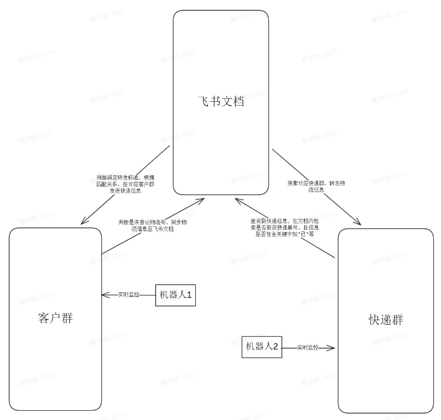
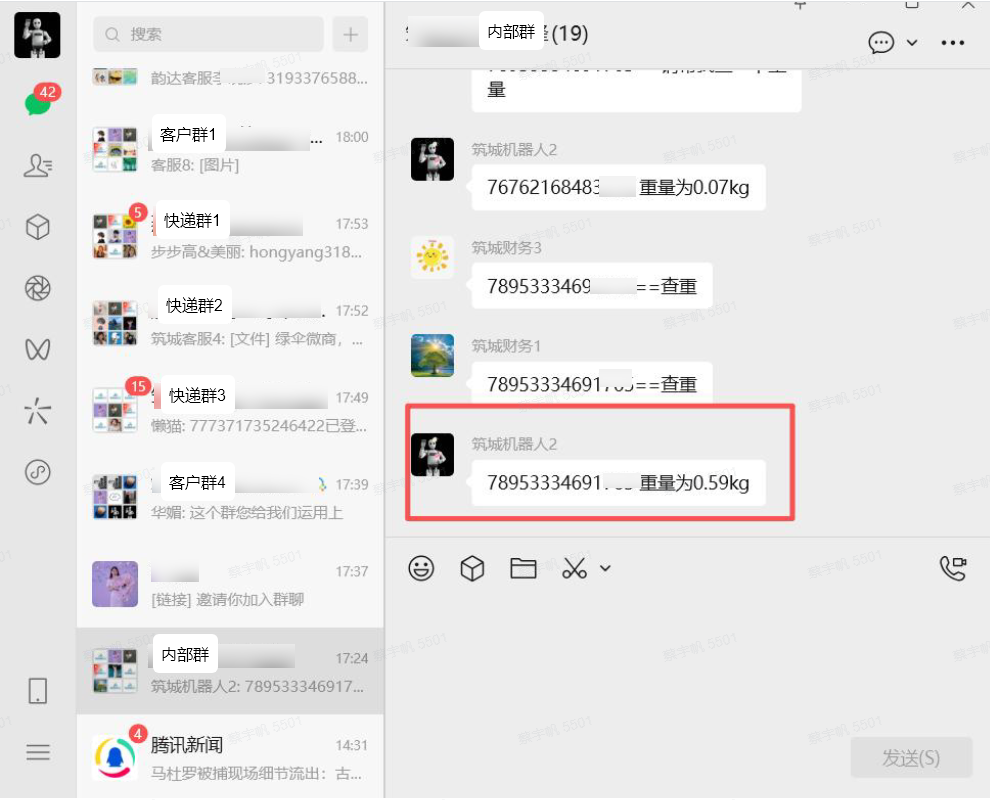
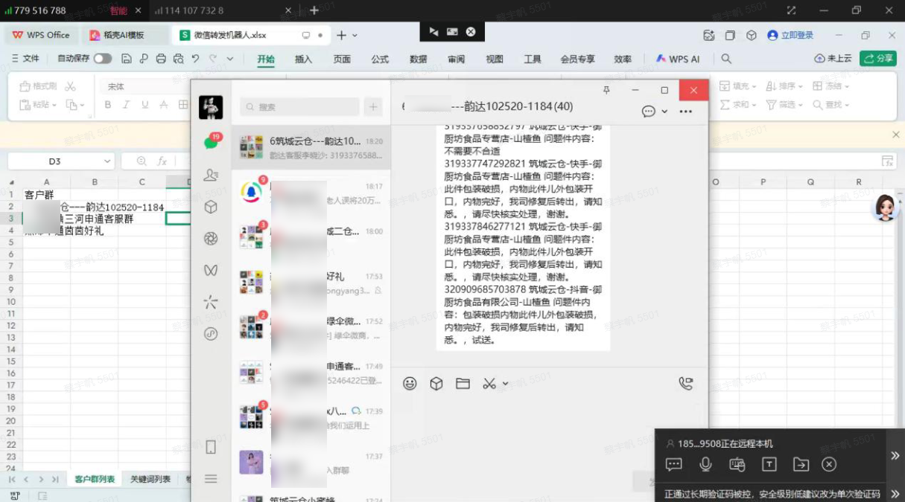
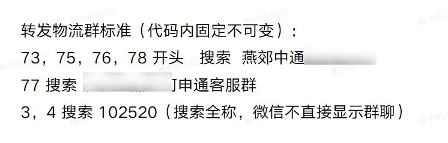
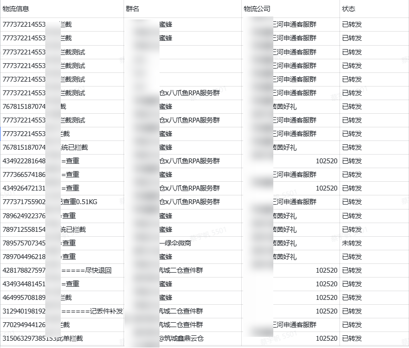

> 云仓运营负责人：
> “以前要在中通群、申通群、燕郊群好几个群来回盯回复，复制粘贴到手软，还总担心漏掉重要的拦截结果。现在机器人帮我们把所有群的回复自动汇总到一个地方，我终于不用再刷群了，安心处理后续就行。”

| 衡量指标 | 使用前 | 使用后 |
|-|-|-|
| 信息汇总效率 | 人工汇总 1-2 分钟/条 | 提升 90%+，缩短至秒级 |
| 信息抓取准确率 | 人工漏看、漏记 | 提升至 100% |
| 单条消息处理耗时 | 2-3 分钟 | 缩短至 秒级自动完成 |
| 日均人力投入 | 客服实时盯十几个微信群 | 日均释放 2-3 小时/人 |
| 覆盖业务场景 | 微信群消息人工盯守 | 拦截、查询、改地址等 7 大场景自动流转 |

> **Agent 自动化需开通企业功能**：点击申请1个月免费权限 [ 点击申请 → ](https://skieer.feishu.cn/share/base/form/shrcnFwMayykP5iaL38fnZKTbrg)

---

## 1.客户信息

云仓服务商（专注于为各类电商、实体企业提供仓储管理、货物收发、订单履约等一体化云仓服务）主营仓储托管、订单处理、物流配送、库存管理等核心业务，服务客户涵盖电商、快消、美妆、家居等多个行业，辐射区域广泛，具备完善的仓储运营体系。

---

## 2.业务问题

### 01.业务背景

该云仓服务商，其日常运营高度依赖 **微信群** 这一沟通工具，业务背景如下：

- **上游客户沟通：** 数十个电商卖家客户通过微信群，向服务商发送各类业务请求——包括物流拦截、改地址、查重量、订单确认等。
- **下游承运商对接：** 中通、申通等快递公司也在微信群中推送物流状态更新（如已揽收、已签收、异常滞留等）
- 这意味着，该云仓服务商的核心业务流程，完全运行在微信生态中——而微信是一个封闭的系统，没有任何API接口可以打通。

在引入RPA之前，这些微信群消息的处理完全依赖人工：客服需要实时盯住十几个微信群，识别消息内容，判断是哪个客户的请求、属于哪类业务、应该由谁处理，然后手动复制单号、发送至快递群并将信息记录，最后再回复结果。

### 02.流程与问题

#### 信息分散，盯群成本极高
涉及多个客户群＋数十个快递群，多个窗口，高峰期每分钟都有新消息弹出。

#### 业务动作多样，处理流程复杂
微信群消息背后，对应着多种不同的业务操作，处理方式各不相同。

#### 跨组织协同，信息流转不畅
信息来源于快递群，需要处理后反馈到客户群或内部物流群，反复流转，手工操作易出错。

| 业务动作 | 具体步骤 | 问题 |
|-|-|-|
| 物流拦截 | 客户群/内部群接收拦截需求 → 快递群发起拦截 → 返回结果 | 业务动作多样，处理流程复杂：微信群消息背后，对应着多种不同的业务操作，处理方式各不相同 |
| 物流查询 | 客户群/内部群接收查询需求 → 快递群发起查询 → 返回结果 | 跨组织协同，信息流转不畅：信息来源于快递群，需要处理后反馈到客户群或内部物流群，反复流转，手工操作易出错 |
| 重量查询 | 客户群/内部群接收查重需求 → 快递群发起查重 → 返回结果 | 业务动作多样，处理流程复杂：微信群消息背后，对应着多种不同的业务操作，处理方式各不相同 |
| 物流更新 | 快递群接收物流状态 → 转发至客户群 | 跨组织协同，信息流转不畅：信息来源于快递群，需要处理后反馈到客户群或内部物流群，反复流转，手工操作易出错 |
| 异常提醒 | 快递群接收异常信息 → 转发至客户群 | 信息分散，盯群成本极高：涉及多个客户群＋数十个快递群，多个窗口，高峰期每分钟都有新消息弹出 |
| 订单确认 | 客户群/内部群接收确认需求 → 快递群发起确认 → 返回结果 | 业务动作多样，处理流程复杂：微信群消息背后，对应着多种不同的业务操作，处理方式各不相同 |
| 改地址 | 客户群/内部群接收改址需求 → 快递群发起改址 → 返回结果 | 跨组织协同，信息流转不畅：信息来源于快递群，需要处理后反馈到客户群或内部物流群，反复流转，手工操作易出错 |

### 03.客户需求

- 需在不改变现有微信群沟通习惯的前提下，实现消息的自动识别、流转与分发；
- 需减少人工盯群、复制粘贴带来的漏看、错转风险，保障信息流转准确与全程留痕；
- 需将客服从「盯群」中解放出来，专注异常处理、客户关系等高价值工作。

---

## 3.解决方案

八爪鱼RPA实现了 “微信-飞书”信息自动流转与分发机器人，在不改变任何现有沟通习惯的前提下，实现业务流程的自动化。

### 01.概述

[查看原视频](https://skieer.feishu.cn/wiki/OKy0wkYLximV2rkRCqRcl7FcnUh)

|  | 说明 |
|-|-|
| 覆盖平台 | 微信（客户群 / 内部物流群 / 中通、申通等数十个快递群）与飞书 |
| 覆盖数据 | 物流拦截、物流查询、重量查询、物流状态更新、异常提醒、订单确认、改地址等消息与结果 |
| 覆盖环节 | 微信群消息识别 → 自动分流 → 转发至对应群 → 自动写入飞书记录留痕 |
| 运行方式 | 机器人7x24小时运行，覆盖拦截、查询、改地址等7大场景，信息自动流转，全程无需人工介入 |

机器人1从客户群获取物流拦截、物流查询等信息，经飞书文档处理后，再返回客户群；机器人2从快递群获取物流信息，经飞书文档处理后，返回快递群。客户群、飞书文档、快递群之间通过两个机器人实现信息自动流转与分发，在不改变任何现有沟通习惯的前提下完成业务流程自动化。

- 微信群消息自动识别与记录：机器人实时监控目标微信群，秒级响应识别拦截、查询等关键词，自动写入飞书，彻底杜绝漏看和延迟；
- 全流程零人工失误：机器人按预设规则精准执行，自动分流、过滤、留痕，SKU格式、渠道匹配全流程零差错；
- 打通微信-飞书-物流群全链路：机器人7x24小时运行，覆盖拦截、查询、改地址等7大场景，信息自动流转，全程无需人工介入。

### 02.方案优势

1. **解决微信封闭性难题，实现 “跨平台自动化”**：微信个人群聊没有API接口，传统ERP/OMS无法接入。八爪鱼RPA以“模拟人工操作”的方式，在不破坏微信规则、不改变用户习惯的前提下，实现了微信与飞书两大平台的数据打通。
2. **覆盖云仓核心业务场景，直击真实痛点**：八爪鱼RPA机器人覆盖云仓中高频的业务操作：物流拦截、物流查询、重量查询、物流更新等等，显著降低退款率、提升客户满意度、减少赔付损失。
3. **降低人力成本，释放核心人力**：将客服从“盯群”中解放出来，日均节省2-3小时/人的无效监控时间；避免人工漏看、错看导致的服务延迟和客户投诉，让员工专注于异常处理、客户关系等高价值工作。
4. **全程无需人工介入，异常有留痕**：机器人7x24小时运行，自动分流、过滤、留痕，信息自动流转，异常信息同样记录在案，便于后续追溯与对账。

### 03.涉及解决方案

**仓储物流 ｜ 亚马逊物流跟踪与异常件处理 Agent 自动化**

> 为亚马逊卖家团队打造的智能体驱动物流跟踪与异常件处理方案，解决物流轨迹跨系统分散、人工反复手动执行、异常发现滞后的问题。方案链接：[仓储物流 ｜ 亚马逊物流跟踪与异常件处理 Agent 自动化](https://skieer.feishu.cn/wiki/LhEswWbzjidOv1kp9rVclTfAntb)

**仓储物流 ｜ 物流轨迹同步与客户进度告知 Agent 自动化**

> 为货代/物流公司打造的物流轨迹同步与客户进度告知方案，一句话调度轨迹自动查询 + 节点整理回填 + 客户自动告知，输出轨迹同步台账与关键节点主动推送。方案链接：[仓储物流 ｜ 物流轨迹同步与客户进度告知 Agent 自动化](https://skieer.feishu.cn/wiki/LJ60wAxrPiLMGAkRAzJcJVMQnKe)

**仓储物流 ｜ 速卖通物流轨迹与时效监控 Agent 自动化**

> 为速卖通卖家团队打造的物流轨迹与时效监控方案，定时查询物流轨迹，智能体做异常识别与时效预警。方案链接：[仓储物流 ｜ 速卖通物流轨迹与时效监控 Agent 自动化](https://skieer.feishu.cn/wiki/BLAFws2ayiaxUSkjA2Acu1GOnLb)

**仓储物流 ｜ 虾皮物流轨迹批量监控 Agent 自动化**

> 为虾皮卖家团队打造的物流轨迹批量监控方案，批量查询在途订单物流轨迹，智能体识别滞留异常并生成客服解释话术。方案链接：[仓储物流 ｜ 虾皮物流轨迹批量监控 Agent 自动化](https://skieer.feishu.cn/wiki/V9G7wQOIri1ah7kWFJicRkRznub)

**仓储物流 ｜ Temu物流面单费用管理 Agent 自动化**

> 为 Temu 卖家团队打造的物流面单费用管理方案，定时导出发货/退货面单费，智能体按费用类型归集建账、标记异常扣费。方案链接：[仓储物流 ｜ Temu物流面单费用管理 Agent 自动化](https://skieer.feishu.cn/wiki/XU9hwVhNBiXyq3kJuE5coBSvnlc)

---

## 4.落地效果

| 衡量指标 | 使用前 | 使用后 |
|-|-|-|
| 信息汇总效率 | 人工汇总 1-2 分钟/条 | 提升 90%+，缩短至秒级 |
| 信息抓取准确率 | 人工漏看、漏记 | 提升至 100% |
| 单条消息处理耗时 | 2-3 分钟 | 缩短至 秒级自动完成 |
| 日均人力投入 | 客服实时盯十几个微信群 | 日均释放 2-3 小时/人 |
| 覆盖业务场景 | 微信群消息人工盯守 | 拦截、查询、改地址等 7 大场景自动流转 |

**信息汇总效率提升 90%+**

信息汇总效率提升90%+，单条快递回复从人工汇总的1-2分钟缩短至秒级自动完成，客服无需再频繁切换多个群窗口，日均释放2-3小时人力。

**信息抓取准确率提升至 100%**

信息抓取准确率提升至100%，机器人自动抓取拦截结果、重量数据、物流状态等关键信息，统一汇总至飞书记录，彻底避免人工漏看、漏记导致的异常遗漏和对账错误。

**改造前 vs 改造后**

改造前：微信群消息人工盯守效率低：客服需同时监控数十个客户群和快递群，单条消息处理耗时2-3分钟，订单高峰熬夜也处理不完，拦截延迟频发；人工操作易出错、风险高：手动复制单号、切换系统，易出现复制错、漏看异常、转发错群等问题，失误直接影响客户满意度；多工具切换繁琐耗力：在微信、飞书、快递系统、OMS间反复切换，每天处理上百条消息，耗时费力易出错，打乱运营节奏。

改造后：微信群消息自动识别与记录：机器人实时监控目标微信群，秒级响应识别拦截、查询等关键词，自动写入飞书，彻底杜绝漏看和延迟；全流程零人工失误：机器人按预设规则精准执行，自动分流、过滤、留痕，SKU格式、渠道匹配全流程零差错；打通微信-飞书-物流群全链路：机器人7x24小时运行，覆盖拦截、查询、改地址等7大场景，信息自动流转，全程无需人工介入。

---

原文：[查看原文](https://skieer.feishu.cn/docx/PCS8dKFHSoIqH3xRnd9cnZ3Jnec)
