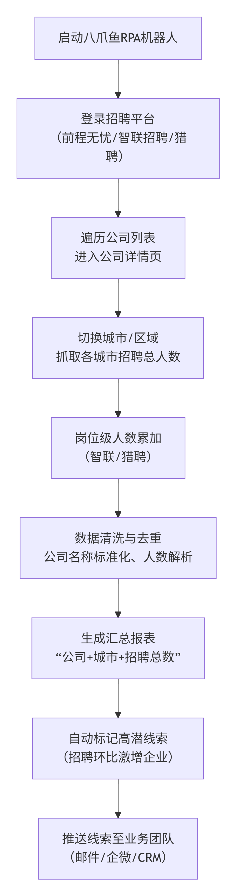
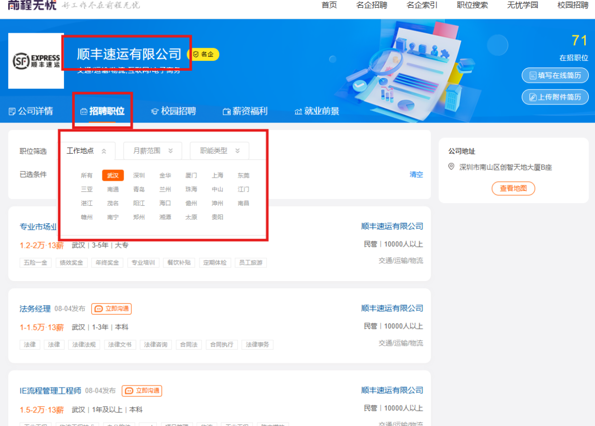
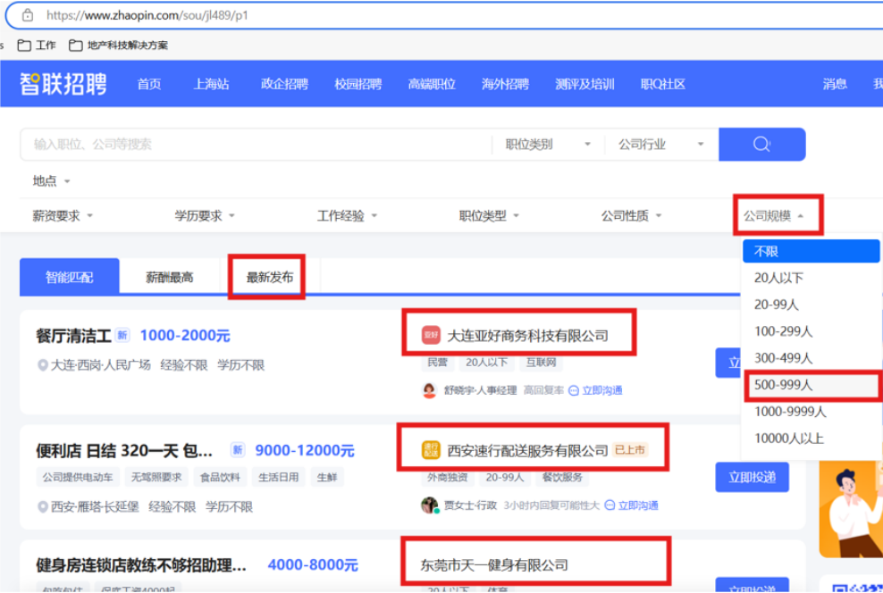
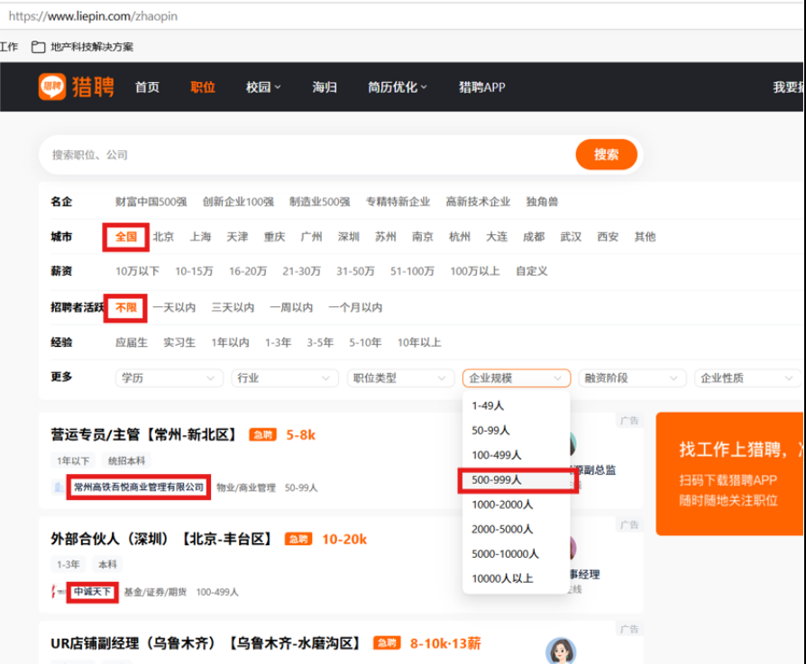
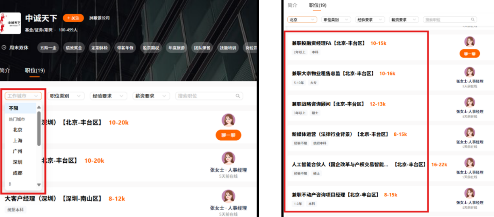
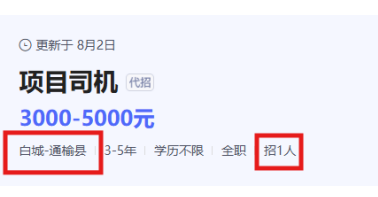
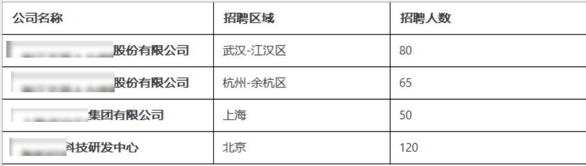

> 某全球领先的商业地产与投资管理公司：
> 主营业务涵盖物业管理、设施管理、项目咨询、租赁代理及资本交易等。在中国市场，该企业管理着众多甲级写字楼、产业园区及企业总部，服务对象包括世界500强公司、跨国企业及高成长性行业龙头。公司拥有深厚的本地运营经验和专业的物业顾问团队，致力于通过数据驱动的方式提升资产价值与客户服务质量。

| 衡量指标 | 使用前 | 使用后 |
|-|-|-|
| 单家公司数据采集耗时 | 人工逐公司逐城抄录，单家 3-5 分钟 | 机器人自动遍历，7×24 小时无人值守运行 |
| 岗位人数统计 | 逐个点击岗位详情页手动累加，极易跳错漏算 | 岗位级人数自动累加，按「公司+城市」维度精准统计 |
| 跨平台公司识别 | 同一公司不同平台名称不一致，人工反复比对去重 | 智能匹配算法自动归一化、自动去重 |
| 模糊数据清洗 | 「若干」「不限」等模糊值人工处理，耗时费力 | 内置解析规则自动转换为可计算数值 |
| 线索报表推送 | 人工筛选整理报表，信息传递滞后 | 自动标记环比激增高潜企业，自动推送业务群或 CRM |

> **Agent 自动化需开通企业功能**：点击申请1个月免费权限 [ 点击申请 → ](https://skieer.feishu.cn/share/base/form/shrcnFwMayykP5iaL38fnZKTbrg)

---

## 1.客户信息

该企业是一家全球领先的商业地产与投资管理公司，在中国市场管理着众多甲级写字楼、产业园区及企业总部，服务对象包括世界500强公司、跨国企业及高成长性行业龙头，致力于通过数据驱动的方式提升资产价值与客户服务质量。其市场团队希望主动识别即将扩租、搬迁或新设办公点的客户，持续挖掘高潜销售线索。

---

## 2.业务问题

### 01.业务背景

该企业作为商业地产服务商，希望通过招聘信号挖掘销售线索，其业务背景如下：

- 作为商业地产服务商，该企业希望主动识别即将扩租、搬迁或新设办公点的客户，他们发现客户的大量招聘动作，是未来3-6个月产生物业需求的“先行信号”。
- 为此，该企业计划系统化采集主流招聘平台上的岗位与企业主页数据，形成高潜销售线索。
- 然而，这一过程面临多重挑战：头部招聘网站反爬机制强，频繁更新策略导致手动或简单工具难以稳定采集；需要跨页面（列表页→企业主页）跳转与数据关联，采集流程复杂；同一企业在不同岗位中的名称表述不一致，招聘人数格式杂乱，清洗难度高；

### 02.流程与问题

人工采集招聘线索的流程繁琐且低效，核心痛点集中在三个方面：

#### 逐公司逐城抄数慢
需要在多个招聘软件种搜索各公司，各企业抄录招聘总数，单家公司耗时3-5分钟，面对数千家潜在客户根本跑不动。

#### 岗位级累加易漏算
人工需逐个点击岗位详情页、手动累加每个岗位的招聘人数。一家公司数十个岗位、覆盖多城市，累加过程极易跳错或漏算。

#### 公司名不一难去重
同一公司在不同平台名称不一致，人工反复比对确认是否已采集；招聘人数出现“若干”、“不限”等模糊值，清洗处理耗时费力。

| 操作环节 | 具体步骤 | 问题 |
|-|-|-|
| 遍历平台栏目与公司列表 | 人工登录前程无忧名企索引板块，依次点击左侧各栏目（除名企索引外），逐个打开栏目下的每家公司详情页，并手动记录已访问过的公司名称，避免重复。 | 逐公司逐城抄数慢：单家公司耗时3-5分钟，面对数千家潜在客户根本跑不动。 |
| 分城市切换并统计招聘总数 | 在公司详情页中手动点击“招聘职位”板块，依次下拉选择不同城市，查看每个城市下方的招聘总数（翻页条数或岗位条目），将数字抄录到表格中。 | 逐公司逐城抄数慢：跨栏目、跨城市反复切换，人工抄录效率低。 |
| 逐一点击岗位并累加招聘人数 | 对于智联招聘和猎聘，人工先按规模筛选公司列表，再依次点击公司进入详情页；然后依次选择不同区域/城市，逐个点击岗位进入详情页，记录每个岗位的招聘人数，手动累加得到该城市的总数。 | 岗位级累加易漏算：累加过程极易跳错或漏算。 |
| 数据去重与格式整理 | 人工对照公司名称，将同一公司在不同平台或不同栏目下的数据合并，处理“若干”、“不限”等模糊人数，修正不规范的城市名称，形成统一的Excel汇总表。 | 公司名不一难去重：名称不一致需反复比对，模糊值清洗耗时费力。 |
| 生成线索报表并推送 | 将汇总后的数据按公司、城市、年份等维度整理成结构化清单，人工筛选出招聘总数增长明显的企业，通过邮件或内部系统发送给业务团队。 | 线索识别与推送依赖人工跟进，信息传递滞后。 |

### 03.客户需求

因此，该企业迫切需要将自动化数据采集技术引入招聘平台信息抓取环节，从而将市场人员从繁琐的重复性人工检索中解放出来，提升销售线索挖掘的效率与精准度：

- 需改变销售线索挖掘依赖人工遍历招聘平台、逐公司逐城统计招聘总数的低效现状；
- 需实现从跨平台公司遍历、分城市招聘数抓取到数据清洗汇总的全流程自动化；
- 需大幅提升线索识别效率与市场响应的及时性。

---

## 3.解决方案

八爪鱼RPA机器人自动登录前程无忧、智联招聘、猎聘三大招聘平台，完成公司遍历、城市切换、岗位人数累加等重复操作，将市场人员从繁琐的重复性人工检索中解放出来，提升销售线索挖掘的效率与精准度。

### 01.概述

|  | 说明 |
|-|-|
| 覆盖平台 | 前程无忧、智联招聘、猎聘三大主流招聘平台 |
| 覆盖数据 | 公司列表与详情、各城市招聘总数、岗位招聘人数、企业主页数据 |
| 覆盖环节 | 公司遍历 → 城市切换 → 招聘数抓取 → 岗位人数累加 → 数据清洗去重 → 线索报表推送 |
| 运行方式 | 机器人 7×24 小时无人值守运行，可根据客户需求快速调整目标平台、城市范围或行业筛选条件 |

机器人启动后自动登录各招聘平台，按预设规则遍历公司列表、切换城市，自动抓取招聘总数；再自动进入每个岗位详情页，提取招聘人数并实时累加，按「公司+城市」维度精准统计总人数；随后通过内置的公司名称标准化规则与模糊匹配算法，自动识别并合并跨平台同名企业、将模糊人数转换为可计算数值；最后自动标记招聘数量环比激增的高潜企业，按城市、行业生成结构化线索报表，并自动推送到业务群或CRM系统。

### 02.方案优势

- **全自动遍历采集，释放人力**：RPA机器人自动登录三大招聘平台，完成公司遍历、城市切换、岗位人数累加等重复操作，让市场人员从繁琐的手工抄录中解放出来，专注线索跟进与客户洽谈。
- **跨平台数据整合，统一公司视图**：自动对接前程无忧、智联招聘、猎聘等多源数据，通过智能匹配算法将同一公司不同名称归一化处理，形成“公司+城市”维度的统一招聘动态库。
- **智能清洗去重，确保数据准确**：内置人数解析规则（自动转换“若干”“不限”等模糊值）与公司去重校验，避免重复统计与人工录入错误，保障线索识别精准可靠。
- **实时高频跑批，抢先识别信号**：支持7×24小时实时跑批，第一时间捕捉各企业招聘动态变化，抢先识别扩租、搬迁信号。
- **灵活适配，低成本验证**：可根据客户需求快速调整目标平台、城市范围或行业筛选条件；支持从模板试跑到定制开发的分阶段推进，降低业务假设验证成本。

### 03.涉及解决方案

**市场 ｜ 招聘信号挖掘与企业线索获取 Agent 自动化**

> 为企业打造的招聘信号挖掘方案，一句话调度招聘信息采集 + 信号识别 + 线索入库，输出企业线索清单与信号分析。方案链接：[市场 ｜ 招聘信号挖掘与企业线索获取 Agent 自动化](https://skieer.feishu.cn/wiki/NjyewP9XQinlLXkCTY8cEm8lnKb)

---

## 4.落地效果

| 衡量指标 | 使用前 | 使用后 |
|-|-|-|
| 单家公司数据采集耗时 | 人工逐公司逐城抄录，单家 3-5 分钟 | 机器人自动遍历，7×24 小时无人值守运行 |
| 岗位人数统计 | 逐个点击岗位详情页手动累加，极易跳错漏算 | 岗位级人数自动累加，按「公司+城市」维度精准统计 |
| 跨平台公司识别 | 同一公司不同平台名称不一致，人工反复比对去重 | 智能匹配算法自动归一化、自动去重 |
| 模糊数据清洗 | 「若干」「不限」等模糊值人工处理，耗时费力 | 内置解析规则自动转换为可计算数值 |
| 线索报表推送 | 人工筛选整理报表，信息传递滞后 | 自动标记环比激增高潜企业，自动推送业务群或 CRM |

**多平台自动遍历采集**

RPA机器人自动登录各招聘平台，按预设规则遍历公司列表、切换城市，自动抓取招聘总数，7×24小时无人值守运行；机器人自动进入每个岗位详情页，提取招聘人数并实时累加，按“公司+城市”维度精准统计总人数。

**智能清洗与线索自动推送**

内置公司名称标准化规则与模糊匹配算法，自动识别并合并跨平台同名企业，自动将模糊人数转换为可计算数值；系统自动标记招聘数量环比激增的高潜企业，按城市、行业生成结构化线索报表，并自动推送到业务群或CRM系统。

**改造前 vs 改造后**

改造前：公司名录遍历耗时费力，需人工逐个登录前程无忧、智联招聘、猎聘，逐个点击栏目、公司、城市，手动抄录招聘总数，单家公司耗时3-5分钟；岗位级人数累加易出错，在多个招聘软件上，人工需逐个点击岗位详情页，手动记录并累加各岗位招聘人数，操作繁琐且极易漏算、跳算；跨平台公司名称难统一，同一公司在不同平台名称不一致，人工反复比对、手动去重；招聘人数出现“若干”“不限”等模糊值，清洗标准不统一；线索识别与推送依赖人工跟进，汇总数据后需人工筛选高招聘增长企业，再手动整理成报表发送给业务团队，信息传递滞后。

改造后：多平台自动遍历采集，RPA机器人自动登录各招聘平台，按预设规则遍历公司列表、切换城市，自动抓取招聘总数，7×24小时无人值守运行；岗位级人数自动累加汇总，机器人自动进入每个岗位详情页，提取招聘人数并实时累加，按“公司+城市”维度精准统计总人数；智能清洗与自动去重，内置公司名称标准化规则与模糊匹配算法，自动识别并合并跨平台同名企业，自动将模糊人数转换为可计算数值；线索自动识别与推送，系统自动标记招聘数量环比激增的高潜企业，按城市、行业生成结构化线索报表，并自动推送到业务群或CRM系统。

---

原文：[查看原文](https://skieer.feishu.cn/docx/LEPKdTU6zofWPaxNnFQclb60nDe)
