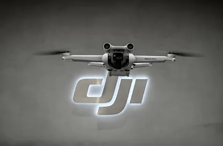

大疆创新电商与用户数据运营负责人：
> 八爪鱼RPA不仅解决了我们多平台海量数据采集的效率问题，更让电商与客服团队从繁琐的“搬数据”中解放出来，真正聚焦于用户体验优化与销售策略决策。

| 衡量指标 | 使用前 | 使用后 |
|-|-|-|
| 平台与社媒系统自动采集 | - | 增加至 12+  |
| 核心业务数据全覆盖 | - | 增加至 7大类  |
| 数据时效 | T+2/T+3 | T+1 |
| 客诉与评论抓取 | 抽样，易遗漏 | 100% 全量精准 |
| 人工耗时 | 5-6小时/天 | 0（全自动） |
| 数据资产 | 散落Excel，格式混乱 | 统一入库，自动排重 |

> **Agent 自动化需开通企业功能**：点击申请1个月免费权限 [ 点击申请 → ](https://skieer.feishu.cn/share/base/form/shrcnFwMayykP5iaL38fnZKTbrg)

---

## 1.客户信息

大疆创新（DJI）是全球无人机与影像技术领域的绝对领军者。自2006年成立以来，大疆以“未来无所不能”为理念，在消费级、专业级及行业应用市场占据全球绝对领先的市场份额，业务遍及全球100多个国家和地区。凭借强大的自主研发能力与数千项核心专利，大疆构建了覆盖航拍、农业、测绘、应急救援等多维度的庞大产品生态。

大疆创新面对十余个国内外电商平台与社媒渠道的海量数据，每天需耗费大量人力处理直播、评论、客服会话及搜索等非结构化数据。大疆与八爪鱼RPA深度合作，成功构建跨平台电商与社媒数据自动化体系。

借助八爪鱼RPA机器人替代人工完成十余个系统、7大类核心数据的自动采集入库。数据时效提升至T+1，实现全渠道营销与客服数据底座升级。

---

## 2.业务问题

### 01.业务背景

大疆创新业务覆盖全球 100 多个国家和地区，需跨十余个电商与社媒平台采集客服、评论、直播等数据以支撑运营与质检。业务背景如下

- 大疆创新（DJI）是全球无人机与影像技术领域的领军者，业务遍及全球 100 多个国家和地区，产品生态覆盖航拍、农业、测绘、应急救援等维度。
- 十余个国内外电商平台与社媒渠道的数据分散，客服会话、商品评论、直播流量等需人工逐日登录导出。
- 不同平台数据规则与风控机制差异大，社媒私信、客服会话等非结构化文本极易遗漏，部分平台还存在查看数量限制。

### 02.流程与问题

#### 数据分散滞后
十余个国内外电商平台与社媒后台数据分散，客服会话、商品评论、直播流量等数据需人工逐日登录导出，耗时费力且时效滞后。

#### 非结构化难采
不同平台数据规则与风控机制差异大，且社媒私信、客服会话等非结构化文本极易遗漏，部分平台还存在查看数量限制。

#### 拼接重复错乱
各平台数据格式不一，客服会话与评论散落各处，人工拼接极易重复且错乱，影响客诉分析与电商运营决策效率。

| 人工操作流程 | 具体步骤 | 问题 |
|-|-|-|
| 跨平台报表采集 | 人工每日登录天猫、京东、亚马逊等后台逐个下载报表 | 耗时费力且时效滞后，数据散落在各平台 |
| 客服会话与私信抓取 | 人工逐个查看未读消息、翻页导出客服会话 | 非结构化文本极易遗漏，受平台查看数量限制 |
| 数据清洗与汇总 | 人工拼接各平台数据，靠 Excel 汇总 | 格式不一、极易重复错乱，影响客诉分析与电商运营决策效率 |

### 03.客户需求

- 十余个电商与社媒后台自动登录采集，覆盖直播、客服会话、评论等 7 大类核心数据。
- 非结构化文本（社媒私信、客服会话）自动抓取，识别未读红点精准采集有效信息。
- 数据自动清洗去重后统一入库，数据时效提升至 T+1。

---

## 3.解决方案

在引入八爪鱼 RPA 后，上述人工环节由机器人自动完成，无需人工参与。

|  | 说明 |
|-|-|
| 覆盖平台 | 天猫、京东（自营/POP）、拼多多、亚马逊、视频号、快手、得物、B站、微博等12+平台系统。 |
| 覆盖数据 | 直播、客服会话、商品评论、优惠券、搜索词、加购收藏、社媒私信等7大类核心业务数据。 |
| 覆盖团队 | 电商运营、客服质检、数据运营、社媒营销、IT/信息化等多部门。 |
| 未来规划 | 大疆计划将RPA应用从电商与客服数据采集延伸至更多全链路营销场景，结合AI能力实现评论情感分析、客服智能质检与舆情实时预警，推动全渠道营销从“数据采集自动化”向“洞察智能化”演进。 |

### 01.概述

针对上述人工流程，八爪鱼 RPA 自动登录各大电商与社媒后台，按预设路径抓取 7 大类核心数据，清洗去重后写入中央数据库。

- 八爪鱼RPA自动登录各大电商与社媒后台，按预设路径自动抓取直播、评论、搜索、客服会话等7大类核心数据，替代全流程手工操作。全渠道业务数据自动采集
- 针对不同平台定制差异化采集策略，自动识别未读消息红点精准抓取有效私信；针对海外平台适配翻译插件，模拟人工逐日筛选以突破平台限制。客服与社媒文本自动抓取
- RPA自动清洗数据，以“平台+单据号+时间戳”等唯一标识进行去重，统一格式后写入中央数据库，保障数据资产的高可用性。多源数据自动清洗排重

### 02.方案优势

1. **12+ 平台自动采集**：深度适配天猫、京东、亚马逊等十余个国内外电商后台，按预设时间自动触发。
2. **非结构化文本抓取**：自动识别社媒后台「未读红点」抓取私信文本；面对京东咚咚、天猫千牛等有限额的客服系统，逐日穿透采集。
3. **自动清洗去重**：以「平台+单据号+时间戳」等唯一标识进行去重，统一格式后写入中央数据库。
4. **团队转型：从「搬数据」到「用数据」**：数据专员转岗至数据分析与业务运营，承担评论舆情分析、客服质检优化、电商流量精准投放等高价值工作。

### 03.涉及解决方案

**数据报表 ｜ 跨平台营销与客服数据自动采集入库 Agent 自动化**

> 自动登录十余个电商与社媒后台，按预设路径抓取直播、评论、搜索、客服会话等 7 大类数据，清洗去重后写入统一数据仓并推送数据就绪通知。方案链接：[数据报表 ｜ 跨平台营销与客服数据自动采集入库 Agent 自动化](https://skieer.feishu.cn/wiki/ZoYewOOxEiaACmkrcd8c5R4MnHd)

**数据报表 ｜ 跨平台营销与客服数据中台 Agent 自动化**

> 把十余平台 + 社媒共 7 大类数据按日自动采集、清洗、统一入库，输出 T+1 可用的数据底座与采集质量台账。方案链接：[数据报表 ｜ 跨平台营销与客服数据中台 Agent 自动化](https://skieer.feishu.cn/wiki/CeUCwIIc6igWD4kzEbQcuwcwnUg)

**售后服务 ｜ 淘宝评价口碑与VOC分析 Agent 自动化**

> 官方导出评价与「问大家」内容，做差评归因、话术生成与周度 VOC 聚类，输出差评响应清单与买家之声月报。方案链接：[售后服务 ｜ 淘宝评价口碑与VOC分析 Agent 自动化](https://skieer.feishu.cn/wiki/RoA9w30QQiiGo2kTONCceox5nud)

**选品 ｜ 亚马逊用户之声与口碑监控 Agent 自动化**

> 每天扫描站内评论、按事件触发扫描社媒，统一取数做 VOC 与口碑监控，有负面才推送，无异常不打扰。方案链接：[选品 ｜ 亚马逊用户之声与口碑监控 Agent 自动化](https://skieer.feishu.cn/wiki/DtTbwieRTiK3uJkCCRdcu20JnNc)

---

## 4.落地效果

| 衡量指标 | 使用前 | 使用后 |
|-|-|-|
| 平台与社媒系统自动采集 | - | 增加至 12+  |
| 核心业务数据全覆盖 | - | 增加至 7大类  |
| 数据时效 | T+2/T+3 | T+1 |
| 客诉与评论抓取 | 抽样，易遗漏 | 100%全量精准 |
| 人工耗时 | 5-6小时/天 | 0（全自动） |
| 数据资产 | 散落Excel，格式混乱 | 统一入库，自动排重 |

**跨平台报表自动采集与入库**

八爪鱼RPA深度适配大疆天猫、京东、亚马逊等十余个国内外电商后台。机器人按预设时间自动触发，模拟真人路径精准定位各大罗盘与商智报表，将直播流量、搜索热词、加购收藏等7大类数据一键下载采集。全流程无需人工守在电脑前导表，每日海量报表自动流转，数据时效从T+2跃升至T+1，保障了前线营销团队决策的数据弹药库。

**社媒私信与客服会话自动抓取**

针对大疆庞大的客诉与社媒互动量，RPA展现出极强的非结构化文本处理能力。机器人能够智能识别社媒后台的“未读红点”，自动点开抓取私信文本；面对京东咚咚、天猫千牛等具有限额的客服系统，RPA逐日穿透历史会话，完整提取说话人ID与聊天记录；并在亚马逊后台联动插件完成多语种评论翻译，确保全球用户声纹“颗粒度收仓”，为客诉分析与舆情预警提供完整素材。

**团队转型：从“搬数据”到“用数据”**

RPA上线后，原先数据专员的“搬数据”工作被大幅增效。团队人员转岗至更核心的数据分析与业务运营岗，从重复劳动中解放出来，开始承担评论舆情分析、客服质检优化、电商流量精准投放等高价值工作。RPA的可视化操作让业务人员也能参与流程设计，真正实现“IT搭台、业务唱戏”的数字化协作。

---

原文：[查看原文](https://skieer.feishu.cn/docx/QlQ3d90HAoK5YgxzNU4cwTZ8nke)
