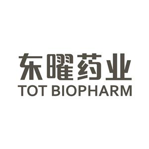

> 东曜药业 财务负责人：
> “八爪鱼RPA帮我们把财务最头疼的重复性工作都自动化了——网银水单下载、凭证制单、银企对账，以前要花大半天的活儿，机器人几分钟就搞定了，还不出错。财务团队终于能从繁琐的操作中解放出来，聚焦更有价值的分析工作。”

| 衡量指标 | 使用前 | 使用后 |
|-|-|-|
| 网银操作 | 人工逐笔下载/上传，在网银与共享平台间来回切换 | 全自动下载/归档/分发 |
| 凭证制单 | 手动逐项录入，字段多、易出错、耗时长 | 自动提取+一键生成，单据与附件完整闭环 |
| 对账准确率 | 依赖人工核对，逐笔匹配难免遗漏 | 100%（机器逐笔比对），留痕可追溯 |
| 人力投入 | 大量重复操作，80% 以上工作量被消耗 | 减少80%重复工作 |
| 系统打通 | OA、ERP、网银、简道云、水单平台多系统人工切换 | 5 大系统自动打通，跨系统数据自动流转 |

> **Agent 自动化需开通企业功能**：点击申请1个月免费权限 [ 点击申请 → ](https://skieer.feishu.cn/share/base/form/shrcnFwMayykP5iaL38fnZKTbrg)

---

## 1.客户信息

东曜药业有限公司是一家专注于ADC（抗体偶联药物）领域的生物制药企业，总部位于苏州工业园区，为港股上市公司。公司是国内ADC CDMO领域的龙头企业，拥有从抗体生产、偶联工艺到制剂灌装的全链条能力，为全球药企提供ADC药物的研发和生产服务。2026年初，东曜药业被药明合联（WuXi XDC）收购，进一步强化了在ADC CDMO领域的领先地位。

作为一家合规要求严格的上市药企，东曜药业的财务流程涉及OA、ERP、网银、简道云、水单共享平台等多个系统。日常工作中，财务人员需要频繁在各系统间切换，手动完成报表下载、凭证制单、发票比对、银企对账等大量重复性操作——不仅效率低下，而且人工操作容易出错，难以满足医药行业严格的财务合规要求。

---

## 2.业务问题

### 01.业务背景

作为国内ADC（抗体偶联药物）CDMO领域的龙头企业，东曜药业是苏州工业园区的港股上市生物药企，其财务数字化背景如下：

- 涉及系统：OA、ERP、网银、简道云、水单共享平台 5 大系统
- 重复工作量：网银水单下载、凭证制单、报表导出等占日常工作量 80% 以上
- 合规要求：发票与 PO 比对、银企对账要求 100% 准确率，且需留痕可追溯

### 02.流程与问题

财务流程横跨多个系统，重复操作与合规要求叠加，形成三道主要卡点：

#### 多系统切换
财务流程横跨 OA、ERP、网银、简道云等多个系统，人工来回切换操作繁琐，数据需要手动搬运，效率低且容易出错。

#### 重复占比高
网银水单下载、凭证制单、报表导出等重复性工作占财务日常工作量的 80% 以上，大量人力被消耗在低价值操作上。

#### 合规压力大
发票与 PO 比对、银企对账等工作要求 100% 准确率，人工逐笔核对耗时费力，且难以满足医药行业严格的财务合规审计要求。

| 人工操作流程 | 具体步骤 | 问题 |
|-|-|-|
| 网银报表与水单 | 登录网银逐笔下载往来明细、收付款台账与水单，手动重命名后上传共享平台 | 逐笔操作耗时，来回切换易漏 |
| 收付凭证制单 | 在 ERP 逐项填写付款日、OA 单号、申请人、金额等字段，再创建银行凭证 | 字段多、录入慢、易出错 |
| 发票 PO 比对 | 分别提取发票 PDF 与 PO PDF 中的商品名称、数量、单价、金额逐行比对 | 人工核对耗时，差异易漏记 |
| 银企对账 | 银行流水与 ERP 凭证逐条匹配，确认金额与对方信息一致 | 逐笔核对费时，难达 100% 准确 |
| 运营类事务 | 长账龄预付款冲账提醒、工资分摊凭证录入、多系统报工数据汇总 | 零散重复，占用大量时间 |

### 03.客户需求

- 跨系统打通：OA、ERP、网银、简道云、水单平台 5 大系统数据自动流转，不再人工搬运
- 重复工作自动化：网银、凭证、对账、运营类 11 大场景由机器人 7×24 执行
- 合规可审计：逐笔比对 100% 准确，每一步操作留痕可追溯，满足上市药企审计要求

---

## 3.解决方案

针对上述痛点，东曜药业引入八爪鱼 RPA，覆盖网银、凭证、对账、运营四类场景，把 5 大系统的数据流转全部交给机器人。

### 01.概述

|  | 说明 |
|-|-|
| 覆盖场景 | 网银报表下载、水单下载归档、收付凭证制单、发票 PO 比对、银企对账、预付款冲账提醒、工资分摊凭证、报工数据汇总等 11 大财务场景 |
| 覆盖系统 | OA 系统、ERP 系统、网银系统、简道云、水单共享平台 5 大系统 |
| 覆盖团队 | 资金会计、应收应付会计、总账会计等财务全岗位 |
| 核心能力 | 跨系统登录与流转 / 水单按规则自动重命名归档 / 凭证自动制单并挂附件 / 逐笔比对与对账 / 操作留痕可追溯 |
| 运行节奏 | 机器人按计划自动执行，7×24 小时无人值守 |

**网银全流程自动化，告别“手动逐笔操作”**

网银操作是财务团队最耗时的日常工作之一——银行往来明细、收款台账、付款台账需要定期下载，每笔水单要手动保存并重命名，还要上传到水单共享平台分发。过去，资金会计每天要花大量时间在网银系统和共享平台之间来回切换，逐笔处理。

八爪鱼RPA将网银相关的3大场景全部自动化：报表下载方面，机器人自动登录网银，按预设条件查询并下载银行往来明细、收款台账、付款台账等报表；水单下载与归档方面，机器人逐笔查看并下载银行水单，按照“类别+收付款日期+对方账户名称+币种+金额+水单编号”的命名规则自动重命名，然后上传至水单共享平台对应文件夹；水单查询与分发方面，机器人自动维护共享平台的目录权限，并根据需求将水单精准发送给对应公司群或指定人员。整个网银流程从“人工逐笔操作”变成“机器人自动完成”。

**收付凭证自动制单，从“手动录入”到“一键生成”**

凭证制单是财务工作的核心环节，也是重复性最强的工作。每一笔收付款都需要在ERP系统中创建收付款单，然后再创建银行凭证，逐项填写摘要信息——付款日、OA单号、申请人、收付款方信息、收付款单号、支付/收款缘由、项目号……字段多、易出错，且耗时巨大。

八爪鱼RPA实现了收付款凭证的全自动制单。机器人自动从OA系统或前置单据中提取收付款信息，在ERP系统中自动创建付款单或收款单——选择银行、填写日期、关联前置单据，一气呵成。收付款单生成后，机器人继续自动创建银行凭证，将摘要信息逐项填入，包括收付款日、OA单号、申请人、收付款方信息、收付款单号、支付/收款缘由及项目号等所有字段。最后，机器人还会自动将对应的水单文件作为附件上传到凭证记录下，实现“单据+附件”的完整闭环。

**自动核对与对账，精准高效零差错**

财务核对工作要求100%的准确率，但人工逐笔核对不仅耗时，而且难免出现遗漏。东曜药业的财务核对涉及多个场景：OA进度款流程中，发票（PDF）与采购订单PO（PDF）需要逐一比对商品名称、数量、单价、金额；银企对账中，银行往来流水需要与ERP系统凭证逐条匹配，确认金额和对方信息一致。

八爪鱼RPA将这些核对工作全部自动化。发票PO比对场景中，机器人自动打开OA系统中的进度款流程，分别提取发票PDF和PO PDF中的商品信息，逐行比对数量、单价、金额是否一致，发现差异自动记录到登记表中。银企对账场景中，机器人从银行流水中逐笔提取对方公司名称、金额等信息，与ERP系统凭证中的收付款记录逐条匹配，自动完成银行余额与账务余额的对账工作。每一笔比对都有完整的操作日志，结果可追溯，完全满足上市药企的合规审计要求。

**财务运营提效，从事务处理到价值创造**

除了核心的网银和凭证场景，八爪鱼RPA还覆盖了多个财务运营提效场景，帮助财务团队从繁琐的事务处理中解放出来。长账龄预付款冲账提醒——机器人定期整理长账龄预付款清单，自动定位每笔预付款对应的申请人和采购员，逐一编写邮件发送提醒，推动冲账进度；工资分摊及冲回凭证录入——机器人自动读取工资分摊明细Excel，将数据逐条填入ERP总账导入模板，核对格式后自动导入系统，有冲回需求时自动重复操作生成冲回凭证；多系统报工数据汇总——机器人分别登录OA和简道云，导出人员报工和机器报工明细，按模板清洗合并成统一汇总表，再根据规则给未按要求报工的员工发送提醒。

通过11大财务场景的全面自动化，东曜药业财务团队的重复操作工作量减少了80%以上。财务人员不再需要每天花大量时间做“数据搬运工”，而是可以将精力聚焦在财务分析、预算管理、风险控制等高价值工作上，真正实现了从事务处理到价值创造的转变。

### 02.方案优势

1. **5 大系统打通**：从登录、查询、下载到上传全流程自动化，跨系统数据流转不再靠人工搬运。
2. **11 大场景覆盖**：网银、凭证、对账、运营四类场景全覆盖，机器人 7×24 小时自动执行。
3. **100% 准确可审计**：逐笔匹配比对并记录操作日志，差异自动登记，满足上市药企合规审计要求。
4. **单据+附件闭环**：凭证自动创建后同步挂接水单附件，财务档案一次成型，无需二次操作。

### 03.涉及解决方案

**医药 ｜ 财务全流程自动化**

> 自动登录网银、ERP、OA 等系统，完成水单下载归档、收付款凭证制单、发票 PO 比对与银企对账，输出财务自动化台账与差异登记。方案链接：[医药 ｜ 财务全流程自动化](https://skieer.feishu.cn/wiki/KMGSwRMyEi4hyJkRXwScGRnQnWf)

---

## 4.落地效果

| 衡量指标 | 使用前 | 使用后 |
|-|-|-|
| 网银操作 | 人工逐笔下载/上传，在网银与共享平台间来回切换 | 全自动下载/归档/分发 |
| 凭证制单 | 手动逐项录入，字段多、易出错、耗时长 | 自动提取+一键生成，单据与附件完整闭环 |
| 对账准确率 | 依赖人工核对，逐笔匹配难免遗漏 | 100%（机器逐笔比对），留痕可追溯 |
| 人力投入 | 大量重复操作，80% 以上工作量被消耗 | 减少80%重复工作 |
| 系统打通 | OA、ERP、网银、简道云、水单平台多系统人工切换 | 5 大系统自动打通，跨系统数据自动流转 |

**网银操作全自动**

报表下载、水单归档、水单分发 3 大网银场景全部由机器人完成，资金会计不再在网银与共享平台之间来回切换，逐笔操作变成一键执行。

**凭证自动提取、一键生成**

机器人从 OA 或前置单据提取收付款信息，在 ERP 中自动创建收付款单与银行凭证，摘要字段逐项填入，水单自动挂接为附件，单据与附件一次成型。

**对账准确率 100%**

发票与 PO 逐行比对数量、单价、金额，银企流水与 ERP 凭证逐条匹配，差异自动登记，每一笔都有操作日志可追溯，满足合规审计要求。

**重复工作减少 80% 以上**

11 大财务场景自动化后，财务团队从“数据搬运工”转向财务分析、预算管理、风险控制等高价值工作，实现从事务处理到价值创造的转变。

**改造前 vs 改造后**

改造前：资金会计在网银与共享平台间逐笔下载上传水单，财务在 ERP 逐项录入凭证，发票与 PO、流水与凭证全靠人工逐笔核对，80% 以上时间消耗在重复操作上。

改造后：机器人自动下载报表与水单并按规则归档分发，自动提取单据生成凭证并挂接附件，逐笔比对对账准确率 100%，重复操作减少 80% 以上，跨 5 大系统全链路自动流转。

---

原文：[在飞书查看本案例](https://skieer.feishu.cn/docx/BIFid9WG4o2FXLx4eZtcxpggnuf)。
