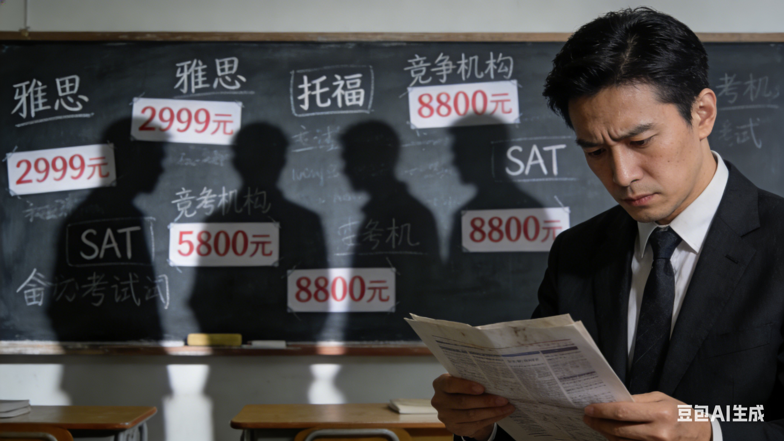
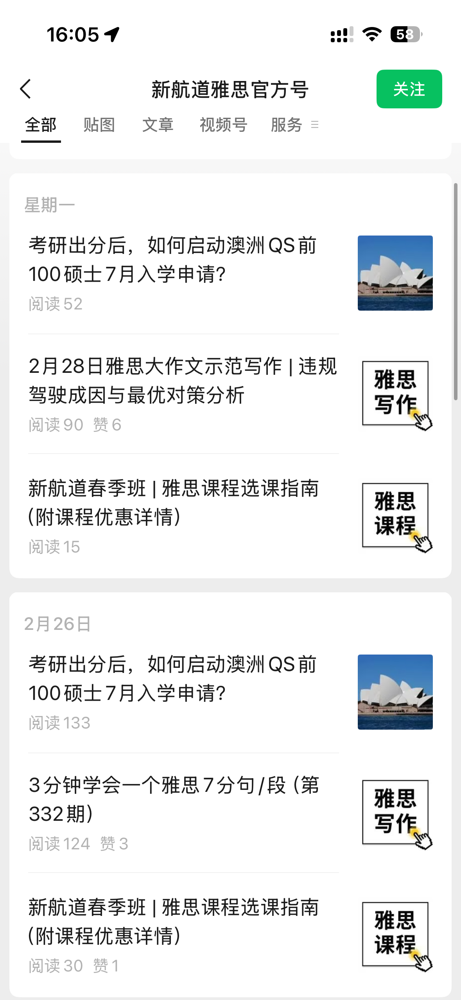
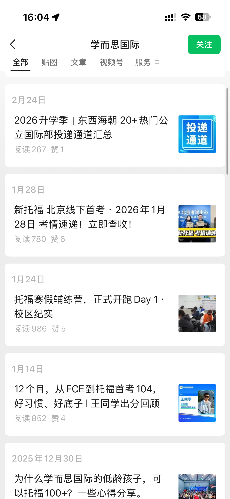
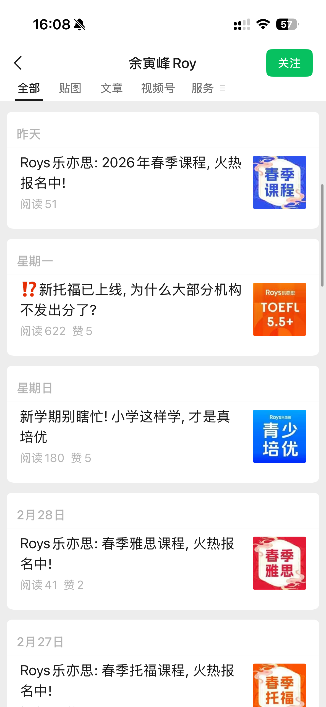
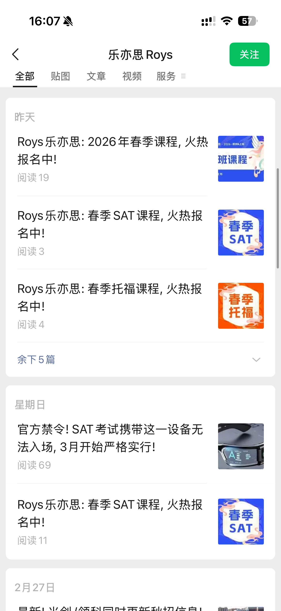
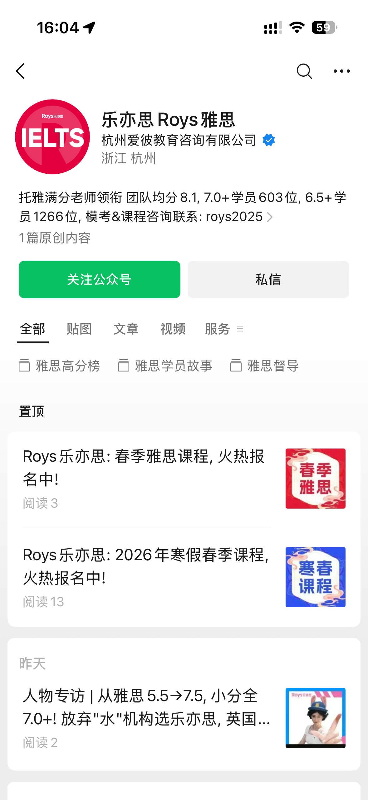
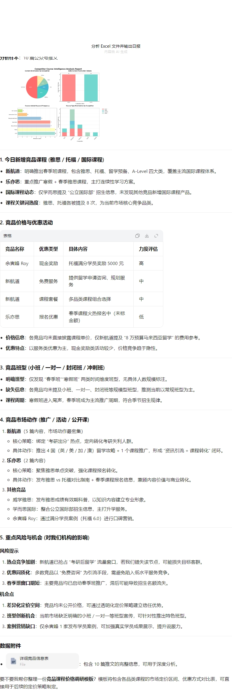
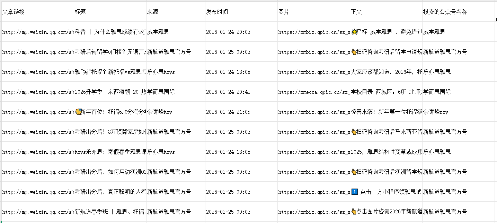

> 该教培集团 市场团队：
> “以前每天要花大量时间盯着各家竞品动态，信息零散又难汇总。现在系统自动监控、自动分析、自动出报告，我们能更快看清市场、找准机会，工作轻松很多，反应也快很多。”

| 衡量指标 | 使用前 | 使用后 |
|-|-|-|
| 竞品动态识别准确率 | 人工提取易漏看、误记、统计不准 | 95% 以上 |
| 重复性工作量 | 每日人工巡查公众号、摘抄、汇总 | 下降约 80% |
| 监控时限 | 人工巡查频率有限，易错过竞品信息 | 7×24 小时自动巡查多平台 |
| 响应时效 | 从发现到预警小时级 | 分钟级 |
| 日报输出 | 人工排版撰写，无法每日准时输出 | AI 自动生成竞品课程上新日报并定时推送 |

> **Agent 自动化需开通企业功能**：点击申请1个月免费权限 [ 点击申请 → ](https://skieer.feishu.cn/share/base/form/shrcnFwMayykP5iaL38fnZKTbrg)

---

## 1.客户信息

某大型教培集团专注出国语言培训与国际教育服务，以雅思、托福等标化考试培训为核心，同步提供国际课程、留学规划、背景提升等一站式服务。集团具备全国连锁规模、成熟教研体系与官方认证资质，是留学语培赛道的主流头部机构之一。

---

## 2.业务问题

### 01.业务背景

随着国内留学市场持续升温，雅思、托福、SAT、国际课程、DSE 等语培赛道竞争日趋白热化，该教培集团的竞品监控背景如下：

- 集团在全国拥有大量直营校区，核心竞品遍布全国与区域头部机构，各家在课程产品、价格策略、优惠活动等方面频繁上新，线上推广迭代节奏极快
- 众多竞品上新通知更新在公众号等平台，人工收集耗时耗力
- 以往依赖人工巡查监控竞品动态，受限于人力与巡查频率，常因信息滞后、覆盖不全、汇总不及时，无法快速掌握竞品课程、价格、活动及营销动向

### 02.流程与问题

竞品情报链路依赖人工逐篇翻阅，覆盖、时效与标准化都难以保证：

#### 课程动态响应滞后
竞品高频发布雅思、托福、国际课程、春季班、留学规划等内容，人工巡查无法实时跟进，极易错过信息，被动落后于市场节奏。

#### 多渠道梳理耗力巨大
需专人逐篇阅读竞品公众号推文，手动提取课程、班型、优惠、奖学金、公开课等信息，统计发文量与关键词热度，重复劳动强度大、人力成本高。

#### 上新情报分析效率低
人工整理课程对比、优惠力度、市场动作等内容，难以按日输出《竞品课程情报日报》，无法为课程定价、活动策划、市场决策提供及时支撑。

| 人工操作流程 | 具体步骤 | 问题 |
|-|-|-|
| 竞品监控基础信息整理 | 人工整理并维护竞品名称、监控平台、账号主页、监控关键词、关注维度等信息，定期检查账号与链接有效性 | 清单维护繁琐，易失效 |
| 逐个访问竞品账号与平台 | 手动打开各竞品在公众号、官网等平台的主页，逐一浏览最新发布内容 | 逐家翻阅，监控效率极低 |
| 手动抓取并记录内容信息 | 从页面中人工复制文案、截图活动、记录课程、价格、优惠、班型、宣传卖点等信息，核对完整性 | 易漏看、误记、统计不准 |
| 人工筛选关键竞品动态 | 人工将记录内容与关注重点逐一比对，识别课程上新、价格调整、优惠活动、营销动作等高价值信息 | 标准不统一，内容零散 |
| 手动生成竞品课程上新快报 | 整理筛选后的竞品最新情报，通过微信、飞书、邮件等方式手动同步相关人员 | 排版撰写耗时，无法每日准时输出 |

### 03.客户需求

该集团迫切需要通过自动化监控方案，来实现竞品内容的实时抓取、汇总与分析，以解决人工监控效率低、响应慢、数据零散的问题。

- 竞品动态全自动实时监控：自动巡查多平台账号，7×24 小时抓取推文、课程、活动等信息
- 关键情报结构化精准提取：自动识别课程类型、班型、优惠、价格等信息，避免人工遗漏与错误
- 情报分析标准化统一输出：AI 按固定维度自动统计、对比、归类，保证每日报告口径一致、数据可靠

---

## 3.解决方案

针对上述痛点，该集团引入八爪鱼 RPA + AI，把“自动巡查 → 结构化提取 → AI 分析 → 日报推送”串成一条全自动链路，市场团队只处理系统推来的竞品情报。

### 01.概述

|  | 说明 |
|-|-|
| 覆盖平台 | 竞品公众号、官网等主流社媒/内容平台，可按需自由添加新增采集规则 |
| 监控维度 | 课程上新、班型、价格、优惠活动、奖学金、公开课、营销动作等 |
| 处理环节 | 多平台自动巡查 → 内容抓取 → 结构化提取 → AI 统计分析 → 竞品课程上新日报自动生成与推送 |
| 运行方式 | 7×24 小时自动循环巡查，AI 按固定维度出报，RPA 定时推送相关人员 |

**竞品动态全自动实时监控**

采集器＋RPA 自动巡查多平台账号，7×24 小时抓取竞品推文、课程、活动等信息，突破单一平台限制，可按监控需求自由添加新增采集规则，实现全网社交媒体舆情的统一监控。

**关键情报结构化精准提取**

自动识别课程类型、班型、优惠、价格等信息，避免人工遗漏与错误；竞品课程、价格及营销动态识别准确率提升至 95% 以上。

**情报分析标准化统一输出**

AI 按固定维度自动统计、对比、归类，保证每日报告口径一致、数据可靠；AI 自动产出竞品课程上新日报，RPA 定时推送相关人员，支撑快速决策。

**响应即时化**

竞品动向从发现到预警的时间从小时级缩短至分钟级，扩大管理层及时决策空间；报告智能化，AI 自动分析大幅降低人工成本，让团队聚焦于策略制定而非机械操作。

### 02.方案优势

1. **舆情全覆盖**：突破单一平台限制，可根据监控需求自由添加新增采集规则，实现全网社交媒体舆情的统一监控。
2. **响应即时化**：竞品动向从发现到预警的时间从小时级缩短至分钟级，扩大管理层及时决策空间。
3. **报告智能化**：AI 自动分析、自动产出竞品课程上新日报并定时推送，大幅降低人工成本，让团队聚焦策略制定。
4. **情报标准化**：AI 按固定维度自动统计、对比、归类，保证每日报告口径一致、数据可靠。

### 03.涉及解决方案

**市场 ｜ 舆情监控与分析 Agent 自动化**

> 为舆情监控场景打造的智能体驱动方案，一句话调度多平台数据采集 + 自动清洗合并 + 深度分析，输出舆情分析报告。方案链接：[市场 ｜ 舆情监控与分析 Agent 自动化](https://skieer.feishu.cn/wiki/H0hew2sJRiGlyAkbjvZcxWRjnoh)

---

## 4.落地效果

| 衡量指标 | 使用前 | 使用后 |
|-|-|-|
| 竞品动态识别准确率 | 人工提取易漏看、误记、统计不准 | 95% 以上 |
| 重复性工作量 | 每日人工巡查公众号、摘抄、汇总 | 下降约 80% |
| 监控时限 | 人工巡查频率有限，易错过竞品信息 | 7×24 小时自动巡查多平台 |
| 响应时效 | 从发现到预警小时级 | 分钟级 |
| 日报输出 | 人工排版撰写，无法每日准时输出 | AI 自动生成竞品课程上新日报并定时推送 |

**竞品动态识别准确率提升至 95% 以上**

竞品课程、价格及营销动态识别准确率提升至 95% 以上，大幅减少人工巡查中常见的信息遗漏、优惠误判、内容统计偏差。

**重复性工作量降低约 80%**

市场团队每日用于公众号巡查、内容摘抄、情报汇总的重复性工作量降低约 80%，可将更多精力投入课程优化、活动策划与市场竞争策略等高价值工作。

**改造前 vs 改造后**

改造前：竞品巡查耗时冗长，需人工每日登录多平台、逐家翻阅公众号、逐篇查看推文；课程信息提取易错，易漏看、误记、统计不准；情报汇总标准不统一，日报依赖人工排版撰写，无法每日准时输出、决策滞后。

改造后：竞品动态全自动实时监控，7×24 小时抓取多平台推文、课程、活动；关键情报结构化精准提取，自动识别课程类型、班型、优惠、价格；情报分析标准化统一输出，AI 自动产出竞品课程上新日报并由 RPA 定时推送。

---

原文：[查看原文](https://skieer.feishu.cn/docx/GdetdrfJqoM6l1x9c0lc5PU1nij)
