> 客户证言：
> “八爪鱼RPA的对账自动化流程稳定高效，大幅提升了我们的财务对账效率。流程迁移过程也非常顺利，实现了对原有流程的平滑切换。”

| 衡量指标 | 使用前 | 使用后 |
|-|-|-|
| 对账周期 | 5 天 | 缩短至 1 天 |
| 月均财务人力 | 财务人员疲于应付多系统操作 | 节省 120+ 小时 |
| 差异识别准确率 | 手工逐笔核对，难以保证准确性 | 达 99% 以上 |
| 核心自动化流程 | 跨系统人工操作 | 3 套流程全覆盖 |
| 店铺运营规模 | 每位运营同时运营 20+ 个天猫店铺 | 自动切换登录、批量处理 |

> **Agent 自动化需开通企业功能**：点击申请1个月免费权限 [ 点击申请 → ](https://skieer.feishu.cn/share/base/form/shrcnFwMayykP5iaL38fnZKTbrg)

---

## 1.客户信息

该企业是韩国第一大的时尚零售集团在中国的核心子公司，旗下拥有ROEM、SPAO、Paw in Paw、Eblin等40＋众多知名品牌，在中国开设有数千家线下门店，并积极布局天猫等主流电商平台，业务覆盖服装、饰品、生活用品等多个品类。

作为国内时尚零售行业的头部企业，该企业拥有庞大的电商业务体量，店铺数量每月天猫平台产生数万笔订单，财务对账工作繁重且复杂。

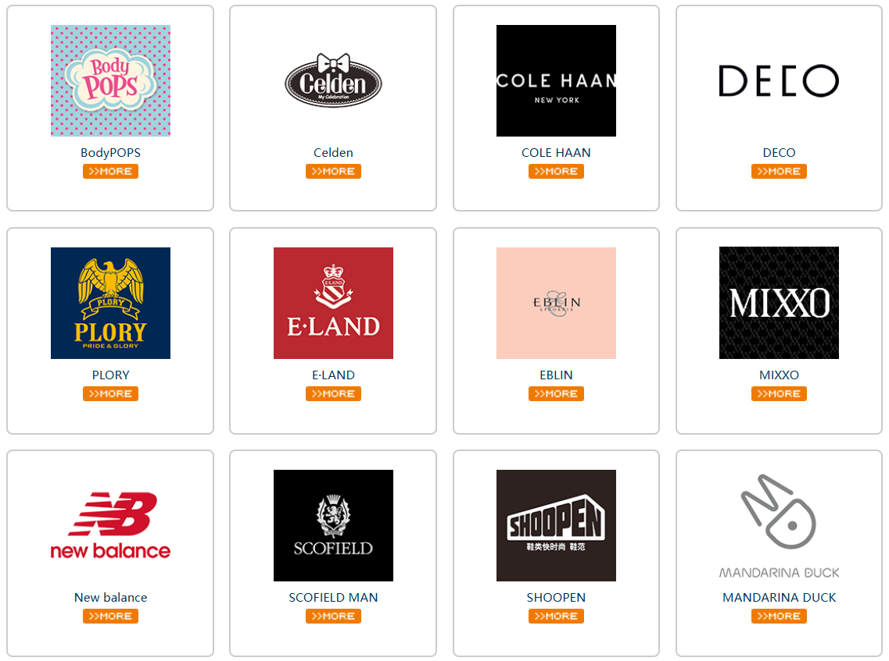

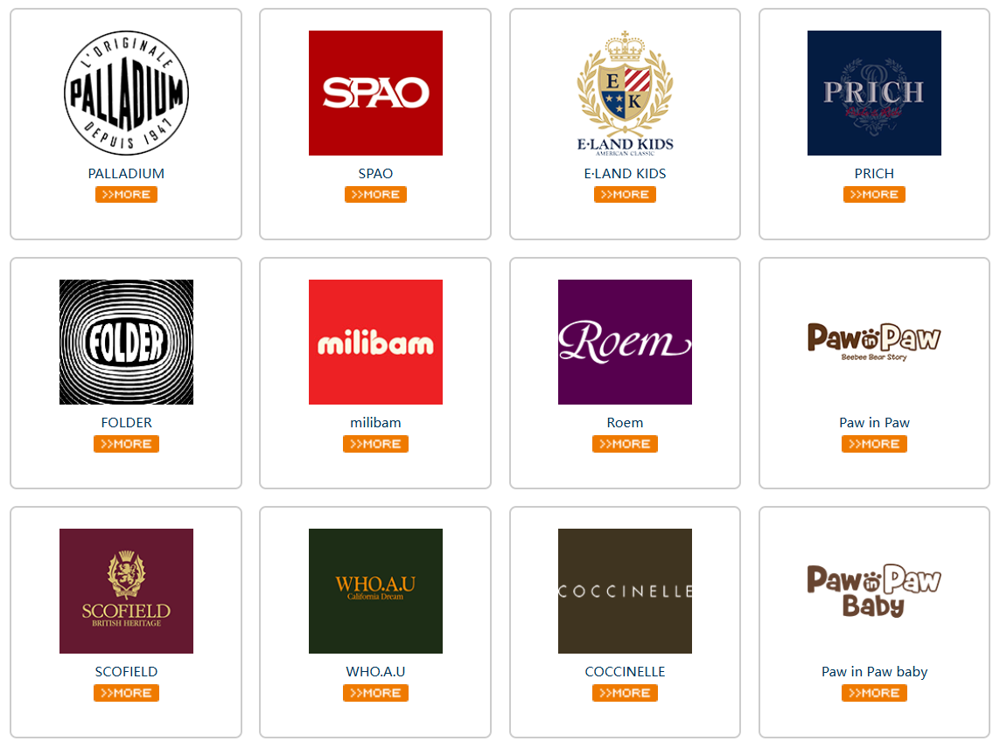

该企业旗下品牌

---

## 2.业务问题

### 01.业务背景

随着电商业务规模持续扩大，该企业财务部门面临跨系统、多维度的零售对账挑战。每月需从天猫商家中心、支付宝对账中心、伯俊ERP系统等多个平台获取数据，进行清洗、汇总、比对及差异处理。业务背景如下：

- 此前，该企业已完成了电商对账自动化的初步探索。为进一步优化底层工具生态、提升自动化稳定性和扩展性，决定将对账自动化流程全面建设至八爪鱼RPA平台。
- 该企业旗下拥有众多品牌矩阵，每个品牌均在天猫平台开设了多个店铺，店铺类型涵盖官方旗舰店、品牌专卖店、奥莱店等多元化业态。
- 每位电商运营人员需同时运营 20+ 个天猫店铺，工作极为繁重，单是店铺切换登录就占据了大量的工作时间，严重挤压了运营人员用于优化策略、分析数据的精力。

### 02.流程与问题

#### 店铺繁多，重复工作占精力
该企业旗下拥有众多品牌矩阵，每个品牌均在天猫平台开设了多个店铺，店铺类型涵盖官方旗舰店、品牌专卖店、奥莱店等多元化业态。
每位电商运营人员需同时运营 20+ 个天猫店铺，工作极为繁重，单是店铺切换登录就占据了大量的工作时间，严重挤压了运营人员用于优化策略、分析数据的精力。

#### 系统众多，账单获取耗时长
该企业为进行每月对账，需要每月导出账单，得手动登录天猫商家中心、支付宝对账中心、伯俊ERP等多个系统，逐一下载账单数据、零售单、宝贝报表等，数据获取耗时长、易遗漏。各系统账号体系独立，切换操作繁琐，财务人员疲于应付。

#### 账单多样，字段清洗规则杂
各平台账单格式、字段定义、结算周期各不相同。
账单导出后，需要进行统一的字段的清洗后续才能对账，以支付宝账单为例：需去掉前后冗余行、去除空格、金额列格式统一、金额计算（收入-支出）、按业务类型和描述分类等，步骤繁多且规则复杂，人工处理极易出错。

#### 对账复杂，差异订单归因难
由于退货退款、平台扣点、价保补贴等原因，资金账单与零售单之间会存在差异订单，需匹配平台单号、比对金额、识别差异类型，手工逐笔核对效率低下，且难以保证准确性。

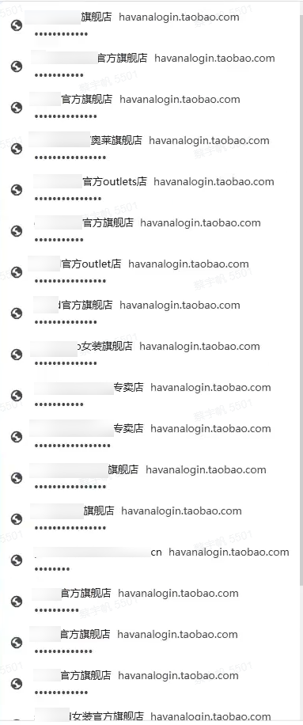

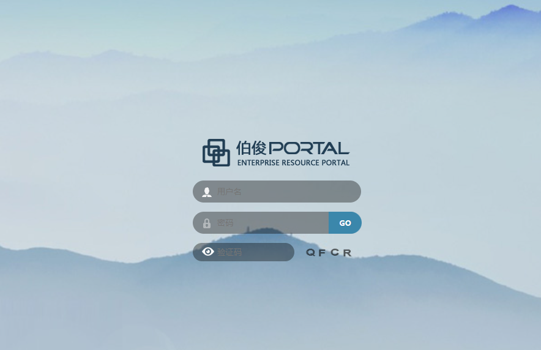

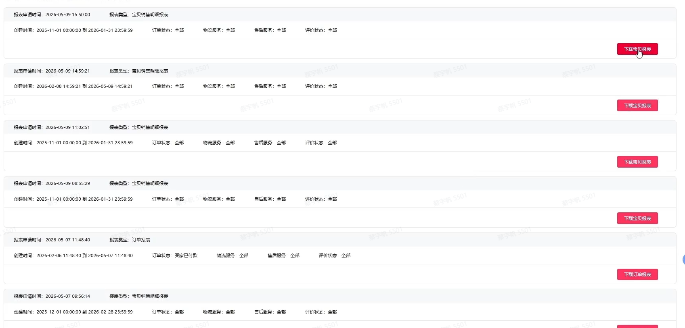

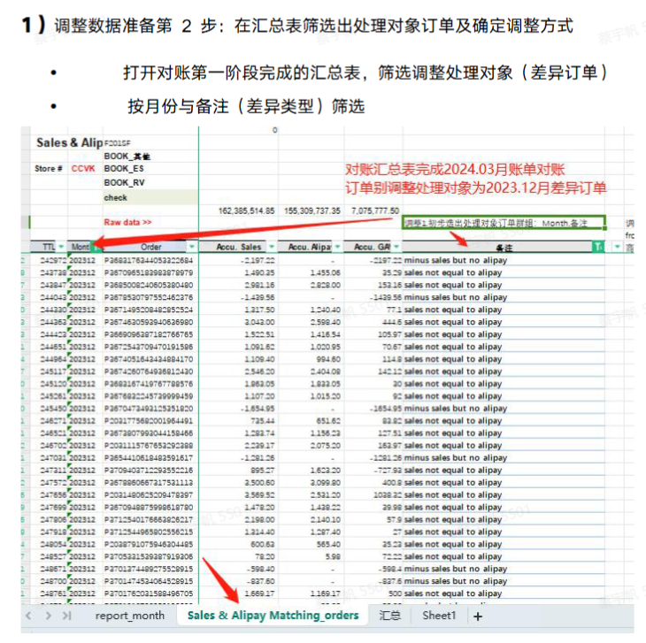

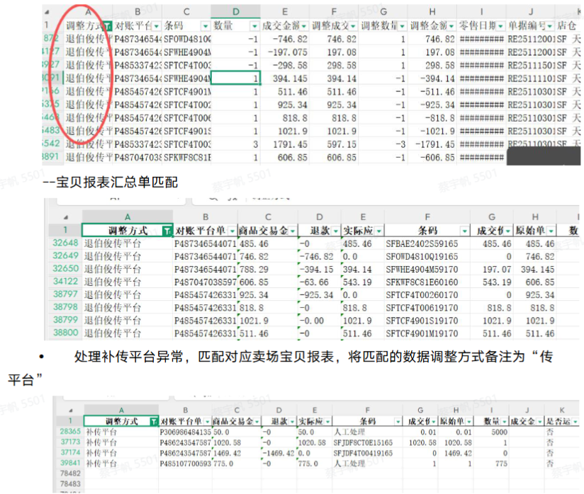

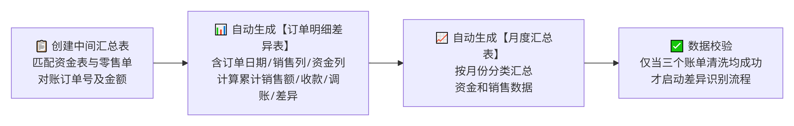

### 03.客户需求

- 需把多源账单获取、清洗汇总、差异识别整条链路从人工操作转为自动化执行；
- 需在优化底层工具生态的同时，保障自动化流程的稳定性与可扩展性；
- 需压缩对账周期与人力投入，释放财务与运营人员的时间用于策略与数据分析。

---

## 3.解决方案

针对该企业的天猫平台零售对账的全流程自动化需求，八爪鱼RPA打造了三套核心流程，覆盖从数据获取、清洗汇总到差异识别的完整闭环。

### 01.概述

|  | 说明 |
|-|-|
| 覆盖平台 | 天猫商家中心、千牛后台、支付宝对账中心、伯俊ERP 等 |
| 覆盖数据 | 支付宝账单、伯俊零售单与零售明细、宝贝报表、淘宝订单、资金账单等 |
| 覆盖环节 | 流程一：资金单与零售单下载及数据清洗；流程二：宝贝报表下载与零售明细汇总；流程三：汇总差异识别与调整处理（自动对账） |
| 交付方式 | 3 套核心自动化流程，含支付宝账单下载、伯俊ERP账单下载、下载天猫报表并处理、自动对账等演示视频 |

三套核心流程分别对应「多源账单自动采集」「平台订单自动汇总」「差异订单智能归因」，覆盖从数据获取、清洗汇总到差异识别的完整闭环：

- 流程一：多源账单自动采集 —— 支付宝账单下载+伯俊零售单下载+数据清洗+差异识别
- 流程二：平台订单自动汇总 —— 淘宝订单抓取+宝贝报表处理+零售明细汇总
- 流程三：差异订单智能归因 —— 汇总差异识别+差异订单调整处理

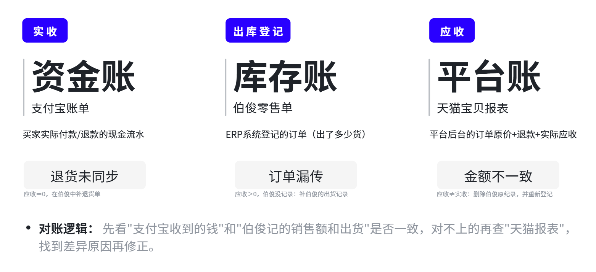

#### 流程一：资金单与零售单下载及数据清洗

#### 💎 场景1：支付宝账单自动下载与清洗

**背景痛点：**每月需从支付宝对账中心下载各月账单，数据量大、格式不统一，需逐项处理后按业务类型分类，人工操作耗时长、易出错。

**RPA方案：**八爪鱼RPA模拟人工操作，自动读取Excel店铺账号，登录支付宝对账中心下载月账单，解压并清洗CSV数据，依据多维规则自动分类账务，对无法判定的订单标记“人工处理”并记录日志，实现支付宝账单的自动下载。

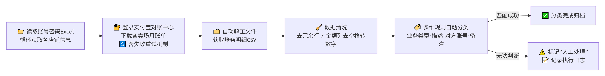

[在飞书原文中查看视频：demo1-支付宝账单下载.mp4](https://skieer.feishu.cn/docx/WtI5dpPIqokxOLxhgoAc2c1zn4g)

#### 💎 场景2：伯俊ERP零售单自动下载与清洗

**背景痛点：**每月需从伯俊系统导出零售单和零售明细，涉及多卖场、多时间范围的数据查询与导出，手工操作繁琐。

**RPA方案：**八爪鱼RPA自动登录伯俊ERP，按店铺筛选上月零售单及明细并规范命名导出，自动处理平台单号，生成对账平台单号并记录处理状态，实现零售单下载与清洗全自动化。

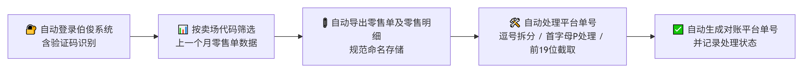

[在飞书原文中查看视频：demo2-伯俊ERP账单下载.mp4](https://skieer.feishu.cn/docx/WtI5dpPIqokxOLxhgoAc2c1zn4g)

#### 流程二：宝贝报表下载与零售明细汇总

#### 💎 场景3：淘宝订单自动抓取与宝贝报表处理

**背景痛点：**每月需从千牛后台导出宝贝报表，数据量庞大且下载易失败，手工合并整理工作量大。

**RPA方案：**八爪鱼RPA自动登录千牛后台，下载报表，合并宝贝报表数据，自动计算对账平台单号、商品交易金额、退款、实际应收、成交价等字段，并识别运费模板条码，实现报表全自动处理。

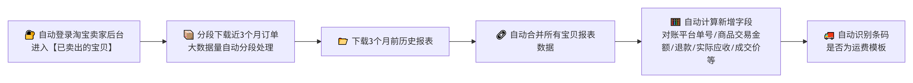

[在飞书原文中查看视频：demo3-下载天猫报表并处理.mp4](https://skieer.feishu.cn/docx/WtI5dpPIqokxOLxhgoAc2c1zn4g)

#### 💎 场景4：零售明细数据自动汇总

**背景痛点：**每月零售明细数据需与历史数据合并，并按规则提取关键字段，手工操作易遗漏、难追溯。

**RPA方案：**八爪鱼RPA自动将新下载零售明细合并至历史汇总表，提取对账平台单号、条码、数量、成交金额、调整数据等关键字段，自动删除最早月份数据以保留最近4个月，并记录完成状态、通知执行结果，确保数据完整可追溯。

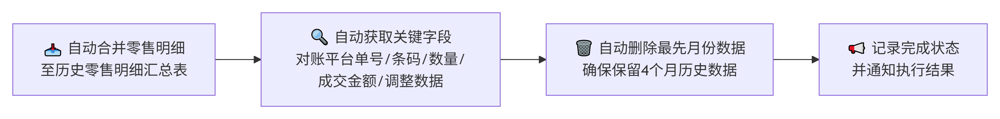

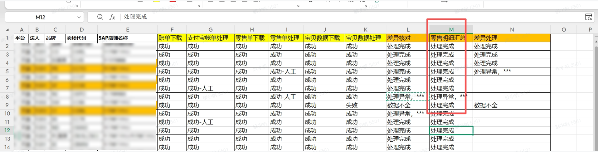

#### 流程三：汇总差异识别与调整处理（自动对账）

[在飞书原文中查看白板](https://skieer.feishu.cn/docx/WtI5dpPIqokxOLxhgoAc2c1zn4g)

[在飞书原文中查看视频：demo4-自动对账.mp4](https://skieer.feishu.cn/docx/WtI5dpPIqokxOLxhgoAc2c1zn4g)

> 注：对账由 RPA 在后台自动处理多个 Excel 表格（涉及宏和 Python），这一过程在画面上不可见，逻辑见上图，该视频仅能展示启动时的状态以及运行成功后的记录。

#### 💎 场景5：资金与零售数据差异自动识别

**背景痛点：**资金账单与零售单之间存在差异，需逐笔匹配、归因分析，手工处理效率低、易遗漏。

**RPA方案：**八爪鱼RPA自动创建中间汇总表，匹配资金表与零售单的订单号及金额，生成《订单明细差异表》及《月度资金销售差异表》，仅当三份账单清洗成功后才启动差异识别，确保准确高效。

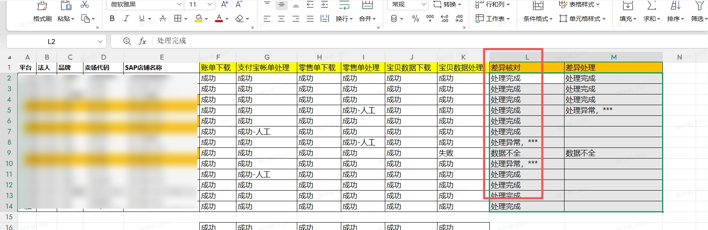

#### 💎 场景6：差异订单自动调整处理

**背景痛点：**差异订单需根据预设规则确定调整方式，并与零售明细单、宝贝报表进行多轮匹配比对，确定最终处理方案，人工处理极为繁琐。

**RPA方案：**八爪鱼RPA自动筛选待调整订单，根据规则确定调整方式，匹配零售明细与宝贝报表数据，区分商品和运费生成上传模板，异常订单标注“人工处理”，成功后记录状态并发送企微通知。

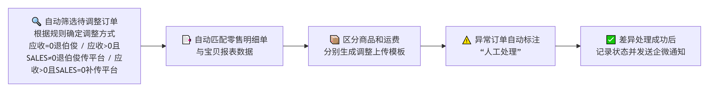

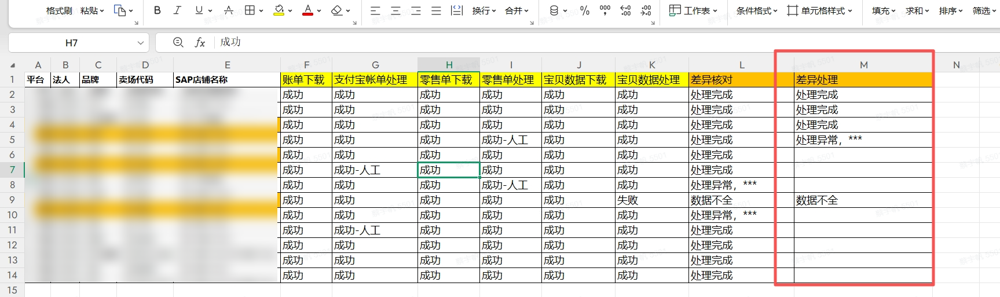

### 02.方案优势

1. **三套流程覆盖对账全闭环**：从多源账单自动采集、平台订单自动汇总到差异订单智能归因，覆盖从数据获取、清洗汇总到差异识别的完整链路。
2. **零接口打通多系统**：以模拟人工操作的方式登录天猫商家中心、支付宝对账中心、伯俊ERP、千牛后台，无需系统改造即可完成跨系统取数与回写。
3. **清洗规则内置，异常有出口**：账单冗余行、空格、金额格式、分类规则全部内置；无法判定的订单自动标记「人工处理」并记录日志，异常可追溯。
4. **流程迁移平滑，稳定性可扩展**：该企业原有对账自动化流程平滑迁移至八爪鱼RPA平台，底层工具生态得到优化，自动化稳定性与扩展性进一步提升。

### 03.涉及解决方案

**财务对账 ｜ 亚马逊平台结算对账**

> 为亚马逊卖家团队打造的平台结算对账衔接方案，主体能力由领星/ERP 承担，本方案补跨系统衔接缺口。方案链接：[财务对账 ｜ 亚马逊平台结算对账](https://skieer.feishu.cn/wiki/S1HXwHObliphYdku2gKcQKjOnVe)

---

## 4.落地效果

| 衡量指标 | 使用前 | 使用后 |
|-|-|-|
| 对账周期 | 5 天 | 缩短至 1 天 |
| 月均财务人力 | 财务人员疲于应付多系统操作 | 节省 120+ 小时 |
| 差异识别准确率 | 手工逐笔核对，难以保证准确性 | 达 99% 以上 |
| 核心自动化流程 | 跨系统人工操作 | 3 套流程全覆盖 |
| 店铺运营规模 | 每位运营同时运营 20+ 个天猫店铺 | 自动切换登录、批量处理 |

该集团通过八爪鱼RPA实现天猫平台电商对账全流程自动化，月均节省财务人力 120+ 小时，对账周期从 5 天缩短至 1 天，差异识别准确率达 99% 以上。

#### 120+ h
月均节省人力

#### 1天
对账周期缩短

#### 99%+
差异识别准确率

#### 3套
核心自动化流程

**月均节省财务人力 120+ 小时**

该集团通过八爪鱼RPA实现天猫平台电商对账全流程自动化，月均节省财务人力 120+ 小时，把财务人员从多系统登录、账单下载、字段清洗等重复工作中释放出来。

**对账周期从 5 天缩短至 1 天**

多源账单自动采集与零售明细自动汇总替代人工逐一下载与合并，对账周期从 5 天缩短至 1 天，财务月结节奏明显加快。

**差异识别准确率达 99% 以上**

资金账单与零售单的订单号、金额自动匹配，生成《订单明细差异表》及《月度资金销售差异表》，差异识别准确率达 99% 以上，退货退款、平台扣点、价保补贴等差异订单归因不再依赖人工逐笔核对。

**3 套核心自动化流程全面上线**

三套核心流程覆盖资金单与零售单下载及数据清洗、宝贝报表下载与零售明细汇总、汇总差异识别与调整处理，支付宝账单、伯俊ERP、千牛报表、自动对账四个环节均配有实际运行演示。

**流程迁移平滑，切换无感**

原有电商对账自动化流程平滑迁移至八爪鱼RPA平台，底层工具生态得到优化，自动化稳定性与扩展性同步提升。

---

原文：[在飞书查看本案例](https://skieer.feishu.cn/docx/WtI5dpPIqokxOLxhgoAc2c1zn4g)。
