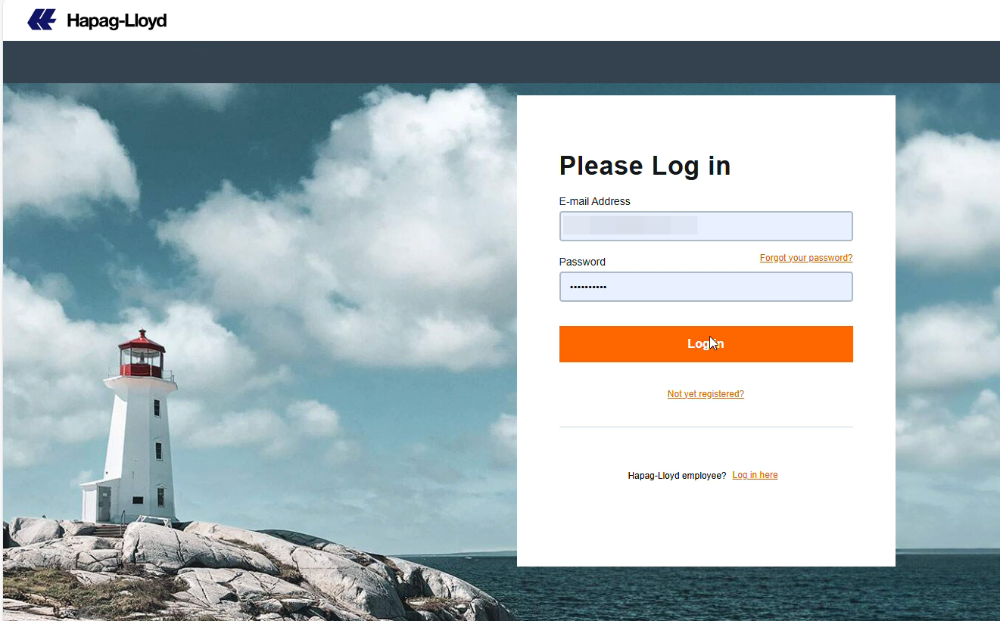
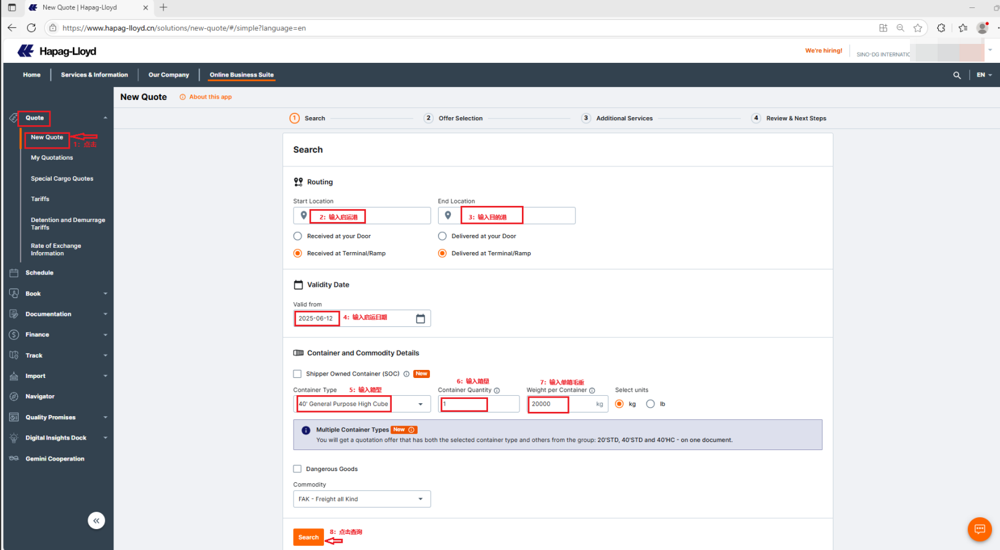
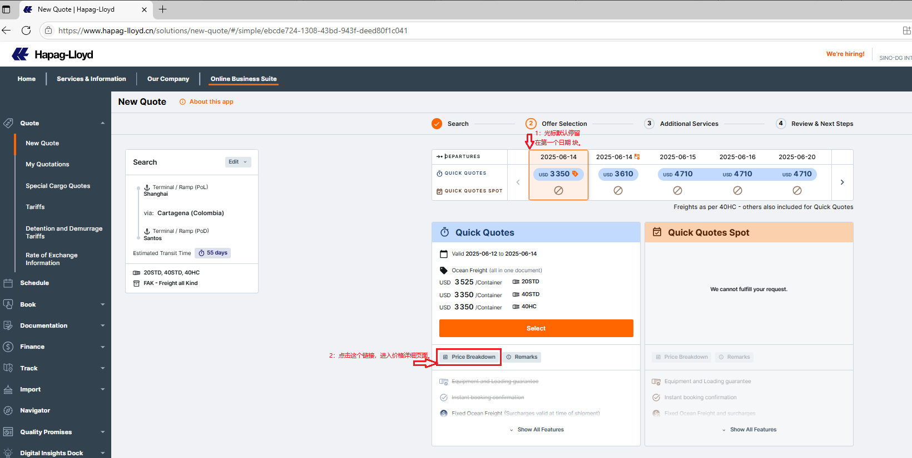
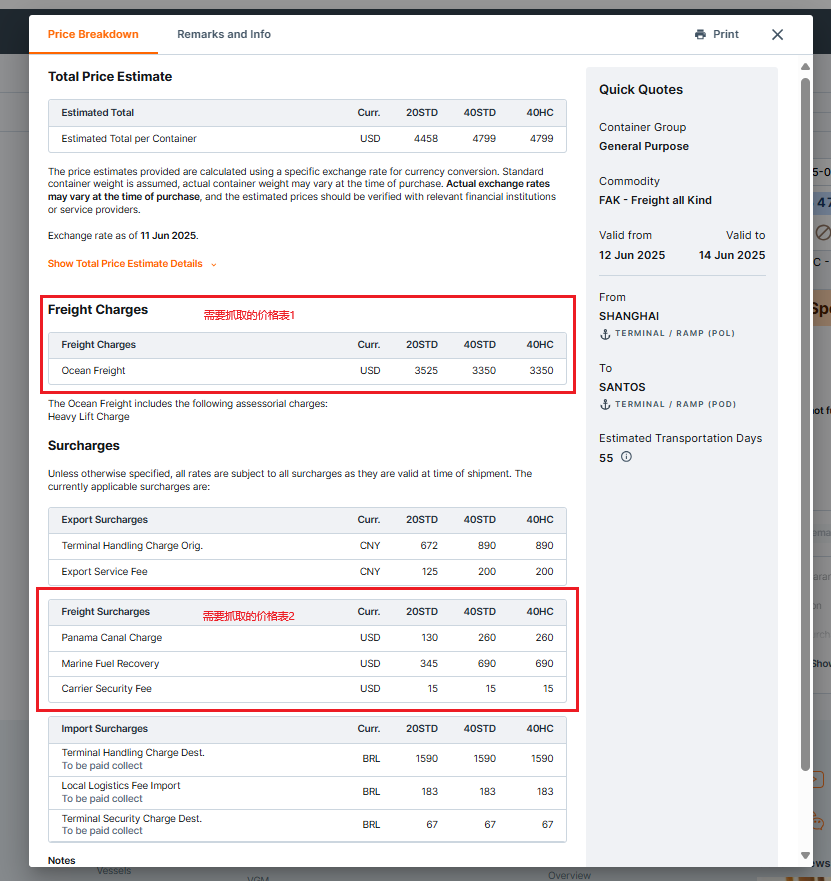
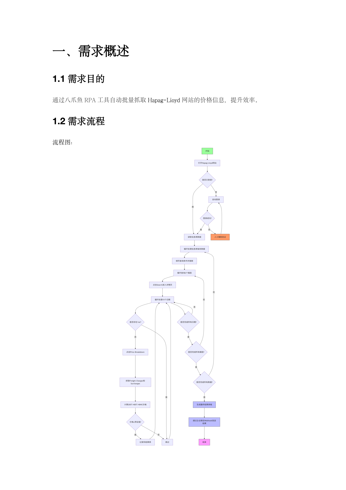
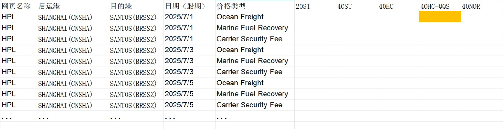
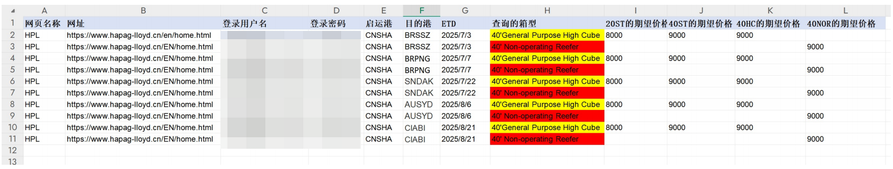
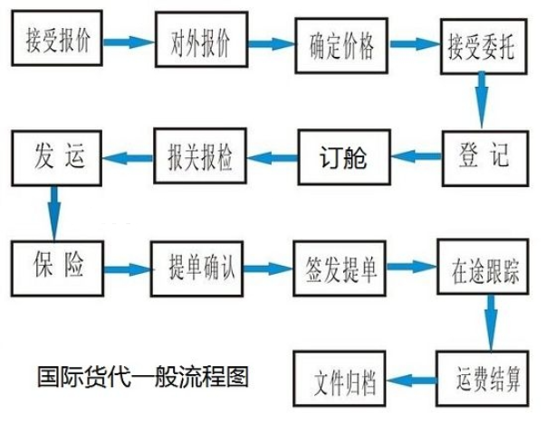

> 该货代公司 业务人员：
> “以前每天花 3-4 小时在各个船公司网站来回切换查价格，旺季忙得连喝水时间都没有还总出错。现在系统自动跑，价格一达标就提醒，省出的时间能多跟客户沟通，订舱效率也高多了。”

| 衡量指标 | 使用前 | 使用后 |
|-|-|-|
| 船期价格查询与数据抓取准确率 | 人工抄录易遗漏附加费、看错数字 | 99% 以上 |
| 重复工作量 | 人工登录各船公司网站、逐条查询并整理数据 | 下降 80% |
| 查询时效 | 人工定时查询频率有限，易错过低价窗口 | 按设定频率自动高频查询 |
| 通知覆盖 | 手动筛选、整理达标信息后推送，易漏发错发 | 达标信息自动定向推送 |
| 数据资产 | 船期价格数据零散，难追踪价格规律 | 沉淀完整船期价格波动数据资产 |

> **Agent 自动化需开通企业功能**：点击申请1个月免费权限 [ 点击申请 → ](https://skieer.feishu.cn/share/base/form/shrcnFwMayykP5iaL38fnZKTbrg)

---

## 1.客户信息

某货运代理有限公司是专注于化工品及危险品海运出口领域的供应链服务提供商，深耕国际货运代理行业多年，凭借对化工物流领域的深刻理解和专业积淀，为客户提供从货物出运前的合规咨询到最终目的港送达的“一条龙”全链条服务。

---

## 2.业务问题

### 01.业务背景

作为货代公司，其核心业务是为客户办理出口货物的订舱及出运操作，其订舱作业背景如下：

- 成本关键：在出口业务中，运费成本是影响运营效益的关键因素
- 价格实时变动：船公司网站上的船期和运费报价实时变动，尤其中美贸易环境复杂，能否及时捕捉直接关系到能否订到符合预期的低价船期
- 原处理方式：依赖人工登录船公司网站查询价格，受限于人力和查询频率，常因信息滞后错失合适的船期和价格

### 02.流程与问题

订舱价格查询链路依赖人工逐条操作，效率、时效与准确性都难以保证：

#### 信息实时性差
船公司价格和船期实时变动，人工查询频率有限，难以覆盖价格波动的关键节点，易错过低价窗口期。

#### 人力成本高且效率低
人工需逐条处理表格中的查询需求，重复登录多个网站、输入查询条件，耗时耗力，且难以应对大量查询任务。

#### 筛选准确性不足
人工比对抓取价格与期望价格时，可能因疲劳或疏忽出现判断失误，导致漏报或误报。

| 人工操作流程 | 具体步骤 | 问题 |
|-|-|-|
| 船期价格查询基础信息整理 | 人工编辑并更新包含网页名称、网址、起运港、目的港、启运日期、箱型、期望价格/区间等信息的表格文件，需定期检查数据准确性（如网址是否失效、港口名称是否正确） | 表格维护繁琐，信息易失效 |
| 逐个登录船公司网站查询信息 | 逐条打开表格中的船公司网址 CMA（达飞）、Hapag-Lloyd（赫伯罗特）、ZIMS（以星）、Coscologistics（外代）、Maersk（马士基）等，手动输入启运港、目的港、启运日期等查询条件，等待网站返回船期和价格结果 | 重复登录多网站、逐条输入，耗时耗力 |
| 手动抓取并记录查询结果 | 从网站查询结果中手动复制船期、运费价格等信息，粘贴到本地文档或表格中，需核对信息完整性 | 易遗漏附加费、截单时间，或数字格式错误 |
| 价格是否符合预期的人工筛选 | 人工将抓取的价格与表格中的期望价格、区间逐一比对，判断是否符合条件，标记出符合要求的记录 | 易因疲劳疏忽漏报或误报 |
| 符合条件的船期价格通知业务人员 | 整理符合条件的船期和价格信息，通过邮件、微信等方式手动发送给相关业务人员，需确保接收人、内容无遗漏 | 手动推送易漏发、错发或滞后 |
| 按频次重复执行全流程查询 | 每天依次重复多次执行上述“登录查询-抓取记录-比对筛选-反馈”全流程，需人工记录每次操作时间和结果 | 无法高频覆盖价格波动高峰 |

### 03.客户需求

该货代公司希望解决船期价格查询依赖人工、信息获取滞后及筛选效率低的问题，实现从价格抓取到符合预期信息推送的全流程自动化，减少人工重复操作，提升捕捉低价船期的及时性和准确性。

- 价格自动抓取：自动读取查询需求并批量登录船公司网站，抓取船期与运费价格，替代人工逐条登录查询
- 低价自动筛选与推送：按期望价格/区间自动比对筛选，达标信息实时定向推送给业务人员，不再漏发错发
- 高频循环监控：按设定频率自动循环查询，覆盖价格波动关键节点，不错过低价窗口期

---

## 3.解决方案

在引入八爪鱼后，借助 RPA（机器人流程自动化）技术，自动完成从读取查询需求表格、登录船公司网站查询船期价格、抓取整理数据，到比对筛选符合预期价格并推送通知的全流程，无需人工参与。

### 01.概述

[在飞书原文中查看视频：第二十四期航司低价提醒订舱自动化-0823.mp4](https://skieer.feishu.cn/wiki/CExIwDsgviK7zTkmsjfc3SPEnOf)

|  | 说明 |
|-|-|
| 覆盖网站 | 达飞（CMA）、赫伯罗特（Hapag-Lloyd）、以星（ZIMS）、外代（Coscologistics）、马士基（Maersk）等多家船公司网站 |
| 覆盖环节 | 读取查询需求 → 批量登录网站 → 自动查询 → 抓取记录 → 比对筛选 → 达标信息推送，全流程自动化 |
| 核心能力 | 多网站自动登录与查询 / 全量信息抓取（含附加费、截单时间）/ 期望价格过滤 / 达标信息定向推送 / 高频循环监控 |
| 运行方式 | 按设定频率自动循环查询，无需人工参与；异常情况自动处理与通知 |

**船公司信息批量自动查询**

RPA 自动读取查询需求表格并批量登录各船公司网站，按起运港、目的港、启运日期等条件填充并查询船期价格，无需人工逐条输入，效率大幅提升。

**船期价格自动完整记录**

自动抓取全量信息（含附加费、截单时间），统一格式记录，数据精准无错，避免人工抄录出现数字与格式错误。

**低价船期自动高频捕捉**

按设定频率自动循环查询，覆盖价格波动高峰，高频捕捉符合期望的价格，不错过订舱窗口期。

**达标船期信息自动定向推送**

自动筛选达标信息，定向推送给对应业务人员，实时触发通知，确保信息准确及时。

### 02.方案优势

1. **全自动查价，释放人力**：RPA 替代人工完成多船公司网站登录、查询、数据抓取，减少重复操作，让业务人员专注低价分析与订舱决策。
2. **多网站联动，整合价格信息**：统一对接达飞、赫伯罗特等船公司平台，自动汇总分散的船期价格数据，解决多网站切换、信息零散问题。
3. **标准化校验，确保数据准确**：预设价格计算（含附加费）、直航筛选规则，避免人工抄录误差，保障船期价格信息精准可靠。
4. **高频监控，及时捕捉低价**：按设定频率自动循环查询，实时跟踪价格波动，快速响应船公司临时降价，不错过订舱窗口期。
5. **灵活扩展，适配业务增长**：可快速接入新增船公司网站，简单重构流程即可支持新航线、新箱型查询，适配业务扩展需求。

### 03.涉及解决方案

**仓储物流 ｜ 船司运价查询通知 Agent 自动化**

> 为货代/物流公司打造的船司运价查询与自动订舱方案，由智能体调度多个工具执行多船司网站自动查价、对比筛选符合预期的低价船期并推送业务人员及时订舱，输出运价监测台账与低价命中提醒。方案链接：[仓储物流 ｜ 船司运价查询通知 Agent 自动化](https://skieer.feishu.cn/wiki/USVZwpx6KigJRxkPaGnc8SS4nDg)

---

## 4.落地效果

| 衡量指标 | 使用前 | 使用后 |
|-|-|-|
| 船期价格查询与数据抓取准确率 | 人工抄录易遗漏附加费、看错数字 | 99% 以上 |
| 重复工作量 | 人工登录各船公司网站、逐条查询并整理数据 | 下降 80% |
| 查询时效 | 人工定时查询频率有限，易错过低价窗口 | 按设定频率自动高频查询 |
| 通知覆盖 | 手动筛选、整理达标信息后推送，易漏发错发 | 达标信息自动定向推送 |
| 数据资产 | 船期价格数据零散，难追踪价格规律 | 沉淀完整船期价格波动数据资产 |

**数据抓取准确率 99% 以上**

船期价格查询与数据抓取准确率达到 99% 以上，避免人工抄录导致的附加费遗漏、数字看错等问题。

**重复工作量下降 80%**

业务人员手动登录网站、逐条查询及整理数据的重复工作量下降 80%，可专注于分析低价船期、快速推进订舱决策。

**沉淀船期价格数据资产**

公司沉淀完整的船期价格波动数据资产，便于追踪各船公司价格规律、优化议价策略与舱位预订计划。

**改造前 vs 改造后**

改造前：船公司信息手动查询效率低，旺季根本来不及；船期价格人工记录易出错，易遗漏附加费、截单时间或出现数字、格式错误；低价船期人工难以及时发现，人工定时查询频率有限；达标船期信息人工推送易漏发、错发，或通知滞后。

改造后：船公司信息批量自动查询，自动批量登录网站、填充查询条件，无需人工干预；船期价格自动完整记录，自动抓取全量信息（含附加费、截单时间）并统一格式记录；低价船期自动高频捕捉，按设定频率自动查询、高频捕捉符合期望的价格；达标船期信息自动定向推送，自动筛选达标信息并实时推送给对应业务人员。

---

原文：[在飞书查看本案例](https://skieer.feishu.cn/docx/RDrqdjyI2o5S9axtZqWcUVIdnjf)。
