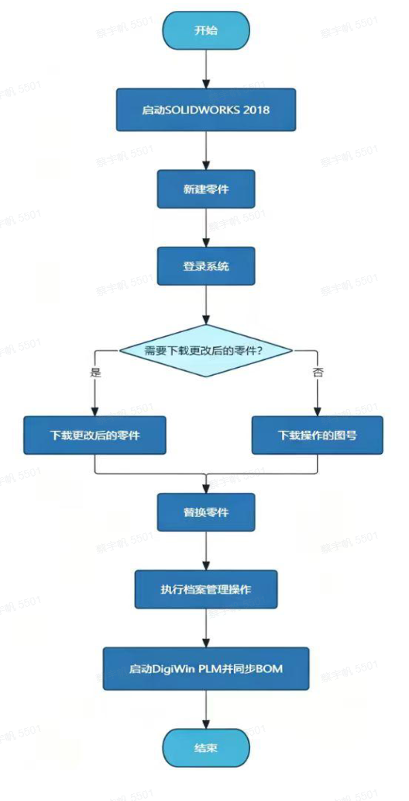
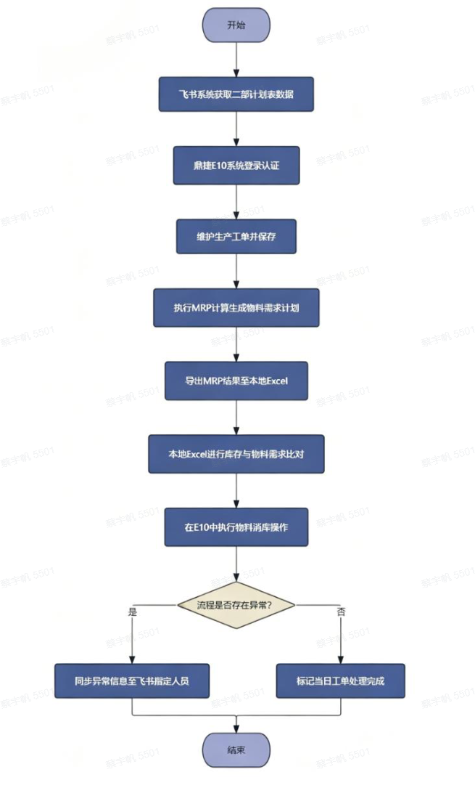

> 该企业数字化负责人：
> “做了这么多年制造业数字化，最大的感受是系统越上越多，人没少干活。数据不打通，最后还是要靠人来来回回搬运。RPA不用动底层系统，部署完就能跑，流程跟原来一样，只是操作的人从我们换成了机器。”

| 衡量指标 | 使用前 | 使用后 |
|-|-|-|
| 技术侧投产数据发放 | 1 名专职人员每日在 3D CAD 和鼎捷 PLM 之间往返操作，固定耗时 6 至 8 小时 | 机器人按固定规则执行，替代每日 4 至 5 小时重复劳动 |
| 生产侧工单与物料核查 | 计划人员在飞书、鼎捷 E10、Excel 三平台间手工完成，每日 2 至 3 小时 | 从取数到回传全链条自动覆盖 |
| 每日工时 | 每日合计约 10 小时+ 人工重复操作 | 每日节省 10+ h 工时 |
| 数据流转差错 | 手工替换易搞错版本或漏掉子部件，抄错是常事 | 数据流转 0 差错、100% 精准 |
| 可追溯性 | 人工操作无记录，出错后要回头重新走一遍流程 | 每次执行结果均记录日志备查 |

> **Agent 自动化需开通企业功能**：点击申请1个月免费权限 [ 点击申请 → ](https://skieer.feishu.cn/share/base/form/shrcnFwMayykP5iaL38fnZKTbrg)

---

## 1.客户信息

某制造企业深耕染整装备领域十余年，核心产品高效平幅水洗机、自动包装机等在细分领域市占率领先，装机量位居行业前列，服务覆盖国内主要印染产业集聚区。

企业具备“整机研发+核心部件自研+智能制造解决方案”一体化能力，拥有上百项专利，客户覆盖申洲国际、互太纺织等头部面料供应商及多个大型印染产业集群，技术与商业价值均获产业高度认可。

---

## 2.业务问题

### 01.业务背景

该公司主营多品种定制化机械产品，其投产准备的业务背景如下：

- 该公司主营多品种定制化机械产品，产品型号繁杂、客户需求多样，生产计划几乎每日动态变化，这意味着每一天正式投产前，车间需要拿到的技术数据包和物料清单都是不同的。
- 技术侧：投产数据发放（图纸与BOM变更）——每天正式投产之前，必须完成当天的图纸替换与工程变更执行，将 PLM 系统中的最新技术数据准确下发至生产端。每款产品的技术数据，在PLM系统中是一个多层级、带引用关系的结构化数据包——总装图挂部件图，部件图挂零件图，各层级关联对应的BOM明细清单，一个通用件变更，几十个系列都要跟着改。车间需要的是这套数据包完整装配后一次性下发，任何层级缺失或版本偏差都会导致生产异常。
- 生产侧：生产工单下达与物料齐套核查（MRP）——技术数据包下发至生产端后，计划部门每日会在飞书群中发出当天的排产计划，——今天要做哪几款产品、各做多少台。计划专员需要把这些信息生成正式工单，再产出一份物料需求清单（MRP），再根据这份清单去跟仓库的实际库存一一比对，看哪些料够、哪些料缺。整个流程涉及飞书取计划、鼎捷E10建工单与跑MRP、Excel对库存、鼎捷E10锁物料、飞书回传结果，五个环节分布在三个平台之间，全部由计划人员手工完成，动作顺序严格、不可颠倒，且对准确性要求极高。

### 02.流程与问题

两个环节一前一后，环环相扣。准确装配的BOM，为MRP运算的提供准确的计算依据，技术侧的数据包装配完整，生产侧才能基于此展开物料需求计算。两段流程共同构成生产启动前的完整准备链条，核心痛点集中在三个方面：

#### 手工操作，选错找不着
一套产品数据层层嵌套，换个零件可能要改好几个关联文件。人工一个个去替换、核对，容易搞错版本或者漏掉子部件。等车间做出来才发现不对，只能报废重来。

#### 来回搬运，抄错是常事
排产计划在飞书里，建工单在ERP系统里，算物料要导到Excel里对库存，对完再回系统里锁料，最后还要回飞书发结果。计划员每天就在三个工具之间来回复制粘贴，极易出错。

#### 前面错一点，后面全乱套
技术侧的BOM是生产侧算物料需求的基础。前头BOM装配有误，生产侧算出来的物料清单就是错的。差错顺着链条一路往下传，改起来要回头重新走一遍流程，浪费操作时间。

| 人工操作流程 | 具体步骤 | 问题 |
|-|-|-|
| 投产数据发放（图纸与BOM变更） | 每天正式投产之前，完成当天的图纸替换与工程变更执行，将 PLM 系统中的最新技术数据准确下发至生产端。目前，这项工作由1名专职人员负责，每日在 3D CAD 和 鼎捷 PLM 之间往返操作，完成当天排产产品的零件装配与BOM同步，固定耗时6至8小时，操作路径深、重复性高。 | 手工操作，选错找不着：人工一个个去替换、核对，容易搞错版本或者漏掉子部件，等车间做出来才发现不对，只能报废重来。 |
| 工单下达 | 计划部门每日会在飞书群中发出当天的排产计划，——今天要做哪几款产品、各做多少台；计划专员把这些信息生成正式工单。 | 来回搬运，抄错是常事：计划员每天在三个工具之间来回复制粘贴，极易出错。 |
| 物料齐套核查（MRP） | 计划专员需要把这些信息生成正式工单，再产出一份物料需求清单（MRP），再根据这份清单去跟仓库的实际库存一一比对，看哪些料够、哪些料缺。比对完成后，将已有库存锁定给这张工单使用，最后把处理结果回传给飞书群。 | 前面错一点，后面全乱套：前头BOM装配有误，生产侧算出来的物料清单就是错的，差错顺着链条一路往下传，改起来要回头重新走一遍流程。 |

### 03.客户需求

- 需对技术侧“投产数据发放”与生产侧“工单下达与物料齐套核查”两个环节进行自动化改造；
- 需保证 BOM 装配与工单、物料数据的准确性与可追溯性，杜绝差错沿链条下传；
- 需在不改动 PLM、ERP、飞书等现有系统的前提下，替代每日的重复性人工操作。

---

## 3.解决方案

针对上述痛点，该制造业公司引入八爪鱼RPA，对技术侧“投产数据发放”与生产侧“工单下达与物料齐套核查”两个环节进行自动化改造。

### 01.概述

[在飞书原文中查看视频：01制造业图纸替换.mp4](https://skieer.feishu.cn/docx/UGtAdgZfyoye9mxjQrNculEOnRh)

|  | 说明 |
|-|-|
| 覆盖平台 | 3D CAD（SOLIDWORKS）、鼎捷 PLM、鼎捷 E10 ERP、飞书群、本地 Excel |
| 覆盖数据 | 排产计划、总装图/部件图/零件图、BOM 明细清单、生产工单、MRP 物料需求清单、库存数据 |
| 覆盖环节 | 图纸自动替换与 BOM 同步 → 数据包下发生产端 → 飞书取排产计划 → ERP 建工单与跑 MRP → Excel 对库存 → 锁定物料 → 结果回传飞书 |
| 运行方式 | 机器人按固定规则逐项执行，操作路径统一、步骤完整可追溯，每次执行结果均记录日志备查；异常信息同步至飞书指定人员 |

**技术侧：投产数据发放自动化（图纸自动替换）**

针对技术侧人工装配易出错、无校验的问题，设计RPA流程如下：RPA自动登录PLM系统，根据当日排产计划逐条读取待处理产品清单，进入3D CAD软件打开对应总装图，按照预设规则完成零件的自动查找、装配与替换操作，随后触发BOM初始化与同步，将更新后的技术数据包下发至生产端。应用价值：整个流程由机器人按照固定规则逐项执行，操作路径统一、步骤完整可追溯，且每次执行结果均记录日志备查，替代人工每日4至5小时的重复性劳动。

[在飞书原文中查看视频：02制造业生产工单下达.mp4](https://skieer.feishu.cn/docx/UGtAdgZfyoye9mxjQrNculEOnRh)

**生产侧：工单下达与物料齐套核查自动化（工单生成）**

针对生产侧跨平台手工搬运、易疲劳且无复核的问题，设计RPA流程如下：RPA自动读取飞书群中的排产计划，登录ERP系统逐条创建工单并触发MRP运算，将生成的物料需求清单导出至Excel，再打开库存表进行逐项比对，识别缺口后回传ERP完成库存锁定，最后将处理结果（工单号、齐套状态、缺口明细）自动发送至飞书群。应用价值：整个流程从飞书取数到结果回传全链条覆盖，执行过程自动记录每一步的操作结果与异常信息，便于事后追溯，替代人工每日2至3小时的跨系统重复操作，每日节省10h+工时。

### 02.方案优势

- **全流程规则化执行，替代重复劳动**：RPA 按固定规则逐项执行，操作路径统一、步骤完整可追溯，替代技术侧每日 4 至 5 小时、生产侧每日 2 至 3 小时的重复性劳动。
- **跨三平台自动流转**：飞书取计划、鼎捷 E10 建工单与跑 MRP、Excel 对库存、鼎捷 E10 锁物料、飞书回传结果，五个环节全部由机器人完成，动作顺序严格不颠倒。
- **异常留痕，可追溯**：执行过程自动记录每一步的操作结果与异常信息，异常同步至飞书指定人员，便于事后追溯，不静默丢数。
- **不动底层系统，部署即跑**：RPA 不用动底层系统，部署完就能跑，流程跟原来一样，只是操作的人从人换成了机器。

### 03.涉及解决方案

**生产制造 ｜ 投产准备自动化（图纸变更到工单下达）**

> 把技术侧「图纸自动替换 + BOM 同步」与生产侧「工单下达 + 物料齐套核查」连成一条自动链路，输出当日投产数据包与工单齐套台账。方案链接：[生产制造 ｜ 投产准备自动化（图纸变更到工单下达）](https://skieer.feishu.cn/wiki/IMzcwFMCFiVF5bkpDN0cRSTwnad)

---

## 4.落地效果

| 衡量指标 | 使用前 | 使用后 |
|-|-|-|
| 技术侧投产数据发放 | 1 名专职人员每日在 3D CAD 和鼎捷 PLM 之间往返操作，固定耗时 6 至 8 小时 | 机器人按固定规则执行，替代每日 4 至 5 小时重复劳动 |
| 生产侧工单与物料核查 | 计划人员在飞书、鼎捷 E10、Excel 三平台间手工完成，每日 2 至 3 小时 | 从取数到回传全链条自动覆盖 |
| 每日工时 | 每日合计约 10 小时+ 人工重复操作 | 每日节省 10+ h 工时 |
| 数据流转差错 | 手工替换易搞错版本或漏掉子部件，抄错是常事 | 数据流转 0 差错、100% 精准 |
| 可追溯性 | 人工操作无记录，出错后要回头重新走一遍流程 | 每次执行结果均记录日志备查 |

**每日节省 10＋h 工时**

技术侧由机器人按固定规则执行图纸替换与 BOM 同步，替代人工每日4至5小时的重复性劳动；生产侧从飞书取数到结果回传全链条自动覆盖，替代人工每日2至3小时的跨系统重复操作，每日节省10h+工时。

**数据流转 0 差错**

机器人按照预设规则完成零件的自动查找、装配与替换操作，操作路径统一、步骤完整可追溯，每步执行结果均记录日志备查；准确装配的BOM为MRP运算提供准确的计算依据，差错不再顺着链条往下传。

**数据流转 100% 精准**

技术侧数据包装配完整下发，生产侧基于准确的 BOM 展开物料需求计算，锁定库存与缺口明细自动回传飞书群，全程无需人工复核。

**改造前 vs 改造后**

改造前：手工操作选错找不着，一套产品数据层层嵌套，换个零件可能要改好几个关联文件，人工一个个去替换、核对，容易搞错版本或者漏掉子部件，等车间做出来才发现不对，只能报废重来；来回搬运抄错是常事，计划员每天在三个工具之间来回复制粘贴，极易出错；前面错一点后面全乱套，前头BOM装配有误，生产侧算出来的物料清单就是错的，差错顺着链条一路往下传，改起来要回头重新走一遍流程，浪费操作时间。

改造后：技术侧 RPA 自动登录 PLM 系统完成零件查找、装配、替换与 BOM 同步，数据包完整下发生产端；生产侧 RPA 自动读取飞书排产计划、建工单、跑 MRP、比对库存、锁料并回传结果；全流程由机器人按照固定规则逐项执行，操作路径统一、步骤完整可追溯，数据流转 0 差错。

---

原文：[在飞书查看本案例](https://skieer.feishu.cn/docx/UGtAdgZfyoye9mxjQrNculEOnRh)。
