> 临湘创博创始人余总：
> “以前员工每天熬夜手动导订单、查渠道、核数据，又累又容易出错，生怕一点失误就丢了分销权限。现在有了八爪鱼 RPA，所有杂活都自动跑完，不用熬夜、不用核对，我终于能专心拓展业务，创业也更有底气了”

| 衡量指标 | 使用前 | 使用后 |
|-|-|-|
| SKU 处理及仓库渠道匹配准确性 | 依赖人工，SKU 格式错误、渠道选错频发 | 提升至 100% |
| 订单履约全流程处理效率 | 单条订单人工处理 3-5 分钟 | 提升 90%+ |
| 单批次订单处理时间 | 全天人工处理 | 缩短至 1 小时 |
| 发货时效 | 订单高峰熬夜也处理不完，发货延迟成常态 | 彻底杜绝发货延迟 |
| 人工投入 | 单人熬夜手动导订单、查渠道、核数据 | 全流程无人值守 |

> **Agent 自动化需开通企业功能**：点击申请1个月免费权限 [ 点击申请 → ](https://skieer.feishu.cn/share/base/form/shrcnFwMayykP5iaL38fnZKTbrg)

---

## 1.客户信息

临湘创博是小余一个人的公司，作为轻资产创业的代表，他选择了无货源跨境电商分销，没有团队、仓库，办公场地就是家里的小角落。店铺经营 Temu 平台的无货源分销，借助店小秘管理订单，通过万邑链货盘平台完成选品与履约。

---

## 2.业务问题

### 01.业务背景

临湘创博是一家典型的轻资产单人创业公司，其业务背景如下：

- 余总一人身兼老板、运营、客服、履约专员数职，白天对接货源、优化店铺，晚上熬夜处理店小秘和万邑链的订单操作——导出订单、筛选SKU、查询仓库渠道，常常忙到后半夜。
- 订单数据处理完全依赖人工，信息处理效率低且操作易出错，是临湘创博希望解决的核心问题。
- 店铺经营 Temu 平台，订单履约链路横跨店小秘、万邑链货盘平台与本地 Excel 表格三套工具，任何一环出错都会直接影响发货时效、店铺评分与分销权限。

### 02.流程与问题

无货源分销远非 “接单→转发” 那么简单，核心履约闭环需在店小秘与万邑链、EXCEL间反复切换，流程繁琐且耗时间、易出错，具体可简化为：

#### 多平台切换繁琐
反复在店小秘、万邑链、Excel间切换，登录、录入繁琐耗时。

#### 人工效率太低
单条订单处理需3-5分钟，订单高峰时熬夜也赶不上进度，发货延迟成常态。

#### 人工操作易出错
容易SKU格式错误、仓库渠道选错，订单无法导入、产生额外运费等等。

| 人工操作流程 | 具体步骤 | 问题 |
|-|-|-|
| 导出订单信息 | 从店小秘导出Temu待审核订单，完成地址解密与SKU筛选； | 人工效率太低：单条订单处理需3-5分钟，订单高峰时熬夜也赶不上进度。 |
| 表格清洗 | 手动清洗数据、格式化字段，适配万邑链发货模板； | 人工操作易出错：容易SKU格式错误，订单无法导入。 |
| 登录货盘平台 | 登录万邑链查询SKU仓库/渠道，手动记录复用； | 多平台切换繁琐：反复在店小秘、万邑链、Excel间切换，登录、录入繁琐耗时。 |
| 导入订单 | 导入订单至万邑链、对比运费选最优方案，确保合规发货； | 人工操作易出错：容易仓库渠道选错，产生额外运费。 |
| 回传追踪号 | 回店小秘审核订单，手动回传追踪号，完成履约。 | 人工效率太低：发货延迟成常态。 |

### 03.客户需求

- 需实现从订单导出到 SKU 数据清洗、仓库渠道匹配、订单上传及追踪号回传的全流程自动化；
- 需减少人工重复操作，降低 SKU 格式错误、渠道选错等人工失误带来的返工成本与经营风险；
- 需提升订单履约的及时性和准确性，守住 Temu 店铺评分，减少客户流失。

---

## 3.解决方案

在引入八爪鱼后，借助 RPA（机器人流程自动化）技术，自动完成从店小秘导出订单、清洗格式SKU信息、登录万邑链查询匹配仓库物流渠道、比价选择最优物流、最后上传订单到店小秘批量审核及追踪号回传的全流程，无需人工参与。

### 01.概述

[观看原视频：20260415-094710.mp4](https://skieer.feishu.cn/file/F5PLbqEWfosYi0xbNDict8b3n0f)

|  | 说明 |
|-|-|
| 覆盖平台 | 店小秘（Temu 店铺订单管理）与万邑链货盘平台，衔接本地 Excel 数据处理 |
| 覆盖数据 | Temu 待审核订单、SKU 仓库/渠道信息、运费报价、VAT、追踪号 |
| 覆盖环节 | 订单导出 → SKU 数据清洗 → 仓库渠道查询匹配 → 运费比价 → 订单上传 → 审核与追踪号回传 |
| 运行方式 | 机器人全程无人值守自动运行；自动缓存已查询的 SKU 仓库渠道数据，重复 SKU 无需反复登录万邑链查询 |

机器人启动后，先导出店小秘订单并处理数据，接着读取本地缓存，若缓存存在则调用仓库/渠道信息，若不存在则查询万邑链并缓存信息。之后上传订单至万邑链，进行运费比价与VAT添加，再由店小秘审核订单，最后追踪号自动回传，流程结束。

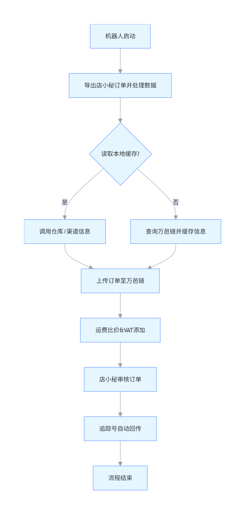

**流程一：订单数据上传至货盘**

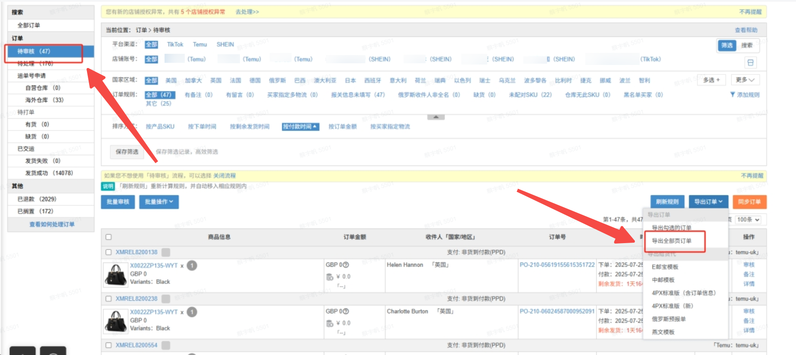

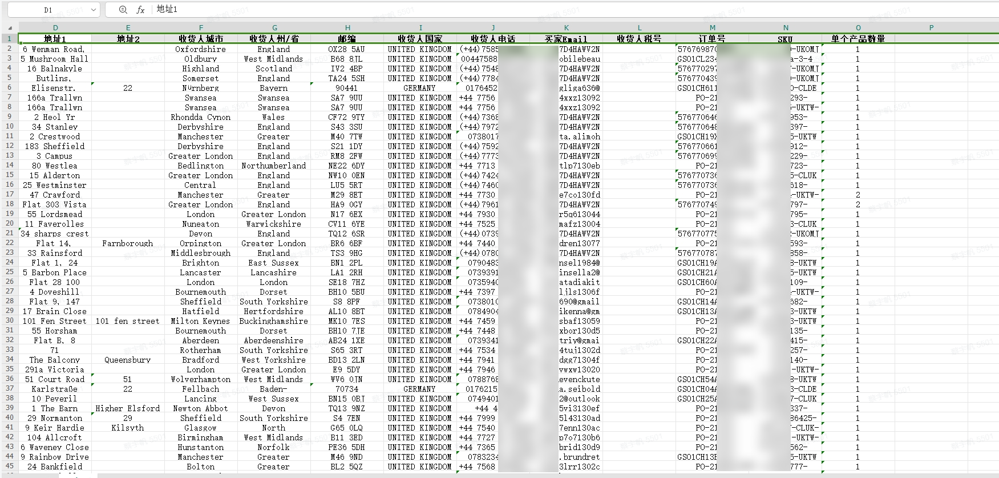

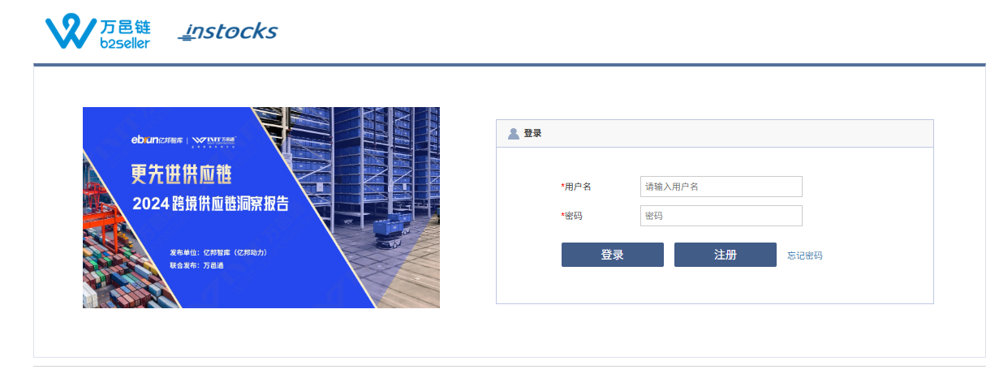

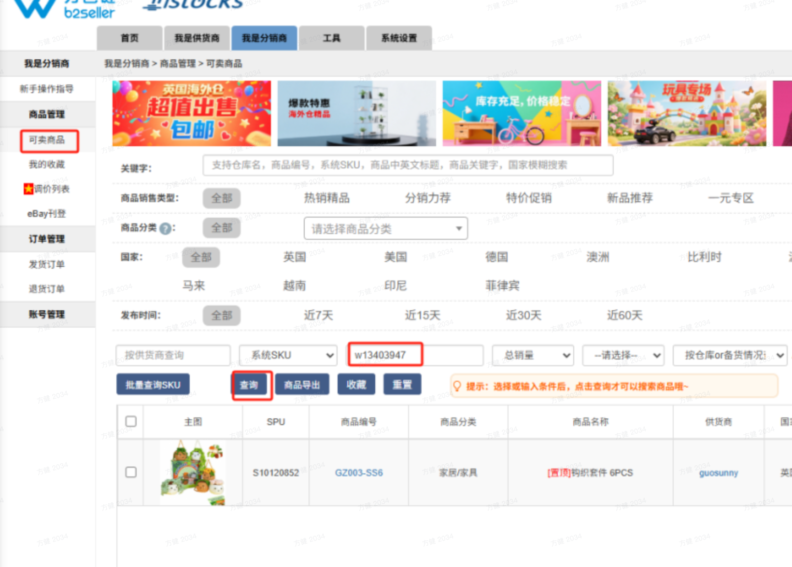

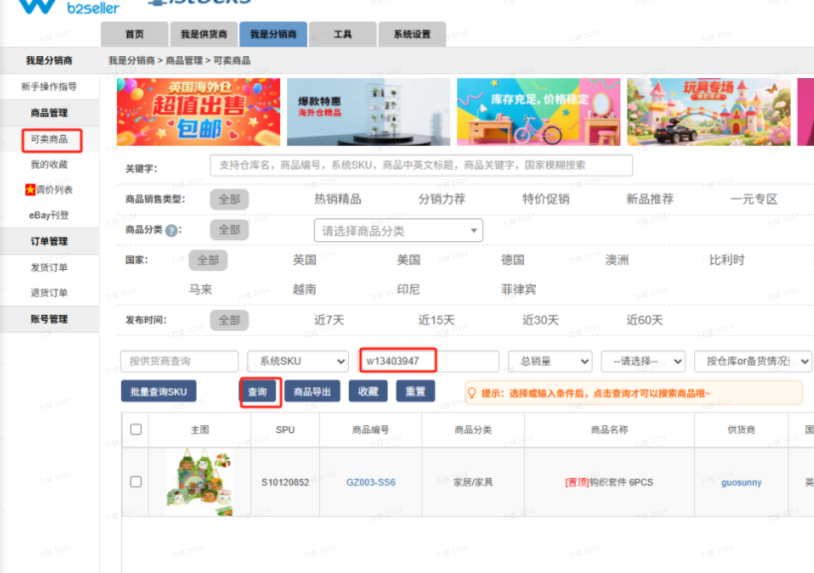

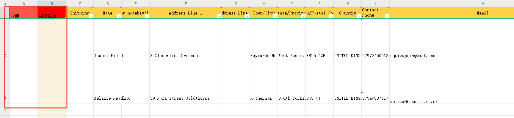

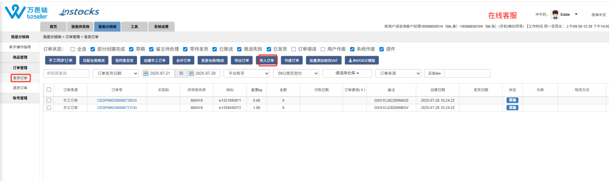

**流程二：追踪号回传至店小秘**

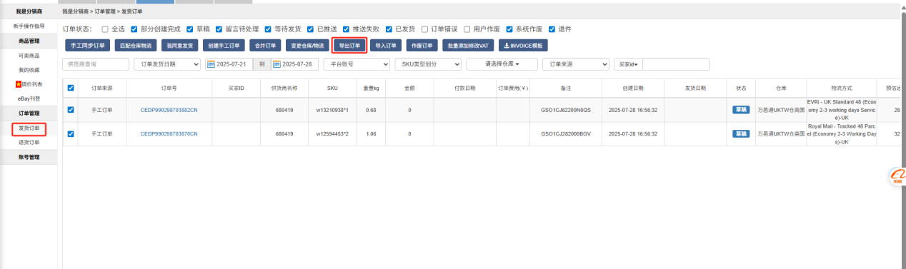

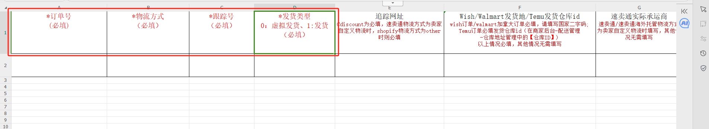

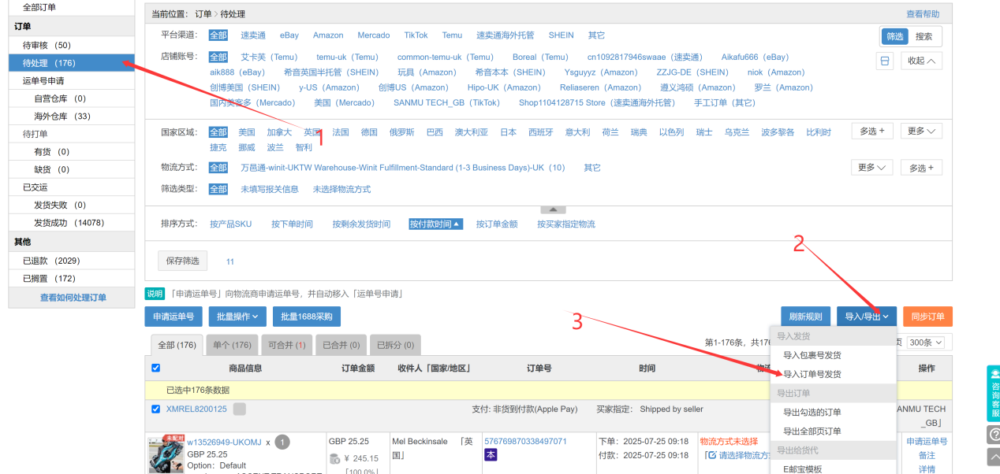

### 02.方案优势

- **全流程自动化，告别熬夜处理订单**：从店小秘订单导出、数据清洗，到万邑链仓库渠道查询、订单上传，再到店小秘审核与追踪号回传，全程无人值守自动完成，彻底摆脱人工手动操作的束缚，无需熬夜处理订单。
- **数据精准无错，低成本创业零风险**：SKU 格式标准化处理、仓库渠道智能匹配、运费比价选最优、VAT 自动添加，全流程严格按规则执行，无人工失误，让单人创业无惧数据错误，守住店铺合规与利润。
- **运费智能比价，守住利润空间**：导入订单至万邑链后自动对比各仓库/渠道运费并选择最优方案，确保合规发货，避免人工选错渠道产生额外运费支出。
- **本地缓存复用，效率大幅提升**：自动缓存已查询的 SKU 仓库渠道数据，重复 SKU 无需反复登录万邑链查询，节省大量重复操作时间，单人也能轻松应对订单量增长，助力业务快速扩张。

### 03.涉及解决方案

**仓储物流 ｜ Temu订单有序发货与预警 Agent 自动化**

> 定时导出 Temu 平台订单明细，按站点生成发货单并跟踪 48h 发货时效倒计时，智能体按截止时间排序发货顺序、标记超时风险单与异常单。方案链接：[仓储物流 ｜ Temu订单有序发货与预警 Agent 自动化](https://skieer.feishu.cn/wiki/FiFqwhu8BihFi9kf4q2cWcVBnrc)

**仓储物流 ｜ 亚马逊订单处理与多渠道同步**

> 自动读取领星/ERP 订单数据，输出异常订单识别、多渠道去重校验与发货时效预警的衔接层分析，把订单数据与多渠道同步打通。方案链接：[仓储物流 ｜ 亚马逊订单处理与多渠道同步](https://skieer.feishu.cn/wiki/JkWawcRapiSdTlk0emFcAv8vnLb)

**仓储物流 ｜ 速卖通订单导出与打单 Agent 自动化**

> 定时导出多店铺订单并按大单/小单/物流线路自动分流，智能体做重复、缺货、地址异常识别与漏单告警。方案链接：[仓储物流 ｜ 速卖通订单导出与打单 Agent 自动化](https://skieer.feishu.cn/wiki/PGLYwNHYpi1o78kcTE3cnbxXnTb)

---

## 4.落地效果

| 衡量指标 | 使用前 | 使用后 |
|-|-|-|
| SKU 处理及仓库渠道匹配准确性 | 依赖人工，SKU 格式错误、渠道选错频发 | 提升至 100% |
| 订单履约全流程处理效率 | 单条订单人工处理 3-5 分钟 | 提升 90%+ |
| 单批次订单处理时间 | 全天人工处理 | 缩短至 1 小时 |
| 发货时效 | 订单高峰熬夜也处理不完，发货延迟成常态 | 彻底杜绝发货延迟 |
| 人工投入 | 单人熬夜手动导订单、查渠道、核数据 | 全流程无人值守 |

**SKU 处理及仓库渠道匹配准确性提升至 100%**

SKU 处理及仓库渠道匹配准确性提升至 100%，避免人工操作中因 SKU 格式错误、渠道选错、VAT 遗漏等导致的订单导入失败、额外运费支出等问题，大幅降低单人创业的返工成本与经营风险。

**订单履约全流程处理效率提升 90%+**

订单履约全流程处理效率提升 90%+，单批次订单处理时间从全天缩短至 1 小时，无需额外投入人力，即可轻松应对订单量增长，确保发货时效，守住 Temu 店铺评分，减少客户流失。

**改造前 vs 改造后**

改造前：订单数据手动处理效率低，手动导出店小秘订单、筛选SKU、格式化字段，单条订单耗时3-5分钟，订单高峰熬夜也处理不完，发货延迟频发；人工操作易出错、风险高，手动处理SKU格式、匹配仓库渠道，易出现截错SKU、选错渠道等问题，还可能遗漏VAT，对无兜底的单人创业来说，失误成本极高；多工具切换繁琐耗力，手动在店小秘、万邑链、本地Excel间反复切换，登录、退出、录入频繁，耗时费力还易忙中出错，打乱运营节奏。

改造后：订单数据自动批量处理，机器人自动导出订单、筛选SKU、格式化字段，批量完成数据清洗，彻底杜绝发货延迟；全流程零人工失误，机器人按预设规则精准处理每一步操作，SKU格式、仓库渠道匹配、VAT添加零差错，自动记录全量信息，规避失误风险；打通订单-发货全流程，机器人按设定频率自动运行，从订单导出到追踪号回传全链路自动完成。

---

原文：[在飞书查看本案例](https://skieer.feishu.cn/docx/Oz10djVHMoUOqaxMuK7cxAp2n0e)。
