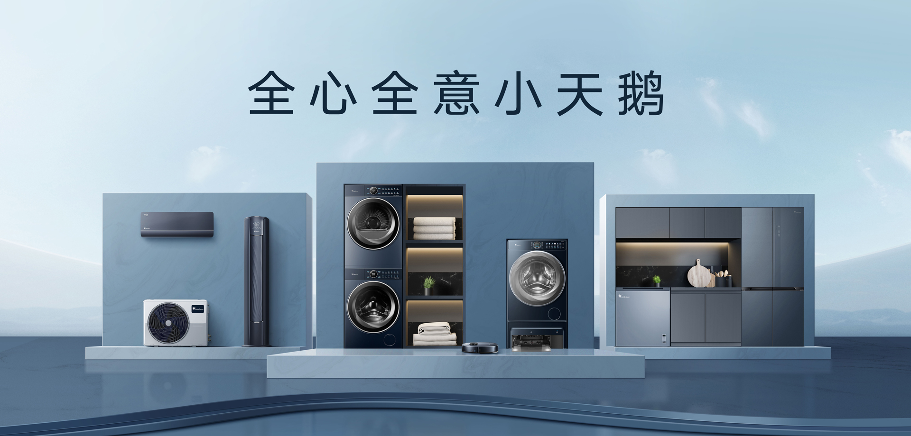

> 美的集团小天鹅事业部供应链数字化负责人：
> 八爪鱼RPA不仅解决了我们多平台数据采集的效率问题，更让供应链团队从’搬数据’的体力活中解放出来，真正把精力放在数据分析和业务决策上。

| 衡量指标 | 使用前 | 使用后 |
|-|-|-|
| 平台数据范围 | — | 增加至 7 个 |
| 日处理报表量 | — | 增加至 86 张 |
| 数据时效 | T+2 | T+1（部分T+0） |
| 数据错误率 | 约 3% | 降低至 0.01% |
| 人工耗时 | 7小时/天 | 0（全自动） |
| 工作效率耗时 | — | 接近 0 人工 |
| 年人力成本 | — | 降低50万元 |

> **Agent 自动化需开通企业功能**：点击申请1个月免费权限 [ 点击申请 → ](https://skieer.feishu.cn/share/base/form/shrcnFwMayykP5iaL38fnZKTbrg)

---

## 1.客户信息

小天鹅股份有限公司始建于1958年，1978年诞生中国第一台全自动洗衣机，是国内洗衣机行业先驱。2018年并入美的集团，成为美的洗衣机事业部主体。公司同时具备全自动波轮、滚筒、搅拌式洗衣机的制造能力，拥有国家级企业技术中心和实验室，在洗涤技术领域持有数千项专利。近年来，小天鹅以"智能化、数字化、国际化"为战略方向，持续推进供应链数字化升级。

作为美的集团旗下核心事业部，小天鹅是国内历史悠久的洗衣机品牌。面对7个电商平台、16个账号、每日86张报表的人工采集压力，小天鹅与八爪鱼RPA深度合作，成功构建跨平台库存数字化体系。

借助八爪鱼RPA机器人替代人工完成7大系统、25类报表的自动采集入库。数据时效提升至T+1，年省成本50万，错误率降至0.1%，实现供应链数据底座升级。

---

## 2.业务问题

### 01.业务背景

小天鹅主营洗衣机等家电品类，需每日汇总 7 个系统、16 个账号的库存与报表数据以支撑供应链决策。业务背景如下

- 小天鹅始建 1958 年，1978 年诞生中国第一台全自动洗衣机，2018 年并入美的集团，成为美的洗衣机事业部主体。
- 公司具备全自动波轮、滚筒、搅拌式洗衣机制造能力，以「智能化、数字化、国际化」为战略方向推进供应链数字化升级。
- 库存、订单、采购等数据分散在沧海系统、菜鸟 ASCP/SCP、京东 VC 等 7 个系统、16 个账号中，每日需处理 86 张报表。

### 02.流程与问题

#### 平台账号多
7个电商平台、16个账号的库存数据需人工逐个登录导出，每天处理86张报表耗时7小时，数据滞后且易出错

#### 风控差异大
天猫风控严格、苏宁数据T-1更新、京东沧海分权管理，各平台特性差异导致统一采集方案难以落地

#### 数据难整合
数据散落在各平台Excel中，格式不统一，跨系统整合困难，影响供应链决策效率

| 人工操作流程 | 具体步骤 | 问题 |
|-|-|-|
| 多平台库存数据采集 | 人工逐个登录 7 个系统、16 个账号导报表，每天处理 86 张报表耗时 7 小时 | 数据滞后且易出错，人力被重复导出工作占满 |
| 跨平台风控适配 | 天猫风控严格、苏宁数据 T-1 更新、京东沧海分权管理 | 各平台特性差异导致统一采集方案难以落地 |
| 数据整合与对账 | 数据散落在各平台 Excel 中，格式不统一，人工拼表 | 跨系统整合困难，影响供应链决策效率 |

### 03.客户需求

- 7 个系统、16 个账号的库存与报表数据自动采集，按各平台风控与更新节奏定时抓取。
- 25 类报表自动下载、清洗去重后统一入库，数据时效提升至 T+1（部分 T+0）。
- 降低人工投入与数据错误率，为供应链决策提供及时、准确的数据支撑。

---

## 3.解决方案

在引入八爪鱼 RPA 后，上述人工环节由机器人自动完成，无需人工参与。

### 01.概述

|  | 说明 |
|-|-|
| 覆盖平台 | 沧海系统、菜鸟ASCP/SCP、京东VC等7个系统，16个账号 |
| 覆盖报表 | 订单、库存、采购等25类，日均86张 |
| 覆盖团队 | 供应链、数据运营、电商运营、IT/信息化、财务、采购、物流等多部门 |
| 未来规划 | 小天鹅计划将RPA应用从库存数据采集延伸至更多供应链场景，结合AI能力实现库存预测、智能补货、异常预警，推动供应链从"数据采集自动化"向"决策智能化"演进。 |

针对上述人工流程，八爪鱼 RPA 自动登录 7 个系统，按预设路径抓取 25 类报表，数据自动清洗入库，替代全流程手工操作。

- 八爪鱼RPA自动登录7个系统，按预设路径抓取25类报表，数据自动清洗入库，替代全流程手工操作跨平台库存数据自动化采集
- 不同平台定制采集策略——天猫用指纹浏览器模拟真人操作，苏宁每2小时定时抓取，京东按事业部隔离账号多平台风控适配与定时采集
- RPA自动清洗Excel数据，以"平台+单据号+时间戳"为唯一标识去重，写入中央数据库并定时清理历史数据数据智能清洗与中央入库

**全渠道库存数据一键采集，告别"人海战术"**

八爪鱼RPA替代了全部人工采集工作。7个平台、16个账号、25类报表——过去需要专员每天花7小时逐个登录导出的工作，现在由RPA自动完成，全程零人工干预。数据时效从T+2提升至T+1，部分平台已实现T+0实时获取，供应链团队每天一上班就能看到最新数据，而不是等专员导完表格再拼接。

**多平台风控从容应对，采集稳定不中断**

各电商平台风控规则各异，是过去人工采集中最头疼的问题。八爪鱼RPA针对不同平台特性定制采集策略——天猫账号稳定运行不触发封禁，苏宁数据每次更新后第一时间获取，京东各事业部数据互不干扰。16个账号全部稳定运行，数据采集不再中断，供应链决策始终基于最新、最全的数据。

**数据自动整合入库，供应链决策"所见即所得"**

过去采回来的数据散落在十几个Excel文件中，格式不统一、手动拼接耗时易错。八爪鱼RPA自动完成数据清洗、格式统一、去重入库，彻底打通跨平台数据孤岛。库存周转分析、安全库存预警、补货决策——这些业务直接在中央数据库查询，响应速度显著提升。数据错误率从人工操作的3%降至0.1%，不再需要人工核对和返工。

**团队转型：从"搬数据"到"用数据"**

RPA上线后，原先2名全职数据专员的"搬数据"工作被完全替代，年节省人力成本50万元。2名专员转岗至数据分析岗，从"导数据、拼表格"的重复劳动中解放出来，开始承担库存分析、周转率优化、滞销品预警等高价值工作。

项目的成功运行在事业部内部形成示范效应，供应链团队开始主动梳理其他可自动化场景——物流对账、库存盘点、采购订单追踪，逐步向"全流程数字化"推进。八爪鱼RPA的低门槛可视化操作让业务人员也能参与流程设计，真正实现"IT搭台、业务唱戏"的数字化协作。

### 02.方案优势

1. **7 系统 16 账号一键采集**：全渠道库存数据自动采集，供应链团队告别「人海战术」。
2. **多平台风控从容应对**：天猫用指纹浏览器模拟真人操作，苏宁每 2 小时定时抓取，京东按事业部隔离账号，采集稳定不中断。
3. **数据自动整合入库**：RPA 自动清洗 Excel 数据，以「平台+单据号+时间戳」为唯一标识去重，写入中央数据库并定时清理历史数据。
4. **团队转型**：供应链团队从「搬数据」转向数据分析与业务决策，把精力放在更有价值的环节。

### 03.涉及解决方案

**店铺运营 ｜ 多平台库存数据健康预警系统Agent自动化（国内平台）**

> 多平台库存数据自动采集、按各平台风控与更新节奏定时抓取、清洗去重入库，输出 T+1（部分 T+0）可用的统一库存数据。方案链接：[店铺运营 ｜ 多平台库存数据健康预警系统Agent自动化（国内平台）](https://skieer.feishu.cn/wiki/Jj6LwqhbtiZknnkCVAGcH4xCnXg)

**财务对账 ｜ 电商业财一体化 BI 看板 Agent 自动化**

> 多平台多系统数据自动获取并做共同指标匹配与清洗整合，输出业财一体化 BI 看板与经营指标日报。方案链接：[财务对账 ｜ 电商业财一体化 BI 看板 Agent 自动化](https://skieer.feishu.cn/wiki/NcVBwmzAziBpoqkxlNIcrGz2nRh)

---

## 4.落地效果

| 衡量指标 | 使用前 | 使用后 |
|-|-|-|
| 平台数据范围 | — | 增加至 7 个 |
| 日处理报表量 | — | 增加至 86 张 |
| 数据时效 | T+2 | T+1（部分T+0） |
| 数据错误率 | 约 3% | 降低至 0.01% |
| 人工耗时 | 7小时/天 | 0（全自动） |
| 工作效率耗时 | — | 接近 0 人工 |
| 年人力成本 | — | 降低50万元 |

---

原文：[查看原文](https://skieer.feishu.cn/docx/B3UMdgSr9o7zKBxq3aUcd4AGn3f)
