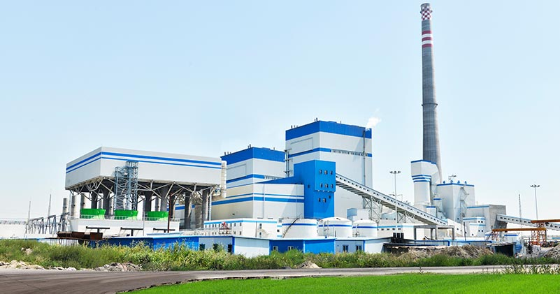
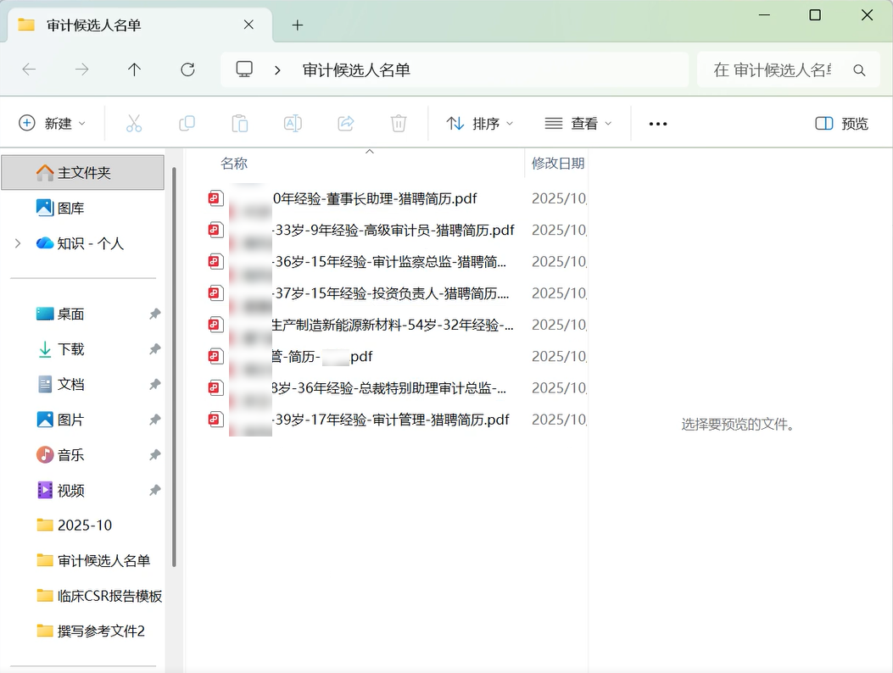
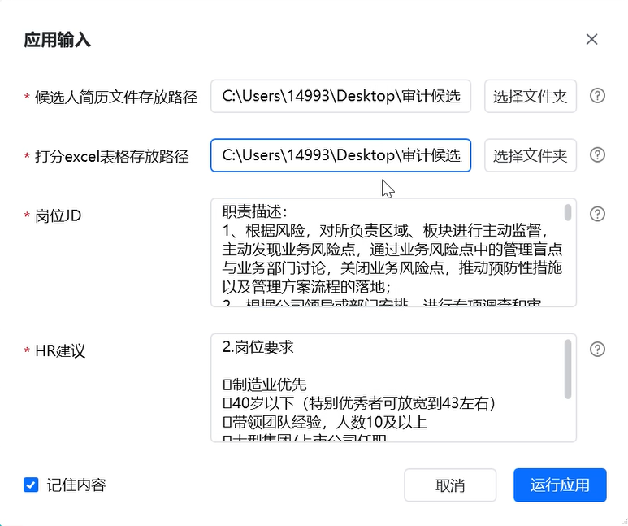
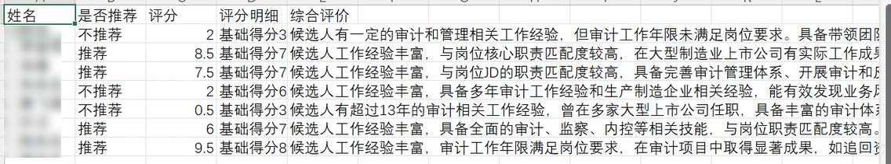

> 该企业 HR 业务人员跟我们说：
> “过去每天耗费近4小时埋头在几百份简历里找信息，头晕眼花还怕看漏。现在AI自动打分排序，我们能快速锁定目标人选，不仅效率翻了倍，招聘质量也更稳了。”

| 衡量指标 | 使用前 | 使用后 |
|-|-|-|
| 简历初筛与信息提取准确率 | 人工审阅易出现信息遗漏、误读及录入偏差 | 98% 以上 |
| 重复性工作量 | 人工收集、下载与信息录入占用大量时间 | 下降 85% 以上 |
| HR 每日投入 | 近 4 小时/天埋在几百份简历里找信息 | AI 自动打分排序，快速锁定目标人选 |
| 单 HR 简历处理量 | 招聘旺季 500\~1000 份/月，逐份人工处理 | 7×24 小时自动批量处理 |
| 筛选标准 | 依赖个人经验，评判尺度波动 | 规则与模型统一打分 |
| 数据资产 | 简历散落在邮箱、平台与本地文件夹 | 首次系统化沉淀 全渠道人才数据库 |

> **Agent 自动化需开通企业功能**：点击申请1个月免费权限 [ 点击申请 → ](https://skieer.feishu.cn/share/base/form/shrcnFwMayykP5iaL38fnZKTbrg)

---

## 1.客户信息

某大型制造业上市公司，主营业务涵盖基础材料与高端制品的研发与生产。公司拥有完整的产业链布局和规模化生产基地，员工总数约万人，产品广泛应用于新能源、电子、化工等多个领域，是国内工业材料领域的重要企业之一。

作为一家持续发展的大型制造业企业，其核心人力资源业务之一即是开展大规模招聘，以保障生产与研发等环节的人才供给。在招聘旺季，每位HR专员平均每月需处理高达500\~1000份简历，简历来源渠道多样，包括公司官网、主流招聘平台、企业内部推荐及公共邮箱等。海量的简历投递导致筛选与初评工作量激增，单纯依赖人工处理效率低下，且极易因疲劳和主观因素出现误判或遗漏优秀人才的情况。

---

## 2.业务问题

### 01.业务背景

该企业员工总数约万人，招聘旺季每位 HR 专员平均每月需处理 500\~1000 份简历，这些简历来源渠道多样，其招聘数字化背景如下：

- 简历规模：招聘旺季每位 HR 每月处理 500\~1000 份，来源多渠道
- 渠道分布：公司官网、主流招聘平台、企业内部推荐、公共邮箱
- 原处理方式：逐份下载、人工精读、手工录入 Excel 并主观打分

### 02.流程与问题

简历初筛链路涉及多渠道、多环节，人工处理在效率、成本与标准一致性上同时承压：

#### 简历处理效率低下
海量简历的收集、筛选与信息录入依赖人工逐份处理，耗时冗长，难以快速响应业务部门的用人需求，错过优质候选人。

#### 人力投入成本高企
HR需重复登录不同渠道，手动下载、阅读并提取简历关键信息，工作单调且强度大，在占用大量人力资源，运营成本高昂。

#### 筛选标准主观性强
人工初筛严重依赖个人经验，难以形成统一标准，易因疲劳或主观偏好导致评判尺度波动，影响人才甄选的公平性与精准度。

| 人工操作流程 | 具体步骤 | 问题 |
|-|-|-|
| 多渠道简历收集与下载 | 每日定时登录公司招聘邮箱、官网后台及各招聘平台，逐一查收新简历，并将 PDF 的简历文件下载到本地指定文件夹 | 重复登录多渠道，逐份下载耗时 |
| 简历初步筛选与分类 | 快速浏览每份简历，根据学历、工作年限等硬性指标进行初步筛选，剔除明显不符合要求的简历，并将剩余简历按应聘岗位进行分类存放 | 逐份浏览，标准依赖经验 |
| 关键信息提取与录入 | 对通过初筛的简历进行精读，人工从每份简历中提取并记录关键信息至 Excel 表，包括：姓名、联系方式、工作经历、项目经验、技能特长、期望薪资等 | 易漏填、误填，录入效率低 |
| 能力评估与初步打分 | 根据提取的信息，结合岗位要求，对候选人的匹配度进行人工判断和初步打分 | 主观性强，尺度难统一 |
| 合格候选人汇总与通知 | 整理当日筛选出的合格候选人名单及简历，通过邮件或内部系统手动发送给对应的业务部门负责人，并安排后续面试事宜 | 流程推进依赖人工跟进，易滞后 |

### 03.客户需求

该制造企业希望改变简历初筛环节依赖人工、效率低下及标准不一的现状，旨在通过智能化技术，实现从简历汇集、信息提取到初步评分的全流程自动化，从而大幅提升招聘效率与人才评估的客观性。

- 简历全自动批量处理：自动登录各渠道批量下载并解析简历，7×24 小时不间断处理
- 关键信息精准录入：自动结构化简历信息并准确填充至数据库或表格，杜绝人为失误
- AI 统一标准初筛：基于预设指标与 AI 模型统一评分排序，筛选结果自动流转通知

---

## 3.解决方案

针对上述痛点，该企业引入八爪鱼 RPA + AI 方案，把“多渠道采集 → 信息结构化 → AI 统一初筛 → 结果自动流转”串成一条全自动链路，HR 只介入需要人工判断的环节。

### 01.概述

|  | 说明 |
|-|-|
| 覆盖渠道 | 公司官网、主流招聘平台、企业内部推荐、公共邮箱等多渠道简历来源 |
| 处理环节 | 简历批量下载 → 关键信息提取 → 智能校验 → 人才库沉淀 → AI 打分排序 → 名单推送 |
| 核心能力 | 多渠道自动登录与下载 / 简历结构化解析与去重 / AI 评分规则可配置 / 结果自动通知招聘负责人 |
| 涉及系统 | 招聘邮箱、招聘平台后台、公司官网后台、内部人才数据库、八爪鱼 RPA |
| 运行节奏 | 7×24 小时实时处理新简历，招聘旺季不间断 |

**全自动筛选，释放人力**

RPA替代人工完成多渠道登录、简历下载及信息提取，让HR专注高价值工作。机器人自动登录公司招聘邮箱、官网后台及各招聘平台，批量下载 PDF 简历文件，实现7x24小时不间断处理。

**多渠道整合，统一人才视图**

自动对接各招聘平台与邮箱，实现简历智能去重与信息整合，生成统一人才库。自动结构化简历信息并准确填充至指定数据库或表格中，杜绝人为操作失误；企业首次系统化沉淀全渠道候选人数据资产，形成统一、规范的人才数据库。

**标准化校验，确保数据准确**

基于预设规则与AI模型统一打分，杜绝主观偏差，确保筛选公平可靠。AI 初筛会先做硬性条件核查，再对工作经历与项目成就做匹配度分析，最后给出评分与推荐结论。

**实时高频处理，抢先锁定人才**

支持7x24小时实时处理新简历，第一时间锁定人选，提升招聘效率。筛选结果自动流转：系统自动将合格简历名单推送给相关招聘负责人，确保流程无缝衔接。

### 02.方案优势

1. **全自动筛选，释放人力**：RPA 替代人工完成多渠道登录、简历下载及信息提取，让 HR 专注高价值工作。
2. **多渠道整合，统一人才视图**：自动对接各招聘平台与邮箱，实现简历智能去重与信息整合，生成统一人才库。
3. **标准化校验，确保数据准确**：基于预设规则与 AI 模型统一打分，杜绝主观偏差，确保筛选公平可靠。
4. **实时高频处理，抢先锁定人才**：支持 7×24 小时实时处理新简历，第一时间锁定人选。
5. **灵活扩展，适配业务增长**：评分规则可根据不同岗位快速调整，无需开发即可适配全岗位招聘场景。

### 03.涉及解决方案

**人力 ｜ AI 自动招聘 Agent 自动化**

> 为招聘场景打造的智能体驱动方案，一句话调度多平台招聘自动化 + 简历 AI 匹配 + 自动记录分析，输出完整招聘分析报告。方案链接：[人力 ｜ AI 自动招聘 Agent 自动化](https://skieer.feishu.cn/wiki/BUw3wTErPiGn03kiYgMc5xCCnvd)

---

## 4.落地效果

| 衡量指标 | 使用前 | 使用后 |
|-|-|-|
| 简历初筛与信息提取准确率 | 人工审阅易出现信息遗漏、误读及录入偏差 | 98% 以上 |
| 重复性工作量 | 人工收集、下载与信息录入占用大量时间 | 下降 85% 以上 |
| HR 每日投入 | 近 4 小时/天埋在几百份简历里找信息 | AI 自动打分排序，快速锁定目标人选 |
| 单 HR 简历处理量 | 招聘旺季 500\~1000 份/月，逐份人工处理 | 7×24 小时自动批量处理 |
| 筛选标准 | 依赖个人经验，评判尺度波动 | 规则与模型统一打分 |
| 数据资产 | 简历散落在邮箱、平台与本地文件夹 | 首次系统化沉淀 全渠道人才数据库 |

**初筛准确率提升至 98% 以上**

简历初筛与信息提取准确率提升至 98% 以上，有效规避人工审阅中易出现的信息遗漏、误读及录入偏差。

**重复性工作量下降超过 85%**

HR 手动进行简历收集、下载与信息录入的重复性工作量下降超过 85%，使其能专注于候选人沟通、面试安排与招聘策略优化等高价值工作。

**沉淀统一人才数据库**

企业首次系统化沉淀全渠道候选人数据资产，形成统一、规范的人才数据库，为后续人才画像分析、招聘效率优化及人才战略规划提供数据支撑。

**改造前 vs 改造后**

改造前：HR 逐日登录邮箱、官网与各招聘平台手动下载简历，逐份浏览做初筛、逐项把关键信息抄进 Excel，再凭经验打分，近 4 小时/天，标准难统一、易漏读。

改造后：机器人 7×24 小时批量下载并结构化解析简历，AI 按统一规则做硬性条件核查与匹配度评分，合格名单自动推送给招聘负责人，准确率 98% 以上、重复性工作量降 85%。

---

原文：[查看原文](https://skieer.feishu.cn/docx/T0uVdnd5QoybXYxCrLWcXoSVnvd)
