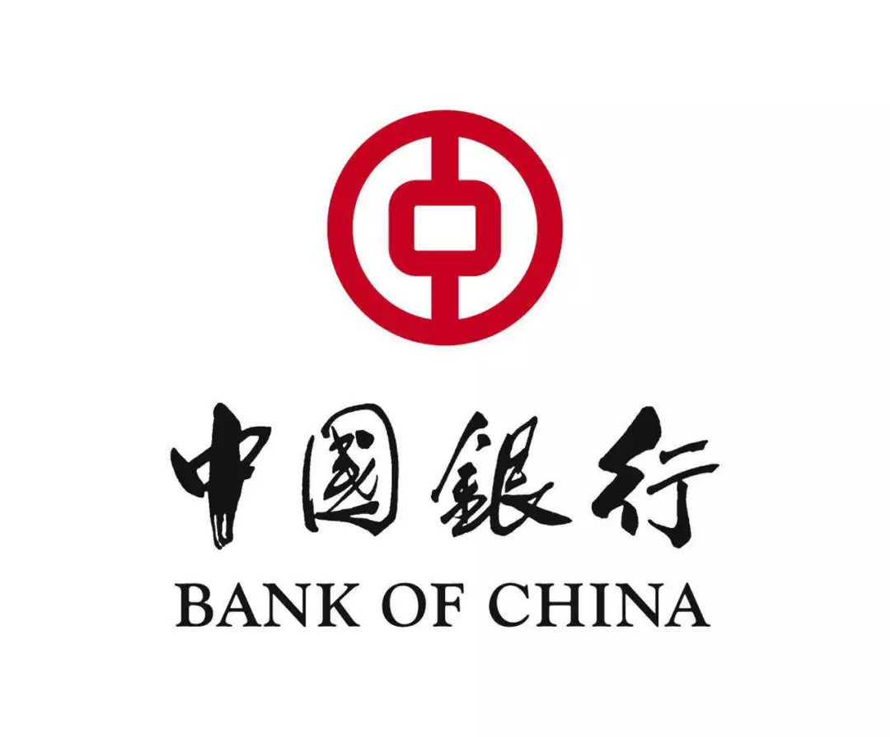
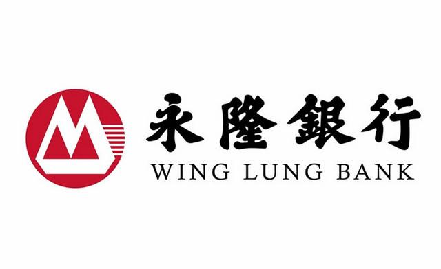
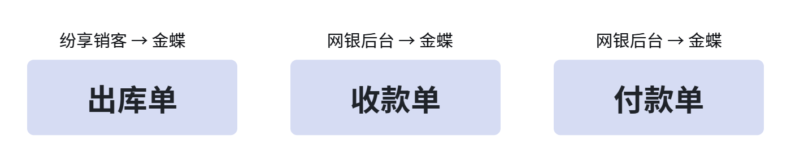
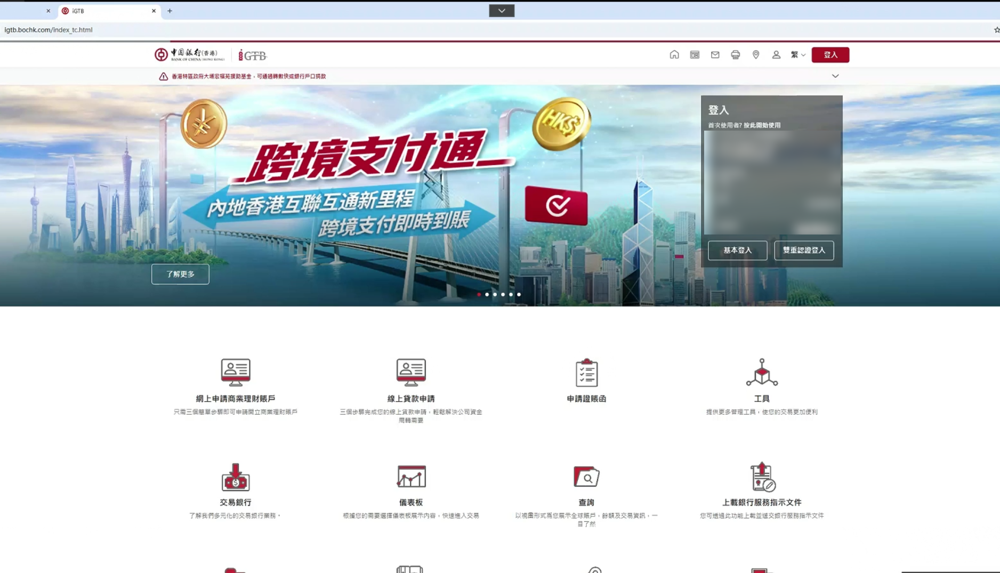
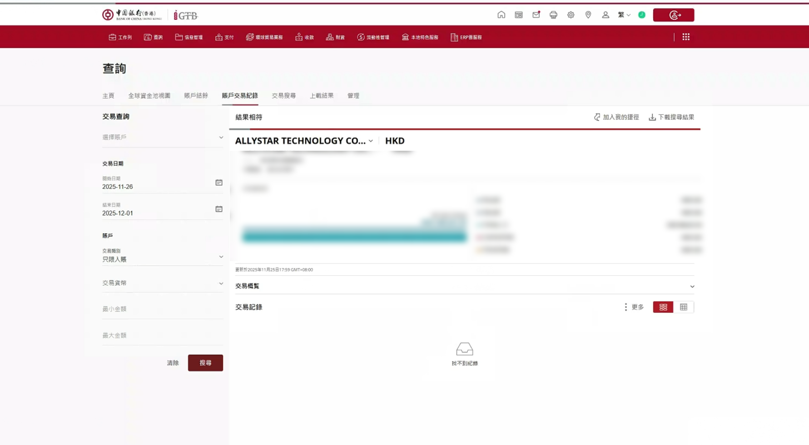
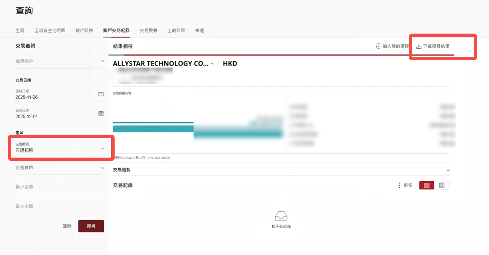
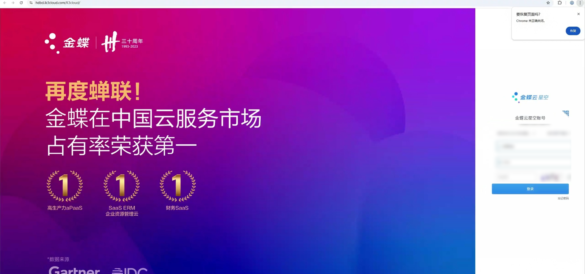
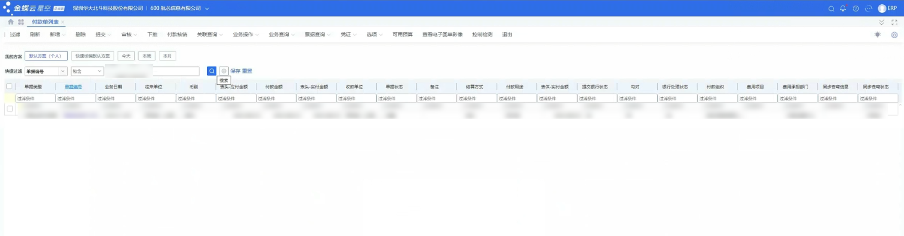
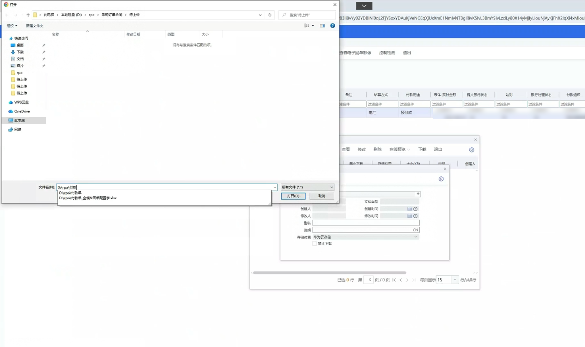

> 该企业财务团队：
> “我们的诉求很简单，就是系统连不上，人要少干活，账要准。RPA把这三个问题都解决了。关键是快，不用等开发排期，也不用动我们的系统，部署完就能跑，跟原来流程也没冲突。”

| 衡量指标 | 使用前 | 使用后 |
|-|-|-|
| 实施周期 | 传统 API 接口开发联调周期长 | 缩短 80%+ |
| 接口开发费用 | 纷享销客与金蝶 ERP 的 API 开发费用高（几十万元） | 零接口开发，节省 30 万+ |
| 数据流转准确性 | 错传、漏传频发，报表反复修正 | 数据流转 100% 精准 |
| 财务日常操作 | 每日数小时手工跨系统操作 | RPA 全程无人工干预 |
| 账务与报表时效 | 月底结算拉长，管理层难以及时获取准确经营数据 | 账实零时差，资金日清月结 |

> **Agent 自动化需开通企业功能**：点击申请1个月免费权限 [ 点击申请 → ](https://skieer.feishu.cn/share/base/form/shrcnFwMayykP5iaL38fnZKTbrg)

---

## 1.客户信息

该企业处于国内导航定位芯片行业第一梯队，核心产品在双频高精度细分领域市占率领先，累计装机量可观。其技术已在智能交通、自动驾驶、低空经济、万物互联等前沿场景实现规模化商用，尤其在共享单车高精度定位领域具有绝对统治力。

企业构建了“芯片+模组+方案”的垂直整合能力，并引入汽车行业头部主机厂及全球级供应商作为战略股东，技术与商业价值均获产业资本高度认可。

---

## 2.业务问题

### 01.业务背景

该企业是一家导航定位芯片行业第一梯队的高科技制造企业，其业财数字化背景如下：

- 随着业务井喷，企业面临前端敏捷销售（纷享销客）与后端严谨财务（金蝶云星空）的系统性割裂。
- 在信创产业与半导体行业高合规要求的背景下，数据流转的及时性、准确性、可追溯性面临严峻考验。
- 纷享销客与金蝶ERP的API开发费用高（几十万元）、联调周期长，性价比低；银行企业网银不开放接口，无法直连ERP取数，两条技术路径均走不通。

### 02.流程与问题

在引入八爪鱼之前，出库同步、收付款下载、流水导入、附件归档等均需财务手工跨系统操作，核心痛点集中在三个方面：

#### 无接口，系统对接受阻
纷享销客与金蝶ERP的API开发费用高（几十万元）、联调周期长，性价比低。银行企业网银不开放接口，无法直连ERP取数。

#### 人工跨系统搬运，效率低
出库同步、收付款下载、流水导入、附件归档等均需财务手工跨系统操作，每日耗时数小时，高价值人力被重复劳动占用。

#### 手工操作易错，报表滞后
错传、漏传频发，影响库存成本核算与对账，报表反复修正；月底结算拉长，管理层难以及时获取准确经营数据。

| 人工操作流程 | 具体步骤 | 问题 |
|-|-|-|
| 出库单同步 | 销售端用纷享销客管订单，财务端用金蝶管库存，两套系统各自独立。每出一单，财务就要手动下载PDF、再上传到金蝶，一天几十单，枯燥又容易漏传。 | 人工跨系统搬运，效率低：枯燥又容易漏传。 |
| 收款单下载与录入 | 该企业的收款分散在招行和中行，每天少则十几笔、多则几十笔。财务得分别登录两个网银，一笔笔下载回单，再手工录入Excel台账，最后还要到金蝶里创建收款单。 | 手工操作易错：月底对账时，常常发现台账跟银行流水对不上，又要重头查。 |
| 付款单回单挂接 | 付款单的回单同样需要人工从网银下载，然后去金蝶里搜索对应的付款单，再把回单挂上去。 | 手工操作易错：有时金蝶里的付款单号和银行回单上的单号对不上，财务要在两个系统之间反复切换核对，非常折腾。 |
| 流水导入与附件归档 | 银行流水导入、单据附件归档等均由财务手工跨系统操作完成。 | 人工跨系统搬运，效率低：每日耗时数小时，高价值人力被重复劳动占用，报表滞后。 |

### 03.客户需求

- 需在不开发接口、不改动现有系统的前提下，打通纷享销客、金蝶与银行网银之间的数据流转；
- 需实现“出库即同步”、“收款即入账”、“付款即归档”三大目标，构建全链路的财务供应链自动化闭环；
- 需让财务团队从重复的跨系统搬运中解放出来，确保账务准确与报表及时。

---

## 3.解决方案

该企业摒弃传统高成本接口模式，引入八爪鱼RPA机器人，以模拟人工、无侵入、低成本的方式，打通纷享销客、金蝶ERP、招商银行、中国银行四大系统。核心策略：围绕“出库即同步”、“收款即入账”、“付款即归档”三大目标，构建全链路的财务供应链自动化闭环。

### 01.概述

[在飞书原文中查看视频：01纷享销客出库单下载.mp4](https://skieer.feishu.cn/wiki/ICE1wbSMYicgwGkpxAqcVCBgnbb)

|  | 说明 |
|-|-|
| 覆盖平台 | 纷享销客、金蝶云星空、招商银行（永隆）网银、中国银行网银 |
| 覆盖数据 | 出库单、收款单与回单、付款单与通知书、银行流水、往来单位与单据附件 |
| 覆盖环节 | 单据下载 → 比对去重 → 台账生成 → 智能匹配 → 金蝶录入/挂接 → 归档与异常群通知 |
| 运行方式 | RPA 机器人定时无人值守运行；搜索不到、金额不一致或保存失败自动移入异常文件夹并群通知，不静默丢数 |

| 核心链条 | 自动化实现路径 | 业务价值 |
|-|-|-|
| 出库单同步 | RPA定时登录纷享销客下载新单，比对去重后自动上传金蝶并关联单据。 | 账实零时差：消灭库存滞后风险，确保成本核算有据可依。 |
| 收款单同步 | 自动登录招行/中行下载回单，解析生成标准化台账，智能匹配客户名称，自动录入金蝶。 | 资金日清月结：杜绝流水遗漏，对账效率呈指数级提升。 |
| 付款单同步 | 自动抓取银行付款通知书，智能识别多格式公司后缀（LTD/INC.），与金蝶单据精准匹配挂接。 | 支付闭环：彻底解决单号不一致的“扯皮”难题。 |

**一、出库单跨系统同步（纷享销客 → 金蝶）**

场景1：纷享销客出库单自动下载——RPA定时登录纷享销客，按配置日期筛选审批完成的样品单，自动比对本地去重记录，将新增单据的PDF下载至“待上传”文件夹，全程无人工干预。

[在飞书原文中查看视频：02金蝶云星空出库单上传.mp4](https://skieer.feishu.cn/wiki/ICE1wbSMYicgwGkpxAqcVCBgnbb)

场景2：金蝶云星空出库单自动上传——RPA自动登录金蝶，扫描“待上传”文件夹，解析PDF文件名或内容获取单据编码，精确搜索金蝶对应出库单后添加附件，保存成功则移动文件至“已上传”并记录单号；搜索不到或保存失败则移入异常文件夹并群通知。

**二、收款单跨系统同步（网银后台 → 金蝶）**

场景1：招行/中行收款单下载——RPA自动登录招行永隆（汇入款项查询）和中行网银（账户交易记录），按配置日期范围筛选收款记录，逐单下载PDF并解析生成按自然日命名的收款台账Excel，提取单据编号、金额、往来单位等字段，自动去空格匹配金蝶往来单位对照表；匹配失败则留空并触发群通知。

[在飞书原文中查看视频：03招商银行收款单&付款单下载.mp4](https://skieer.feishu.cn/wiki/ICE1wbSMYicgwGkpxAqcVCBgnbb)

场景2：金蝶云星空收款单自动上传——RPA扫描本地“收款单-待上传”文件夹，根据PDF单据ID匹配台账记录，校验客户名称完整性后，自动在金蝶中新增收款单，填写应收金额、手续费及收款用途（预收款），保存成功后上传PDF附件；金额比对不一致或保存重试3次失败则移入异常并群通知，成功后更新台账状态为“已上传”并归档文件。

[在飞书原文中查看视频：04金蝶云星空收款单上传.mp4](https://skieer.feishu.cn/wiki/ICE1wbSMYicgwGkpxAqcVCBgnbb)

**三、付款单跨系统同步（网银后台 → 金蝶）**

场景1：中行/招行付款单下载——RPA自动登录招行永隆（交易通知书查询）及中行网银，按配置日期筛选付款记录，下载付款单PDF并生成按自然日命名的付款台账Excel，提取单据编号、金蝶单据编码、付款金额、往来单位等信息，同时进行智能后缀匹配（Limited、LTD、INC.等）以识别完整公司名称。

场景2：金蝶云星空付款单上传——RPA扫描“付款单-待上传”文件夹，根据PDF中的付款单编码在金蝶付款单列表中精确搜索，命中后比对单据ID与付款金额的一致性，一致则直接上传PDF附件并保存；若搜索不到或金额不一致，自动将文件移入异常文件夹，并通过群消息通知具体单据编号及差异原因。

### 02.方案优势

- **零接口、无侵入**：不依赖纷享销客、金蝶开放 API，也不需要银行开放接口，以模拟人工的方式打通四大系统，节省几十万元接口开发费用，不用等开发排期。
- **全链路自动化闭环**：围绕“出库即同步”、“收款即入账”、“付款即归档”三大目标，RPA 定时运行，从单据下载、台账生成到金蝶录入挂接全程无人工干预。
- **智能匹配，账实精准**：自动去空格匹配金蝶往来单位对照表，智能识别多格式公司后缀（Limited、LTD、INC.等），与金蝶单据精准匹配挂接，数据流转 100% 精准，账实零时差。
- **异常不静默**：搜索不到、金额不一致或保存重试失败，自动移入异常文件夹并群通知具体单据编号及差异原因，杜绝漏单与静默丢数。

### 03.涉及解决方案

**生产制造 ｜ 业财一体零接口自动化（CRM × ERP × 网银）**

> 为制造业企业以非侵入方式打通 CRM、ERP 与多家网银，围绕「出库即同步、收款即入账、付款即归档」自动流转，输出单据同步台账与异常清单。方案链接：[生产制造 ｜ 业财一体零接口自动化（CRM × ERP × 网银）](https://skieer.feishu.cn/wiki/CXk2wzoekimg37kgoVyc1z9wn7e)

---

## 4.落地效果

| 衡量指标 | 使用前 | 使用后 |
|-|-|-|
| 实施周期 | 传统 API 接口开发联调周期长 | 缩短 80%+ |
| 接口开发费用 | 纷享销客与金蝶 ERP 的 API 开发费用高（几十万元） | 零接口开发，节省 30 万+ |
| 数据流转准确性 | 错传、漏传频发，报表反复修正 | 数据流转 100% 精准 |
| 财务日常操作 | 每日数小时手工跨系统操作 | RPA 全程无人工干预 |
| 账务与报表时效 | 月底结算拉长，管理层难以及时获取准确经营数据 | 账实零时差，资金日清月结 |

**实施周期缩短 80%+**

实施周期缩短80%；不用等开发排期，也不用动现有系统，部署完就能跑，跟原来流程也没有冲突。

**零接口开发，节省几十万接口费**

绕开纷享销客与金蝶 ERP 高昂的 API 开发费用（几十万元）与银行网银不开放接口的限制，节省几十万接口费（30w＋）。

**数据流转 100% 精准**

数据流转 100% 精准：出库即同步消灭库存滞后风险，确保成本核算有据可依；收款杜绝流水遗漏，对账效率呈指数级提升；付款单智能匹配挂接，彻底解决单号不一致的“扯皮”难题。

**轻量破局，让数字化回归业务本质**

在接口开发成本高、银行系统封闭、自研排期遥遥无期的现实面前，很多企业把数字化等同于“砸钱做系统”或“等总部给资源”——这条路对大多数业务高速奔跑的腰部企业来说，走不通，也等不起。

该企业的实践提供了一个可复制的答案：数字化不一定要从上到下推倒重来，也可以从一线最痛的点切入，用轻量化的方式快速见效。八爪鱼RPA没有动任何一套现有系统，不依赖任何一家银行开放接口，以非侵入的方式把割裂的流程重新串了起来。成本可控、部署敏捷、风险极低——这不是一个宏大叙事的技术革命，而是一次务实的流程再造。

更重要的是，当财务团队从“确保不出错”的机械劳动中被解放出来，他们有了时间和心力去追问那些真正有价值的问题：成本为什么高了？回款为什么慢了？资金效率还能怎么优化？

系统通没通，只是技术问题；人有没有被放到对的位置上，才是管理问题。而RPA的价值，恰恰在于帮企业跨过那道最烦人、最耗人、却又最没技术含量的坎，让优秀的团队重新做回他们本该做的事。

---

原文：[在飞书查看本案例](https://skieer.feishu.cn/docx/ZcSFdtmXLo6FOvx4ZbFcbd3Fnqc)。
