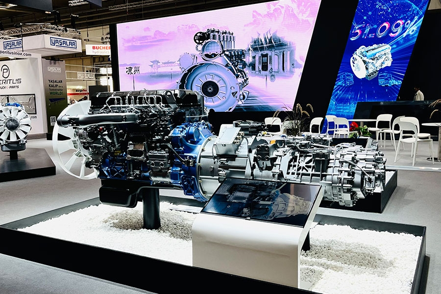

> 关于该企业：
> 某大型制造企业，作为中国重型汽车动力系统的领军者，其品牌声誉直接影响市场信任度与客户选择。随着线上内容爆发，全网（今日头条、百家号、微博等平台）不时出现关于产品质量、服务问题的负面新闻、用户帖子——小到一条“发动机故障”的用户吐槽，大到一篇行业媒体的负面报道，都可能快速发酵影响品牌形象。

| 衡量指标 | 使用前 | 使用后 |
|-|-|-|
| 信息覆盖范围 | 只能覆盖微博、今日头条等常用平台，百家号、知乎等垂直平台易遗漏 | 设定关键词后 自动遍历全网内容 |
| 识别效率 | 逐篇阅读判断是否负面，每天 50-80 条要花 3-4 小时 | 每天 50-80 条由 关键词库自动标记 |
| 响应速度 | 从发现到联系博主/举报，往往需要 1-2 天 | 识别与预警 分钟级（原 1-2 天） |
| 人力投入 | 每月需投入 5 人/天的工作量 | 释放 5 人/天，全自动化批量处理 |
| 内容扩散 | 仍有 30% 的负面内容因处理不及时扩散 | 处理能力 不再受人力限制 |

> **Agent 自动化需开通企业功能**：点击申请1个月免费权限 [ 点击申请 → ](https://skieer.feishu.cn/share/base/form/shrcnFwMayykP5iaL38fnZKTbrg)

---

## 1.客户信息

**关于该企业**

某大型制造企业，作为中国重型汽车动力系统的领军者，其品牌声誉直接影响市场信任度与客户选择。随着线上内容爆发，全网（今日头条、百家号、微博等平台）不时出现关于产品质量、服务问题的负面新闻、用户帖子——小到一条“发动机故障”的用户吐槽，大到一篇行业媒体的负面报道，都可能快速发酵影响品牌形象。

---

## 2.业务问题

### 01.业务背景

作为中国重型汽车动力系统的领军企业，品牌声誉直接影响市场信任度与客户选择。市场部每天用品牌关键词在各大平台搜索内容，逐一甄别负面舆情，再通过微博私信、文章留言联系博主要求下架，或手动提交平台举报。这种方式不仅耗时，还常因“漏看、延迟”导致负面内容扩散。为此，企业引入八爪鱼 RPA 搭建“舆情采集-负面识别-批量处理”全流程自动化系统。

- **监测范围：** 今日头条、百家号、微博、知乎等全网平台
- **核心关键词：**“品牌名”“产品名”等，以及企业提供的“负面关键词库”
- **原处理方式：** 人工逐平台搜索、逐篇阅读判断、逐个私信或举报

### 02.流程与问题

负面舆情的处置链路全靠人工巡检与逐条沟通，覆盖、效率、速度与人力四头承压：

#### 信息覆盖不全
人工只能覆盖常用平台（如微博、今日头条），像百家号、知乎等垂直平台易遗漏；
#### 响应速度慢
从发现负面内容到联系博主/举报，往往需要1-2天，错过最佳处理时机；

#### 识别效率低
需逐篇阅读内容判断“是否负面”，每天处理50-80条内容要花3-4小时；
#### 人力成本高
每月需投入 5 人/天的工作量，却仍有 30% 的负面内容因处理不及时扩散。

| 人工操作流程 | 具体步骤 | 问题 |
|-|-|-|
| 关键词搜索 | 市场部每天用品牌关键词在各大平台逐一搜索内容 | 平台逐个人工查，垂直平台易漏 |
| 负面甄别 | 逐篇阅读内容判断是否属于负面舆情 | 每天 50-80 条要花 3-4 小时 |
| 联系博主 | 通过微博私信、文章留言联系博主要求下架 | 逐条沟通，耗时 1-2 天 |
| 提交举报 | 手动提交平台举报，跟进处理结果 | 流程重复，跟进不及时 |
| 汇总复盘 | 人工统计当日处理情况供复盘 | 仍有 30% 内容因延误扩散 |

### 03.客户需求

- **全网自动采集：** 设定核心关键词后自动遍历全网含关键词的内容，覆盖垂直平台
- **负面智能标记：** 基于“负面关键词库”自动匹配侵权关键词，标记高风险内容
- **批量自动处置：** 对高风险内容自动联系发文方、批量发送“下架请求”模板消息并自动提交举报

---

## 3.解决方案

针对该企业的需求，我们用 RPA 搭了一套“舆情采集-负面识别-批量处理”全流程自动化系统，市场与法务只处理系统推来的高风险线索。

### 01.概述

|  | 说明 |
|-|-|
| 覆盖平台 | 今日头条、百家号、微博、知乎等全网内容平台 |
| 识别方式 | 基于“负面关键词库”自动匹配，标记高风险维权内容 |
| 处置动作 | 自动联系发文方、批量发送“下架请求”模板消息、自动提交举报 |
| 使用部门 | 市场部、法务部 |
| 运行节奏 | 定时自动采集与处置，识别与预警分钟级 |

**全网舆情自动采集**

RPA 自动操作新浪舆情通，设定“品牌名”“产品名”等核心关键词，自动遍历平台上所有含关键词的内容，覆盖人工容易漏掉的百家号、知乎等垂直平台。

**负面内容智能标记**

基于企业提供的“负面关键词库”，RPA 自动匹配内容中的侵权关键词，并将维权内容标记为高风险，替代逐篇阅读的人工判断，标准统一、无遗漏。

**批量维权自动化**

针对标记的“高风险”内容，RPA 自动联系发文方，批量发送“下架请求”模板消息，并自动提交举报，把过去 1-2 天的人工沟通压缩到分钟级批量处理。

### 02.方案优势

1. 覆盖无死角：核心关键词自动遍历全网内容，垂直平台不再遗漏。
2. 判断标准化：负面关键词库自动匹配标记，替代逐篇人工阅读，标准统一。
3. 处置批量化：自动联系发文方、批量发送“下架请求”并提交举报，处置效率提升数十倍。
4. 能力可扩展：采集、识别与处置链路全自动，处理能力不再受人力限制。

### 03.涉及解决方案

**市场 ｜ 舆情监控与分析 Agent 自动化**

> 为舆情监控场景打造的智能体驱动方案，一句话调度多平台数据采集 + 自动清洗合并 + 深度分析，输出舆情分析报告。方案链接：[市场 ｜ 舆情监控与分析 Agent 自动化](https://skieer.feishu.cn/wiki/H0hew2sJRiGlyAkbjvZcxWRjnoh)

---

## 4.落地效果

| 衡量指标 | 使用前 | 使用后 |
|-|-|-|
| 信息覆盖 | 常用平台为主，垂直平台易遗漏 | 全网自动遍历 |
| 识别效率 | 50-80 条/天需 3-4 小时逐篇判断 | 关键词库自动标记 |
| 响应速度 | 1-2 天才能联系博主或举报 | 分钟级识别与预警 |
| 人力投入 | 5 人/天工作量 | 全自动化批量处理 |
| 内容扩散 | 30% 因处理不及时扩散 | 风险 早发现、早处置 |

**响应效率质变**

负面舆情识别与预警从人工巡查的“小时级”跃升为“分钟级”，实现风险早发现、早处置。

**处置能力倍增**

维权流程实现全自动化批量处理，效率提升数十倍，处理能力不再受人力限制。

**团队价值升级**

法务与品牌团队得以从重复的“网络巡检”工作中解放，转向更高价值的策略分析与关系维护。

---

原文：[查看原文](https://skieer.feishu.cn/docx/EeU0dNGCJoQufHxLGaEcEfVpnxt)
