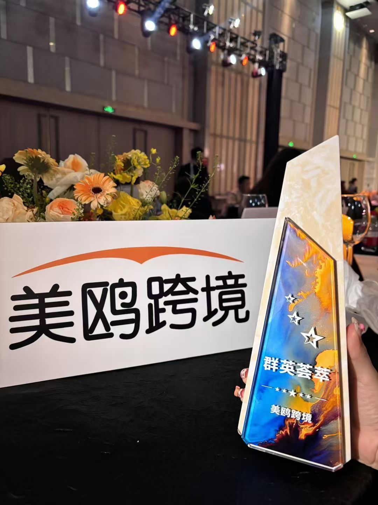
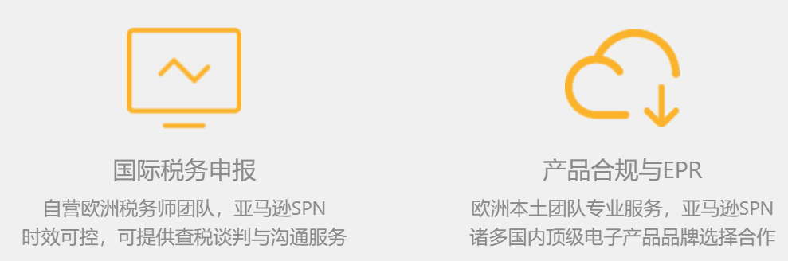
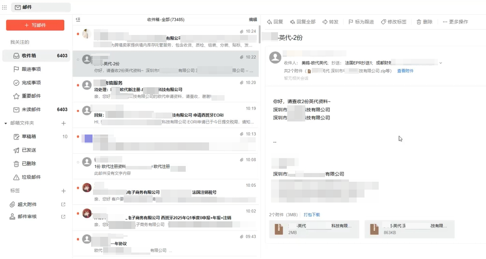
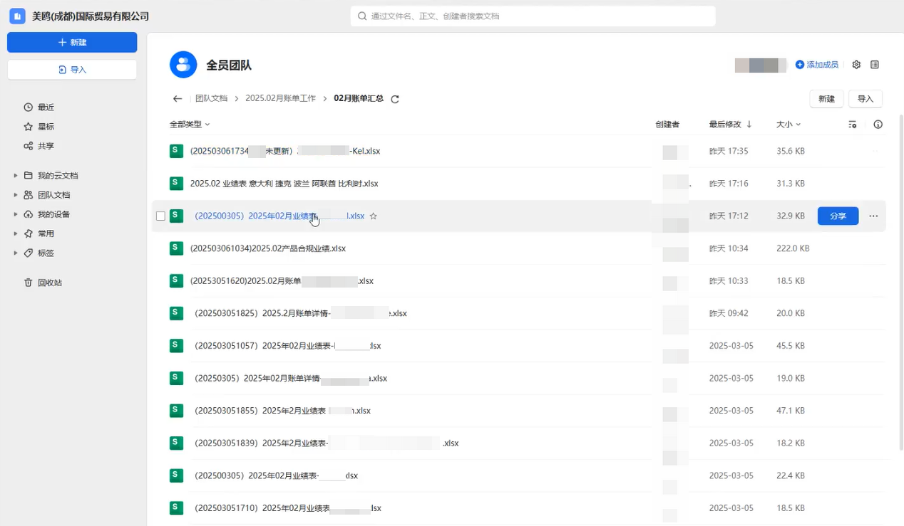
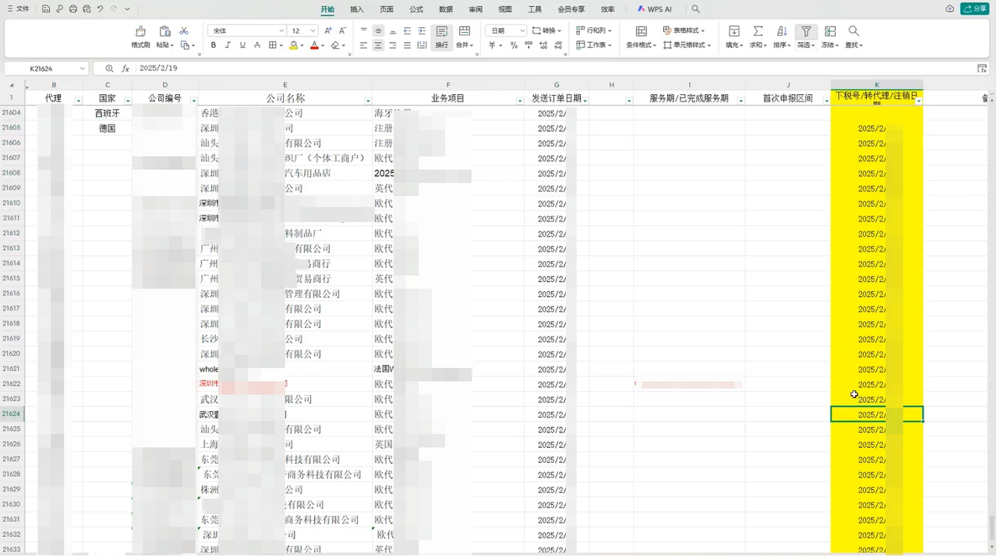
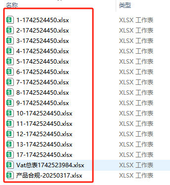
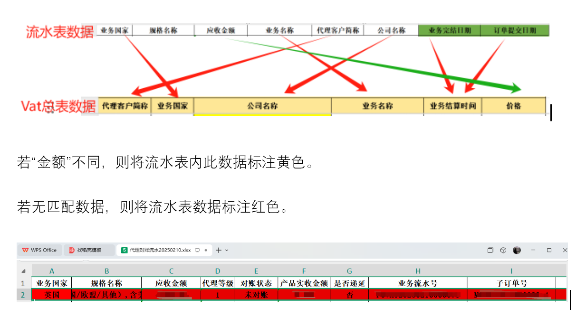
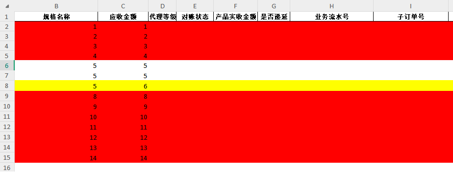
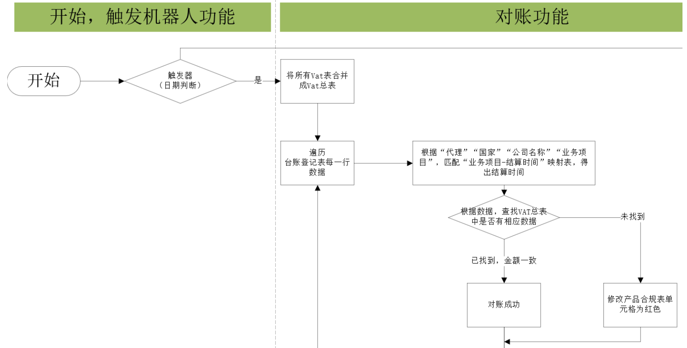
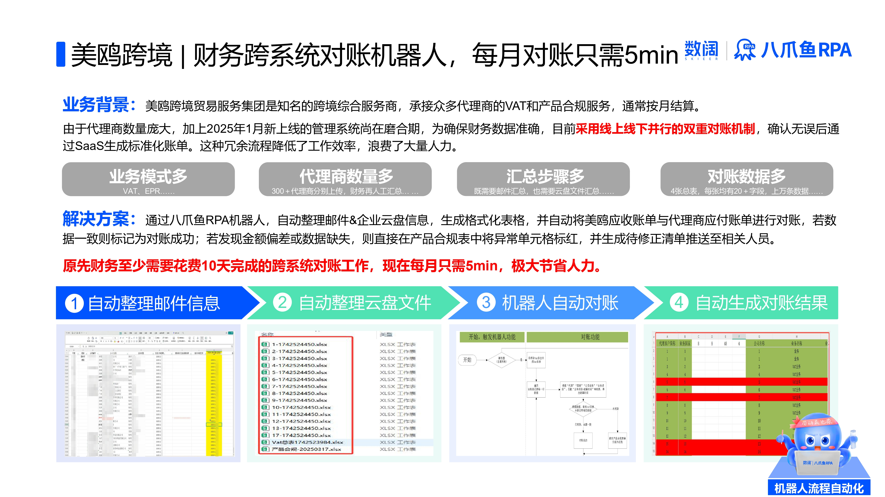

> 美鸥 财务负责人：
> 以前每到结算日，财务要在邮件、云盘和系统之间来回捞数据，一版对账表至少十个工作日才能出来，还总担心漏项。现在机器人把订单确认函和代理商账单自动汇总、自动比对，五分钟就能出结果，异常直接标红推给代理商，VAT 和 EPR 两个场景一次核完，心里踏实多了。

| 衡量指标 | 使用前 | 使用后 |
|-|-|-|
| 对账周期 | 财务手工汇总多系统数据，每月至少 10 个完整工作日 | 5 分钟内完成 |
| 数据可追溯性 | 手工操作数据容易出现错漏 | 异常数据 100% 可追溯 |
| 汇总方式 | 邮件、企业云盘人工逐条提取汇总 | 机器人自动提取并汇总成表 |
| 对账方式 | 应收账单与应付账单人工二次核对 | 台账与 VAT 总表自动比对、差异标红 |
| 覆盖场景 | VAT（税务申报）与 EPR（产品合规）逐一人工核对 | 双场景双向核验、交叉验证自动完成 |

> **Agent 自动化需开通企业功能**：点击申请1个月免费权限 [ 点击申请 → ](https://skieer.feishu.cn/share/base/form/shrcnFwMayykP5iaL38fnZKTbrg)

---

## 1.客户信息

美鸥跨境贸易服务集团作为知名跨境综合服务商，深耕跨境电商行业多年，深悉行业需求及痛点，致力于为广大品牌出海企业及跨境电商企业提供专业的国际知识产权、税务合规、产品合规、海外仓储、跨境物流、跨境保险等综合性服务。

---

## 2.业务问题

### 01.业务背景

美鸥旗下有一重要的业务板块，是承接众多代理商的 VAT 和产品合规服务，通常按月结算，其跨系统对账背景如下：

- 代理商数量庞大，按月结算，账期集中、对账量大
- 新上线的管理系统（2025年1月投入运营）尚处于磨合验证期，为确保财务数据准确性，当前采取线上线下并行的双重对账机制，确认无误后再通过 SaaS 生成标准化账单
- 冗余的操作流程显著降低工作效率，造成大量人力资源的重复性消耗

### 02.流程与问题

跨系统对账链路横跨邮件、SaaS、企业云盘多个来源，人工介入越多，效率与准确性越难保证：

#### 规范难
在订单确认环节，长期沿用的邮件确认机制存在显著的业务惯性。尽管已推进流程数字化升级，但多数代理商仍沿用传统作业模式——业务人员通过邮件发送订单确认函，导致财务人员需耗费大量时间从分散的邮件系统中人工提取、核验订单数据。

#### 汇总难
代理商自行统计月度应付账单，交由美鸥财务统一汇总对账。由于代理商众多，后期对账工作量繁重；代理商提交的账单常有不符合规定的情况，如仅填写备注栏、删减 Excel 列数、未填价格等，财务需人工逐一检查、退回修改，再修订最终表格。

#### 对账难
财务需将自行统计的应收账单（邮件人工汇总＋SaaS 统一导出）与代理商统计的应付账单（企业云盘文件人工汇总）进行人工二次核对，涉及 VAT（税务申报）和 EPR（产品合规）两个场景，代理商众多，极其耗费时间，手工操作容易出现错漏。

### 03.客户需求

- 订单确认数据自动提取：从邮件中自动定位并提取订单确认函信息，替代人工逐条核验
- 代理商账单自动汇总：自动整合企业云盘各代理商账单，用规则校验替代人工逐一检查与退回修改
- 跨系统自动对账：应收账单与应付账单自动比对，异常标红并推送待修正清单，覆盖 VAT 与 EPR 双场景

---

## 3.解决方案

八爪鱼RPA针对订单对账流程中的效率与准确性问题，设计了一套自动化解决方案。该方案通过机器人流程自动化技术，将传统依赖人工邮件汇总、多系统数据核对的分散作业模式，转变为标准化系统操作。

### 01.概述

[查看原视频](https://skieer.feishu.cn/wiki/S364wc0Xsisz71k81xKc1pfJnah)

|  | 说明 |
|-|-|
| 覆盖场景 | VAT（税务申报）与 EPR（产品合规）两大对账场景 |
| 数据来源 | 代理商邮件订单确认函、企业云盘代理商账单、SaaS 系统导出账单 |
| 处理环节 | 邮件定位提取 → 汇总生成表格 → 云盘账单整合 → 台账与 VAT 总表比对 → 异常标红推送 |
| 核心能力 | 关键词定位邮件 / 自动汇总成表 / 云盘账单整合 / 双向核验与交叉验证 / 异常标红与通知 |
| 运行方式 | 按结算周期（如每月结算日）自动触发，异常自动通知相关人员 |

**邮件自动提取信息汇总**

八爪鱼会通过关键词定位邮件，汇总邮件内容生成表格，并对异常情况进行处理与通知。关键词定位邮件：八爪鱼RPA会根据预设的关键词，例如发件人地址或邮件主题等条件，精准定位需要处理的邮件；汇总生成表格：自动提取邮件中的关键字段，如订单号、金额、业务类型等，并将这些数据整理成结构化的信息并汇总成表格；异常处理与通知：若遇到格式不符合要求或数据缺失的邮件，机器人会自动标记并通知相关人员进行处理，避免流程中断。

**企业云盘文件自动汇总**

系统首先会在预设时间（如每月结算日）自动触发运行，将企业邮箱中各个代理商提交的 VAT 申报表整合为统一的总表。随后逐行解析台账登记表中的代理商、国家、业务项目等关键信息，并调用内置的「业务项目-结算时间」规则库，为每笔业务匹配合规结算周期。

**机器人自动对账**

完成数据整合后，机器人会对台账数据与 VAT 总表中的金额记录进行自动比对。若数据一致则标记为对账成功；若发现金额偏差或数据缺失，则将异常单元格标红，并生成待修正清单推送至代理商。同时，该方案覆盖了台账表与 VAT 总表、产品合规表之间的双向核验，以及流水表与税务数据的交叉验证，确保税务申报（VAT）和产品合规服务（EPR）两大场景的数据一致性。

### 02.方案优势

1. **邮件自动汇总**：按发件人地址、邮件主题等关键词精准定位订单确认邮件，自动提取订单号、金额、业务类型等字段汇总成表，异常自动标记通知。
2. **云盘账单自动整合**：每月结算日自动触发，把各代理商提交的 VAT 申报表整合为统一总表，并按「业务项目-结算时间」规则匹配结算周期。
3. **跨系统自动对账**：台账数据与 VAT 总表金额自动比对，一致即标记成功，偏差或缺失自动标红并生成待修正清单推送代理商。
4. **双场景覆盖**：覆盖台账与 VAT 总表、产品合规表的双向核验，以及流水表与税务数据的交叉验证，保障 VAT 与 EPR 两大场景数据一致。
5. **异常可追溯**：替代手工汇总与核对，异常数据 100% 可追溯，从根本上避免手工操作中的错漏风险。

---

## 4.落地效果

| 衡量指标 | 使用前 | 使用后 |
|-|-|-|
| 对账周期 | 财务手工汇总多系统数据，每月至少 10 个完整工作日 | 5 分钟内完成 |
| 数据可追溯性 | 手工操作数据容易出现错漏 | 异常数据 100% 可追溯 |
| 汇总方式 | 邮件、企业云盘人工逐条提取汇总 | 机器人自动提取并汇总成表 |
| 对账方式 | 应收账单与应付账单人工二次核对 | 台账与 VAT 总表自动比对、差异标红 |
| 覆盖场景 | VAT（税务申报）与 EPR（产品合规）逐一人工核对 | 双场景双向核验、交叉验证自动完成 |

**对账周期从 10 天压缩至 5 分钟**

通过上述流程，系统替代了财务人员手工汇总邮件、SaaS 系统和企业云盘数据的重复劳动，解决了代理商账单格式混乱导致的修改循环问题。原先财务至少需要花费 10 天完成的跨系统对账工作，现可压缩至 5 分钟内完成。

**异常数据 100% 可追溯**

在降低人工操作时间的同时，实现了异常数据 100% 可追溯，从根本上避免了手工操作中的错漏风险。

**改造前 vs 改造后**

改造前：财务需从分散的邮件系统人工提取、核验订单确认数据，再逐一检查代理商账单格式问题并退回修改，最后把应收账单与应付账单人工二次核对，涉及 VAT 与 EPR 两个场景，代理商众多，每月至少耗费 10 个完整工作日，手工操作易出错漏。

改造后：机器人按关键词自动定位并提取订单确认邮件信息汇总成表，自动整合企业云盘各代理商账单并按规则匹配结算周期，台账数据与 VAT 总表自动比对、差异标红并推送待修正清单，覆盖 VAT 与 EPR 双场景，对账压缩至 5 分钟内完成、异常 100% 可追溯。

---

原文：[查看原文](https://skieer.feishu.cn/docx/FwazdsUv9obBxgxBWd9cPpJRnn7)
