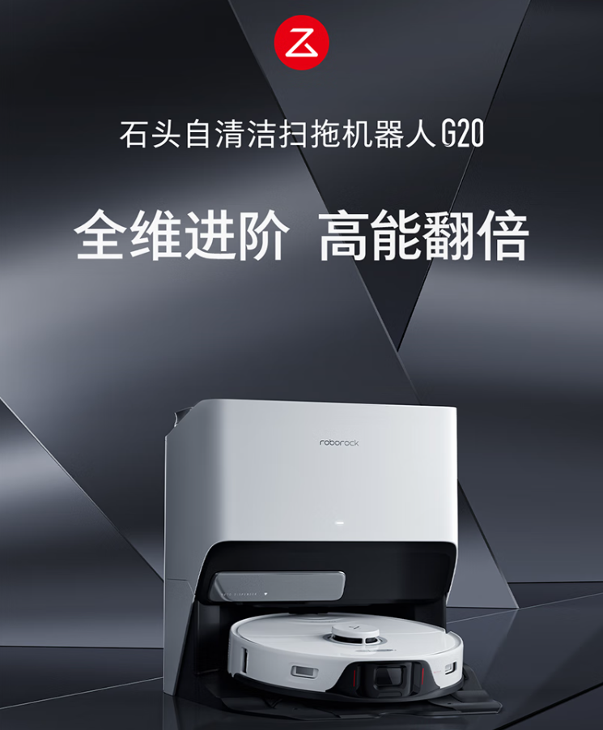
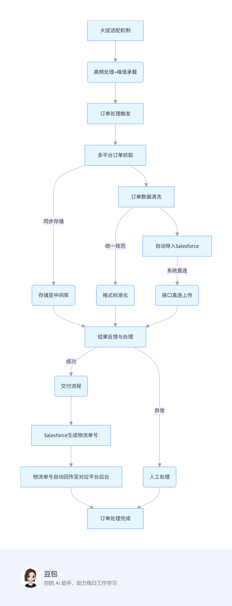
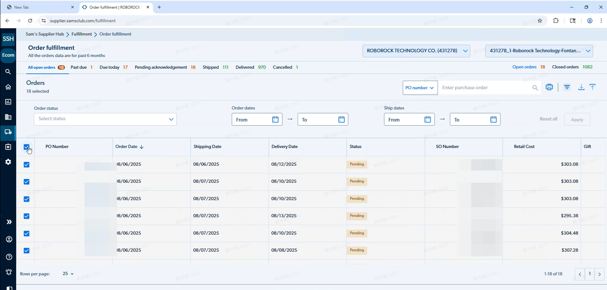
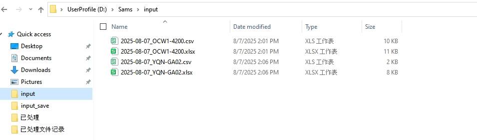
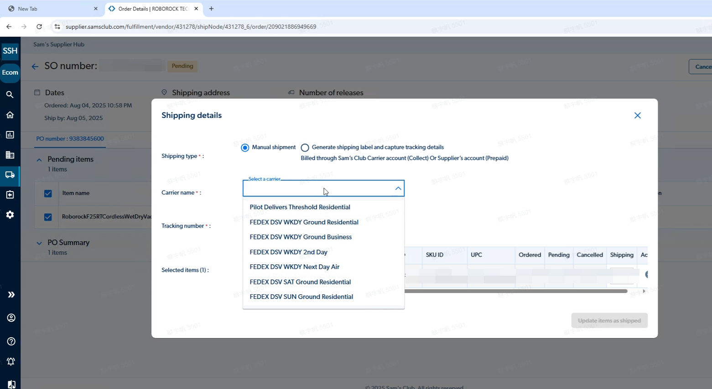
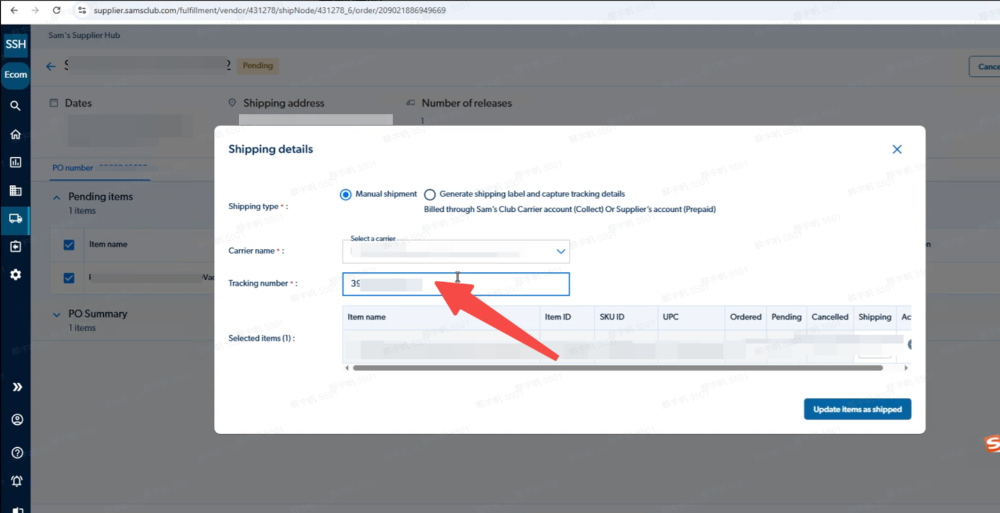
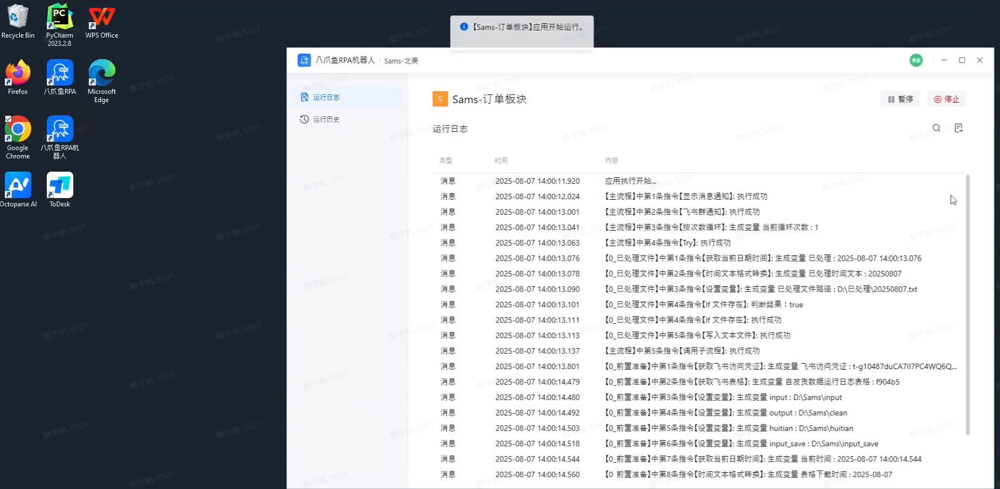

> 该企业业务人员：
> “以前大促光是登录 20 多个平台导订单、核对格式就忙到凌晨，还总出错拖慢发货。现在 RPA 自动跑完所有流程，哪怕爆单也能准时发，绩效再也不会受影响了”

| 衡量指标 | 使用前 | 使用后 |
|-|-|-|
| 订单数据准确性 | 人工核对易出错 | 提升至 100% |
| 重复工作量 | 客服手动导入导出 | 下降 90% |
| 单批次导入时间 | 5 小时（需 30 分钟以上反复校验） | 缩短至 5 分钟 |
| 大促峰值订单量 | 人工处理延迟率超 30% | 承载 10 倍 日常订单量 |
| 发货按时完成率 | 大促难以按时完成发货 | 100% |

> **Agent 自动化需开通企业功能**：点击申请1个月免费权限 [ 点击申请 → ](https://skieer.feishu.cn/share/base/form/shrcnFwMayykP5iaL38fnZKTbrg)

---

## 1.客户信息

石头科技是一家专注于家用智能清洁机器人及其他清洁电器研发和生产的公司。2014年成立于北京，曾是小米生态链企业，2016年推出首款“米家扫地机器人”。2017年起发展自有品牌，2020年登陆上交所科创板。其产品凭借先进技术和高品质，畅销全球170多个国家和地区，**2024年成为全球GMV和销量第一的智能扫地机器人品牌。**

---

## 2.业务问题

### 01.业务背景

该企业海外北美 **Salesforce 系统承担着各电商平台对终端用户的销售订单交付功能**。因海外电商平台拓展速度快、种类繁多，**系统自动发货流程中与各平台的对接机制尚未完善**，导致 Overstock、Sams 等20＋个平台的订单交付需依赖客服线下通过表格导入导出的方式手动操作。业务背景如下：

- 海外电商平台拓展速度快、种类繁多，各平台接口规则不一，系统自动对接能力不足；
- Overstock、Sams 等 20＋个平台的订单交付需依赖客服线下通过表格导入导出，操作繁琐且重复度高；
- 黑五网一大促，销量激增时，客服难以按时完成发货，严重制约工作效率与业务发展，因此急需借助八爪鱼 RPA 优化流程，以应对各类大促需求。

### 02.流程与问题

#### 平台多
平台数量多且持续增加，各平台接口规则不一，人工适配难度大，系统自动对接能力不足。

#### 人工导入导出耗时
依赖客服手动进行表格导入导出，操作繁琐且重复度高，易因人为失误导致订单信息错误。

#### 大促发货时效难保障
促销高峰期订单量暴增，人工处理效率低下，无法按时完成发货，影响用户体验与业务增长。

| 人工操作流程 | 具体步骤 | 问题 |
|-|-|-|
| 多平台订单数据获取 | 从 Overstock、Sams、Walmart 等各平台后台手动导出订单数据表格（含用户信息、商品明细、收货地址等） | 手工登录各个平台：人工逐一登录 20＋平台（亚马逊、Sams 等），手动导出订单信息，耗时且易遗漏 |
| 订单数据清洗 | 人工核对各平台导出表格的字段格式，按 Salesforce 系统要求调整列名、补充缺失信息 | 人工核对不同平台的订单数据格式（如日期、地址字段），手动修正错乱信息，易出错 |
| 导入Salesforce | 登录 Salesforce 系统，选择对应平台的订单导入入口，上传整理后的表格，等待系统校验并处理导入结果 | 手工上传效率低：客服手动将整理后的表格上传至 Salesforce，单批次导入需 30 分钟以上，且需反复校验 |
| 导入结果检查 | 查看系统导入日志，针对导入失败的订单（如格式错误、字段冲突），重新修改表格后再次手动导入 | 依赖客服手动进行表格导入导出，操作繁琐且重复度高，易因人为失误导致订单信息错误 |
| 回传物流单号 | 将salesforce生成的物流单号、快递公司等信息，手动复制粘贴匹配订单至平台后台中。 | 大促发货来不及：促销高峰期订单量激增时，人工处理延迟率超30%，导致发货延误影响用户体验 |

### 03.客户需求

- 需打通 20＋平台与 Salesforce 之间的订单交付链路，减少对客服线下表格导入导出操作的依赖；
- 需保障订单数据准确性，避免因格式错乱、信息遗漏导致的导入失败与后续返工成本；
- 需在大促高峰期维持发货时效，避免订单积压处理不及时被客户投诉、影响用户体验与品牌口碑。

---

## 3.解决方案

在引入八爪鱼后，借助RPA（机器人流程自动化）技术，实现自动从20＋平台（亚马逊、Sams、Overstock等）订单信息导出，并自动进行数据清洗并自动导入Salesforce。整个流程无需人工介入，机器人可按预设频率批量处理订单，也能在促销高峰期自动提升处理频次，高效应对订单激增。

### 01.概述

|  | 说明 |
|-|-|
| 覆盖平台 | 亚马逊、Sams、Overstock、Walmart 等 20＋个海外电商平台 |
| 覆盖数据 | 用户信息、商品明细、收货地址等订单数据，以及 Salesforce 生成的物流单号、快递公司信息 |
| 覆盖系统 | Salesforce（海外北美订单交付系统）与各海外电商平台后台 |
| 覆盖环节 | 多平台订单抓取 → 订单数据清洗 → 自动导入 Salesforce → 物流单号回传平台 |

八爪鱼 RPA 从大促适配机制、高频处理与峰值承载开始，依次完成订单处理触发、多平台订单抓取、订单数据清洗；清洗后分两支路径推进：一支将数据同步存储至中间库后统一做格式标准化，另一支经自动导入 Salesforce 后进行接口直连上传，二者最终汇总至结果反馈与处理节点。处理成功则进入交付流程，由 Salesforce 生成物流单号，再将单号回传至对应平台后台；若流程异常则进入人工处理环节，整体实现订单全流程自动化处理。

- 处理成功则进入交付流程，由 Salesforce 生成物流单号，再将单号回传至对应平台后台，最终完成订单处理；
- 若流程异常则进入人工处理环节，避免异常订单无人跟进；
- 机器人可按预设频率批量处理订单，也能在促销高峰期自动提升处理频次，高效应对订单激增。

### 02.方案优势

1. **全自动导入导出，释放人力**：从 20 + 平台（亚马逊、Sams 等）自动登录、批量抓取订单，替代人工逐一登录导出的繁琐操作，覆盖无遗漏。
2. **数据 “零差错”，订单导入一次过**：数据清洗（统一日期 / 地址格式、补全缺失信息）、导入 Salesforce 全流程自动化，客服无需再手动核对表格、反复上传校验，彻底从机械劳动中解放。
3. **大促爆单不 “卡壳”，发货时效有保障**：日常按固定频率批量处理，大促期间自动提升处理频次，峰值可承载 10 倍于日常的订单量，避免因为订单积压处理不及时被客户投诉。
4. **导入结果自动反馈**：系统直连上传，导入结果自动反馈，客服无需再逐条查看导入日志、针对失败订单反复修改表格重传。

### 03.涉及解决方案

**仓储物流 ｜ 亚马逊订单处理与多渠道同步**

> 自动读取领星/ERP 订单数据，输出异常订单识别、多渠道去重校验与发货时效预警的衔接层分析，把订单数据与多渠道同步打通。方案链接：[仓储物流 ｜ 亚马逊订单处理与多渠道同步](https://skieer.feishu.cn/wiki/JkWawcRapiSdTlk0emFcAv8vnLb)

**仓储物流 ｜ 速卖通订单导出与打单 Agent 自动化**

> 定时导出多店铺订单并按大单/小单/物流线路自动分流，智能体做重复、缺货、地址异常识别与漏单告警。方案链接：[仓储物流 ｜ 速卖通订单导出与打单 Agent 自动化](https://skieer.feishu.cn/wiki/PGLYwNHYpi1o78kcTE3cnbxXnTb)

**仓储物流 ｜ Temu订单有序发货与预警 Agent 自动化**

> 定时导出 Temu 平台订单明细，按站点生成发货单并跟踪 48h 发货时效倒计时，智能体按截止时间排序发货顺序、标记超时风险单与异常单。方案链接：[仓储物流 ｜ Temu订单有序发货与预警 Agent 自动化](https://skieer.feishu.cn/wiki/FiFqwhu8BihFi9kf4q2cWcVBnrc)

---

## 4.落地效果

| 衡量指标 | 使用前 | 使用后 |
|-|-|-|
| 订单数据准确性 | 人工核对易出错 | 提升至 100% |
| 重复工作量 | 客服手动导入导出 | 下降 90% |
| 单批次导入时间 | 5 小时（需 30 分钟以上反复校验） | 缩短至 5 分钟 |
| 大促峰值订单量 | 人工处理延迟率超 30% | 承载 10 倍 日常订单量 |
| 发货按时完成率 | 大促难以按时完成发货 | 100% |

**订单数据准确性提升至 100%**

订单数据准确性提升至 100%，避免人工处理中因格式错乱、信息遗漏等导致的订单导入失败问题，减少后续返工成本。

**重复工作量下降 90%**

客服团队在订单导出、清洗、导入环节的重复工作量下降90%，从繁琐的机械操作中解放，可专注于订单异常处理、客户需求响应等核心工作。

**单批次导入时间从 5 小时缩短至 5 分钟**

订单处理效率大幅提升，单批次导入时间从5小时缩短至5分钟，且支持大促期间10倍峰值订单量的高效处理，确保发货时效，提升用户体验与品牌口碑。

**改造前 vs 改造后**

改造前：手工登录各个平台：人工逐一登录 20＋平台（亚马逊、Sams 等），手动导出订单信息，耗时且易遗漏；人工核对易出错：人工核对不同平台的订单数据格式（如日期、地址字段），手动修正错乱信息，易出错；手工上传效率低：客服手动将整理后的表格上传至 Salesforce，单批次导入需 30 分钟以上，且需反复校验；大促发货来不及：促销高峰期订单量激增时，人工处理延迟率超30%，导致发货延误影响用户体验。

改造后：自动登录20＋平台：RPA 自动登录各平台，批量导出所有订单信息，覆盖全平台无遗漏；数据自动清洗无错漏：RPA 按预设规则自动清洗数据（统一格式、补全缺失字段、剔除重复项），数据准确性达 100%；自动导入Salesforce：RPA 自动将清洗后的数据导入 Salesforce，单批次处理仅需 5 分钟，系统直连无人工干预；大促爆单也不怕：RPA 自动提升处理频次，峰值可承载日常10倍订单量，发货按时完成率达 100%。

---

原文：[在飞书查看本案例](https://skieer.feishu.cn/docx/PhFpdQQyoo2HFLxrd4zcNG3TnEh)。
