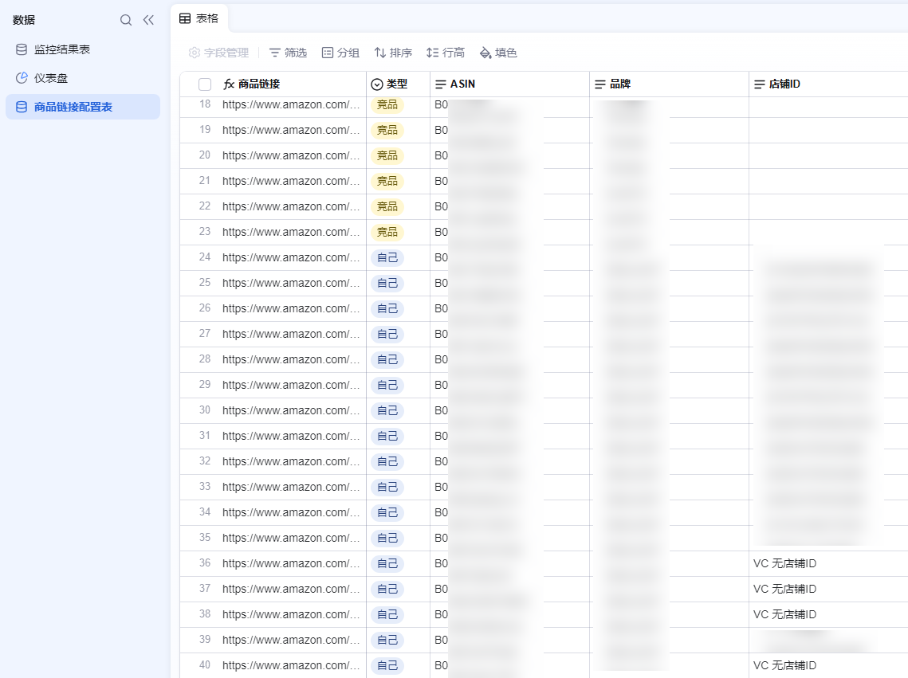
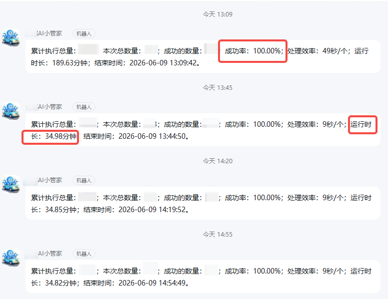
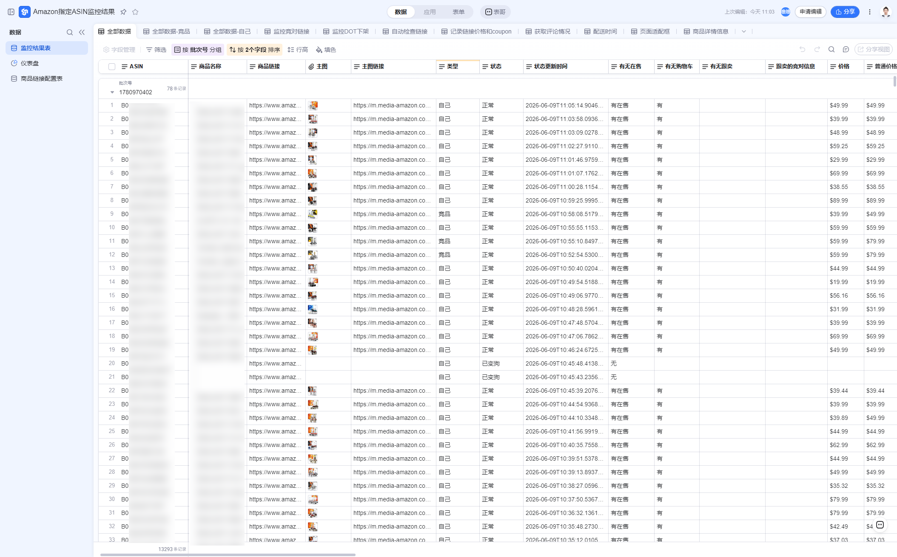
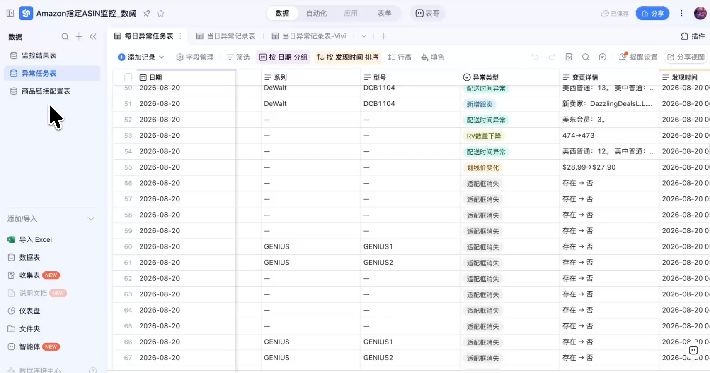
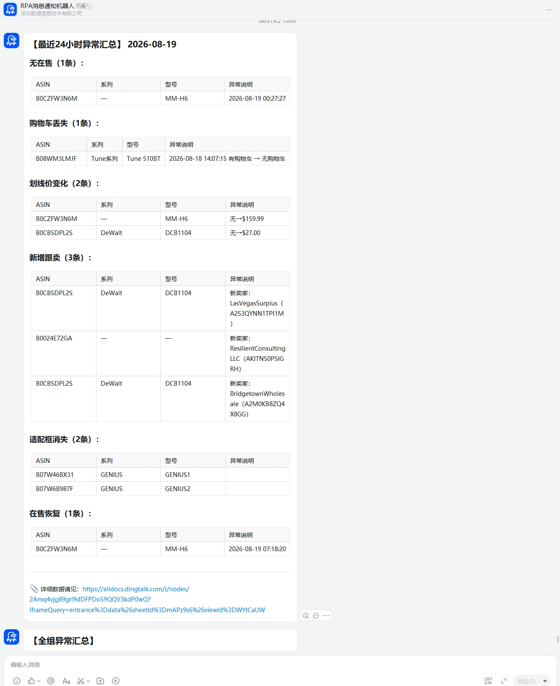
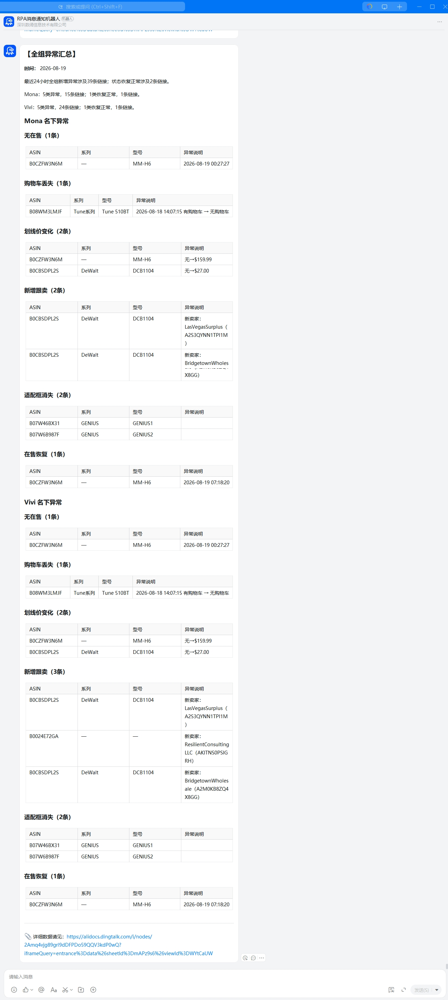
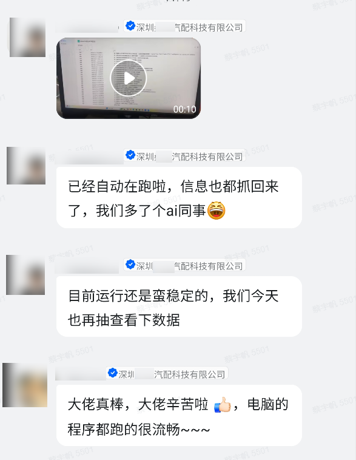

> 桑椹汽配 AI 产品经理 / FDE：
> “目前系统运行十分流畅、状态稳定，已经实现全自动运行，所需数据信息都能正常抓取回来，相当于为我们团队新增了一位 AI 同事，有效助力日常运营工作。”

| 衡量指标 | 使用前 | 使用后 |
|-|-|-|
| 监控 ASIN 数量 | 人工抽查部分链接，全量覆盖做不到 | 1000+ |
| 单轮监控耗时 | 人工巡检无固定频次，小时级难保证 | 多机器人并发约 1 小时完成一轮 |
| 运行成功率 | — | 100% |
| 累计运行时长 | — | 938.2h |
| 节省人力 | 人工逐页巡检、记录、转发异常 | 586.4 人/天 |

> **Agent 自动化需开通企业功能**：点击申请1个月免费权限 [ 点击申请 → ](https://skieer.feishu.cn/share/base/form/shrcnFwMayykP5iaL38fnZKTbrg)

---

## 1.客户信息

深圳桑椹汽配科技有限公司：汽车后市场领域全球品牌，汽配出海10亿大卖。专注于汽车照明、汽车用品、汽车配件和汽车电子品类的设计、研发和销售。亚马逊是重点经营平台之一。

公司设有规模化运营团队和专业 IT 团队，自研 WMS/ERP 系统，从上到下推动 AI 与 RPA 在实际业务中落地。

---

## 2.业务问题

### 01.业务背景

桑椹汽配需要持续监控 1000+ 自有商品与重点竞品 ASIN，其监控背景如下：

- 本品与竞品 ASIN 数量多：1000+ ASIN 需全量覆盖，监控清单频繁增删
- 监控场景多、时效要求高：多场景持续检查，约 1 小时完成一轮，重点异常按小时级推送
- 数据和异常通知进入钉钉工作流：数据进入钉钉 AI 表格，异常通知对应负责人和群聊

### 02.流程与问题

人工巡检、通用 ERP 和自研系统都无法满足业务需求：

#### 人工巡检覆盖不全、频次不足
运营人员平时只能抽空检查部分 ASIN，缺少固定巡检频次。链接下架等明显问题相对容易发现，购物车丢失、跟卖变化及价格促销波动，则容易在快速浏览中被遗漏；面对 1000+ ASIN，人工无法同时保证全量覆盖、小时级巡检和完整记录。

#### 数据分散、异常难追踪
人工检查结果分散在商品页面、表格和群聊中，缺少连续更新的巡检记录和异常台账。哪些 ASIN 已检查、异常何时出现、是否仍在持续、由谁负责，都难以集中查询，历史变化也难以追溯。

#### 通用 ERP 无法适配，自研调整依赖 IT
通用跨境 ERP 能监控的 ASIN 数量和字段有限，更新频率也无法适配小时级监控；自研 WMS/ERP 虽有能力，但监控清单调整仍依赖 IT 排期、改代码和发版，跟不上运营频繁增删改的节奏。

| 人工操作流程 | 具体步骤 | 问题 |
|-|-|-|
| 本品链接状态巡检 | 逐页打开商品页面，人工核对链接是否正常在售 | 只能抽查部分 ASIN，无固定频次，全量覆盖做不到 |
| 竞品价格与促销跟踪 | 逐个打开竞品页面，记录价格、促销与排名变化 | 快速浏览中易遗漏价格促销波动 |
| 购物车与跟卖核查 | 人工对比 Buy Box、在售卖家与跟卖情况 | 购物车丢失、跟卖变化难以及时发现 |
| 数据与异常记录 | 把检查结果记录在表格或群聊中 | 记录零散，缺统一巡检台账，难以追溯 |
| 异常通知与转发 | 发现异常后人工截图、确认负责人并转发 | 靠群聊与人员反馈，责任归属与进展不透明 |

### 03.客户需求

- 全量高频监控：1000+ 本品与竞品 ASIN 需全量覆盖，约 1 小时完成一轮，重点异常按小时级推送
- 运营自主维护清单：ASIN 与负责人可直接在表格中调整，无需每次等待 IT 排期改代码发版
- 数据入表可追溯、异常到人：监控数据与异常记录统一存入钉钉 AI 表格，异常分层通知到负责人、组长与经理

---

## 3.解决方案

八爪鱼 RPA 为桑椹汽配搭建亚马逊 ASIN 自动监控预警系统，接入钉钉 AI 表格。运营在表格中维护商品和负责人，系统接手日常巡检、异常识别和任务分发。工作流程：运营维护监控对象 → RPA 定时采集、监控数据更新 → 异常识别与任务生成 → 分层预警，运营核查处理。

### 01.概述

[观看原视频：亚马逊ASIN监控预警系统介绍-飞书版.mp4](https://skieer.feishu.cn/file/Uiehb5yYBoC1x5xoFrscK5wHnQb)

|  | 说明 |
|-|-|
| 覆盖平台 | 亚马逊（重点经营平台），覆盖本品与重点竞品 ASIN |
| 监控场景 | 链接状态、Buy Box（购物车）、跟卖、排名、价格与促销、评论、配送时间等 |
| 巡检规模 | 1000+ ASIN 全量覆盖，多机器人并发约 1 小时完成一轮 |
| 落地形态 | 接入钉钉 AI 表格，运营零代码维护清单；异常按负责人/组长/经理三级通知，恢复后自动更新 |

**01 运营自主维护监控清单，增删改十分灵活**

商品链接配置表集中维护 ASIN、商品链接、店铺、品牌、系列、型号，以及运营负责人、组长和经理等信息。新增商品、调整监控范围或更换负责人时，运营直接更新配置表；RPA 在后续运行中读取最新清单，按更新后的商品范围执行任务、按最新人员归属分发异常，无需每次等待 IT 改代码和发版。

**02 多机器人并发监控，1000+ ASIN 一小时内完成**

RPA 从配置表读取本品与竞品清单，由多个机器人批量访问亚马逊商品页面，采集链接状态、Buy Box、在售卖家、排名、价格与 Coupon、评论数量与星级、配送时间和商品详情。不同任务按小时、按天或按周运行，每轮采集都记录执行时间、ASIN 清单和采集结果，运营可以查询每条链接是否已检查、最近一次检查时间和对应结果。

[观看原视频：RPA运行采集Asin过程.mp4](https://skieer.feishu.cn/file/GY6CbV5vaonn5Nxsg2ocHngsnhh)

[观看原视频：变狗+购物车.mp4](https://skieer.feishu.cn/file/QoSUbPVW0ow3w0xoHVocNJbynUc)

[观看原视频：亚马逊榜单+商品排名.mp4](https://skieer.feishu.cn/file/WMtybQu4CoBFrBxsOdMcJkqanHy)

**03 数据统一入表，异常自动识别**

系统根据本轮数据判断链接下架、购物车丢失和出现跟卖，通过前后周期对比识别价格、排名、评论等变化，符合规则时自动生成异常任务。监控结果与异常任务统一写入钉钉 AI 表格，记录 ASIN、异常类型、变化详情和负责人等信息，运营及管理者按人员、商品和异常类型查询，并回看历史记录。

[观看原视频：Asin监控数据表30个字段+不同视图展示.mp4](https://skieer.feishu.cn/file/Ar55bQJIcowrd0xQGVQctsAMnA1)

[观看原视频：异常监控表格.mp4](https://skieer.feishu.cn/file/G5IEboKnLoEOdaxa9ffcF02QnGb)

**04 异常分层通知，恢复自动更新**

钉钉机器人按 ASIN 归属发送异常任务，直接推送给对应的运营负责人；组长查看组内异常，经理查看跨人员、跨商品和跨场景的汇总；团队异常按设定周期汇总，推送给管理人员及业务群。桑椹汽配重点关注的监控场景按小时级推送，负责人收到商品链接和具体异常后进入核查与处理。

### 02.方案优势

1. **全量自动巡检**：1000+ 本品与竞品 ASIN 统一纳入自动监控，多机器人并发约 1 小时完成一轮，按规则识别异常并生成任务。
2. **零散记录汇成统一台账**：商品数据、巡检记录和异常状态按统一字段持续存入钉钉 AI 表格与数据库，形成可分析、可追溯的数据资产。
3. **异常直接到人**：ASIN 与负责人、组长、经理统一对应，异常任务直接通知负责人，管理者查看管理范围内汇总，责任清晰。
4. **运营零代码自主维护**：ASIN 与负责人直接在表格中调整，无需 IT 排期改代码发版，灵活适配每日变动。
5. **数据与 SOP 持续扩展 Agent 能力**：监控、判断、通知与恢复跟踪按统一 SOP 运行，沉淀的数据与规则促进企业 Agent 自动化快速落地。

### 03.涉及解决方案

**店铺运营 ｜ 亚马逊ASIN跟卖与竞品监控 Agent 自动化**

> 为亚马逊卖家团队打造的 ASIN 跟卖与竞品监控方案，由智能体调度多个工具统一取数，新跟卖与重要变化才推送，无异常不打扰。方案链接：[店铺运营 ｜ 亚马逊ASIN跟卖与竞品监控 Agent 自动化](https://skieer.feishu.cn/wiki/Yjh3wy8jzijNkpkNdR0cIO1QnXc)

**店铺运营 ｜ 亚马逊竞品异动监控 Agent 自动化**

> 为亚马逊卖家团队打造的竞品异动监控方案，由智能体调度多工具统一取数，每日扫描，有异动才推送，无异常不打扰。方案链接：[店铺运营 ｜ 亚马逊竞品异动监控 Agent 自动化](https://skieer.feishu.cn/wiki/Njaaw7gEAi130ekxGv2cOytynxh)

---

## 4.落地效果

| 衡量指标 | 使用前 | 使用后 |
|-|-|-|
| 监控 ASIN 数量 | 人工抽查部分链接，全量覆盖做不到 | 1000+ |
| 单轮监控耗时 | 人工巡检无固定频次，小时级难保证 | 多机器人并发约 1 小时完成一轮 |
| 运行成功率 | — | 100% |
| 累计运行时长 | — | 938.2h |
| 节省人力 | 人工逐页巡检、记录、转发异常 | 586.4 人/天 |

**全量自动巡检，替代人工抽查**

1000+ 本品与竞品 ASIN 统一纳入自动监控，多机器人并发约 1 小时完成一轮，系统按规则识别异常并生成任务；累计运行 938.2h、运行成功率 100%，节省人力 586.4 人/天。

**零散记录汇成统一业务台账**

商品数据、巡检记录和异常状态按统一字段持续存入钉钉 AI 表格和数据库，形成团队共用、可分析、可追溯的数据资产，运营可按人员、商品和异常类型查询历史，为业务复盘与后续 BI 分析提供数据。

**异常直接到人，团队责任清晰**

ASIN 与负责人、组长、经理统一对应，异常任务直接通知运营负责人，组长和经理查看各自管理范围内的汇总，责任归属与异常情况集中可查。

**改造前 vs 改造后**

改造前：运营逐页检查、只能抽查部分 ASIN，巡检频率不固定，隐性异常容易遗漏；商品数据和异常信息分散在页面、表格和群聊中，历史变化难以追溯；发现异常后人工截图、确认负责人并转发，管理者依靠群聊和人员反馈了解情况；检查重点和频次依赖个人经验，清单调整需要 IT 修改程序。

改造后：1000+ 本品与竞品 ASIN 统一纳入自动监控、多机器人并发约 1 小时完成一轮；商品数据、巡检记录和异常状态按统一字段持续存入钉钉 AI 表格和数据库；异常任务直接通知运营负责人、组长和经理查看管理范围汇总；监控、判断、通知和恢复跟踪按统一 SOP 运行，运营更新清单与人员关系即可复用。

---

原文：[在飞书查看本案例](https://skieer.feishu.cn/docx/LEfLdEBTQoqASZxNk4BcfQcHnuc)。
