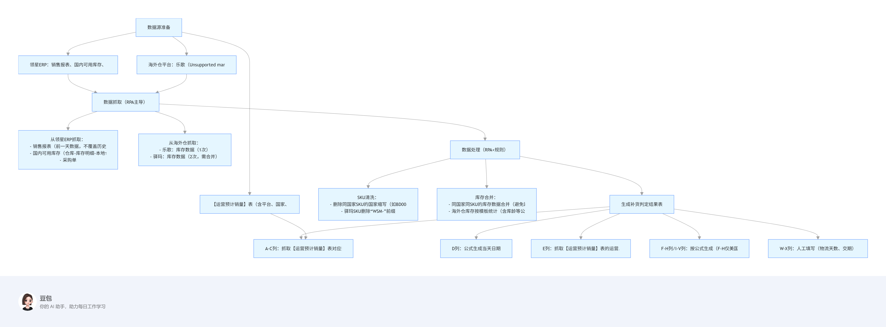
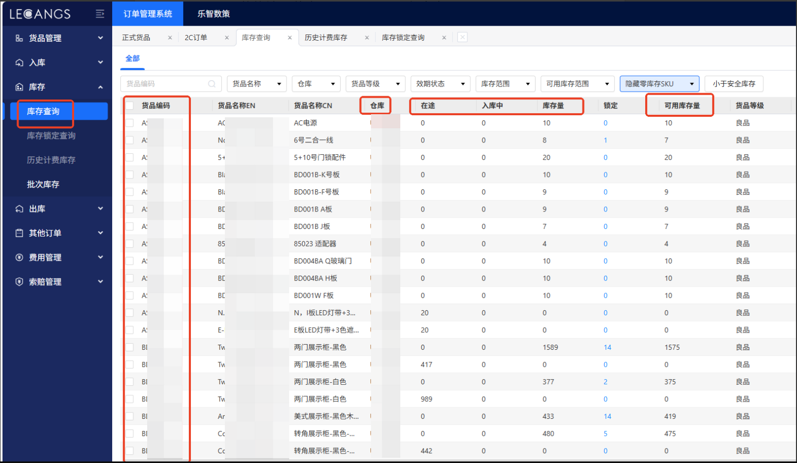
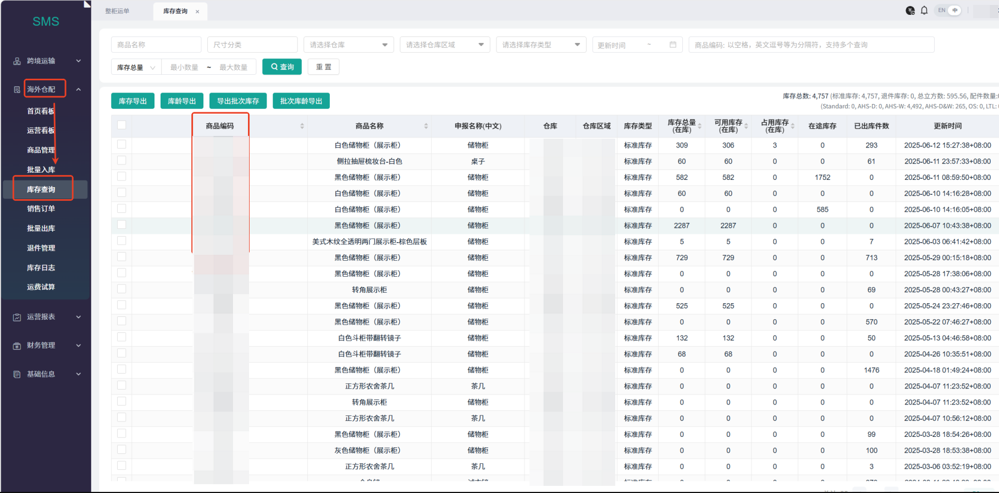
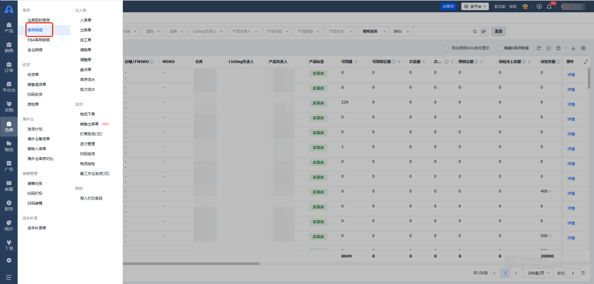

> 深圳唯世美库存岗位同事：
> 以前天天对着五六个平台导数据、对表格，眼睛都花了还总出错。现在系统自己跑，省出的时间不光能盯着异常库存，还能琢磨琢磨哪个海外仓补货节奏能再调调，确实轻松多了"

| 衡量指标 | 使用前 | 使用后 |
|-|-|-|
| 数据抓取 | 手动导出易遗漏：手动从领星 ERP 及各海外仓平台导出库存、库龄等数据，效率低且易遗漏。 | 自动抓取无错漏：RPA 自动抓取领星 ERP 及各平台数据，实时同步分散数据源，效率提升显著。 |
| 数据处理 | SKU整理混乱容易匹配不上：人工整理混乱的 SKU，易因人为操作导致误差。 | 自动清洗匹配准：RPA 自动清洗数据并整理 SKU，减少人为误差，数据准确性提高。 |
| 补货计算 | 手动导入耗时长：手动将数据导入 Excel 模板，按逻辑计算补货量，流程繁琐且耗时。 | 自动导入飞速：RPA自动将数据导入模板并按专属逻辑计算，自动生成补货结果，无需人工干预。 |
| 库存周转 | 影响库存周转：全流程依赖人工操作，受限于人力时间，难以快速响应库存变动。 | 提高库存周转率：全流程自动化处理，可实时响应库存数据变化，快速输出补货建议，提升库存周转效率。 |
| 数据处理准确率 | - | 99%+ |
| 重复工作量 | 每天反复导数据、对表 | 下降 80%，专员重点关注异常数据、优化补货逻辑即可。 |
| 企业数据资产 | 数据散落各平台与 Excel | 公司沉淀完整的库存与补货数据资产，便于追踪各海外仓库存波动规律、优化补货策略。 |

> **Agent 自动化需开通企业功能**：点击申请1个月免费权限 [ 点击申请 → ](https://skieer.feishu.cn/share/base/form/shrcnFwMayykP5iaL38fnZKTbrg)

---

## 1.客户信息

深圳唯世美有限公司是一家专注于室内家具赛道的跨境电商企业，致力于打造国际知名的中国家具品牌。

公司首款内置RGB灯光展示柜上架两个月即拿下Amazon美、加、英、德四站点的Best Seller，还有Walmart、Temu美站的Best Seller，仅半年单款产品月销售额便超100万美金，当前市场占有率超50%，迅速成为Amazon家具市场的领导者之一。

---

## 2.业务问题

### 01.业务背景

唯世美主营**家具大件**，需精准计算**每日补货量以保障库存合理周转**。业务背景如下

- 公司无自有海外仓，需与多个国家的海外仓（如无忧达、中运、驿玛、乐歌、niuke等）合作。
- 而库存数据（包括可售库存、在途库存等）和库龄数据（库龄越长仓储费越高）分散在领星ERP及各海外仓平台中。
- 此外，领星ERP的通用补货建议不符合公司专属补货逻辑，因此需从上述平台抓取相关数据，导入自有Excel模板处理，最终得出补货结果。

### 02.流程与问题

#### 数据源分散
库存、库龄等关键数据分布在领星 ERP 及多个海外仓平台，整合难度大。

#### 人工操作耗时
需手动从各平台导出数据、整理 SKU、导入Excel计算，流程繁琐且耗时。

#### SKU 管理混乱
增加了数据处理的复杂度，易导致误差。

| 人工操作流程 | 具体步骤 | 问题 |
|-|-|-|
| 数据抓取 | 从领星 ERP 及无忧达、中运、驿玛、乐歌、niuke等海外仓平台，抓取可售库存、在途库存、库龄等数据 | 数据分散。库存、库龄等关键数据分布在领星 ERP 及多个海外仓平台，整合难度大。 |
| 数据处理 | 对抓取的原始数据进行清洗，整理混乱的SKU，转化为符合 Excel 模板要求的格式 | 人工操作耗时。需手动从各平台导出数据、整理 SKU、导入Excel计算，流程繁琐且耗时。 |
| 补货计算 | 将处理后的数据导入自有 Excel 模板，按专属逻辑计算每日需补货的数量 | SKIU管理混乱。增加了数据处理的复杂度，易导致误差。 |

### 03.客户需求

- 唯世美希望解决数据源分散、人工操作耗时及 SKU 管理混乱的问题
- 实现补货判断全流程自动化
- 减少人工干预，提升补货计算的效率和准确性。

---

## 3.解决方案

在引入八爪鱼后，借助RPA（机器人流程自动化）技术，自动完成从领星ERP及各海外仓平台的数据抓取、SKU 整理、数据处理到补货结果计算的全流程，无需人工参与。

### 01.概述

[查看原视频](https://skieer.feishu.cn/wiki/Gca3w8j1KixDXjkz0oScFwHAngf)

|  | 说明 |
|-|-|
| 覆盖平台 | 领星 ERP，以及无忧达、中运、驿玛、乐歌、niuke 等多家海外仓平台。 |
| 覆盖数据 | 可售库存、在途库存、库龄等库存与补货核心数据。 |
| 覆盖环节 | 数据抓取 → SKU 整理与数据清洗 → 补货量计算 → 补货结果输出。 |
| 交付方式 | 先协助搭建 3 个核心平台流程，再通过针对性培训传递方法，让客户自主完成剩余平台搭建，支持长期自主维护与扩展。 |

补货全流程自动化的数据流转路径如下。

**多平台自动登录，自动识别验证码**

**RPA自动取数清洗**

### 02.方案优势

1. **自动化提效，解放人力**：RPA 替代人工完成多平台数据抓取、处理及结果生成，减少重复劳动，让人员聚焦策略优化。
2. **跨平台整合，打破数据孤岛**：统一对接领星 ERP 及各海外仓，自动整合分散数据，解决多系统切换、信息碎片化问题。
3. **标准化处理，保障数据精准**：预设SKU清洗、数据合并规则，避免人工误差，确保补货结果准确一致。
4. **实时更新，快速响应变化**：每日自动抓取最新数据，动态同步库存、销量变动，助力及时调整补货策略。
5. **灵活适配，支持业务扩展**：可快速对接新增平台或国家市场，无需重构即可适配业务增长需求。
6. **赋能自主操作，服务可持续**：先协助搭建3个核心平台流程，再通过针对性培训传递方法，让客户自主完成剩余平台搭建，既快速落地又提升客户自主能力，支持长期自主维护与扩展。

### 03.涉及解决方案

**采购供应链 ｜ 跨境补货量自动计算与看板 Agent 自动化**

> 自动抓取领星 ERP 与多家海外仓的库存、库龄数据并清洗成模板格式，导入卖家自有 Excel 模板按专属逻辑算出每日补货量，输出补货结果与自更新看板。方案链接：[采购供应链 ｜ 跨境补货量自动计算与看板 Agent 自动化](https://skieer.feishu.cn/wiki/C6mowBcCUiJdsFkev5Yc2gBVnke)

**仓储物流 ｜ 跨境多平台库存自动同步与预警 Agent 自动化**

> 多账号自动登录平台后台与各海外仓系统导出库存、库龄报表，自动清洗去重、按 SKU 对齐入库，并做安全库存/库龄/周转/差异核查分级预警，输出实时库存看板。方案链接：[仓储物流 ｜ 跨境多平台库存自动同步与预警 Agent 自动化](https://skieer.feishu.cn/wiki/HPALwbVukiw5pWkBzR0cgdGRnyd)

**采购供应链 ｜ 速卖通备货与库存管理 Agent 自动化**

> 采集直发/优选仓/海外仓三轨库存与在途数据，按「安全库存＋备货周期＋销量预测」测算补货量，输出补货单与仓间调拨建议，提交由人工确认。方案链接：[采购供应链 ｜ 速卖通备货与库存管理 Agent 自动化](https://skieer.feishu.cn/wiki/DQ2swAl8MiJE16kOznqcWfTDnlh)

**仓储物流 ｜ 虾皮库存管理与预警 Agent 自动化**

> 定时拉取各站点可用/预留/在途库存并在途采购进度，按「可用库存＋在途＋日均销量」预测断货日、识别多站点共享库存的超卖风险，推送预警与补货建议。方案链接：[仓储物流 ｜ 虾皮库存管理与预警 Agent 自动化](https://skieer.feishu.cn/wiki/Vg2SwpbxritRmrkOq6AcjapWnrg)

---

## 4.落地效果

| 衡量指标 | 使用前 | 使用后 |
|-|-|-|
| 数据抓取 | 手动导出易遗漏：手动从领星 ERP 及各海外仓平台导出库存、库龄等数据，效率低且易遗漏。 | 自动抓取无错漏：RPA 自动抓取领星 ERP 及各平台数据，实时同步分散数据源，效率提升显著。 |
| 数据处理 | SKU整理混乱容易匹配不上：人工整理混乱的 SKU，易因人为操作导致误差。 | 自动清洗匹配准：RPA 自动清洗数据并整理 SKU，减少人为误差，数据准确性提高。 |
| 补货计算 | 手动导入耗时长：手动将数据导入 Excel 模板，按逻辑计算补货量，流程繁琐且耗时。 | 自动导入飞速：RPA自动将数据导入模板并按专属逻辑计算，自动生成补货结果，无需人工干预。 |
| 库存周转 | 影响库存周转：全流程依赖人工操作，受限于人力时间，难以快速响应库存变动。 | 提高库存周转率：全流程自动化处理，可实时响应库存数据变化，快速输出补货建议，提升库存周转效率。 |
| 数据处理准确率 | - | 99%+ |
| 重复工作量 | 每天反复导数据、对表 | 下降 80%，专员重点关注异常数据、优化补货逻辑即可。 |
| 企业数据资产 | 数据散落各平台与 Excel | 公司沉淀完整的库存与补货数据资产，便于追踪各海外仓库存波动规律、优化补货策略。 |

**库存与库龄数据自动抓取**

八爪鱼 RPA 自动登录领星 ERP 及无忧达、中运、驿玛、乐歌、niuke 等海外仓平台，按预设路径抓取可售库存、在途库存、库龄等数据，替代人工逐个平台导表；多平台数据实时同步，分散的数据源被统一收进同一条自动化链路。

**SKU 整理与数据自动清洗**

针对各平台混乱的 SKU 与不一致的数据格式，RPA 按预设的清洗与合并规则自动整理，转化为符合自有 Excel 模板要求的格式，减少人为操作误差，数据处理准确率达 99%+。

**补货量自动计算与结果输出**

处理后的数据自动导入唯世美自有 Excel 模板，按专属补货逻辑算出每日补货量并生成补货结果，无需人工干预；补货结果与自更新看板同步输出，专员只需重点关注异常数据、持续优化补货逻辑。

**库存与补货数据资产沉淀**

公司沉淀完整的库存与补货数据资产，便于追踪各海外仓库存波动规律、优化补货策略，也为后续快速对接新增平台或国家市场提供了数据底座。

![图片展示的是唯世美补货全流程自动化处理后的数据导入Excel模板界面。模板包含平台、国家、产品sku、补货日期、按公式生成、按公式生成、按公式生成、按公式生成、按公式生成、按公式生成、按公式生成、按公式生成、按公式生成、按公式生成、按公式生成、按公式生成、按公式生成、按公式生成、按公式生成、按公式生成、按公式生成、按公式生成、按公式生成、按公式生成、按公式生成、按公式生成、按公式生成、按公式生成、按公式生成、按公式生成、按公式生成、按公式生成、按公式生成、按公式生成、按公式生成、按公式生成、按公式生成、按公式生成、按公式生成、按公式生成、按公式生成、按公式生成、按公式生成、按公式生成、按公式生成、按公式生成、按公式生成、按公式生成、按公式生成、按公式生成、按公式生成、按公式生成、按公式生成、按公式生成、按公式生成、按公式生成、按公式生成、按公式生成、按公式生成、按公式生成、按公式生成、按公式生成、按公式生成、按公式生成、按公式生成、按公式生成、按公式生成、按公式生成、按公式生成、按公式生成、按公式生成、按公式生成、按公式生成、按公式生成、按公式生成、按公式生成、按公式生成、按公式生成、按公式生成、按公式生成、按公式生成、按公式生成、按公式生成、按公式生成、按公式生成、按公式生成、按公式生成、按公式生成、按公式生成、按公式生成、按公式生成、按公式生成、按公式生成、按公式生成、按公式生成、按公式生成、按公式生成、按公式生成、按公式生成、按公式生成、按公式生成、按公式生成、按公式生成、按公式生成、按公式生成、按公式生成、按公式生成、按公式生成、按公式生成、按公式生成、按公式生成、按公式生成、按公式生成、按公式生成、按公式生成、按公式生成、按公式生成、按公式生成、按公式生成、按公式生成、按公式生成、按公式生成、按公式生成、按公式生成、按](/images/customer-cases/KMOzby8bUonXTUxGtDdcPAWcn1b.png)

---

原文：[查看原文](https://skieer.feishu.cn/docx/LWqtd3nO2oeQDVxLznacBMOqnJc)
