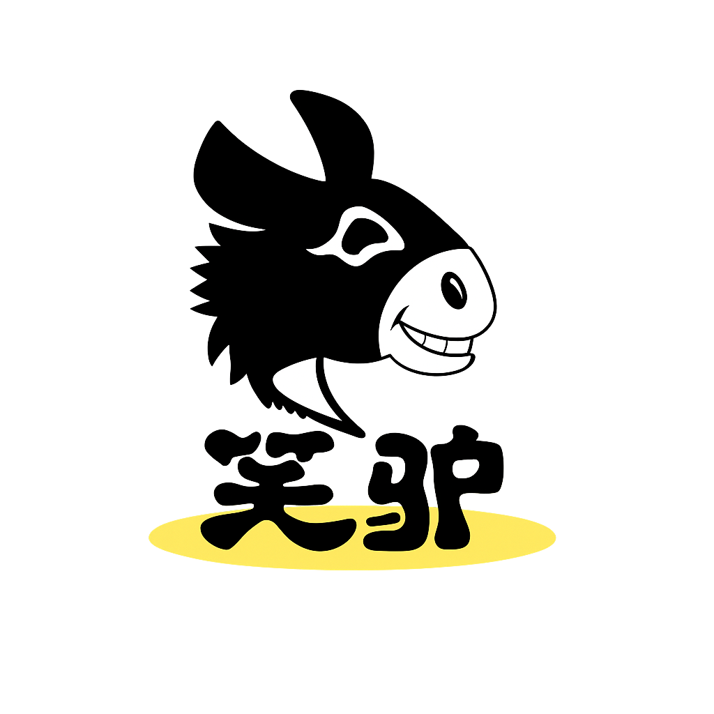

> 笑驴 AI 创始人 黄锐立：
> “AI 工具 ≠ AI 能力。工具人人都能买，能力是自己长出来的。把经验沉淀为数字资产，才是真正的护城河。”

| 衡量指标 | 使用前 | 使用后 |
|-|-|-|
| AI 客服覆盖率 | 以人工客服为主 | 70%，人工介入大幅下降 |
| 选品效率 | 运助、美工、运营三岗人工接力 | 提升 10 倍，从人工到自动化 |
| 单组人员配置 | 4.5人 | 1.5人，GMV 还在涨 |
| GMV | 基准 | 同比增长 +50%，人效大幅提升 |
| 单店周上新 | 约 10 个 | 约 50 个 |
| 选品人力投入 | 三岗接力 | 下降约 67% |

> **Agent 自动化需开通企业功能**：点击申请1个月免费权限 [ 点击申请 → ](https://skieer.feishu.cn/share/base/form/shrcnFwMayykP5iaL38fnZKTbrg)

---

## 1.客户信息

笑驴 AI 是一家专注于精铺模式的电商企业，长期运营多平台、多品类的商品矩阵，目前经营百货精铺 30 家店。创始人黄锐立深耕电商行业 10 余年，拥有制造业基因。企业发展经历了三个阶段：工厂起步 → 10 年精铺电商成长为亿级体量 → 3 年 AI 化全链路重构。

面对日益增长的 SKU 规模和平台复杂度，笑驴 AI 从 2023 年起系统性推进企业 AI 落地，逐步将客服、视觉、运营等核心环节从人工驱动转向 AI 协同，最终形成由企业大脑统一管理、数字员工持续工作的 AI Native 组织形态。

---

## 2.业务问题

### 01.业务背景

笑驴 AI 将分散的自动化能力组织成企业级 AI 能力前，面临能力、经验、过程、改进四重分散，其转型背景如下：

- 角色分工：企业大脑统一管理数据、知识、Skill 和数字员工；Agent 负责理解任务、分析和调度；RPA 负责数据采集和跨系统执行；人集中处理经营判断、复杂问题和异常情况
- 业务规模：多平台、多品类精铺商品矩阵，百货精铺 30 家店，SKU 规模与平台复杂度持续增长
- 转型路径：从 2023 年起系统性推进企业 AI 落地，把客服、视觉、运营从人工驱动转向 AI 协同

### 02.流程与问题

在企业大脑统一管理之前，AI 能力与业务经验四散在各部门与个人手中，难以形成组织级能力：

#### 能力和状态分散
不同部门用不同工具，管理者看不清已上线哪些数字员工、哪些任务在运行。

#### 经验和规则分散
各部门 SOP 和判断标准不同，经验存在负责人脑中、个人文档或单个流程里。

#### 过程和结果分散
任务记录和执行结果留在不同系统，异常需跨部门查找，难以统一复盘。

#### 改进缺少依据
看不清哪些 AI 能力真正产生业务结果，难以判断下一步调整方向。

### 03.客户需求

- 能力统一管理：把数据、知识、Skill、数字员工、任务和运行记录放进同一套系统，管理者可在一处完成调度、过程查看、治理与审计
- 经验沉淀为资产：把分散在各人脑中的 SOP、判断标准封装成可复用的数字资产
- 人聚焦判断：让数字员工承担执行层，人专注于经营判断、复杂问题与异常处理

---

## 3.解决方案

笑驴 AI 以企业大脑为中枢，把数据、知识、Skill、数字员工、任务和运行记录放进同一套系统，由 Agent 理解任务、分析调度，RPA 负责数据采集和跨系统执行，人集中处理经营判断、复杂问题和异常情况，最终形成 AI Native 组织形态。

### 01.概述

[在飞书原文中查看视频：数字员工-现场介绍_飞书兼容版.mp4](https://skieer.feishu.cn/wiki/NUOlwjsGZiiZLVkdH3ecQFYMn1f#share-VZBIdTqDSoUFmvxDxSZc5M7Onje)

|  | 说明 |
|-|-|
| 中枢 | 企业大脑：企业 AI 数字资产的控制中枢，统一管理数据、知识、Skill 和数字员工，并按组织与岗位权限把能力交给 Agent 调用 |
| 覆盖场景 | AI 运营、AI 客服、AI 视觉三大数字员工场景，持续在真实生产环境承担具体工作 |
| 标杆场景 | AI 选品全链路：市场机会发现 → 选品与上架 → 测款优化与扩品 |
| 组成与分工 | 企业大脑统一调度与审计；数据与知识提供业务依据；Skill 保存目标、步骤、规则与人工节点；Agent 与数字员工理解任务并调度；RPA / API / MCP 打通跨平台、跨系统执行 |
| 运行方式 | 数字员工 7×24 持续工作，运行结果写回系统持续更新规则 |

**企业大脑：统一管理数据、知识、Skill 和数字员工**

企业大脑是企业 AI 数字资产的控制中枢，统一记录任务状态、调用过程和执行结果：Agent 理解任务、分析、调度；RPA 进入平台完成已确认的数据采集和系统操作；人设定业务目标和规则，在关键节点作出判断、处理复杂问题和异常。管理者在同一处完成调度、过程查看、治理和审计。

[在飞书原文中查看视频：知序-企业大脑介绍.mp4](https://skieer.feishu.cn/docx/Asp8dnT23oiixSxj9omcgXUdnnd)

**数字员工：在真实生产环境工作**

笑驴 AI 将数字员工部署到运营、客服、视觉三大核心业务场景，持续承担具体工作。AI 运营定期采集行业趋势与品类增长数据输出市场机会报告、筛选潜力新品方向、追踪竞品动态生成简报、实时监控广告数据并生成优化建议；AI 客服完成售前回复、售后标准流程处理、高价值/风险对话转人工，并对全部对话自动质检评分送入 VOC 分析；AI 视觉按平台规范自动生成主图、整理商品画面、基于图片与卖点生成短视频。

**标杆场景：AI 选品全链路跑通**

在 AI 选品标杆场景中，Agent 负责分析和任务调度，RPA 负责数据采集和跨系统执行，人集中处理经营判断、复杂问题和异常。原来由运助、美工和运营三人接力完成的工作，变成一名运营管理 Agent 和 RPA：单店周上新从约 10 个提高到约 50 个，从确认趋势到商品上架最快 1 天完成，人力投入下降约 67%。

[在飞书原文中查看视频：笑驴AI选品工作流.mp4](https://skieer.feishu.cn/docx/Asp8dnT23oiixSxj9omcgXUdnnd)

[在飞书原文中查看视频：笑驴AI选品工作流_扩展详解版.mp4](https://skieer.feishu.cn/docx/Asp8dnT23oiixSxj9omcgXUdnnd)

### 02.方案优势

1. **流程自动化**：重复、规则明确的业务流程由 AI 自动执行，减少机械性人工操作。
2. **决策智能化**：Agent 基于数据和规则提供建议，人聚焦关键判断，判断标准统一、可复用。
3. **数据透明化**：所有业务数据和运行记录统一管理，经营状态实时可见、过程可审计。
4. **管理扁平化**：数字员工承担执行层，组织层级简化，决策链路缩短（单组人员配置 4.5→1.5人，GMV 还在涨）。
5. **经验沉淀为资产**：把业务目标、处理步骤、筛选规则、调用顺序、输出格式和人工节点封装为 Skill，让经验脱离个人、持续复用与迭代。

---

## 4.落地效果

| 衡量指标 | 使用前 | 使用后 |
|-|-|-|
| AI 客服覆盖率 | 以人工客服为主 | 70%，人工介入大幅下降 |
| 选品效率 | 运助、美工、运营三岗人工接力 | 提升 10 倍，从人工到自动化 |
| 单组人员配置 | 4.5人 | 1.5人，GMV 还在涨 |
| GMV | 基准 | 同比增长 +50%，人效大幅提升 |
| 单店周上新 | 约 10 个 | 约 50 个 |
| 选品人力投入 | 三岗接力 | 下降约 67% |

**数字员工进入真实生产环境**

AI 客服覆盖率达 70%、人工介入大幅下降；AI 视觉按平台规范自动出图出视频；AI 运营持续完成市场洞察、商品挖掘、竞品分析与投放监控。选品场景下，单店周上新从约 10 个提高到约 50 个，从确认趋势到商品上架最快 1 天完成。

**组织从三岗接力到一人管理**

原来分散在运助、美工、运营三个人手里的工作，现在由一名运营统一管理 Agent 和 RPA 完成：单组人员配置从 4.5人减到 1.5人，而 GMV 同比增长 50%、人效大幅提升。

**业务经验变成企业 AI 能力**

笑驴 AI 的落地路径可复用：第一步业务负责人把经验显性化为 SOP；第二步 AI 产品经理把 SOP 封装成 Agent 可调用的 Skill；第三步用 RPA、API 与 MCP 接入真实数据和系统；第四步运行结果持续更新规则。经验由此从“在个人脑中”变成可复用的企业数字资产。

**改造前 vs 改造后**

改造前：AI 能力与状态分散在不同工具、各人脑中与不同系统里，管理者看不清已上线的数字员工与在跑任务，经验难以复用，异常需跨部门查找，改进缺少依据。

改造后：企业大脑统一管理数据、知识、Skill 和数字员工，Agent 理解任务并调度、RPA 跨系统执行、人专注关键判断；流程自动化、决策智能化、数据透明化、管理扁平化，形成 AI Native 组织形态。

---

原文：[在飞书查看本案例](https://skieer.feishu.cn/docx/Asp8dnT23oiixSxj9omcgXUdnnd)。
