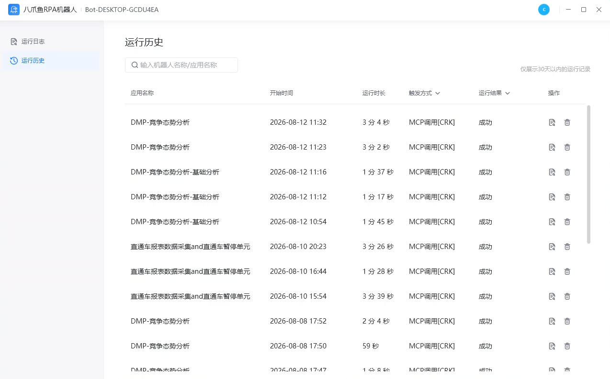
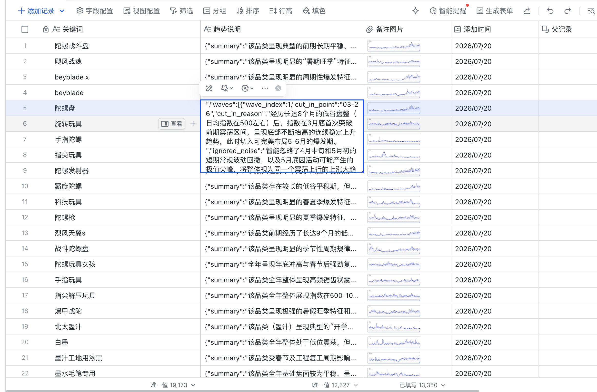
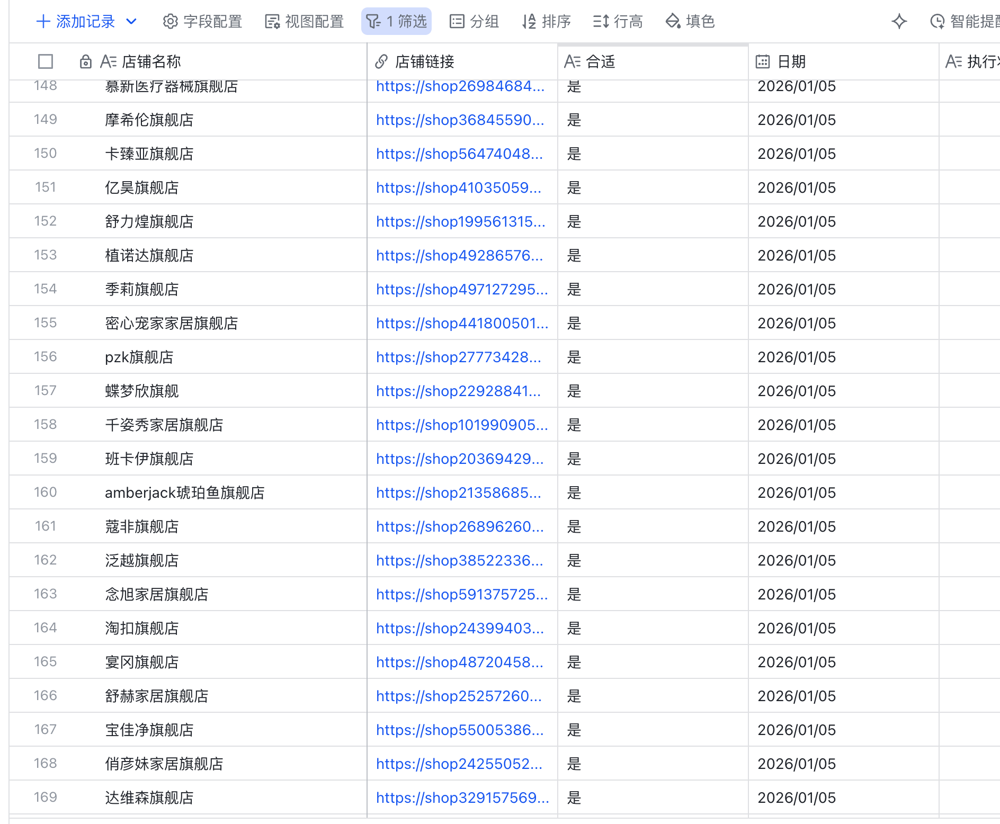
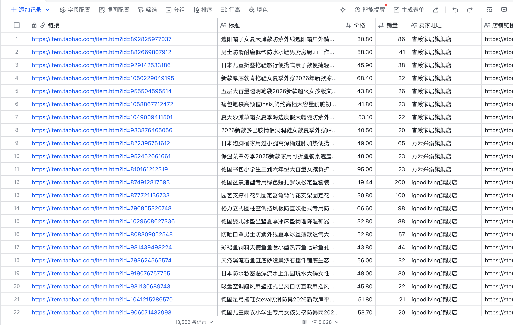
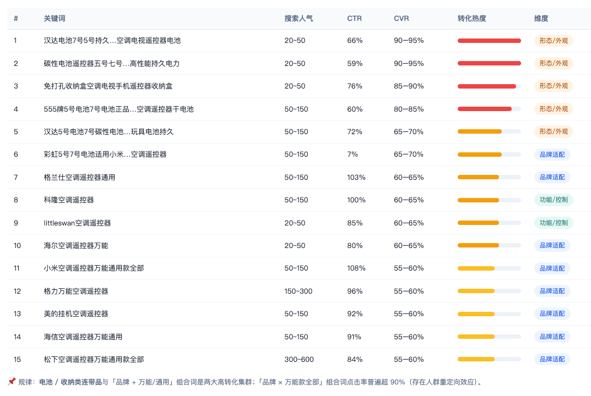

> 笑驴 AI 业务负责人：
> 过去一次上新要运助、美工、运营三个人接力，单店一周做到十个就到顶了。现在 Agent 负责分析和调度、RPA 负责取数和执行，我一个人就能管起来，一周能上五十个款，从确认趋势到上架最快一天；经验也不再只留在老员工脑子里，都写进了 SOP 和 Skill。

| 衡量指标 | 使用前 | 使用后 |
|-|-|-|
| 单店周上新 | 维持约 10 个，提量就卡住 | 约 50 个 |
| 流程参与人员 | 运助、美工、运营 3 人接力 | 1 人（管理 Agent 与 RPA） |
| 人力投入 | 三岗接力，查数传文件对需求 | 下降约 67% |
| 确认趋势到上架 | 依赖三岗交接，周期长 | 最快 1 天 |
| 选品依据 | 依赖老员工经验，标准不一 | SOP + Skill 统一规则，数据找货 |

> **Agent 自动化需开通企业功能**：点击申请1个月免费权限 [ 点击申请 → ](https://skieer.feishu.cn/share/base/form/shrcnFwMayykP5iaL38fnZKTbrg)

---

## 1.客户信息

笑驴 AI 是一家 AI Native 电商企业，专注于精铺模式，长期运营多平台、多品类的商品矩阵，目前经营百货精铺 30 家店。面对日益增长的 SKU 规模和平台复杂度，笑驴 AI 将分散的自动化能力整合为企业级 AI 能力：在 AI 选品场景，Agent 负责理解任务、分析和调度，RPA 负责数据采集和跨系统执行，人集中处理经营判断、复杂问题和异常。

把数据采集、市场机会发现、选品验证、供应链匹配、视觉生成、商品上架、测款和商品优化多个业务环节接进同一条 AI 工作流，实现从「人找货」到「数据找货」的转变。

---

## 2.业务问题

### 01.业务背景

精铺经营需要持续发现新品、批量上新、快速测款，再决定哪些商品值得继续投入，其选品链路背景如下：

- 经营模式：多平台、多品类精铺商品矩阵，需持续发现新品、批量上新、快速测款
- 原有分工：一次上新要经过运助、美工、运营三个岗位接力
- 扩产受限：上新越多，查数、传文件、对需求、催进度的工作就越多，上新数量增加、人手也相应增加

### 02.流程与问题

改造前，一次上新要经过三个岗位，三岗接力成了扩产瓶颈：

#### 三岗接力成瓶颈
运助挖掘市场趋势、整理竞品数据；美工制作主图和详情素材；运营复核商品、供应链、利润和视觉素材。三岗接力，任何一环都成为扩产瓶颈。

#### 任何一环延迟就等
趋势数据没整理完，候选商品出不来；视觉需求有偏差，图片要返工；美工排期延后，上架和测款跟着顺延。任何一环没交付，后面只能等。

#### 上新越多人力越多
上新越多，查数、传文件、对需求、催进度的工作就越多；上新数量增加，人手也相应增加，单店周上新维持在约 10 个，很难再往上提。

| 人工操作流程 | 具体步骤 | 问题 |
|-|-|-|
| 市场趋势与竞品数据整理 | 运助挖掘市场趋势、整理竞品数据，形成选品基础资料 | 趋势数据没整理完，候选商品出不来 |
| 选品判断 | 运营基于资料复核商品、供应链与利润，决定是否上新 | 依赖老员工经验，标准不统一 |
| 视觉素材制作 | 美工根据选品结果制作主图、详情页和视频素材 | 视觉需求有偏差要返工，排期延后上架就顺延 |
| 上架与测款 | 运营最终决定上架和测款，人工录入商品信息与图片 | 岗位交接等待多，上架与测款跟着顺延 |
| 测款与优化 | 人工下载投放报表、分析表现、决定去留与调整 | 上新越多，查数、对需求、催进度的工作越多 |

### 03.客户需求

- 流程连续跑：夜间自动更新数据，Agent 分析后把结果和待办推给运营，运营确认后继续执行，不用等下一个岗位接手
- 经验沉淀成规则：趋势判断、选品、测款标准写进 SOP 和 Skill，新老员工用同一套规则，投放、利润和转化结果再反馈调整下一轮
- 人专注判断：运营不用再查数、传文件、协调交接，只判断商品机会、供应链利润、视觉方案和投放去留

---

## 3.解决方案

笑驴 AI 把精铺商品运营链重构为一条 AI 驱动、一人管理的连续工作流：Agent 负责分析和任务调度，按业务规则判断每个环节输出是否达标、自动触发下一环节；RPA 负责数据采集、平台操作和结果回写，跨亚马逊、供应链系统、广告平台执行；运营在关键节点决策——商品与供应链利润评估、视觉素材审核、投放去留判断。原来分散在三个岗位的任务，由一名运营统一管理 Agent 和 RPA 完成。

### 01.概述

|  | 说明 |
|-|-|
| 覆盖环节 | 数据采集 → 市场机会发现 → 选品验证 → 供应链匹配 → 视觉生成 → 商品上架 → 测款 → 商品优化 |
| 数据来源 | 电商平台搜索下拉、类目榜单、搜索词报告、广告报表、指数趋势平台、DMP、竞店/竞品页、第三方数据工具 |
| 分工方式 | Agent 分析与任务调度 / RPA 数据采集与后台录入等确定性操作 / 运营只做经营判断 |
| 运行节奏 | RPA 夜间自动更新数据，Agent 分析后推结果与待办给运营，运营确认后继续执行 |

**市场机会发现：寻找增长需求和已被验证的商品**

RPA 每天凌晨自动采集三类数据：关键词趋势、竞店清单、竞品销量，运营白天打开系统就能看到更新好的数据，省去每天重复查数、整理表格的工作。数据准备好后，Agent 从趋势选品和竞对选品两个方向寻找机会：趋势选品从多渠道采集趋势词、分析关键词涨跌找出正在升温的需求方向；竞对选品从 DMP、平台前台与第三方工具批量采集竞店信息、商品列表、销量估算、BSR 排名和评论增长数据，筛选出已产生真实销量、成交趋势稳定且与本店客群品类匹配的商品进入候选池。

[观看原视频：001市场机会发现：抓取趋势词.mp4](https://skieer.feishu.cn/file/AtnBbu6tEoPboLx8YJ1cNXh5nAg)

[观看原视频：002竞品商品采集.mp4](https://skieer.feishu.cn/file/VbWhb7SPsoQtLcxwOUEch2COnZc)

**选品与上架：筛选出能承接、能盈利的商品**

RPA 拉取竞店流量、成交和健康度数据，Agent 横向对比筛出重点竞店；获取重点竞店 Top 商品成交表现，只保留持续成交的商品；采集候选商品的流量结构、转化率、ROI 和客群画像，逐项核验过滤高投流、弱转化、客群不匹配的商品。运营再把通过数据核验的商品与内部货盘匹配，确认能否承接、毛利是否达标——四个条件全部成立（市场有需求、经营数据可行、货盘能接、利润达标）才进入上架环节。Agent 分析竞品主图、详情和卖点生成视觉方案，视觉智能体自动出图，运营审核确认后 RPA 完成上架。

[观看原视频：03经营验证.mp4](https://skieer.feishu.cn/file/PzeLbwdqyoosUBxoEnlc3wwHnMf)

**测款优化与扩品：用真实经营数据决定商品去向**

RPA 定时下载投放报表，Agent 找出表现差的计划和单元生成暂停待办，运营确认后 RPA 执行暂停并写回记录；对通过测款的商品，RPA 采集竞品图片、详情、SKU、价格和标题，Agent 对比差异生成调整建议；商品展现爆款潜力时，RPA 下载 500 个细分关键词，Agent 按场景、规格、人群和需求分类形成品类矩阵。投放、利润和转化结果写回系统，用于更新下一轮选品规则，形成数据闭环。

[观看原视频：04测款分析 优化和扩品.mp4](https://skieer.feishu.cn/file/Nw41bQ3fAormRHxRZIRcoVcvngg)

### 02.方案优势

1. **流程连续跑**：RPA 夜间更新数据，Agent 分析后把结果和待办推给运营，运营确认后继续执行，不用等下一个岗位接手。
2. **经验沉淀成规则**：趋势判断、选品、测款标准写进 SOP 和 Skill，新老员工用同一套规则，投放、利润和转化结果再反馈调整下一轮。
3. **人专注判断**：运营不用再查数、传文件、协调交接，只判断商品机会、供应链利润、视觉方案和投放去留。
4. **数据驱动选品**：从「人找货」到「数据找货」，选品依据来自每日更新的关键词趋势、竞店与竞品库，而非个人经验。
5. **全链路闭环**：从数据采集到测款优化，投放、利润和转化结果写回系统持续更新规则，形成可复用的数据闭环。

### 03.涉及解决方案

**选品 ｜ 亚马逊市场机会发现 Agent 自动化**

> 为亚马逊选品团队打造的市场机会发现方案，由智能体调度工具统一取数、输出机会报告，一次性给出蓝海方向、潜力关键词与捆绑组合的候选清单。方案链接：[选品 ｜ 亚马逊市场机会发现 Agent 自动化](https://skieer.feishu.cn/wiki/ItYBwSwvXiYFo9kHctLcOcBqnhf)

**选品 ｜ 亚马逊竞品数据采集与分析 Agent 自动化**

> 为亚马逊卖家团队打造的竞品数据采集与分析方案，由智能体调度多个工具执行卖家精灵/Sif 双平台数据采集与自动清洗合并，输出竞品数据表与流量分析报告。方案链接：[选品 ｜ 亚马逊竞品数据采集与分析 Agent 自动化](https://skieer.feishu.cn/wiki/MdpXwupOsiZ5QQkLv91cIv5Vnhh)

---

## 4.落地效果

| 衡量指标 | 使用前 | 使用后 |
|-|-|-|
| 单店周上新 | 维持约 10 个，提量就卡住 | 约 50 个 |
| 流程参与人员 | 运助、美工、运营 3 人接力 | 1 人（管理 Agent 与 RPA） |
| 人力投入 | 三岗接力，查数传文件对需求 | 下降约 67% |
| 确认趋势到上架 | 依赖三岗交接，周期长 | 最快 1 天 |
| 选品依据 | 依赖老员工经验，标准不一 | SOP + Skill 统一规则，数据找货 |

**单店周上新从约 10 个提升到约 50 个**

原来由运助、美工和运营三人接力完成的工作，现在由一名运营管理 Agent 和 RPA 完成：单店周上新从约 10 个提高到约 50 个，从确认趋势到商品上架最快 1 天完成。

**流程人员从三岗接力到一人管理**

精铺商品运营链被重构为一条 AI 驱动、一人管理的连续工作流，流程参与人员从 3 人降到 1 人，人力投入下降约 67%，运营只做经营判断。

**经验沉淀为可复用规则**

趋势判断、选品、测款标准写进 SOP 和 Skill，新老员工用同一套规则；投放、利润和转化结果写回系统，用于更新下一轮选品规则，形成数据闭环。

**改造前 vs 改造后**

改造前：一次上新要经过运助、美工、运营三个岗位接力，任何一环没交付后面只能等；上新越多，查数、传文件、对需求、催进度的工作越多，单店周上新维持在约 10 个，扩产受限于人力。

改造后：Agent 负责分析和任务调度、RPA 负责数据采集与后台录入等确定性操作、运营只做经营判断；原分散在三人的工作由一名运营统一管理 Agent 和 RPA 完成，单店周上新约 50 个、上架最快 1 天、人力投入下降约 67%。

---

原文：[在飞书查看本案例](https://skieer.feishu.cn/docx/QLYLdp2g0otsJlx3HSGcOWA3nce)。
