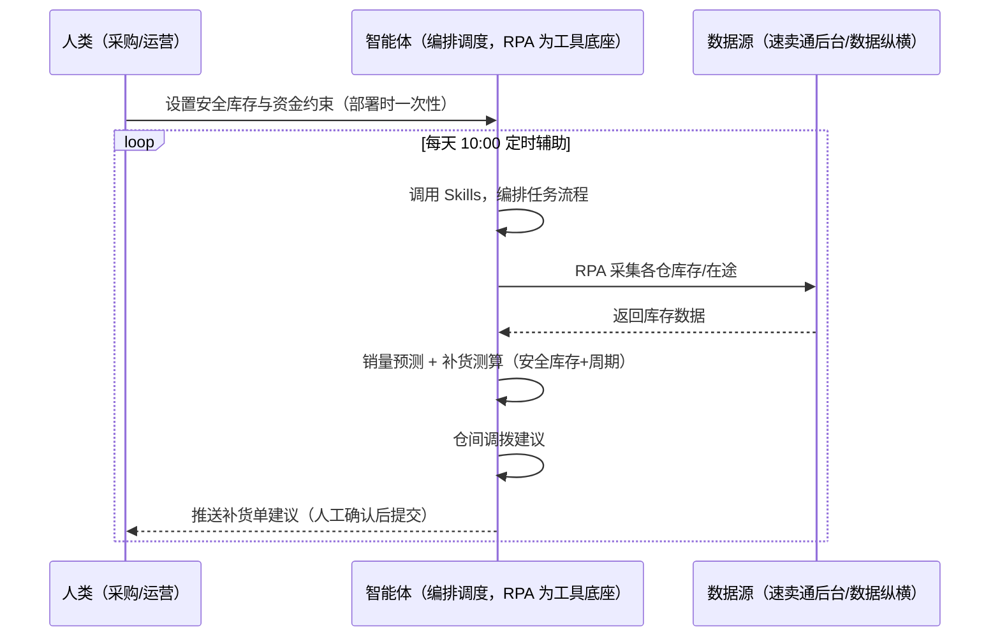
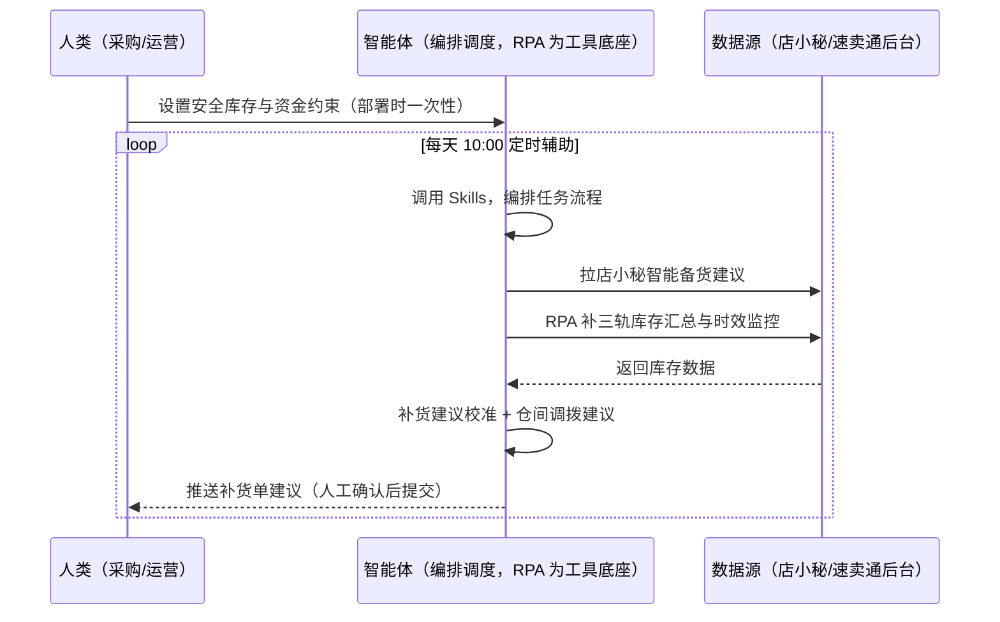

> 为速卖通卖家团队打造的备货与库存管理方案。三轨库存（直发/优选仓/海外仓）分散难汇总、补货量拍脑袋、仓发超时被罚 20 美金、海外仓备货占用资金没数。本方案由智能体调度多个工具执行采集各仓库存与在途数据，智能体做销量预测与补货测算。每天定时辅助，输出补货单建议，提交由人工确认。

> Agent 自动化需开通企业功能
> 点击申请1个月免费权限
> [点击申请 →](https://skieer.feishu.cn/share/base/form/shrcnFwMayykP5iaL38fnZKTbrg)

## 一、用户与需求

核心矛盾：速卖通三轨库存（直发/优选仓/海外仓）分散难汇总、补货量拍脑袋断货或积压、仓发补货超时被罚 20 美金、海外仓备货占用资金没数。

两类客户痛点同源，数据来源不同：

- 未购 SaaS 客户（新卖家/小团队）：人工登录后台查各仓库存、手动算补货量，全靠手；
- 已购 SaaS 客户（店小秘 ERP 等）：店小秘有智能备货建议（可评估挂接），但三轨库存汇总与仓发时效监控仍要人盯。

适用客户：多仓/多 SKU 卖家。后台库存数据可采（数据纵横/后台），补货量测算需智能体+人工确认（资金约束下决策）。

### 1.1 不同模式卖家

| 类型 | 选择 | 建议 |
|-|-|-|
| POP | 首选 | 强烈推荐（三轨库存自主管理，补货必须） |
| 半托管 | 次选 | 一般推荐（半托管库存自理） |
| 全托管 | 次选 | 一般推荐（仓发补货是全托管核心履约动作） |

### 1.2 不同类目卖家

| 类目 | 最关注维度 | 核心逻辑 |
|-|-|-|
| 3C 数码 | 直发时效 | 迭代快，直发为主 |
| 家居家具 | 海外仓资金 | 大件备货占用资金高 |
| 美妆个护 | 效期管理 | 避免过量备货过期 |
| 服装鞋帽 | 季节备货 | 换季备货节奏 |
| 户外运动 | 旺季前置 | 大促备货提前 |
| 母婴用品 | 安全库存 | 断货影响大 |

### 1.3 不同角色用户

| 用户 | 需求 | 问题 | 投入时间（估算） |
|-|-|-|-|
| 老板 | 不断货不积压 | 三轨库存没数 | 0.5 小时/周 |
| 采购/运营 | 补货单建议 | 补货量拍脑袋 | 2-3 小时/周 |
| 仓储 | 仓发时效 | 超时被罚 20 美金 | 1 小时/周 |

---

## 二、现在的方法与问题

### 2.1 流程步骤与问题总结

人工方式（未购 SaaS 客户）

| 序号 | 步骤 | 现在的方法 | 问题缺陷 |
|-|-|-|-|
| 1 | 看库存 | 手动查各仓库存 | 三轨分散难汇总 |
| 2 | 算补货 | 凭经验拍脑袋 | 断货或积压 |
| 3 | 盯时效 | 手动算 9 天红线 | 仓发超时被罚 |
| 4 | 管资金 | 凭感觉 | 海外仓占用资金没数 |
| 5 | 调拨 | 凭经验 | 仓间调拨无建议 |

SaaS 方式（已购店小秘 ERP 客户）

| 序号 | 步骤 | 现在的方法 | 问题缺陷 |
|-|-|-|-|
| 1 | 看库存 | 店小秘部分覆盖 | 三轨汇总靠人 |
| 2 | 算补货 | 店小秘智能备货建议（可挂接） | 建议需人工确认 |
| 3 | 盯时效 | 不覆盖 | 靠人盯 |
| 4 | 管资金 | 无 | 资金占用无感知 |
| 5 | 调拨 | 无 | 无建议 |

### 2.2 问题分析

人工方式根因

| 序号 | 根因 | 具体表现 |
|-|-|-|
| 1 | 三轨分散 | 直发/优选仓/海外仓难汇总 |
| 2 | 补货拍脑袋 | 断货罚款或资金积压 |
| 3 | 时效靠人盯 | 9 天红线算不清被罚 |

**SaaS 方式根因**

| 序号 | 根因 | 具体表现 |
|-|-|-|
| 1 | 覆盖不完整 | 店小秘管订单，仓发时效与资金占用不覆盖 |
| 2 | 无联动 | 备货与资金约束无联动 |

---

## 三、解决方案

### 3.1 功能概述

为速卖通卖家团队打造的备货与库存管理方案，采集各仓库存与在途数据，智能体做销量预测与补货测算，输出补货单建议与仓间调拨建议。

每天定时触发并调度多个工具，调起八爪鱼 RPA（Agent 的工具底座，能耦合多系统、完成自动化任务执行）采集各仓库存与在途数据（优选仓/官方认证海外仓，后台可采），智能体按「安全库存 + 备货周期 + 销量预测」测算补货量。每天定时辅助，输出补货单建议，提交由人工确认。

### 3.2 系统结合

| 要素 | 说明 |
|-|-|
| 客户现有工具盘点 | **未购 SaaS 客户**：无第三方工具，库存全靠人工查后台。    
**已购 SaaS 客户**（主流组合）：店小秘 ERP（官方服务市场合作 ERP，智能备货建议功能可评估挂接） |
| 数据/能力来源 | **无 SaaS**：速卖通后台各仓库存/在途（优选仓/海外仓，登录采集）+ 数据纵横动销。    
**有 SaaS**：店小秘智能备货建议（可挂接）+ RPA 补三轨库存汇总与时效监控 |
| RPA 耦合动作 | 作为 Agent 的工具底座，按计划采集各仓库存（库存口径校验、每日快照），按 SKU 对齐去重，统一流转给智能体；数据缺失告警 |
| 耦合出的新价值 | 单工具给不了的端到端结论：三轨库存一次取齐 → 销量预测 + 补货测算 → 补货单建议 + 仓间调拨建议，**只推送补货建议与时效预警** |

### 3.3 智能体执行流程

智能体定时触发。支持**两种数据通道**，部署时按客户现有工具选择：

**通道一：无 SaaS 方式（RPA 采集各仓库存，适合未购 ERP 的客户）**

**通道二：有 SaaS 方式（店小秘智能备货建议 + RPA 补三轨汇总，适合已购客户）**

> Agent 自动化需开通企业功能
> 点击申请1个月免费权限
> [点击申请 →](https://skieer.feishu.cn/share/base/form/shrcnFwMayykP5iaL38fnZKTbrg)

### 3.4 为何这么设计

要同时回答三个问题：**为什么不能只用 SaaS/API？为什么不能纯靠智能体写代码？为什么 RPA 是执行底座？** 本场景的核心是"定时采集、预测测算、红线预警、挂了有人管"。

#### 1）逐项对比

| 对比维度 | SaaS/API 堆叠（店小秘） | 纯智能体（智能体写代码） | 智能体+自动化工具（RPA 工具底座） |
|-|-|-|-|
| 实现方式 | 店小秘智能备货建议（主体部分） | 能调后台能算，但全要自己接 | 后台三轨汇总 + 预测测算 |
| 定时采集 | 部分覆盖 | 智能体无法常驻轮询 | RPA 每日快照 |
| 红线预警 | 不覆盖 | 需自写倒计时逻辑 | 9 天红线倒计时可视化配置 |
| 使用成本（总拥有成本） | 店小秘订阅费（主体另算） | 代理 IP + 服务器 + 开发维护人力，隐性成本高 | 一份平台订阅跑多流程，单方案边际成本 ≈ 0 |
| 维护人要求 | 低（工具现成） | 规则调整都要开发介入 | 可视化流程，采购自己可调安全库存 |

#### 2）优劣势说明

|  | SaaS/API 堆叠（店小秘） | 纯智能体（智能体写代码） | 智能体+自动化工具（RPA 工具底座） |
|-|-|-|-|
| 优势 | 智能备货建议现成（主体已解决） | 无订阅费；    
可深度定制预测模型 | 三轨汇总+预测测算即开即用；    
非技术人员可维护 |
| 劣势 | 仓发时效与资金占用不覆盖 | 轮询与登录保活全自建；    
AI 生成代码是生成性的 | 本地电脑运行需保持开机；    
订阅费；    
后台登录态需保活 |

#### 3）结论

| 论点 | 说明 |
|-|-|
| 红线=罚款 | 全托管仓发补货单审核后 9 天内未生成入库单/发货单罚 20 美金、实收 &lt; 确认量 80% 罚 20 美金（实锤） |
| 三轨库存特殊性 | 直发/优选仓/海外仓三轨并存，库存口径必须统一——RPA 采集对齐解决分散问题 |
| 官方海外仓 | 官方认证海外仓 = 万邑通/谷仓/美鸥等（实锤）；海外仓发货地须与实际一致否则处罚 |
| 大促备货节奏 | 2025 双11&黑五白皮书：仓发备货周期 9.22-11.10、平均库存售卖天数 26-45 天、POP 商家备货建议 28-42 天、仓发发货时效大促期调 T+4（实锤） |
| 一个底座跑多流程 | 客户购买 RPA 平台是跑多个流程（备货/断货/仓发），本方案只是其中一个——平台订阅费被多流程摊薄 |
| 时间 | 采购要的是"补货单建议 + 时效预警"，不是"翻后台" |

### 3.5 功能清单

| 功能 | 系统 | 功能说明（解决问题） |
|-|-|-|
| 会话/定时 | 智能体 | 1. 理解人类语言，调用已预设好的 Skills。    
2. 编排多任务、调度多工具。 |
| 多系统数据取数 | RPA、指纹浏览器 | 1. 解决三轨库存分散、补货拍脑袋问题。    
2. 作为智能体工具底座被调度执行，每日快照、数据缺失告警。    
3. **【无 SaaS 方式】** RPA 采集各仓库存/在途。**【有 SaaS 方式】** 店小秘智能备货建议 + RPA 补三轨汇总与时效。 |
| 销量预测 | 智能体 | 按动销趋势预测（销量波动大的 SKU 人工复核）。 |
| 补货测算 | 智能体 | 安全库存 + 备货周期 + 销量预测（资金约束下建议）。 |
| 仓间调拨建议 | 智能体 | 优选仓/海外仓间调拨（平衡库存与时效）。 |
| 仓发时效预警 | 智能体 | 9 天红线倒计时（审核后未生成入库单/发货单罚 20 美金）。 |
| IM通知 | 飞书、钉钉、企微等 | 解决补货滞后问题。补货单建议与时效预警自动推送。 |
| 数据资产储存 | 本地电脑、云储存 | 1. Skills 资产：速卖通备货技能。    
2. 数据储存：库存快照统一写入本地。    
3. 经验知识库：补货结果回填迭代。 |

### 3.6 智能体执行落地过程

部署时一次性配置入参（补货策略、目标仓、资金约束、数据通道），会话中无需重复输入。

**⚠️ 部署前提（不满足则方案无法跑起来）**：①RPA 需部署在**常开电脑/云机**上，并配置漏跑补跑机制；②后台需登录采集，登录失效自动告警、人工介入后断点续跑；③**补货单提交由人工确认**（资金约束下决策）；④**有 SaaS 方式需店小秘账号**（智能备货建议挂接，可选增强，无则走后台通道）；⑤首次配置（登录态、安全库存、预测参数）需服务方/技术人员介入一次，属实施成本。

#### 1）配置

| 类别 | 说明 |
|-|-|
| 智能体 | 主流智能体。 |
| 智能体工具 | 1. **数据通道（按客户现有工具二选一）**：【无 SaaS】速卖通后台各仓库存（RPA 采集）；【有 SaaS】店小秘智能备货建议 + RPA 补三轨汇总。    
2. 数据取数与自动化执行：八爪鱼 RPA，MCP 配置完成。    
3. 数据分析：智能体自带。    
4. IM：企业办公 IM（飞书/钉钉/企微），MCP 或 webhook 配置。 |
| 工作知识 | 1. 补货策略：安全库存天数。    
2. 目标仓：优选仓/海外仓。    
3. 资金约束：备货占用现金流上限。    
4. 大促备货节奏：POP 28-42 天。 |
| 本地数据库 | 1. 库存快照库地址。    
2. 补货台账库地址。    
3. 经验库地址。 |

#### 2）执行

| 任务 | 产出 | 产出物接收人 |
|-|-|-|
| 接收补货策略，定时触发 | 任务启动记录 | —— |
| 调用已预设 Skills，编排任务流程 | 任务编排方案 | —— |
| 经 MCP 向八爪鱼 RPA 下发取数任务 | 自动化任务指令 | —— |
| 多源取数并按 SKU 对齐（无 SaaS：后台采集；有 SaaS：店小秘+后台，智能体监控状态） | 对齐后库存数据 | —— |
| 销量预测 + 补货测算 | 补货建议 | 采购 |
| 仓间调拨建议 | 调拨建议 | 采购 |
| 仓发时效预警（9 天红线） | 时效预警 | 仓储 |
| 推送补货单建议（人工确认后提交） | 群消息 | 采购/仓储/老板 |

异常处理：

库存数据缺失 → 告警人工补充；

销量波动大 → 转人工复核预测；

仓发临界 → 告警提醒；

补货建议低置信度 → 转人工；

置信度 &lt;70% → 转人工复核，不输出硬结论。

#### 3）结果

| 结果 | 说明 |
|-|-|
| 数据资产 | 库存快照结构化数据（SKU/三轨库存/在途/可售天数），可审计可追溯。 |
| 分析报告 | 1. 补货单建议：安全库存+周期测算。    
2. 仓间调拨建议。    
3. 仓发时效预警。 |
| Skills | 智能体 Skills：速卖通备货技能，按备货结果迭代预测参数。 |

> Agent 自动化需开通企业功能
> 点击申请1个月免费权限
> [点击申请 →](https://skieer.feishu.cn/share/base/form/shrcnFwMayykP5iaL38fnZKTbrg)

---

## 四、使用前后预估

> 本方案价值 = **三轨库存自动汇总 → 销量预测 + 补货测算 → 补货单建议 + 仓间调拨 → 时效预警**。后台库存数据可采，店小秘智能备货建议可评估挂接。

| 指标 | 人工 | SaaS/API（店小秘） | 智能体+自动化工具 |
|-|-|-|-|
| 三轨汇总 | 手动分散查 | 部分覆盖 | 自动汇总对齐 |
| 补货测算 | 拍脑袋 | 智能建议 | 预测+周期测算（资金约束） |
| 仓间调拨 | 凭经验 | 无 | 平衡建议 |
| 仓发时效 | 靠人算 | 不覆盖 | 9 天红线自动预警 |
| 资金占用 | 没数 | 无 | 备货占用可视化 |
| 方法论 | 无 | 单工具规则 | 可复用的 Skills 与预测模型 |

**说明**：全托管仓发补货单审核后 9 天内未生成入库单/发货单罚 20 美金、实收 &lt; 确认量 80% 罚 20 美金（实锤）；海外仓发货地须与实际一致否则处罚；官方认证海外仓 = 万邑通/谷仓/美鸥等；10 日达覆盖 50 国是物流竞争力；大促备货节奏（2025 双11&黑五白皮书）：仓发备货周期 9.22-11.10、平均库存售卖天数 26-45 天、POP 商家备货建议 28-42 天、仓发发货时效大促期调 T+4。

---

## 五、效果证明

> Agent 自动化需开通企业功能
> 点击申请1个月免费权限
> [点击申请 →](https://skieer.feishu.cn/share/base/form/shrcnFwMayykP5iaL38fnZKTbrg)

### 5.1 客户案例

**《唯世美：家具大件补货全流程自动化》**

> 首款内置 RGB 灯光展示柜上架两个月即拿下 Amazon 美加英德四站与 Walmart、Temu 美站 Best Seller。为应对数据源分散、人工操作耗时与 SKU 管理混乱，实现补货判断全流程自动化。

| 效果 | 说明 |
|-|-|
| 提效 | 补货整理重复工作量下降 80%。原本需人工从领星 ERP 与各海外仓平台逐项导出库存、库龄数据再手工清洗匹配 SKU，现在自动抓取、自动清洗，输出补货建议。 |
| 降本 | 免除人工导表与拼表的重复投入，供应链团队投入转向库存结构优化与周转率提升等重点工作。 |
| 任务 | 库存数据抓取与处理准确率达 99% 以上，分散数据源实时同步。 |
| 任务 | 自有 Excel 模板逻辑零改动保留，补货计算口径与原有习惯一致。 |

案例详情：[家具大件补货：补货全流程自动化，整理数据重复工作量下降 80%](https://skieer.feishu.cn/wiki/Gca3w8j1KixDXjkz0oScFwHAngf)

**《小天鹅：7 平台 16 账号库存数据自动化，年省成本 50 万》**

> 美的集团旗下小天鹅事业部，7 个电商平台、16 个账号、每日 86 张报表原需专员逐个登录导出 7 小时/天。八爪鱼 RPA 替代全部人工采集，7 大系统、25 类报表自动采集入库。

| 效果 | 说明 |
|-|-|
| 提效 | 多平台报表采集效率提升约 85%。原本 7 个平台 16 个账号、86 张报表需逐个登录导出，每天耗 7 小时，现在全自动采集入库；数据时效由 T+2 提升至 T+1，部分平台已 T+0。 |
| 降本 | 减少数据专员 2 人（原文：2 名全职数据专员的「搬数据」工作被完全替代，年节省人力成本 50 万元）。原本需 2 人全职导表，现在 0 人；2 名专员转岗至数据分析岗，投入库存分析、周转率优化、滞销品预警等高价值工作。 |
| 任务 | 7 个电商平台 16 个账号、25 类报表自动采集入库；错误率降至 0.1%。 |
| 任务 | 天猫指纹浏览器、苏宁每 2 小时定时抓取、京东按事业部隔离账号，多平台差异化策略稳定运行。 |

案例详情：[小天鹅：百亿级洗衣机巨头的多平台库存数据自动化实践](https://skieer.feishu.cn/wiki/Q6Qjw2FtDiNFgWkOVHacEFJ0nlh)

---

## 六、备注

### 6.1 Agent 支持

本方案不绑定具体智能体，主流 Agent 均可运行（需支持技能/Skills 加载与工具调用）：

| Agent/智能体 | 说明 |
|-|-|
| Workbuddy | 本方案运行平台，支持技能/Skills 上传加载、定时任务、MCP 工具调用与表格/报告处理 |
| 豆包（国内·字节） | 国内主流个人智能体，支持技能上传、定时任务与工具调用，上手成本低 |
| 通义千问（国内·阿里） | 支持 Agent 编排与插件生态，集成阿里电商数据能力，适合电商场景 |
| DeepSeek（国内） | 推理能力强、成本低，适合规则打分与归因分析类任务 |
| ChatGPT（国外·OpenAI） | 海外主流通用智能体，支持 GPTs/Agent 模式与工具调用 |
| Claude（国外·Anthropic） | 长文本与结构化分析能力强，原生支持 MCP 连接外部工具 |

### 6.2 名词解释

| 术语 | 说明 |
|-|-|
| 三轨库存 | 直发/优选仓/海外仓三轨库存模式 |
| 优选仓 | 平台优选海外仓（官方认证：万邑通/谷仓/美鸥等） |
| 9 天红线 | 仓发补货单审核后 9 天内未生成入库单/发货单罚 20 美金 |
| 安全库存 | 补货策略参数（安全库存天数） |
| 仓间调拨 | 优选仓/海外仓间库存平衡 |
| 混合数据源 | 速卖通后台库存（登录采集）+ 店小秘智能备货建议（有 SaaS 客户挂接） |
| 有 SaaS 方式 | 已购店小秘 ERP，智能备货建议 + RPA 补三轨汇总 |
| 无 SaaS 方式 | 不购买第三方工具，RPA 采集后台库存 |
| POP | 自主运营模式（自主上架定价，总费率 6%-11.5%） |
| 全托管 | 平台代运营（无自主发布权，平台抽佣 25%-30%） |
| 半托管 | 佣金介于 POP 与全托管之间 |
| MCP | Model Context Protocol，智能体连接外部工具的标准化通道 |

> Agent 自动化需开通企业功能
> 点击申请1个月免费权限
> [点击申请 →](https://skieer.feishu.cn/share/base/form/shrcnFwMayykP5iaL38fnZKTbrg)

---

原文：[查看原文](https://skieer.feishu.cn/wiki/DQ2swAl8MiJE16kOznqcWfTDnlh)
