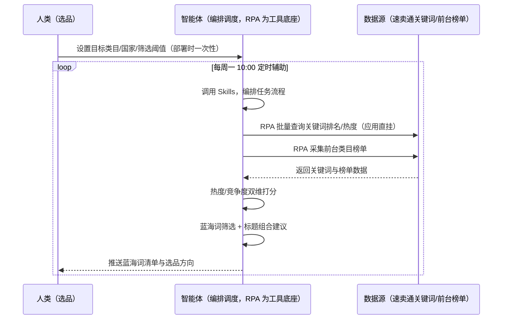
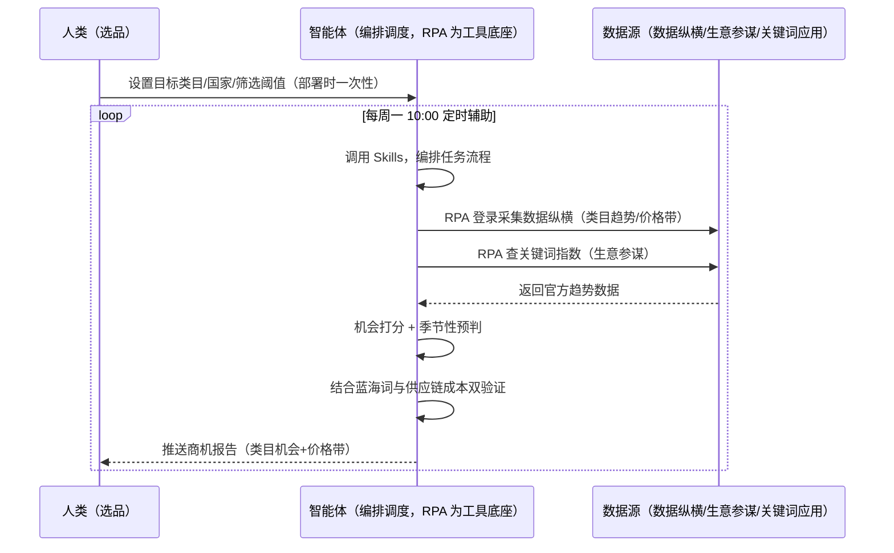

> 为速卖通卖家团队打造的市场机会发现方案。选品靠刷榜截图信息散乱、凭感觉判断趋势选错品类、季节品备货节奏踩错。本方案由智能体调度多个工具执行批量查询关键词排名/热度 + 采集官方数据纵横类目趋势，输出蓝海词清单与商机报告任务。每周定时辅助，输出选品方向与商机清单，供你验证选品。

> Agent 自动化需开通企业功能
> 点击申请1个月免费权限
> [点击申请 →](https://skieer.feishu.cn/share/base/form/shrcnFwMayykP5iaL38fnZKTbrg)

## 一、用户与需求

核心矛盾：逐词手动查排名 100 个词要一上午、凭感觉选品上架后没流量、官方数据纵横维度多但不会用。

两类客户痛点同源，数据来源不同：

- 未购 SaaS 客户（新卖家/小团队）：人工刷榜单截图、逐词查排名、手动看数据纵横，全靠手；
- 已购 SaaS 客户（店小秘 ERP 等）：店小秘管订单/上架（官方服务市场合作 ERP），关键词排名与商机分析不覆盖，仍要人手动做。

适用客户：有选品规模需求的卖家。关键词排名批量查询现成应用直挂（唯一速卖通专属应用）；官方数据纵横需登录后台采集。

### 1.1 不同模式卖家

| 类型 | 选择 | 建议 |
|-|-|-|
| POP（自主运营） | 首选 | 强烈推荐（自主选品上架，商机分析直接指导） |
| 半托管 | 次选 | 一般推荐（半托管可自主选品，佣金介于中间） |
| 全托管 | 任意 | 不推荐（平台代运营，无自主发布权，选品价值有限） |

### 1.2 不同类目卖家

| 类目 | 最关注维度 | 核心逻辑 |
|-|-|-|
| 3C 数码 | 搜索热度 | 关键词=流量入口，热度趋势关键 |
| 家居家具 | 价格带 | 蓝海价格带识别 |
| 美妆个护 | 认证门槛 | 资质成本可控才值得做 |
| 服装鞋帽 | 季节性 | 按市场季节预判 |
| 户外运动 | 旺季前置 | 旺季前 2-3 周选品 |
| 母婴用品 | 合规成本 | 安全认证前置评估 |

### 1.3 不同角色用户

| 用户 | 需求 | 问题 | 投入时间（估算） |
|-|-|-|-|
| 老板 | 选品方向 | 凭感觉选，试错成本高 | 1 小时/周 |
| 选品 | 蓝海词+商机清单 | 逐词查排名费时 | 2-3 小时/周 |
| 运营 | 标题关键词组合 | 堆砌关键词被判定垃圾信息 | 1 小时/周 |

---

## 二、现在的方法与问题

### 2.1 流程步骤与问题总结

人工方式（未购 SaaS 客户）

| 序号 | 步骤 | 现在的方法 | 问题缺陷 |
|-|-|-|-|
| 1 | 查词 | 逐词手动查排名 | 100 个词要一上午 |
| 2 | 看趋势 | 手动翻数据纵横 | 维度多不会用 |
| 3 | 定品 | 凭感觉 | 上架后没流量 |
| 4 | 组标题 | 凭经验堆词 | 被判定垃圾信息 |
| 5 | 验证 | 上架后才知道 | 试错成本高 |

SaaS 方式（已购店小秘 ERP 客户）

| 序号 | 步骤 | 现在的方法 | 问题缺陷 |
|-|-|-|-|
| 1 | 查词 | 店小秘不覆盖 | 靠人查 |
| 2 | 看趋势 | 手动 | 不会用 |
| 3 | 定品 | 凭感觉 | 无分析 |
| 4 | 组标题 | 靠人 | 无建议 |
| 5 | 验证 | 无回测 | 不迭代 |

### 2.2 问题分析

人工方式根因

| 序号 | 根因 | 具体表现 |
|-|-|-|
| 1 | 逐词手动 | 排名查询费时 |
| 2 | 趋势靠感觉 | 选错品类 |
| 3 | 无词库沉淀 | 标题组合凭经验 |

**SaaS 方式根因**

| 序号 | 根因 | 具体表现 |
|-|-|-|
| 1 | 店小秘不覆盖选品 | 关键词/趋势分析无工具 |
| 2 | 无闭环 | 新品排名不回测 |

---

## 三、解决方案

### 3.1 功能概述

为速卖通卖家团队打造的市场机会发现方案，批量查询关键词排名/热度 + 采集官方数据纵横类目趋势，输出蓝海词清单与商机报告。

每周定时触发并调度多个工具，调起八爪鱼 RPA（Agent 的工具底座，能耦合多系统、完成自动化任务执行）批量查询速卖通关键词排名/热度（现成专属应用直挂）+ 采集官方数据纵横类目榜单/趋势数据，智能体按热度/竞争度双维度打分，输出选品方向与商机报告。每周定时辅助，输出选品方向与商机清单，供你验证选品。

### 3.2 系统结合

| 要素 | 说明 |
|-|-|
| 客户现有工具盘点 | **未购 SaaS 客户**：无第三方工具，选品全靠手动查词。  
**已购 SaaS 客户**（主流组合）：店小秘 ERP（官方服务市场合作 ERP，管订单/上架，选品不覆盖） |
| 数据/能力来源 | **无 SaaS**：速卖通关键词排名批量查询导出（唯一专属应用直挂）+ 前台类目榜单。  
**有 SaaS**：官方数据纵横（店铺/行业/关键词多维度，需登录，紫鸟/飞跨浏览器配合）+ 生意参谋关键词指数（官方选品工具） |
| RPA 耦合动作 | 作为 Agent 的工具底座，按计划批量查词（应用直挂、批量限速防风控）+ 登录采集数据纵横（榜单快照留档），统一流转给智能体；低置信度词转人工 |
| 耦合出的新价值 | 单工具给不了的端到端结论：关键词排名 + 类目趋势一次取齐 → 热度/竞争度双维打分 → 蓝海词清单 + 选品方向 + 标题组合建议，**只推送商机清单** |

### 3.3 智能体执行流程

智能体定时触发。支持**两种数据通道**，部署时按客户现有工具选择：

**通道一：无 SaaS 方式（RPA 批量查词，适合未购 ERP 的客户）**

**通道二：有 SaaS 方式（官方数据纵横 + 关键词应用，适合已购客户）**

> Agent 自动化需开通企业功能
> 点击申请1个月免费权限
> [点击申请 →](https://skieer.feishu.cn/share/base/form/shrcnFwMayykP5iaL38fnZKTbrg)

### 3.4 为何这么设计

要同时回答三个问题：**为什么不能只用 SaaS/API？为什么不能纯靠智能体写代码？为什么 RPA 是执行底座？** 本场景的核心是"定时查词、趋势采集、双维打分、挂了有人管"。

#### 1）逐项对比

| 对比维度 | SaaS/API 堆叠（店小秘/数据纵横） | 纯智能体（智能体写代码） | 智能体+自动化工具（RPA 工具底座） |
|-|-|-|-|
| 实现方式 | 官方工具给趋势数据（数据纵横） | 能查词能分析，但全要自己接 | 关键词应用直挂 + 官方数据采集 |
| 批量查词 | 无专属应用覆盖 | 需自写查询与限速 | 现成应用直挂、批量限速防风控 |
| 登录采集 | 数据纵横需登录态 | 会话易失效 | 紫鸟/飞跨配合、快照留档 |
| 使用成本（总拥有成本） | ERP/紫鸟订阅费 | 代理 IP + 服务器 + 开发维护人力，隐性成本高 | 一份平台订阅跑多流程，单方案边际成本 ≈ 0 |
| 维护人要求 | 低（工具现成） | 规则调整都要开发介入 | 可视化流程，选品自己可调阈值 |

#### 2）优劣势说明

|  | SaaS/API 堆叠（官方工具） | 纯智能体（智能体写代码） | 智能体+自动化工具（RPA 工具底座） |
|-|-|-|-|
| 优势 | 数据纵横官方口径权威 | 无订阅费；  
可深度定制选品模型 | 关键词应用直挂；  
双维打分即开即用；  
非技术人员可维护 |
| 劣势 | 需登录态与权限；  
趋势判断依赖人工 | 登录保活与查词全自建；  
AI 生成代码是生成性的 | 本地电脑运行需保持开机；  
订阅费；  
后台采集受登录态影响 |

#### 3）结论

| 论点 | 说明 |
|-|-|
| 关键词=流量入口 | 速卖通搜索流量占比高（直通车是搜索广告），蓝海词判断 = 搜索热度上升 + 在线商品数少（实锤） |
| 双源互补 | 前台查词反映消费需求，数据纵横反映官方趋势（店铺/行业/关键词多维度）——双源交叉验证 |
| 商机需双验证 | 商机判断需结合蓝海词与供应链成本双验证，避免「数据好看做不了」的坑 |
| 一个底座跑多流程 | 客户购买 RPA 平台是跑多个流程（选品/竞品/定价），本方案只是其中一个——平台订阅费被多流程摊薄 |
| 时间 | 选品要的是"每周一张可决策的商机清单"，不是"查一上午词" |

### 3.5 功能清单

| 功能 | 系统 | 功能说明（解决问题） |
|-|-|-|
| 会话/定时 | 智能体 | 1. 理解人类语言，调用已预设好的 Skills。  
2. 编排多任务、调度多工具。 |
| 多系统数据取数 | RPA、指纹浏览器 | 1. 解决逐词手动查排名、趋势靠感觉问题。  
2. 作为智能体工具底座被调度执行，批量限速防风控、快照留档。  
3. **【无 SaaS 方式】** RPA 批量查关键词排名 + 采集前台榜单。**【有 SaaS 方式】** RPA 登录采集数据纵横 + 查生意参谋关键词指数。 |
| 双维打分 | 智能体 | 热度/竞争度双维度打分（蓝海 = 热度上升 + 在线商品数少）。 |
| 蓝海词筛选 | 智能体 | 低竞争高需求词筛选，标题核心词放前 3 位（平台标题权重）。 |
| 商机分析 | 智能体 | 类目机会分析（蓝海类目/价格带/季节性预判），结合供应链成本双验证。 |
| IM通知 | 飞书、钉钉、企微等 | 解决商机清单交付滞后问题。蓝海词与商机报告自动推送。 |
| 数据资产储存 | 本地电脑、云储存 | 1. Skills 资产：速卖通品类机会库技能。  
2. 数据储存：词库与榜单快照统一写入本地。  
3. 经验知识库：动销回填迭代词库。 |

### 3.6 智能体执行落地过程

部署时一次性配置入参（目标类目、目标国家、关键词池、筛选阈值、数据通道），会话中无需重复输入。

**⚠️ 部署前提（不满足则方案无法跑起来）**：①RPA 需部署在**常开电脑/云机**上，并配置漏跑补跑机制；②**有 SaaS 方式需卖家后台登录态**（数据纵横采集，紫鸟/飞跨浏览器配合，登录失效自动告警）；③关键词查询应用需按平台风控限速；④首次配置（登录态、词库、打分参数）需服务方/技术人员介入一次，属实施成本。

#### 1）配置

| 类别 | 说明 |
|-|-|
| 智能体 | 主流智能体。 |
| 智能体工具 | 1. **数据通道（按客户现有工具二选一）**：【无 SaaS】关键词排名应用 + 前台榜单（RPA 采集）；【有 SaaS】官方数据纵横 + 生意参谋（登录采集）。  
2. 数据取数与自动化执行：八爪鱼 RPA，MCP 配置完成。  
3. 数据分析：智能体自带。  
4. IM：企业办公 IM（飞书/钉钉/企微），MCP 或 webhook 配置。 |
| 工作知识 | 1. 目标类目。  
2. 目标国家（欧美/拉美/俄罗斯权重不同）。  
3. 关键词池（或智能体按类目挖掘）。  
4. 筛选阈值（热度/竞争度）。 |
| 本地数据库 | 1. 词库地址。  
2. 榜单快照库地址。  
3. 经验库地址。 |

#### 2）执行

| 任务 | 产出 | 产出物接收人 |
|-|-|-|
| 接收关键词池，定时触发 | 任务启动记录 | —— |
| 调用已预设 Skills，编排任务流程 | 任务编排方案 | —— |
| 经 MCP 向八爪鱼 RPA 下发取数任务 | 自动化任务指令 | —— |
| 多源取数（无 SaaS：查词+榜单；有 SaaS：数据纵横+生意参谋，智能体监控状态） | 对齐后关键词数据 | —— |
| 热度/竞争度双维打分 | 蓝海词清单 | 选品 |
| 商机分析（类目/价格带/季节） | 商机报告 | 选品/老板 |
| 标题关键词组合建议 | 标题建议 | 运营 |
| 推送蓝海词清单与商机报告 | 群消息 | 选品/运营/老板 |

异常处理：

查询失败 → 自动重试并告警；

登录失效 → 告警人工介入后断点续跑；

低置信度词 → 转人工；数据异常 → 快照比对告警；

置信度 &lt;70% → 转人工复核，不输出硬结论。

#### 3）结果

| 结果 | 说明 |
|-|-|
| 数据资产 | 词库与榜单快照结构化数据（关键词/热度/竞争度/来源），可审计可追溯。 |
| 分析报告 | 1. 蓝海词清单：双维打分。  
2. 商机报告：类目机会+价格带+季节性。  
3. 标题组合建议。 |
| Skills | 智能体 Skills：速卖通品类机会库技能，按月迭代趋势判断。 |

> Agent 自动化需开通企业功能
> 点击申请1个月免费权限
> [点击申请 →](https://skieer.feishu.cn/share/base/form/shrcnFwMayykP5iaL38fnZKTbrg)

---

## 四、使用前后预估

> 本方案价值 = **关键词排名批量查询 → 热度/竞争度双维打分 → 蓝海词清单 + 商机报告 → 标题组合建议**。关键词排名批量查询现成应用直挂（唯一速卖通专属应用）。

| 指标 | 人工 | SaaS/API（官方工具） | 智能体+自动化工具 |
|-|-|-|-|
| 关键词查询 | 100 词一上午 | 无专属应用 | 应用直挂批量查 |
| 趋势分析 | 不会用 | 数据纵横（需登录） | 自动采集+打分 |
| 蓝海判断 | 凭感觉 | 无 | 热度/竞争度双维 |
| 标题组合 | 凭经验堆词 | 无 | 核心词前置建议 |
| 季节预判 | 踩错节奏 | 无 | 季节因子校正 |
| 方法论 | 无 | 单工具数据 | 可复用的 Skills 与词库 |

**说明**：速卖通搜索流量占比高（直通车是搜索广告），关键词=流量入口；蓝海词判断 = 搜索热度上升 + 在线商品数少；标题核心词放前 3 位（平台标题权重）；参考数据纵横 + 生意参谋关键词指数（实锤官方选品工具）；商机判断需结合蓝海词与供应链成本双验证。

---

## 五、效果证明

> Agent 自动化需开通企业功能
> 点击申请1个月免费权限
> [点击申请 →](https://skieer.feishu.cn/share/base/form/shrcnFwMayykP5iaL38fnZKTbrg)

### 5.1 客户案例

**《家居龙头：20+ 海外平台商品数据自动化，日均 2.5 万条》**

> 20+ 海外平台的商品价格、运费、SKU、排名等多维度数据原靠人工抽样采集。RPA 实现全自动全量采集与入库，为跨境运营决策提供数据底座。

| 效果 | 说明 |
|-|-|
| 提效 | 多平台商品数据采集效率提升约 85%。原本 20+ 海外平台的商品数据靠人工抽样采集，现在全自动全量采集入库，日均 2.5 万条，运营上班即可看到最新数据。 |
| 降本 | 告别「导表格、拼数据」的重复劳动，运营团队从人工采集转为直接使用数据做选品与定价决策。 |
| 任务 | 覆盖 20+ 海外平台，价格/运费/SKU/EAN/首图/类目排名等 8+ 核心字段，支持变体信息全采集。 |
| 任务 | 采集稳定率 99%+，跨语言、跨页面结构、跨价格展示方式全部适配。 |

案例详情：[跨境取数：家居龙头的20+海外平台商品数据自动化实践](https://skieer.feishu.cn/wiki/Iko0wtqEfiOdzlkstYBc5DI3nUe)

**《竞品 AI 快报：多平台动态 7×24 监控与自动出报》**

> 某大型教培集团需盯多家竞品公众号、课程与活动动态，人工巡查信息零散难汇总。RPA 自动巡查多平台账号并生成竞品快报。

| 效果 | 说明 |
|-|-|
| 提效 | 竞品动态巡查由人工每日逐平台翻阅变为 7×24 自动监控。原本市场团队需人工登录多平台逐篇查看推文、课程与活动，现在自动抓取、自动分析、自动出报告。 |
| 降本 | 市场团队用于公众号巡查、内容摘抄与情报汇总的重复性工作量降低约 80%，投入转向课程优化、活动策划与市场竞争策略等重点工作。 |
| 任务 | 竞品课程、价格及营销动态识别准确率提升至 95% 以上，减少遗漏与误判。 |
| 任务 | 多平台账号自动巡查，情报按周期自动汇总成报。 |

案例详情：[快报|社媒监控：竞品AI快报生成自动化](https://skieer.feishu.cn/wiki/UNA7wUatCih1D2kXL5Fco3MpnGe)

---

## 六、备注

### 6.1 Agent 支持

本方案不绑定具体智能体，主流 Agent 均可运行（需支持技能/Skills 加载与工具调用）：

| Agent/智能体 | 说明 |
|-|-|
| Workbuddy | 本方案运行平台，支持技能/Skills 上传加载、定时任务、MCP 工具调用与表格/报告处理 |
| 豆包（国内·字节） | 国内主流个人智能体，支持技能上传、定时任务与工具调用，上手成本低 |
| 通义千问（国内·阿里） | 支持 Agent 编排与插件生态，集成阿里电商数据能力，适合电商场景 |
| DeepSeek（国内） | 推理能力强、成本低，适合规则打分与归因分析类任务 |
| ChatGPT（国外·OpenAI） | 海外主流通用智能体，支持 GPTs/Agent 模式与工具调用 |
| Claude（国外·Anthropic） | 长文本与结构化分析能力强，原生支持 MCP 连接外部工具 |

### 6.2 名词解释

| 术语 | 说明 |
|-|-|
| 蓝海词 | 搜索热度上升 + 在线商品数少的词（低竞争高需求） |
| 数据纵横 | 速卖通官方数据分析工具（店铺/行业/关键词多维度） |
| 生意参谋 | 官方选品工具（关键词指数） |
| 双维打分 | 热度/竞争度双维度评分 |
| 标题权重 | 平台标题核心词前置（前 3 位）规则 |
| 混合数据源 | 关键词排名应用（直挂）+ 官方数据纵横（需登录）+ 前台榜单（公开） |
| 有 SaaS 方式 | 已购店小秘 ERP，官方数据纵横 + 生意参谋关键词指数 |
| 无 SaaS 方式 | 不购买第三方工具，RPA 批量查词 + 前台榜单 |
| POP | 自主运营模式（自主上架定价，总费率 6%-11.5%） |
| 全托管 | 平台代运营（无自主发布权，平台抽佣 25%-30%） |
| 半托管 | 佣金介于 POP 与全托管之间 |
| MCP | Model Context Protocol，智能体连接外部工具的标准化通道 |

> Agent 自动化需开通企业功能
> 点击申请1个月免费权限
> [点击申请 →](https://skieer.feishu.cn/share/base/form/shrcnFwMayykP5iaL38fnZKTbrg)

---

原文：[查看原文](https://skieer.feishu.cn/wiki/AbRQwcKPBi6m6fkQe0LcgYC1nph)
