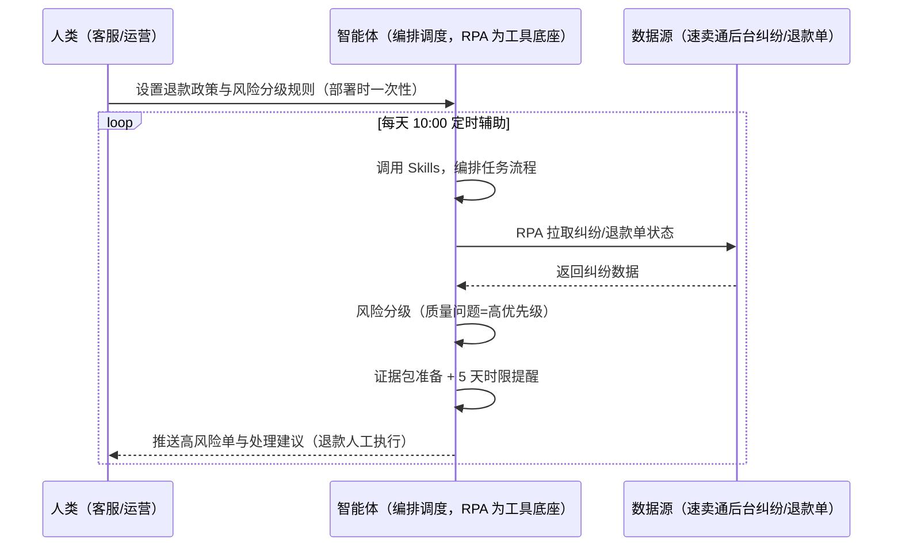
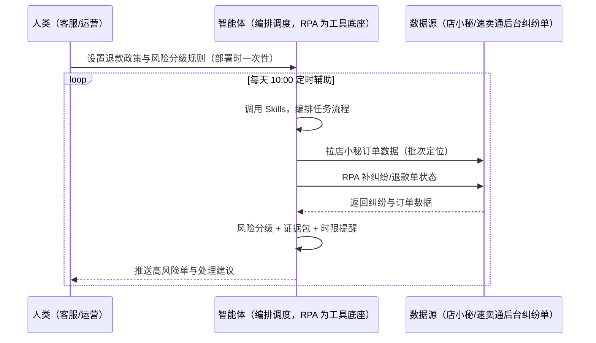

> 为速卖通卖家团队打造的纠纷与退款管理方案。纠纷单 5 天响应/ODR 红线、仅退款最低 10 美金、退款率影响放款评估、退货跨境退运成本高。本方案由智能体调度多个工具执行拉取纠纷/退款单状态，智能体按规则风险分级并准备证据。每天定时辅助，只推送高风险单与处理建议，退款决策由人工执行。

> Agent 自动化需开通企业功能
> 点击申请1个月免费权限
> [点击申请 →](https://skieer.feishu.cn/share/base/form/shrcnFwMayykP5iaL38fnZKTbrg)

## 一、用户与需求

核心矛盾：纠纷单 5 天响应时限、ODR 红线影响店铺；主流国家支持仅退款无需退货（最低 10 美金）、韩国/德国无理由退款比例高需在定价预留；退款率影响放款评估。

两类客户痛点同源，数据来源不同：

- 未购 SaaS 客户（新卖家/小团队）：人工逐单处理纠纷、手动看退款率，全靠手；
- 已购 SaaS 客户（店小秘 ERP 等）：店小秘管订单库存，纠纷风险分级与证据整理不覆盖，仍要人盯。

适用客户：售后量大、ODR 敏感的卖家。纠纷监控与证据整理可自动化，退款决策需人工（涉及资金）。

### 1.1 不同模式卖家

| 类型 | 选择 | 建议 |
|-|-|-|
| POP | 首选 | 强烈推荐（自主履约，纠纷/ODR 影响店铺权重） |
| 半托管 | 次选 | 一般推荐（半托管自主履约） |
| 全托管 | 不适用 | 平台代运营履约 |

### 1.2 不同类目卖家

| 类目 | 最关注维度 | 核心逻辑 |
|-|-|-|
| 3C 数码 | ODR 红线 | 客单价高，纠纷影响大 |
| 家居家具 | 退货成本 | 大件退运成本高 |
| 美妆个护 | 仅退款 | 质量问题退款 |
| 服装鞋帽 | 尺寸纠纷 | 尺码问题占比高 |
| 户外运动 | 质量投诉 | 功能件纠纷 |
| 母婴用品 | 安全退款 | 安全问题高优先级 |

### 1.3 不同角色用户

| 用户 | 需求 | 问题 | 投入时间（估算） |
|-|-|-|-|
| 老板 | ODR 可控 | 纠纷影响放款 | 0.5 小时/周 |
| 客服 | 风险分级 | 逐单处理费时 | 1-2 小时/周 |
| 运营 | 退款损耗 | 无理由退款预留 | 1 小时/周 |

---

## 二、现在的方法与问题

### 2.1 流程步骤与问题总结

**人工方式（未购 SaaS 客户）**

| 序号 | 步骤 | 现在的方法 | 问题缺陷 |
|-|-|-|-|
| 1 | 拉纠纷单 | 手动翻后台 | 逐单看费时 |
| 2 | 分级 | 凭经验 | 高风险漏判 |
| 3 | 准备证据 | 手动找 | 证据准备慢 |
| 4 | 处理 | 手动退款/申诉 | 5 天时限错过 |
| 5 | 统计 | 手动算 ODR | 红线无感知 |

**SaaS 方式（已购店小秘 ERP 客户）**

| 序号 | 步骤 | 现在的方法 | 问题缺陷 |
|-|-|-|-|
| 1 | 拉纠纷单 | 店小秘部分覆盖 | 状态快照靠人 |
| 2 | 分级 | 靠人 | 无风险模型 |
| 3 | 准备证据 | 手动 | 慢 |
| 4 | 处理 | 手动 | 时限靠人 |
| 5 | 统计 | 手动 | 无预警 |

### 2.2 问题分析

**人工方式根因**

| 序号 | 根因 | 具体表现 |
|-|-|-|
| 1 | 风险分级靠人 | 高风险单漏判 |
| 2 | 5 天时限错过 | 纠纷升级影响 ODR |
| 3 | 证据准备慢 | 申诉被动 |

**SaaS 方式根因**

| 序号 | 根因 | 具体表现 |
|-|-|-|
| 1 | 覆盖不完整 | 风险分级与证据整理无工具 |
| 2 | 无闭环 | 退款损耗不归因 |

---

## 三、解决方案

### 3.1 功能概述

为速卖通卖家团队打造的纠纷与退款管理方案，拉取纠纷/退款单状态，智能体按规则风险分级并准备证据。

每天定时触发并调度多个工具，调起八爪鱼 RPA（Agent 的工具底座，能耦合多系统、完成自动化任务执行）拉取纠纷/退款单状态（后台可采），智能体按「仅退款」政策与退款率红线分析风险单（质量问题/货不对板）、按分级规则准备证据包。每天定时辅助，只推送高风险单与处理建议，退款决策由人工执行。

### 3.2 系统结合

| 要素 | 说明 |
|-|-|
| 客户现有工具盘点 | **未购 SaaS 客户**：无第三方工具，纠纷全靠人工处理。     **已购 SaaS 客户**（主流组合）：店小秘 ERP（官方服务市场合作 ERP，管订单库存，纠纷风控不覆盖） |
| 数据/能力来源 | **无 SaaS**：速卖通后台纠纷/退款单状态（登录采集）。     **有 SaaS**：店小秘订单数据（辅助定位问题批次）+ RPA 补纠纷单采集 |
| RPA 耦合动作 | 作为 Agent 的工具底座，按计划拉取纠纷/退款单状态（拉单幂等、状态快照），统一流转给智能体；5 天响应时限倒计时 |
| 耦合出的新价值 | 单工具给不了的端到端结论：纠纷单一次取齐 → 风险分级（质量问题=高优先级）→ 证据包准备 → 5 天时限提醒，**只推送高风险单与处理建议** |

### 3.3 智能体执行流程

智能体定时触发。支持**两种数据通道**，部署时按客户现有工具选择：

**通道一：无 SaaS 方式（RPA 采集纠纷单，适合未购 ERP 的客户）**

**通道二：有 SaaS 方式（店小秘订单辅助定位 + RPA 补纠纷单，适合已购客户）**

> Agent 自动化需开通企业功能
> 点击申请1个月免费权限
> [点击申请 →](https://skieer.feishu.cn/share/base/form/shrcnFwMayykP5iaL38fnZKTbrg)

### 3.4 为何这么设计

要同时回答三个问题：**为什么不能只用 SaaS/API？为什么不能纯靠智能体写代码？为什么 RPA 是执行底座？** 本场景的核心是"定时拉单、风险分级、时限提醒、挂了有人管"。

#### 1）逐项对比

| 对比维度 | SaaS/API 堆叠（店小秘） | 纯智能体（智能体写代码） | 智能体+自动化工具（RPA 工具底座） |
|-|-|-|-|
| 实现方式 | 店小秘管订单，纠纷风控不覆盖 | 能抓后台能分析，但全要自己接 | 后台纠纷采集 + 风险分级 |
| 定时拉单 | 不覆盖 | 智能体无法常驻轮询 | RPA 定时拉单幂等 |
| 证据准备 | 无 | 需自建证据逻辑 | 证据包模板化 |
| 使用成本（总拥有成本） | 店小秘订阅费（主体另算） | 代理 IP + 服务器 + 开发维护人力，隐性成本高 | 一份平台订阅跑多流程，单方案边际成本 ≈ 0 |
| 维护人要求 | 低（工具现成） | 规则调整都要开发介入 | 可视化流程，客服自己可调分级规则 |

#### 2）优劣势说明

|  | SaaS/API 堆叠（店小秘） | 纯智能体（智能体写代码） | 智能体+自动化工具（RPA 工具底座） |
|-|-|-|-|
| 优势 | 订单数据权威（批次定位） | 无订阅费；     可深度定制风控模型 | 纠纷拉单+风险分级+证据包；     非技术人员可维护 |
| 劣势 | 纠纷风控不覆盖 | 拉单与分级全自建；     AI 生成代码是生成性的 | 本地电脑运行需保持开机；     订阅费；     退款需人工执行 |

#### 3）结论

| 论点 | 说明 |
|-|-|
| 5 天响应=红线 | 争议单 5 天响应时限，逾期升级影响 ODR（实锤） |
| 仅退款政策实锤 | 速卖通主流国家支持仅退款无需退货、自定义最低退款金额（最低要求 10 美金）；韩国/德国无理由退款比例高需在定价预留 |
| 退款率影响放款 | 退款率影响放款评估（综合评估指标：纠纷率/退款率/好评率，实锤） |
| 退运成本高 | 退货跨境退运平均 ¥80-150 耗时 20-40 天（实锤）——尽量仅退款不退货 |
| 退款人工执行 | 退款决策涉及资金，由人工执行，本方案只做分级与建议 |
| 一个底座跑多流程 | 客户购买 RPA 平台是跑多个流程（纠纷/罚款/日报），本方案只是其中一个——平台订阅费被多流程摊薄 |
| 时间 | 客服要的是"高风险单自动推送 + 证据包"，不是"逐单翻后台" |

### 3.5 功能清单

| 功能 | 系统 | 功能说明（解决问题） |
|-|-|-|
| 会话/定时 | 智能体 | 1. 理解人类语言，调用已预设好的 Skills。     2. 编排多任务、调度多工具。 |
| 多系统数据取数 | RPA、指纹浏览器 | 1. 解决逐单处理费时、高风险漏判问题。     2. 作为智能体工具底座被调度执行，拉单幂等、状态快照。     3. **【无 SaaS 方式】** RPA 采集纠纷/退款单。**【有 SaaS 方式】** 店小秘订单辅助定位 + RPA 补纠纷单。 |
| 风险分级 | 智能体 | 质量问题退款 = 高优先级；按「仅退款」政策与退款率红线分析。 |
| 证据包准备 | 智能体 | 申诉/拒绝证据包模板化（物流底单/沟通记录）。 |
| 时限提醒 | 智能体 | 5 天响应时限倒计时；ODR 红线预警。 |
| 退款损耗统计 | 智能体 | 按 SKU 统计退款损耗（无理由退款预留校验）。 |
| IM通知 | 飞书、钉钉、企微等 | 解决高风险单滞后问题。高风险单与处理建议自动推送。 |
| 数据资产储存 | 本地电脑、云储存 | 1. Skills 资产：速卖通退款损耗技能。     2. 数据储存：纠纷台账统一写入本地。     3. 经验知识库：退款案例持续沉淀。 |

### 3.6 智能体执行落地过程

部署时一次性配置入参（退款政策、驳回策略、损耗红线、数据通道），会话中无需重复输入。

**⚠️ 部署前提（不满足则方案无法跑起来）**：①RPA 需部署在**常开电脑/云机**上，并配置漏跑补跑机制；②**退款决策由人工执行**，本方案只做分级与建议（涉及资金）；③**有 SaaS 方式需店小秘账号**（批次定位，可选增强，无则走后台通道）；④首次配置（登录态、分级规则、证据模板）需服务方/技术人员介入一次，属实施成本。

#### 1）配置

| 类别 | 说明 |
|-|-|
| 智能体 | 主流智能体。 |
| 智能体工具 | 1. **数据通道（按客户现有工具二选一）**：【无 SaaS】速卖通后台纠纷/退款单（RPA 采集）；【有 SaaS】店小秘订单数据 + RPA 补纠纷单。     2. 数据取数与自动化执行：八爪鱼 RPA，MCP 配置完成。     3. 数据分析：智能体自带。     4. IM：企业办公 IM（飞书/钉钉/企微），MCP 或 webhook 配置。 |
| 工作知识 | 1. 退款政策：仅退款最低 10 美金（主流国家）。     2. 驳回策略。     3. 损耗红线。     4. 风险分级规则。 |
| 本地数据库 | 1. 纠纷台账库地址。     2. 证据包库地址。     3. 经验库地址。 |

#### 2）执行

| 任务 | 产出 | 产出物接收人 |
|-|-|-|
| 接收分级规则，定时触发 | 任务启动记录 | —— |
| 调用已预设 Skills，编排任务流程 | 任务编排方案 | —— |
| 经 MCP 向八爪鱼 RPA 下发取数任务 | 自动化任务指令 | —— |
| 多源取数并按订单号对齐（无 SaaS：后台采集；有 SaaS：店小秘+后台，智能体监控状态） | 对齐后纠纷数据 | —— |
| 风险分级（质量问题=高优先级） | 高风险清单 | 客服 |
| 证据包准备 | 证据包 | 客服 |
| 5 天时限倒计时 + ODR 预警 | 时限提醒 | 客服/运营 |
| 退款损耗统计 | 损耗报告 | 运营/老板 |
| 推送高风险单与处理建议（退款人工执行） | 群消息 | 客服/运营/老板 |

异常处理：

拉单失败 → 自动重试并告警；

争议单临界 5 天 → 告警提醒；

退款率超红线 → 预警；

证据缺失 → 标注待补；

置信度 &lt;70% → 转人工复核，不输出硬结论。

#### 3）结果

| 结果 | 说明 |
|-|-|
| 数据资产 | 纠纷台账结构化数据（订单/纠纷状态/分级/时限/损耗），可审计。 |
| 分析报告 | 1. 高风险单清单：按风险分级。     2. 证据包。     3. 退款损耗报告与 ODR 预警。 |
| Skills | 智能体 Skills：速卖通退款损耗技能，按 SKU 迭代分级规则。 |

> Agent 自动化需开通企业功能
> 点击申请1个月免费权限
> [点击申请 →](https://skieer.feishu.cn/share/base/form/shrcnFwMayykP5iaL38fnZKTbrg)

---

## 四、使用前后预估

> 本方案价值 = **纠纷/退款单自动拉取 → 风险分级 → 证据包准备 → 5 天时限提醒 → 退款损耗统计**。纠纷监控与证据整理可自动化，退款决策需人工。

| 指标 | 人工 | SaaS/API（店小秘） | 智能体+自动化工具 |
|-|-|-|-|
| 纠纷拉单 | 手动翻后台 | 部分覆盖 | 自动拉单幂等 |
| 风险分级 | 凭经验 | 无 | 规则自动分级 |
| 证据准备 | 手动找 | 无 | 证据包模板化 |
| 5 天时限 | 易错过 | 无提醒 | 倒计时自动预警 |
| 退款损耗 | 无统计 | 无 | 按 SKU 自动统计 |
| 方法论 | 无 | 单工具 | 可复用的 Skills 与风控模型 |

**说明**：速卖通主流国家支持仅退款无需退货、自定义最低退款金额（最低要求 10 美金，实锤）；韩国/德国无理由退款比例高需在定价预留（实锤）；退款率影响放款评估（综合评估指标：纠纷率/退款率/好评率，实锤）；退货跨境退运平均 ¥80-150 耗时 20-40 天（实锤）；退款决策涉及资金，由人工执行。

---

## 五、效果证明

> Agent 自动化需开通企业功能
> 点击申请1个月免费权限
> [点击申请 →](https://skieer.feishu.cn/share/base/form/shrcnFwMayykP5iaL38fnZKTbrg)

### 5.1 客户案例

**《三只松鼠：29 家店铺退款工单 AI+RPA 全流程自动化》**

> 天猫、淘宝等平台近 30 家店铺，日均退款工单量大，客服需逐单阅读聊天记录、判断退款原因、从 50+ 三级标签中选择、核对金额。AI+RPA 实现退款工单全流程自动化。

| 效果 | 说明 |
|-|-|
| 提效 | 退款工单处理效率翻倍。原本客服需逐单核对聊天记录、判断退款原因、人工匹配标签并校验金额，现在由「大模型解析 + RPA 执行」完成 18 步全流程自动化。 |
| 降本 | 客服从重复的标签匹配与金额核对中解放，投入真正需要人工判断的复杂场景与客户沟通等重点工作。 |
| 任务 | 覆盖天猫/淘宝 29 家店铺，50+ 三级退款标签体系智能匹配，日均退款工单全量处理。 |
| 任务 | 退款金额按 1 元阈值精准校验，减少人工误判造成的资损风险。 |

案例详情：[退款：国民休闲零食品牌电商退款工单AI自动化实践](https://skieer.feishu.cn/wiki/S0XuwLL0aiwLfbkEqAqc2BEXnzx)

**《米足电商：得物多账号批量签收与退款自动化》**

> 潮流鞋服退货率高，多店铺运营下每日售后订单量庞大，人工逐个签收退款易漏单错单。RPA 打通得物商家后台与聚水潭 ERP，自动比对筛选后批量签收退款。

| 效果 | 说明 |
|-|-|
| 提效 | 多账号签收退款效率提升 80% 以上。原本人工逐个账号签收再退款需 2-3 小时/天，现在批量自动执行，压缩到几十分钟，账号自动切换。 |
| 降本 | 免除逐单重复操作的人力投入，售后团队投入转向异常订单处理与客户沟通等重点工作。 |
| 任务 | 打通得物商家后台与聚水潭 ERP，自动比对应退与实退数量，操作准确率 100%。 |
| 任务 | 多账号一键切换，5 个或 20 个账号均可稳定跑完，退货退款全流程标准化执行。 |

案例详情：[售后：得物多账号自动签收退款实践](https://skieer.feishu.cn/wiki/F6LewVFMuiAFkRkBP8QcZuHPngc)

---

## 六、备注

### 6.1 Agent 支持

本方案不绑定具体智能体，主流 Agent 均可运行（需支持技能/Skills 加载与工具调用）：

| Agent/智能体 | 说明 |
|-|-|
| Workbuddy | 本方案运行平台，支持技能/Skills 上传加载、定时任务、MCP 工具调用与表格/报告处理 |
| 豆包（国内·字节） | 国内主流个人智能体，支持技能上传、定时任务与工具调用，上手成本低 |
| 通义千问（国内·阿里） | 支持 Agent 编排与插件生态，集成阿里电商数据能力，适合电商场景 |
| DeepSeek（国内） | 推理能力强、成本低，适合规则打分与归因分析类任务 |
| ChatGPT（国外·OpenAI） | 海外主流通用智能体，支持 GPTs/Agent 模式与工具调用 |
| Claude（国外·Anthropic） | 长文本与结构化分析能力强，原生支持 MCP 连接外部工具 |

### 6.2 名词解释

| 术语 | 说明 |
|-|-|
| 仅退款 | 主流国家支持无需退货直接退款（最低 10 美金） |
| ODR | 订单缺陷率（纠纷率/退款率/好评率综合评估） |
| 5 天响应 | 争议单响应时限（逾期升级影响 ODR） |
| 退款损耗 | 无理由退款预留成本（韩国/德国比例高） |
| 证据包 | 申诉/拒绝证据模板化（物流底单/沟通记录） |
| 混合数据源 | 速卖通后台纠纷单（RPA 采集）+ 店小秘订单数据（有 SaaS 客户批次定位） |
| 有 SaaS 方式 | 已购店小秘 ERP，订单辅助定位 + RPA 补纠纷单 |
| 无 SaaS 方式 | 不购买第三方工具，RPA 采集后台纠纷单 |
| POP | 自主运营模式（自主上架定价，总费率 6%-11.5%） |
| 全托管 | 平台代运营（无自主发布权，平台抽佣 25%-30%） |
| 半托管 | 佣金介于 POP 与全托管之间 |
| MCP | Model Context Protocol，智能体连接外部工具的标准化通道 |

> Agent 自动化需开通企业功能
> 点击申请1个月免费权限
> [点击申请 →](https://skieer.feishu.cn/share/base/form/shrcnFwMayykP5iaL38fnZKTbrg)

---

原文：[查看原文](https://skieer.feishu.cn/wiki/Sfsuwdq4WixQ4LkacO8cX8oxnLc)
