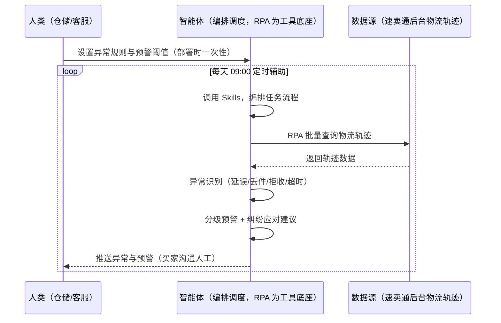
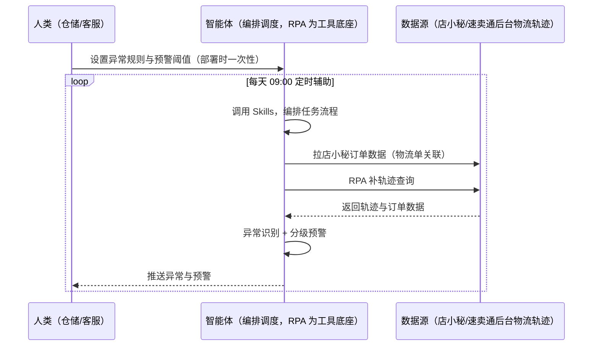

> 为速卖通卖家团队打造的物流轨迹与时效监控方案。逐单查轨迹耗时、物流异常发现晚、买家物流纠纷应对被动。本方案由智能体调度多个工具执行定时查询物流轨迹（无忧物流/海外仓），智能体做异常识别与时效预警。每天定时辅助，只推送异常与预警，买家沟通由人工处理。

> Agent 自动化需开通企业功能
> 点击申请1个月免费权限
> [点击申请 →](https://skieer.feishu.cn/share/base/form/shrcnFwMayykP5iaL38fnZKTbrg)

## 一、用户与需求

核心矛盾：逐单查轨迹耗时、物流异常（延误/丢件/拒收）发现晚、买家物流纠纷应对被动。

两类客户痛点同源，数据来源不同：

- 未购 SaaS 客户（新卖家/小团队）：人工逐单查轨迹、被动处理异常，全靠手；
- 已购 SaaS 客户（店小秘 ERP 等）：店小秘管订单库存，物流轨迹监控不覆盖，仍要人盯。

适用客户：发货频次高的卖家。轨迹查询可自动化，异常处理与买家沟通需人工。

### 1.1 不同模式卖家

| 类型 | 选择 | 建议 |
|-|-|-|
| POP | 首选 | 强烈推荐（自主履约，物流轨迹监控必须） |
| 半托管 | 次选 | 一般推荐（半托管自主履约） |
| 全托管 | 不适用 | 平台代运营履约 |

### 1.2 不同类目卖家

| 类目 | 最关注维度 | 核心逻辑 |
|-|-|-|
| 3C 数码 | 妥投时效 | 客单价高，时效影响大 |
| 家居家具 | 大件物流 | 大件物流异常影响大 |
| 美妆个护 | 纠纷应对 | 物流纠纷应对被动 |
| 服装鞋帽 | 旺季时效 | 旺季单量暴增 |
| 户外运动 | 旺季物流 | 旺季物流压力大 |
| 母婴用品 | 时效红线 | 超时罚款明确 |

### 1.3 不同角色用户

| 用户 | 需求 | 问题 | 投入时间（估算） |
|-|-|-|-|
| 老板 | 少纠纷不被罚 | 物流异常发现晚 | 0.5 小时/周 |
| 仓储 | 轨迹看板+预警 | 逐单查轨迹耗时 | 1-2 小时/周 |
| 客服 | 纠纷应对 | 买家沟通被动 | 1 小时/周 |

---

## 二、现在的方法与问题

### 2.1 流程步骤与问题总结

人工方式（未购 SaaS 客户）

| 序号 | 步骤 | 现在的方法 | 问题缺陷 |
|-|-|-|-|
| 1 | 查轨迹 | 逐单手动查 | 耗时 |
| 2 | 盯异常 | 被动发现 | 延误/丢件发现晚 |
| 3 | 沟通 | 被动应对 | 买家纠纷被动 |
| 4 | 记录 | 手动 | 无台账 |
| 5 | 复盘 | 无 | 无沉淀 |

SaaS 方式（已购店小秘 ERP 客户）

| 序号 | 步骤 | 现在的方法 | 问题缺陷 |
|-|-|-|-|
| 1 | 查轨迹 | 店小秘部分覆盖 | 不完整 |
| 2 | 盯异常 | 靠人 | 发现晚 |
| 3 | 沟通 | 手动 | 被动 |
| 4 | 记录 | 手动 | 无台账 |
| 5 | 复盘 | 无 | 无沉淀 |

### 2.2 问题分析

人工方式根因

| 序号 | 根因 | 具体表现 |
|-|-|-|
| 1 | 逐单查轨迹 | 耗时 |
| 2 | 异常发现晚 | 延误/丢件后知后觉 |
| 3 | 纠纷被动 | 买家沟通应对被动 |

**SaaS 方式根因**

| 序号 | 根因 | 具体表现 |
|-|-|-|
| 1 | 覆盖不完整 | 店小秘管订单，轨迹监控不覆盖 |
| 2 | 无预警 | 异常无主动提醒 |

---

## 三、解决方案

### 3.1 功能概述

为速卖通卖家团队打造的物流轨迹与时效监控方案，定时查询物流轨迹，智能体做异常识别与时效预警。

每天定时触发并调度多个工具，调起八爪鱼 RPA（Agent 的工具底座，能耦合多系统、完成自动化任务执行）查询物流轨迹（无忧物流/海外仓，后台可查），智能体按异常规则（延误/丢件/拒收/超时）识别并分级预警。每天定时辅助，只推送异常与预警，买家沟通由人工处理。

### 3.2 系统结合

| 要素 | 说明 |
|-|-|
| 客户现有工具盘点 | **未购 SaaS 客户**：无第三方工具，轨迹全靠人工查。    
**已购 SaaS 客户**（主流组合）：店小秘 ERP（官方服务市场合作 ERP，管订单库存，轨迹监控不覆盖） |
| 数据/能力来源 | **无 SaaS**：速卖通后台物流轨迹（无忧物流/海外仓，登录查询）。    
**有 SaaS**：店小秘订单数据（辅助关联物流单）+ RPA 补轨迹查询 |
| RPA 耦合动作 | 作为 Agent 的工具底座，按计划查询轨迹（批量查询限速、快照留档），按订单号对齐去重，统一流转给智能体；异常自动分级 |
| 耦合出的新价值 | 单工具给不了的端到端结论：轨迹一次取齐 → 异常识别（延误/丢件/拒收/超时）→ 分级预警 → 纠纷应对建议，**只推送异常与预警** |

### 3.3 智能体执行流程

智能体定时触发。支持**两种数据通道**，部署时按客户现有工具选择：

**通道一：无 SaaS 方式（RPA 查询轨迹，适合未购 ERP 的客户）**

**通道二：有 SaaS 方式（店小秘订单关联 + RPA 补轨迹查询，适合已购客户）**

> Agent 自动化需开通企业功能
> 点击申请1个月免费权限
> [点击申请 →](https://skieer.feishu.cn/share/base/form/shrcnFwMayykP5iaL38fnZKTbrg)

### 3.4 为何这么设计

要同时回答三个问题：**为什么不能只用 SaaS/API？为什么不能纯靠智能体写代码？为什么 RPA 是执行底座？** 本场景的核心是"批量查询、异常识别、分级预警、挂了有人管"。

#### 1）逐项对比

| 对比维度 | SaaS/API 堆叠（店小秘） | 纯智能体（智能体写代码） | 智能体+自动化工具（RPA 工具底座） |
|-|-|-|-|
| 实现方式 | 店小秘管订单，轨迹监控不覆盖 | 能查轨迹能分析，但全要自己接 | 轨迹批量查询 + 异常识别 |
| 批量查询 | 不覆盖 | 需自建查询与限速 | 批量限速、快照留档 |
| 异常规则 | 无 | 需自写异常逻辑 | 异常规则可视化配置 |
| 使用成本（总拥有成本） | 店小秘订阅费（主体另算） | 代理 IP + 服务器 + 开发维护人力，隐性成本高 | 一份平台订阅跑多流程，单方案边际成本 ≈ 0 |
| 维护人要求 | 低（工具现成） | 规则调整都要开发介入 | 可视化流程，仓储自己可调阈值 |

#### 2）优劣势说明

|  | SaaS/API 堆叠（店小秘） | 纯智能体（智能体写代码） | 智能体+自动化工具（RPA 工具底座） |
|-|-|-|-|
| 优势 | 订单数据权威（物流单关联） | 无订阅费；    
可深度定制异常模型 | 轨迹查询+异常分级即开即用；    
非技术人员可维护 |
| 劣势 | 轨迹监控不覆盖 | 查询与异常全自建；    
AI 生成代码是生成性的 | 本地电脑运行需保持开机；    
订阅费；    
买家沟通需人工 |

#### 3）结论

| 论点 | 说明 |
|-|-|
| 异常=纠纷前兆 | 物流异常（延误/丢件/拒收）是买家纠纷前兆——早发现早应对，纠纷率下降 |
| 无忧物流 | 速卖通无忧物流覆盖主流线路（10 日达覆盖 50 国是物流竞争力）——轨迹监控必须 |
| 人工沟通边界 | 异常处理与买家沟通需人工，本方案只做识别与预警 |
| 一个底座跑多流程 | 客户购买 RPA 平台是跑多个流程（物流/订单/纠纷），本方案只是其中一个——平台订阅费被多流程摊薄 |
| 时间 | 仓储要的是"异常自动预警"，不是"逐单查轨迹" |

### 3.5 功能清单

| 功能 | 系统 | 功能说明（解决问题） |
|-|-|-|
| 会话/定时 | 智能体 | 1. 理解人类语言，调用已预设好的 Skills。    
2. 编排多任务、调度多工具。 |
| 多系统数据取数 | RPA、指纹浏览器 | 1. 解决逐单查轨迹耗时、异常发现晚问题。    
2. 作为智能体工具底座被调度执行，批量限速、快照留档。    
3. **【无 SaaS 方式】** RPA 查询后台物流轨迹。**【有 SaaS 方式】** 店小秘订单关联 + RPA 补轨迹查询。 |
| 异常识别 | 智能体 | 延误/丢件/拒收/超时自动识别。 |
| 分级预警 | 智能体 | 异常分级（高/中/低），高危即时通知。 |
| 纠纷应对建议 | 智能体 | 异常单应对建议（补发/退款/沟通话术）。 |
| IM通知 | 飞书、钉钉、企微等 | 解决异常滞后问题。异常与预警自动推送。 |
| 数据资产储存 | 本地电脑、云储存 | 1. Skills 资产：速卖通物流监控技能。    
2. 数据储存：轨迹台账统一写入本地。    
3. 经验知识库：异常案例持续沉淀。 |

### 3.6 智能体执行落地过程

部署时一次性配置入参（监控范围、异常规则、预警阈值、数据通道），会话中无需重复输入。

**⚠️ 部署前提（不满足则方案无法跑起来）**：①RPA 需部署在**常开电脑/云机**上，并配置漏跑补跑机制；②后台需登录查询，登录失效自动告警；③**异常处理与买家沟通由人工执行**，本方案只做识别与预警；④**有 SaaS 方式需店小秘账号**（物流单关联，可选增强，无则走后台通道）；⑤首次配置（登录态、异常规则、分级阈值）需服务方/技术人员介入一次，属实施成本。

#### 1）配置

| 类别 | 说明 |
|-|-|
| 智能体 | 主流智能体。 |
| 智能体工具 | 1. **数据通道（按客户现有工具二选一）**：【无 SaaS】速卖通后台物流轨迹（RPA 查询）；【有 SaaS】店小秘订单数据 + RPA 补轨迹。    
2. 数据取数与自动化执行：八爪鱼 RPA，MCP 配置完成。    
3. 数据分析：智能体自带。    
4. IM：企业办公 IM（飞书/钉钉/企微），MCP 或 webhook 配置。 |
| 工作知识 | 1. 监控范围（订单/物流线路）。    
2. 异常规则：延误/丢件/拒收/超时。    
3. 预警阈值。    
4. 应对 SOP（补发/退款/沟通话术）。 |
| 本地数据库 | 1. 轨迹台账库地址。    
2. 报告库地址。    
3. 经验库地址。 |

#### 2）执行

| 任务 | 产出 | 产出物接收人 |
|-|-|-|
| 接收监控范围，定时触发 | 任务启动记录 | —— |
| 调用已预设 Skills，编排任务流程 | 任务编排方案 | —— |
| 经 MCP 向八爪鱼 RPA 下发取数任务 | 自动化任务指令 | —— |
| 多源取数并按订单号对齐（无 SaaS：后台查询；有 SaaS：店小秘+后台，智能体监控状态） | 对齐后轨迹数据 | —— |
| 异常识别（延误/丢件/拒收/超时） | 异常清单 | 仓储 |
| 分级预警（高/中/低） | 预警消息 | 仓储/运营 |
| 纠纷应对建议（补发/退款/话术） | 应对建议 | 客服 |
| 推送异常与预警 | 群消息 | 仓储/客服/老板 |

异常处理：

查询失败 → 自动重试并告警；

轨迹缺失 → 标注待补；

高危异常 → 即时通知；

应对建议低置信度 → 转人工；

置信度 &lt;70% → 转人工复核，不输出硬结论。

#### 3）结果

| 结果 | 说明 |
|-|-|
| 数据资产 | 轨迹台账结构化数据（订单/轨迹节点/状态/异常类型），可审计可追溯。 |
| 分析报告 | 1. 异常清单：按类型分级。    
2. 预警消息。    
3. 纠纷应对建议。 |
| Skills | 智能体 Skills：速卖通物流监控技能，按异常案例迭代。 |

> Agent 自动化需开通企业功能
> 点击申请1个月免费权限
> [点击申请 →](https://skieer.feishu.cn/share/base/form/shrcnFwMayykP5iaL38fnZKTbrg)

---

## 四、使用前后预估

> 本方案价值 = **轨迹批量查询 → 异常识别 → 分级预警 → 纠纷应对建议**。轨迹查询可自动化，异常处理与买家沟通需人工。

| 指标 | 人工 | SaaS/API（店小秘） | 智能体+自动化工具 |
|-|-|-|-|
| 轨迹查询 | 逐单手动 | 部分覆盖 | 批量自动查询 |
| 异常发现 | 发现晚 | 无 | 自动识别分级 |
| 纠纷应对 | 被动 | 无 | 应对建议 |
| 预警时效 | 无 | 无 | 高危即时通知 |
| 台账沉淀 | 无 | 无 | 轨迹台账统一沉淀 |
| 方法论 | 无 | 单工具 | 可复用的 Skills 与异常规则 |

**说明**：速卖通无忧物流覆盖主流线路（10 日达覆盖 50 国是物流竞争力）；物流异常（延误/丢件/拒收）是买家纠纷前兆——早发现早应对，纠纷率下降；异常处理与买家沟通需人工，本方案只做识别与预警。

---

## 五、效果证明

> Agent 自动化需开通企业功能
> 点击申请1个月免费权限
> [点击申请 →](https://skieer.feishu.cn/share/base/form/shrcnFwMayykP5iaL38fnZKTbrg)

### 5.1 客户案例

**《云仓物流状态同步：微信 – 飞书 – 物流群全链路自动化》**

> 涉及多个客户群与数十个快递群，高峰期每分钟都有新消息弹出，客服需在微信、飞书、快递系统、OMS 间反复切换，单条消息处理耗时 2-3 分钟。

| 效果 | 说明 |
|-|-|
| 提效 | 物流信息处理由人工盯群变为自动流转。原本客服需同时盯数十个客户群与快递群，单条消息处理耗时 2-3 分钟，现在机器人 7×24 自动处理，覆盖拦截、查询、改地址等 7 大场景。 |
| 降本 | 日均节省 2-3 小时/人的无效盯群时间，人力投入转向异常件处理与客户关系维护等重点工作。 |
| 任务 | 打通微信 – 飞书 – 物流群全链路，微信群消息与飞书指令自动流转分发。 |
| 任务 | 降低手工复制单号导致的错漏，减少退款率与赔付损失。 |

案例详情：[云仓物流状态同步](https://skieer.feishu.cn/wiki/OKy0wkYLximV2rkRCqRcl7FcnUh)

---

## 六、备注

### 6.1 Agent 支持

本方案不绑定具体智能体，主流 Agent 均可运行（需支持技能/Skills 加载与工具调用）：

| Agent/智能体 | 说明 |
|-|-|
| Workbuddy | 本方案运行平台，支持技能/Skills 上传加载、定时任务、MCP 工具调用与表格/报告处理 |
| 豆包（国内·字节） | 国内主流个人智能体，支持技能上传、定时任务与工具调用，上手成本低 |
| 通义千问（国内·阿里） | 支持 Agent 编排与插件生态，集成阿里电商数据能力，适合电商场景 |
| DeepSeek（国内） | 推理能力强、成本低，适合规则打分与归因分析类任务 |
| ChatGPT（国外·OpenAI） | 海外主流通用智能体，支持 GPTs/Agent 模式与工具调用 |
| Claude（国外·Anthropic） | 长文本与结构化分析能力强，原生支持 MCP 连接外部工具 |

### 6.2 名词解释

| 术语 | 说明 |
|-|-|
| 无忧物流 | 速卖通官方物流（10 日达覆盖 50 国） |
| 异常识别 | 延误/丢件/拒收/超时自动识别 |
| 分级预警 | 高/中/低三级，高危即时通知 |
| 纠纷应对 | 补发/退款/沟通话术建议 |
| 轨迹台账 | 物流轨迹结构化沉淀 |
| 混合数据源 | 速卖通后台物流轨迹（RPA 查询）+ 店小秘订单数据（有 SaaS 客户关联） |
| 有 SaaS 方式 | 已购店小秘 ERP，订单关联 + RPA 补轨迹查询 |
| 无 SaaS 方式 | 不购买第三方工具，RPA 查询后台轨迹 |
| POP | 自主运营模式（自主上架定价，总费率 6%-11.5%） |
| 全托管 | 平台代运营（无自主发布权，平台抽佣 25%-30%） |
| 半托管 | 佣金介于 POP 与全托管之间 |
| MCP | Model Context Protocol，智能体连接外部工具的标准化通道 |

> Agent 自动化需开通企业功能
> 点击申请1个月免费权限
> [点击申请 →](https://skieer.feishu.cn/share/base/form/shrcnFwMayykP5iaL38fnZKTbrg)

---

原文：[查看原文](https://skieer.feishu.cn/wiki/BLAFws2ayiaxUSkjA2Acu1GOnLb)
