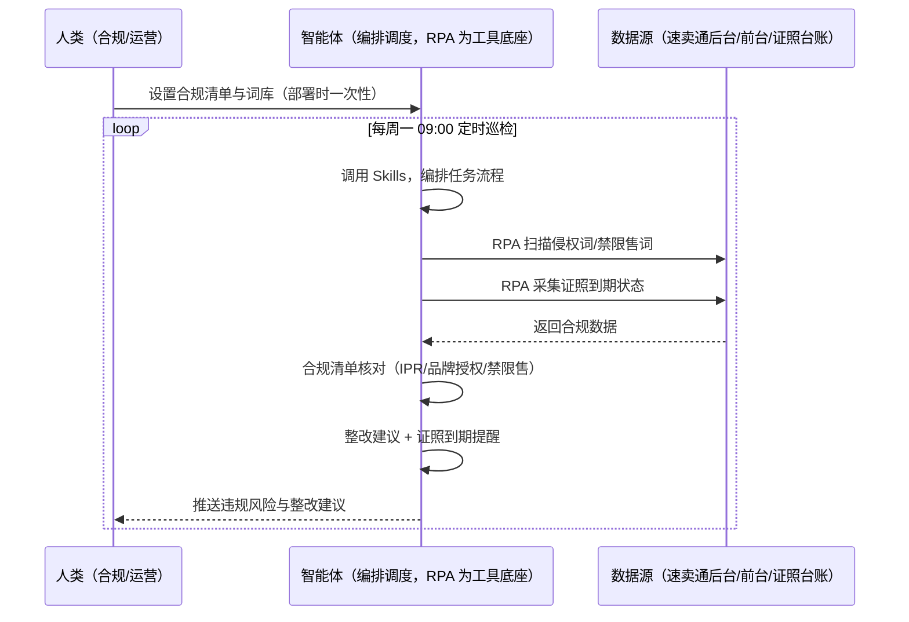
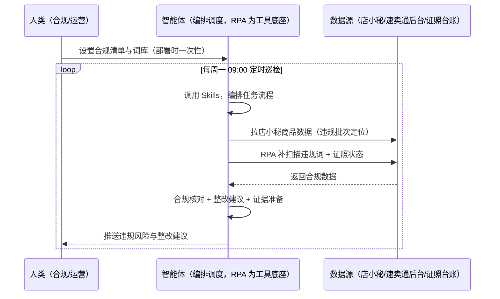

> 为速卖通卖家团队打造的侵权与品质合规方案。侵权词/禁限售词查不全、品牌授权类目不符被罚、品质抽检证照准备慢、发现违规时已损失链接权重。本方案由智能体调度多个工具执行扫描违规风险点与证照到期，智能体按合规清单核对并准备证据。定时巡检，只推送违规风险与整改建议。

> Agent 自动化需开通企业功能
> 点击申请1个月免费权限
> [点击申请 →](https://skieer.feishu.cn/share/base/form/shrcnFwMayykP5iaL38fnZKTbrg)

## 一、用户与需求

核心矛盾：侵权（IPR/品牌授权/禁限售）与品质抽检是速卖通合规双高危——侵权词查不全、品牌授权类目不符被罚、品质抽检证照（采购发票/检测报告/授权书）准备慢。

两类客户痛点同源，数据来源不同：

- 未购 SaaS 客户（新卖家/小团队）：人工查违规词、手动找证照，全靠手；
- 已购 SaaS 客户（店小秘 ERP 等）：店小秘管订单/上架，侵权扫描与证照管理不覆盖，仍要人盯。

适用客户：品牌/侵权敏感类目卖家。违规监控可自动化，申诉提交与证据准备需人工。

### 1.1 不同模式卖家

| 类型 | 选择 | 建议 |
|-|-|-|
| POP | 首选 | 强烈推荐（自主发布，侵权/资质风险高） |
| 半托管 | 次选 | 一般推荐（半托管自主发布） |
| 全托管 | 不适用 | 平台代运营 |

### 1.2 不同类目卖家

| 类目 | 最关注维度 | 核心逻辑 |
|-|-|-|
| 3C 数码 | IPR | 仿牌/专利风险高 |
| 家居家具 | 品质抽检 | 材质检测证照 |
| 美妆个护 | 品牌授权 | 品牌未授权被罚 |
| 服装鞋帽 | 盗图风险 | 图片侵权高发 |
| 户外运动 | 认证缺失 | 资质不全下架 |
| 母婴用品 | 安全合规 | 安全类目要求高 |

### 1.3 不同角色用户

| 用户 | 需求 | 问题 | 投入时间（估算） |
|-|-|-|-|
| 老板 | 不被罚不封店 | 侵权被罚损失链接 | 0.5 小时/周 |
| 合规 | 违规风险清单 | 侵权词查不全 | 1-2 小时/周 |
| 运营 | 证照准备 | 品质抽检证照慢 | 1 小时/周 |

---

## 二、现在的方法与问题

### 2.1 流程步骤与问题总结

人工方式（未购 SaaS 客户）

| 序号 | 步骤 | 现在的方法 | 问题缺陷 |
|-|-|-|-|
| 1 | 查侵权 | 手动查词 | 查不全 |
| 2 | 核对授权 | 手动核对 | 品牌授权类目不符被罚 |
| 3 | 备证照 | 手动找发票/报告 | 品质抽检准备慢 |
| 4 | 盯到期 | 靠记忆 | 证照过期 |
| 5 | 整改 | 罚后补救 | 损失链接权重 |

SaaS 方式（已购店小秘 ERP 客户）

| 序号 | 步骤 | 现在的方法 | 问题缺陷 |
|-|-|-|-|
| 1 | 查侵权 | 店小秘不覆盖 | 靠人查 |
| 2 | 核对授权 | 手动 | 无清单 |
| 3 | 备证照 | 手动 | 无归档 |
| 4 | 盯到期 | 靠人 | 过期风险 |
| 5 | 整改 | 罚后 | 无建议 |

### 2.2 问题分析

人工方式根因

| 序号 | 根因 | 具体表现 |
|-|-|-|
| 1 | 侵权词查不全 | IPR/禁限售风险漏检 |
| 2 | 证照散乱 | 品质抽检准备慢 |
| 3 | 发现时已损失 | 链接权重受损 |

**SaaS 方式根因**

| 序号 | 根因 | 具体表现 |
|-|-|-|
| 1 | 店小秘不覆盖 | 侵权扫描与证照管理无工具 |
| 2 | 无闭环 | 违规案例不沉淀 |

---

## 三、解决方案

### 3.1 功能概述

为速卖通卖家团队打造的侵权与品质合规方案，扫描违规风险点与证照到期，智能体按合规清单核对并准备证据。

定时巡检并调度多个工具，调起八爪鱼 RPA（Agent 的工具底座，能耦合多系统、完成自动化任务执行）扫描待发/在售商品侵权词与禁限售词、采集证照到期状态，智能体按合规清单（IPR/品牌授权/禁限售/品质抽检）核对资质并输出整改建议。定时巡检，只推送违规风险与整改建议。

### 3.2 系统结合

| 要素 | 说明 |
|-|-|
| 客户现有工具盘点 | **未购 SaaS 客户**：无第三方工具，合规全靠人工。    
**已购 SaaS 客户**（主流组合）：店小秘 ERP（官方服务市场合作 ERP，管订单/上架，合规扫描不覆盖） |
| 数据/能力来源 | **无 SaaS**：速卖通后台/前台违规风险点（标题/图片/属性，RPA 扫描）+ 证照台账（本地维护）。    
**有 SaaS**：店小秘商品数据（辅助定位违规批次）+ RPA 补扫描与证照采集 |
| RPA 耦合动作 | 作为 Agent 的工具底座，按计划扫描违规风险点（词库扫描、证据快照）、采集证照到期状态，统一流转给智能体；高风险命中告警 |
| 耦合出的新价值 | 单工具给不了的端到端结论：违规风险一次扫齐 → 合规清单核对 → 证照到期提醒 → 整改建议与证据准备，**只推送违规风险与整改建议** |

### 3.3 智能体执行流程

智能体定时触发。支持**两种数据通道**，部署时按客户现有工具选择：

**通道一：无 SaaS 方式（RPA 扫描违规风险，适合未购 ERP 的客户）**

**通道二：有 SaaS 方式（店小秘商品数据辅助定位 + RPA 补扫描，适合已购客户）**

> Agent 自动化需开通企业功能
> 点击申请1个月免费权限
> [点击申请 →](https://skieer.feishu.cn/share/base/form/shrcnFwMayykP5iaL38fnZKTbrg)

### 3.4 为何这么设计

要同时回答三个问题：**为什么不能只用 SaaS/API？为什么不能纯靠智能体写代码？为什么 RPA 是执行底座？** 本场景的核心是"定时扫描、清单核对、证照提醒、挂了有人管"。

#### 1）逐项对比

| 对比维度 | SaaS/API 堆叠（店小秘） | 纯智能体（智能体写代码） | 智能体+自动化工具（RPA 工具底座） |
|-|-|-|-|
| 实现方式 | 店小秘管商品，合规扫描不覆盖 | 能抓数据能核对，但全要自己接 | 扫描应用直挂 + 清单核对 |
| 词库扫描 | 不覆盖 | 需自建词库与扫描 | 词库可视化配置、证据快照 |
| 证照管理 | 无 | 需自建台账逻辑 | 台账+到期提醒即开即用 |
| 使用成本（总拥有成本） | 店小秘订阅费（主体另算） | 代理 IP + 服务器 + 开发维护人力，隐性成本高 | 一份平台订阅跑多流程，单方案边际成本 ≈ 0 |
| 维护人要求 | 低（工具现成） | 规则调整都要开发介入 | 可视化流程，合规自己可调词库 |

#### 2）优劣势说明

|  | SaaS/API 堆叠（店小秘） | 纯智能体（智能体写代码） | 智能体+自动化工具（RPA 工具底座） |
|-|-|-|-|
| 优势 | 商品数据权威（批次定位） | 无订阅费；    
可深度定制合规模型 | 扫描+核对+证照提醒即开即用；    
非技术人员可维护 |
| 劣势 | 合规扫描不覆盖 | 词库与台账全自建；    
AI 生成代码是生成性的 | 本地电脑运行需保持开机；    
订阅费；    
申诉提交需人工 |

#### 3）结论

| 论点 | 说明 |
|-|-|
| 侵权=罚款封店 | 侵权（IPR/品牌授权/禁限售）是速卖通合规高危——侵权词查不全被罚、品牌授权类目不符被罚 |
| 品质抽检=证照链 | 品质抽检需证照（采购发票/检测报告/授权书），证照散乱准备慢——证照台账与到期提醒 |
| 事前合规 > 事后申诉 | 发现违规时已损失链接权重——把「事后申诉」变成「事前巡检」 |
| 一个底座跑多流程 | 客户购买 RPA 平台是跑多个流程（合规/上架/侵权），本方案只是其中一个——平台订阅费被多流程摊薄 |
| 时间 | 合规要的是"违规风险清单 + 证照提醒"，不是"翻文件柜" |

### 3.5 功能清单

| 功能 | 系统 | 功能说明（解决问题） |
|-|-|-|
| 会话/定时 | 智能体 | 1. 理解人类语言，调用已预设好的 Skills。    
2. 编排多任务、调度多工具。 |
| 多系统数据取数 | RPA、指纹浏览器 | 1. 解决侵权词查不全、证照准备慢问题。    
2. 作为智能体工具底座被调度执行，词库扫描、证据快照。    
3. **【无 SaaS 方式】** RPA 扫描违规风险点 + 采集证照状态。**【有 SaaS 方式】** 店小秘商品数据辅助定位 + RPA 补扫描。 |
| 合规清单核对 | 智能体 | IPR/品牌授权/禁限售/品质抽检逐项核对（按站点）。 |
| 证照台账 | 智能体 | 采购发票/检测报告/授权书按 SKU 归档，到期提醒。 |
| 整改建议 | 智能体 | 违规项整改建议（改标题/换图/补证照）。 |
| 申诉证据准备 | 智能体 | 违规申诉证据包清单（底单/发票/授权书）。 |
| IM通知 | 飞书、钉钉、企微等 | 解决合规滞后问题。违规风险与证照到期自动推送。 |
| 数据资产储存 | 本地电脑、云储存 | 1. Skills 资产：速卖通合规技能。    
2. 数据储存：合规台账统一写入本地。    
3. 经验知识库：违规案例持续沉淀。 |

### 3.6 智能体执行落地过程

部署时一次性配置入参（合规清单、词库、证照台账路径、数据通道），会话中无需重复输入。

**⚠️ 部署前提（不满足则方案无法跑起来）**：①RPA 需部署在**常开电脑/云机**上（每周巡检可接受任务时开机），并配置漏跑补跑机制；②**申诉提交与证据准备由人工执行**，本方案只出清单与建议；③**有 SaaS 方式需店小秘账号**（批次定位，可选增强，无则走后台通道）；④首次配置（登录态、词库、合规清单）需服务方/技术人员介入一次，属实施成本。

#### 1）配置

| 类别 | 说明 |
|-|-|
| 智能体 | 主流智能体。 |
| 智能体工具 | 1. **数据通道（按客户现有工具二选一）**：【无 SaaS】速卖通后台/前台 + 证照台账（RPA 扫描）；【有 SaaS】店小秘商品数据 + RPA 补扫描。    
2. 数据取数与自动化执行：八爪鱼 RPA，MCP 配置完成。    
3. 数据分析：智能体自带。    
4. 数据报告：智能体自带。    
5. IM：企业办公 IM（飞书/钉钉/企微），MCP 或 webhook 配置。 |
| 工作知识 | 1. 合规清单：IPR/品牌授权/禁限售/品质抽检。    
2. 词库（按站点语言维护）。    
3. 证照台账路径。    
4. 站点合规要求。 |
| 本地数据库 | 1. 合规台账库地址。    
2. 证照台账库地址。    
3. 经验库地址。 |

#### 2）执行

| 任务 | 产出 | 产出物接收人 |
|-|-|-|
| 接收合规清单，定时巡检触发 | 任务启动记录 | —— |
| 调用已预设 Skills，编排任务流程 | 任务编排方案 | —— |
| 经 MCP 向八爪鱼 RPA 下发扫描任务 | 自动化任务指令 | —— |
| 多源取数并按 SKU 对齐（无 SaaS：扫描+台账；有 SaaS：店小秘+扫描，智能体监控状态） | 对齐后合规数据 | —— |
| 合规清单核对（IPR/品牌授权/禁限售） | 违规风险清单 | 合规 |
| 证照台账更新 + 到期提醒 | 证照提醒 | 合规 |
| 整改建议 + 申诉证据准备 | 整改清单 | 运营 |
| 推送违规风险与整改建议 | 群消息 | 合规/运营/老板 |

异常处理：

扫描失败 → 自动重试并告警；

词库命中高 → 高风险告警；

证照缺失 → 标注待补；

整改建议低置信度 → 转人工；

置信度 &lt;70% → 转人工复核，不输出硬结论。

#### 3）结果

| 结果 | 说明 |
|-|-|
| 数据资产 | 合规台账结构化数据（SKU/风险类型/证照状态/整改状态），可审计可追溯。 |
| 分析报告 | 1. 违规风险清单：按类型。    
2. 证照台账与到期提醒。    
3. 整改建议与证据准备清单。 |
| Skills | 智能体 Skills：速卖通合规技能，按违规案例迭代词库。 |

> Agent 自动化需开通企业功能
> 点击申请1个月免费权限
> [点击申请 →](https://skieer.feishu.cn/share/base/form/shrcnFwMayykP5iaL38fnZKTbrg)

---

## 四、使用前后预估

> 本方案价值 = **违规风险自动扫描 → 合规清单核对 → 证照台账与到期提醒 → 整改建议与证据准备**。违规监控可自动化，申诉提交与证据准备需人工。

| 指标 | 人工 | SaaS/API（店小秘） | 智能体+自动化工具 |
|-|-|-|-|
| 侵权扫描 | 查不全 | 不覆盖 | 词库自动扫描 |
| 合规核对 | 凭经验 | 无 | 清单逐项核对 |
| 证照管理 | 散乱 | 无 | 台账+到期提醒 |
| 品质抽检 | 准备慢 | 无 | 证据清单模板化 |
| 违规预警 | 损失后才知 | 无 | 事前巡检 |
| 方法论 | 无 | 单工具 | 可复用的 Skills 与词库 |

**说明**：侵权（IPR/品牌授权/禁限售）与品质抽检是速卖通合规双高危；侵权词查不全被罚、品牌授权类目不符被罚、品质抽检证照（采购发票/检测报告/授权书）准备慢；发现违规时已损失链接权重——把「事后申诉」变成「事前巡检」。

---

## 五、效果证明

> Agent 自动化需开通企业功能
> 点击申请1个月免费权限
> [点击申请 →](https://skieer.feishu.cn/share/base/form/shrcnFwMayykP5iaL38fnZKTbrg)

### 5.1 客户案例

**《社媒违禁词监控：日均处理 300+ 违规帖》**

> 面向多账号多平台的价格体系与舆情治理，自动巡检违规帖与违禁词内容，锁定低价倾销与负面信息并留证。

| 效果 | 说明 |
|-|-|
| 提效 | 违规内容处理由人工逐页排查变为日均 300+ 条自动处理。原本需监控上百个电商链接与全网社媒内容、逐条人工审阅，现在 7×24 自动采集与识别。 |
| 降本 | 免除市场与法务人工逐条筛查的重复投入，投入转向维权处置与渠道治理等重点工作。 |
| 任务 | 覆盖电商链接价格合规、社媒违规内容与新闻舆情三类风险场景，全渠道统一监控。 |
| 任务 | 违规内容自动留证，为维权与渠道沟通提供证据链。 |

案例详情：[维权|违禁词监控：八爪鱼RPA日均处理300+违规帖，守牢价格体系，扼杀负面舆情](https://skieer.feishu.cn/wiki/VBfdwmbNbiSVHhkMt1tc528Tn0d)

---

## 六、备注

### 6.1 Agent 支持

本方案不绑定具体智能体，主流 Agent 均可运行（需支持技能/Skills 加载与工具调用）：

| Agent/智能体 | 说明 |
|-|-|
| Workbuddy | 本方案运行平台，支持技能/Skills 上传加载、定时任务、MCP 工具调用与表格/报告处理 |
| 豆包（国内·字节） | 国内主流个人智能体，支持技能上传、定时任务与工具调用，上手成本低 |
| 通义千问（国内·阿里） | 支持 Agent 编排与插件生态，集成阿里电商数据能力，适合电商场景 |
| DeepSeek（国内） | 推理能力强、成本低，适合规则打分与归因分析类任务 |
| ChatGPT（国外·OpenAI） | 海外主流通用智能体，支持 GPTs/Agent 模式与工具调用 |
| Claude（国外·Anthropic） | 长文本与结构化分析能力强，原生支持 MCP 连接外部工具 |

### 6.2 名词解释

| 术语 | 说明 |
|-|-|
| IPR | 知识产权侵权（仿牌/专利/盗图） |
| 禁限售 | 平台禁止/限制销售品类 |
| 品质抽检 | 平台抽查商品质量，需证照链 |
| 证照台账 | 采购发票/检测报告/授权书按 SKU 归档 |
| 合规清单 | IPR/品牌授权/禁限售/品质抽检核对项 |
| 混合数据源 | 速卖通后台/前台（RPA 扫描）+ 证照台账（本地）+ 店小秘商品数据（有 SaaS 客户） |
| 有 SaaS 方式 | 已购店小秘 ERP，商品数据辅助定位 + RPA 补扫描 |
| 无 SaaS 方式 | 不购买第三方工具，RPA 扫描违规风险 |
| POP | 自主运营模式（自主上架定价，总费率 6%-11.5%） |
| 全托管 | 平台代运营（无自主发布权，平台抽佣 25%-30%） |
| 半托管 | 佣金介于 POP 与全托管之间 |
| MCP | Model Context Protocol，智能体连接外部工具的标准化通道 |

> Agent 自动化需开通企业功能
> 点击申请1个月免费权限
> [点击申请 →](https://skieer.feishu.cn/share/base/form/shrcnFwMayykP5iaL38fnZKTbrg)

---

原文：[查看原文](https://skieer.feishu.cn/wiki/WrhfwjJwuiWNCJkjWp6cwCddnyd)
