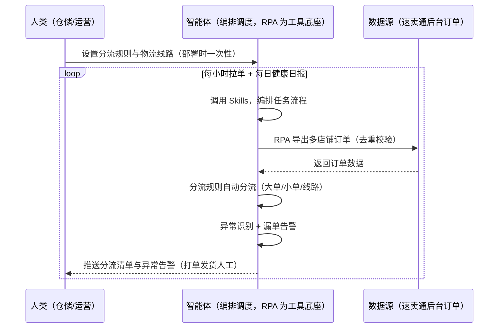
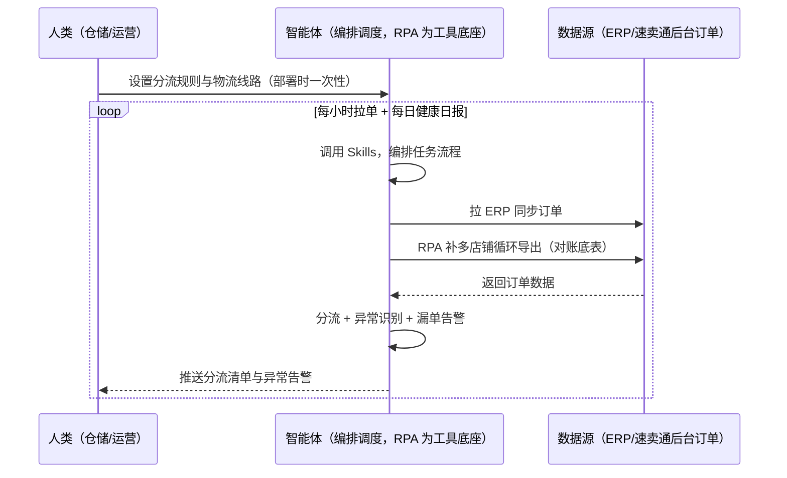

> 为速卖通卖家团队打造的订单导出与打单方案。多店铺订单逐店导出费时易漏、订单分流靠经验（大单/小单/物流线路）、漏单没有兜底。本方案由智能体调度多个工具执行定时导出多店铺订单并按规则分流，智能体做异常识别与漏单告警。定时触发，订单导出自动化，物理打单/发货依赖人工。

> Agent 自动化需开通企业功能
> 点击申请1个月免费权限
> [点击申请 →](https://skieer.feishu.cn/share/base/form/shrcnFwMayykP5iaL38fnZKTbrg)

## 一、用户与需求

核心矛盾：多店铺订单逐店导出费时易漏、订单分流靠经验（大单/小单/物流线路选择）、漏单没有兜底；小额订单（&lt;\$5）建议经济物流线控成本。

两类客户痛点同源，数据来源不同：

- 未购 SaaS 客户（新卖家/小团队）：人工逐店导出订单、凭经验分流，全靠手；
- 已购 SaaS 客户（店小秘/妙手 ERP 等）：ERP 有订单同步功能（可挂接），但多店铺导出与分流规则不覆盖，仍要人盯。

适用客户：多店铺卖家。订单导出可自动化（多店铺循环逻辑），物理打单/发货依赖人工（面单打印本地设备）。

### 1.1 不同模式卖家

| 类型 | 选择 | 建议 |
|-|-|-|
| POP | 首选 | 强烈推荐（自主履约，订单导出+分流必须） |
| 半托管 | 次选 | 一般推荐（半托管自主履约） |
| 全托管 | 不适用 | 平台代运营履约 |

### 1.2 不同类目卖家

| 类目 | 最关注维度 | 核心逻辑 |
|-|-|-|
| 3C 数码 | 发货时效 | 客单价高，时效影响大 |
| 家居家具 | 大件物流 | 大件物流线路选择 |
| 美妆个护 | 时效合规 | 超时罚款 |
| 服装鞋帽 | 多件拆单 | 一单多件拆单发货 |
| 户外运动 | 旺季单量 | 旺季导出量大 |
| 母婴用品 | 时效红线 | 缺货罚款明确 |

### 1.3 不同角色用户

| 用户 | 需求 | 问题 | 投入时间（估算） |
|-|-|-|-|
| 老板 | 不超时不被罚 | 漏单/超时罚款 | 0.5 小时/周 |
| 仓储 | 订单分流 | 多店铺导出费时 | 2-3 小时/周 |
| 运营 | 订单健康日报 | 异常单识别靠人 | 1 小时/周 |

---

## 二、现在的方法与问题

### 2.1 流程步骤与问题总结

人工方式（未购 SaaS 客户）

| 序号 | 步骤 | 现在的方法 | 问题缺陷 |
|-|-|-|-|
| 1 | 导订单 | 逐店手动导出 | 费时、易漏 |
| 2 | 分流 | 凭经验分流 | 大单/小单/线路靠人 |
| 3 | 打单 | 手动生成面单 | 设备配合 |
| 4 | 发货 | 手动 | 时效盯不住 |
| 5 | 查漏 | 无兜底 | 漏单无告警 |

**SaaS 方式（已购店小秘/妙手 ERP 客户）**

| 序号 | 步骤 | 现在的方法 | 问题缺陷 |
|-|-|-|-|
| 1 | 导订单 | ERP 同步（可挂接） | 部分覆盖 |
| 2 | 分流 | 靠人 | 无规则 |
| 3 | 打单 | 半自动 | 设备配合 |
| 4 | 发货 | 部分覆盖 | 时效靠人 |
| 5 | 查漏 | 无 | 无告警 |

### 2.2 问题分析

人工方式根因

| 序号 | 根因 | 具体表现 |
|-|-|-|
| 1 | 多店铺导出费时 | 逐店手动，易漏单 |
| 2 | 分流靠经验 | 线路选择不当，成本高 |
| 3 | 无漏单兜底 | 漏单无告警 |

**SaaS 方式根因**

| 序号 | 根因 | 具体表现 |
|-|-|-|
| 1 | 覆盖不完整 | ERP 同步订单，多店铺循环与分流不覆盖 |
| 2 | 无预警 | 漏单无兜底 |

---

## 三、解决方案

### 3.1 功能概述

为速卖通卖家团队打造的订单导出与打单方案，定时导出多店铺订单并按规则分流，智能体做异常识别与漏单告警。

定时触发并调度多个工具，调起八爪鱼 RPA（Agent 的工具底座，能耦合多系统、完成自动化任务执行）定时导出多店铺订单（后台数据可导，多店铺循环逻辑），按分流规则（大单/小单/物流线路）自动分流，智能体做异常识别（重复/缺货/地址异常）与漏单告警。定时触发，订单导出自动化，物理打单/发货依赖人工。

### 3.2 系统结合

| 要素 | 说明 |
|-|-|
| 客户现有工具盘点 | **未购 SaaS 客户**：无第三方工具，订单全靠手动导出。     **已购 SaaS 客户**（主流组合）：店小秘/妙手 ERP（订单同步功能，可挂接） |
| 数据/能力来源 | **无 SaaS**：速卖通后台订单导出（多店铺循环，RPA 自建；无专属订单导出应用，走查实锤）。     **有 SaaS**：ERP 订单同步（可挂接）+ RPA 补多店铺循环导出与分流 |
| RPA 耦合动作 | 作为 Agent 的工具底座，按计划导出多店铺订单（多店铺循环容错、订单去重、导出校验），按分流规则自动分流，统一流转给智能体；漏单告警 |
| 耦合出的新价值 | 单工具给不了的端到端结论：多店铺订单一次取齐 → 分流规则自动分流 → 异常识别与漏单告警 → 订单健康日报，**只推送异常与漏单** |

### 3.3 智能体执行流程

智能体定时触发。支持**两种数据通道**，部署时按客户现有工具选择：

**通道一：无 SaaS 方式（RPA 导出多店铺订单，适合未购 ERP 的客户）**

**通道二：有 SaaS 方式（ERP 订单同步 + RPA 补导出分流，适合已购客户）**

> Agent 自动化需开通企业功能
> 点击申请1个月免费权限
> [点击申请 →](https://skieer.feishu.cn/share/base/form/shrcnFwMayykP5iaL38fnZKTbrg)

### 3.4 为何这么设计

要同时回答三个问题：**为什么不能只用 SaaS/API？为什么不能纯靠智能体写代码？为什么 RPA 是执行底座？** 本场景的核心是"定时拉单、规则分流、漏单兜底、挂了有人管"。

#### 1）逐项对比

| 对比维度 | SaaS/API 堆叠（ERP） | 纯智能体（智能体写代码） | 智能体+自动化工具（RPA 工具底座） |
|-|-|-|-|
| 实现方式 | ERP 订单同步（主体部分） | 能导单能分流，但全要自己接 | 多店铺循环导出 + 规则分流 |
| 多店铺循环 | 部分覆盖 | 需自建循环容错逻辑 | 循环容错、订单去重即开即用 |
| 漏单兜底 | 无 | 需自写对账逻辑 | 漏单告警规则可视化配置 |
| 使用成本（总拥有成本） | ERP 订阅费（主体另算） | 代理 IP + 服务器 + 开发维护人力，隐性成本高 | 一份平台订阅跑多流程，单方案边际成本 ≈ 0 |
| 维护人要求 | 低（工具现成） | 规则调整都要开发介入 | 可视化流程，仓储自己可调分流规则 |

#### 2）优劣势说明

|  | SaaS/API 堆叠（ERP） | 纯智能体（智能体写代码） | 智能体+自动化工具（RPA 工具底座） |
|-|-|-|-|
| 优势 | 订单同步现成（主体已解决） | 无订阅费；     可深度定制分流模型 | 多店铺循环+规则分流即开即用；     漏单兜底；     非技术人员可维护 |
| 劣势 | 多店铺循环与分流不覆盖 | 循环与去重全自建；     AI 生成代码是生成性的 | 本地电脑运行需保持开机；     订阅费；     打单/发货需人工 |

#### 3）结论

| 论点 | 说明 |
|-|-|
| 分流=成本与时效 | 小额订单（&lt;\$5）建议经济物流线控成本——分流规则内置（实锤） |
| 多店铺循环 | 多店铺循环逻辑与 Temu 平台订单导出同源（走查实锤）；速卖通无专属订单导出应用需自建 |
| ERP 覆盖不完整 | 店小秘/妙手有订单同步，但多店铺循环导出与分流不覆盖——本方案补导出与分流 |
| 一个底座跑多流程 | 客户购买 RPA 平台是跑多个流程（订单/物流/对账），本方案只是其中一个——平台订阅费被多流程摊薄 |
| 时间 | 仓储要的是"分流清单 + 漏单告警"，不是"逐店导单" |

### 3.5 功能清单

| 功能 | 系统 | 功能说明（解决问题） |
|-|-|-|
| 会话/定时 | 智能体 | 1. 理解人类语言，调用已预设好的 Skills。     2. 编排多任务、调度多工具。 |
| 多系统数据取数 | RPA、指纹浏览器 | 1. 解决多店铺导出费时、漏单无兜底问题。     2. 作为智能体工具底座被调度执行，多店铺循环容错、订单去重、导出校验。     3. **【无 SaaS 方式】** RPA 导出多店铺订单。**【有 SaaS 方式】** ERP 订单同步 + RPA 补循环导出。 |
| 订单分流 | 智能体 | 大单/小单/物流线路自动分流（小额订单 &lt;\$5 建议经济物流线）。 |
| 异常识别 | 智能体 | 重复订单/缺货风险/地址异常标记。 |
| 漏单告警 | 智能体 | 订单导出与后台比对，漏单自动告警。 |
| IM通知 | 飞书、钉钉、企微等 | 解决漏单滞后问题。分流清单与异常告警自动推送。 |
| 数据资产储存 | 本地电脑、云储存 | 1. Skills 资产：速卖通订单同步技能。     2. 数据储存：订单底表统一写入本地。     3. 经验知识库：对账差异回填修正。 |

### 3.6 智能体执行落地过程

部署时一次性配置入参（导出范围、分流规则、物流线路、异常判定规则、数据通道），会话中无需重复输入。

**⚠️ 部署前提（不满足则方案无法跑起来）**：①RPA 需部署在**常开电脑/云机**上（每小时拉单需常开），并配置漏跑补跑机制；②**物理打单/发货依赖人工**（面单打印本地设备）；③**有 SaaS 方式需 ERP 账号**（订单同步挂接，可选增强，无则走后台导出通道）；④首次配置（登录态、分流规则、线路清单）需服务方/技术人员介入一次，属实施成本。

#### 1）配置

| 类别 | 说明 |
|-|-|
| 智能体 | 主流智能体。 |
| 智能体工具 | 1. **数据通道（按客户现有工具二选一）**：【无 SaaS】速卖通后台订单（RPA 多店铺循环导出）；【有 SaaS】ERP 订单同步 + RPA 补导出。     2. 数据取数与自动化执行：八爪鱼 RPA，MCP 配置完成。     3. 数据分析：智能体自带。     4. IM：企业办公 IM（飞书/钉钉/企微），MCP 或 webhook 配置。 |
| 工作知识 | 1. 导出范围：店铺/时间窗/订单状态。     2. 分流规则：大单/小单/物流线路。     3. 小额订单阈值：&lt;\$5 经济物流线。     4. 异常判定规则。 |
| 本地数据库 | 1. 订单底表库地址。     2. 分流台账库地址。     3. 经验库地址。 |

#### 2）执行

| 任务 | 产出 | 产出物接收人 |
|-|-|-|
| 接收导出范围，定时触发 | 任务启动记录 | —— |
| 调用已预设 Skills，编排任务流程 | 任务编排方案 | —— |
| 经 MCP 向八爪鱼 RPA 下发取数任务 | 自动化任务指令 | —— |
| 多源取数并按订单号对齐（无 SaaS：后台导出；有 SaaS：ERP+导出，智能体监控状态） | 对齐后订单数据 | —— |
| 分流规则自动分流 | 分流清单 | 仓储 |
| 异常识别（重复/缺货/地址） | 异常单清单 | 运营 |
| 漏单比对告警 | 漏单告警 | 仓储/运营 |
| 推送分流清单与异常告警 | 群消息 | 仓储/运营/老板 |

异常处理：

导出失败 → 自动重试并告警；

重复订单 → 幂等去重；

漏单 → 比对告警；

地址异常 → 标注转人工；

置信度 &lt;70% → 转人工复核，不输出硬结论。

#### 3）结果

| 结果 | 说明 |
|-|-|
| 数据资产 | 订单底表结构化数据（订单号/店铺/分流/状态），对账/核算复用，可审计。 |
| 分析报告 | 1. 分流清单：大单/小单/线路。     2. 异常单清单。     3. 订单健康日报。 |
| Skills | 智能体 Skills：速卖通订单同步技能，按对账差异回填修正。 |

> Agent 自动化需开通企业功能
> 点击申请1个月免费权限
> [点击申请 →](https://skieer.feishu.cn/share/base/form/shrcnFwMayykP5iaL38fnZKTbrg)

---

## 四、使用前后预估

> 本方案价值 = **多店铺订单自动导出 → 分流规则自动分流 → 异常识别与漏单告警 → 订单健康日报**。订单导出可自动化，物理打单/发货依赖人工。

| 指标 | 人工 | SaaS/API（ERP） | 智能体+自动化工具 |
|-|-|-|-|
| 订单导出 | 逐店手动 | ERP 同步 | 多店铺循环自动导出 |
| 订单分流 | 凭经验 | 无 | 规则自动分流 |
| 漏单兜底 | 无 | 无 | 比对自动告警 |
| 异常识别 | 后知后觉 | 无 | 重复/缺货/地址自动标记 |
| 订单底表 | 无/散乱 | 部分 | 对账/核算复用底表 |
| 方法论 | 无 | 单工具 | 可复用的 Skills 与分流规则 |

**说明**：小额订单（&lt;\$5）建议经济物流线控成本；订单数据后台可导（多店铺循环逻辑与 Temu 平台订单导出同源）；速卖通无专属订单导出应用（走查实锤），需自建；ERP 同步（妙手/店小秘）可挂接。

---

## 五、效果证明

> Agent 自动化需开通企业功能
> 点击申请1个月免费权限
> [点击申请 →](https://skieer.feishu.cn/share/base/form/shrcnFwMayykP5iaL38fnZKTbrg)

### 5.1 客户案例

**《智能清洁巨头：20+ 平台订单自动导出清洗并导入 Salesforce》**

> 海外平台拓展快，系统自动发货与各平台对接机制未完善，20+ 平台订单交付依赖客服线下表格导入导出。RPA 实现自动导出、清洗并导入 Salesforce。

| 效果 | 说明 |
|-|-|
| 提效 | 20+ 平台订单交付由人工导表变为自动同步。原本需人工从 Overstock、Sams、Walmart 等平台导出订单表格并清洗后导入 Salesforce，现在自动取数、清洗、导入并回读结果。 |
| 降本 | 客服/运营从逐平台导表与返工重导中解放，投入转向异常订单处理与客户服务等重点工作。 |
| 任务 | 覆盖 20+ 海外电商平台，订单数据字段自动对齐 Salesforce 导入要求。 |
| 任务 | 导入失败订单自动识别并按规则修正重试，减少人工二次处理。 |

案例详情：[订单同步：自动发货：20+平台订单"秒处理"，助智能清洁巨头打赢大促发货攻坚战](https://skieer.feishu.cn/wiki/Pvzmw4JRxikc74kukEbcrNhenjg)

**《无货源跨境多平台分销自动发货》**

> 一人身兼老板、运营、客服、履约，夜晚处理店小秘与万邑链订单，单条订单处理需 3-5 分钟，订单高峰熬夜也赶不上进度。

| 效果 | 说明 |
|-|-|
| 提效 | 跨境分销履约从「熬夜手工操作」变为自动批量执行。原本需在店小秘与万邑链、Excel 间反复切换，完成订单导出、地址解密、SKU 筛选、模板清洗、渠道比价与导入发货，现在全流程自动跑完。 |
| 降本 | 一人即可承担原先老板、运营、客服、履约多岗的重复操作，人力投入转向货源洽谈与店铺运营等重点工作。 |
| 任务 | Temu 待审核订单自动导出、解密与筛选，发货模板自动适配。 |
| 任务 | 自动查询仓库/渠道并对比运费选最优方案，保障合规发货。 |

案例详情：[无货源|跨境多平台分销自动发货，低成本创业新可能](https://skieer.feishu.cn/wiki/W8dUwc8pni0R6jkpH10cRMavnId)

---

## 六、备注

### 6.1 Agent 支持

本方案不绑定具体智能体，主流 Agent 均可运行（需支持技能/Skills 加载与工具调用）：

| Agent/智能体 | 说明 |
|-|-|
| Workbuddy | 本方案运行平台，支持技能/Skills 上传加载、定时任务、MCP 工具调用与表格/报告处理 |
| 豆包（国内·字节） | 国内主流个人智能体，支持技能上传、定时任务与工具调用，上手成本低 |
| 通义千问（国内·阿里） | 支持 Agent 编排与插件生态，集成阿里电商数据能力，适合电商场景 |
| DeepSeek（国内） | 推理能力强、成本低，适合规则打分与归因分析类任务 |
| ChatGPT（国外·OpenAI） | 海外主流通用智能体，支持 GPTs/Agent 模式与工具调用 |
| Claude（国外·Anthropic） | 长文本与结构化分析能力强，原生支持 MCP 连接外部工具 |

### 6.2 名词解释

| 术语 | 说明 |
|-|-|
| 分流规则 | 大单/小单/物流线路自动分流 |
| 经济物流线 | 小额订单（&lt;\$5）建议的控成本物流 |
| 多店铺循环 | 多店铺订单循环导出（容错/去重） |
| 漏单告警 | 导出与后台比对，漏单自动告警 |
| 订单底表 | 结算对账/利润核算的基础数据表 |
| 混合数据源 | 速卖通后台订单（RPA 多店铺循环）+ ERP 订单同步（有 SaaS 客户挂接） |
| 有 SaaS 方式 | 已购店小秘/妙手 ERP，订单同步 + RPA 补循环导出 |
| 无 SaaS 方式 | 不购买第三方工具，RPA 导出多店铺订单 |
| POP | 自主运营模式（自主上架定价，总费率 6%-11.5%） |
| 全托管 | 平台代运营（无自主发布权，平台抽佣 25%-30%） |
| 半托管 | 佣金介于 POP 与全托管之间 |
| MCP | Model Context Protocol，智能体连接外部工具的标准化通道 |

> Agent 自动化需开通企业功能
> 点击申请1个月免费权限
> [点击申请 →](https://skieer.feishu.cn/share/base/form/shrcnFwMayykP5iaL38fnZKTbrg)

---

原文：[查看原文](https://skieer.feishu.cn/wiki/PGLYwNHYpi1o78kcTE3cnbxXnTb)
