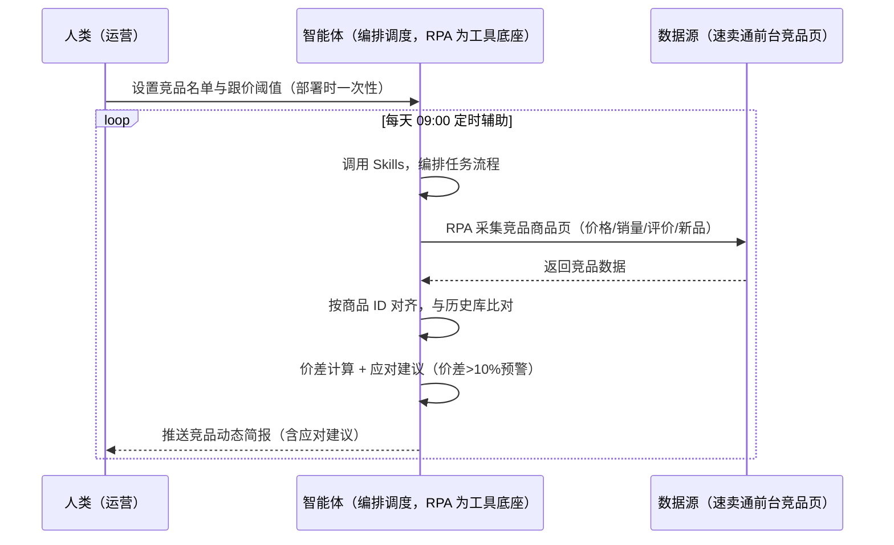
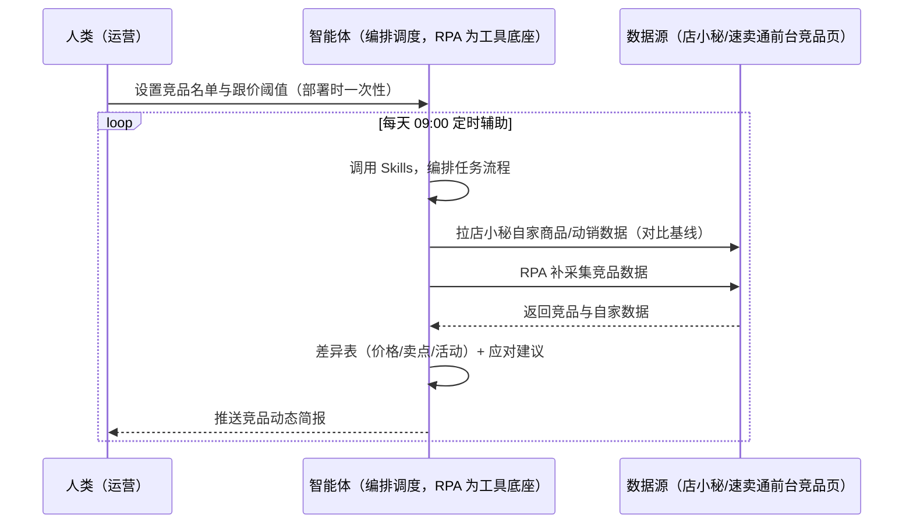

> 为速卖通卖家团队打造的竞品监控方案。手动翻竞品店费时、竞品调价/上新品后知后觉、大促期间竞品动作无法跟踪。本方案由智能体调度多个工具执行定时采集竞品店铺/商品数据（价格/销量/评价/新品），输出应对建议与跟价预警。每天定时辅助，只推送异动与应对建议，无异常不打扰。

> Agent 自动化需开通企业功能
> 点击申请1个月免费权限
> [点击申请 →](https://skieer.feishu.cn/share/base/form/shrcnFwMayykP5iaL38fnZKTbrg)

## 一、用户与需求

核心矛盾：竞品调价/上新品后知后觉、大促期间竞品动作无法跟踪；低价跟卖在速卖通意义有限（服务分权重更关键），需要的是策略性应对而非盲目跟价。

两类客户痛点同源，数据来源不同：

- 未购 SaaS 客户（新卖家/小团队）：人工翻竞品店、逐条记价格/销量/评价，全靠手；
- 已购 SaaS 客户（店小秘 ERP 等）：店小秘管订单/上架，竞品监控不覆盖，仍要人手动翻。

适用客户：核心类目有直接竞品的卖家。速卖通前台商品页公开可采。

### 1.1 不同模式卖家

| 类型 | 选择 | 建议 |
|-|-|-|
| POP | 首选 | 强烈推荐（自主定价，竞品监控直接指导调价） |
| 半托管 | 次选 | 一般推荐（半托管可自主调价） |
| 全托管 | 任意 | 不推荐（平台代运营定价，竞品监控价值有限） |

### 1.2 不同类目卖家

| 类目 | 最关注维度 | 核心逻辑 |
|-|-|-|
| 3C 数码 | 价格异动 | 迭代快，竞品降价即应对 |
| 家居家具 | 上新监控 | 大件上新少但权重高 |
| 美妆个护 | 竞品活动 | 大促活动报名节奏 |
| 服装鞋帽 | 季节上新 | 按站点季节盯竞品 |
| 户外运动 | 旺季价格 | 旺季前竞品动作 |
| 母婴用品 | 合规风险 | 竞品被下架=品类风险信号 |

### 1.3 不同角色用户

| 用户 | 需求 | 问题 | 投入时间（估算） |
|-|-|-|-|
| 老板 | 竞争态势 | 不知道竞品在干什么 | 0.5 小时/周 |
| 运营 | 竞品异动清单 | 手动翻店费时 | 1-2 小时/周 |
| 选品 | 上新机会 | 竞品上新错过 | 1 小时/周 |

---

## 二、现在的方法与问题

### 2.1 流程步骤与问题总结

**人工方式（未购 SaaS 客户）**

| 序号 | 步骤 | 现在的方法 | 问题缺陷 |
|-|-|-|-|
| 1 | 找竞品 | 手动搜关键词找 | 名单不全，漏盯 |
| 2 | 看价格 | 逐页翻竞品店 | 调价后知后觉 |
| 3 | 看上新 | 手动刷新 | 上新错过 |
| 4 | 对比 | 凭记忆对比 | 无历史基线 |
| 5 | 应对 | 凭经验调价 | 无策略建议 |

**SaaS 方式（已购店小秘 ERP 客户）**

| 序号 | 步骤 | 现在的方法 | 问题缺陷 |
|-|-|-|-|
| 1 | 找竞品 | 店小秘不覆盖 | 靠人找 |
| 2 | 看价格 | 手动 | 无自动化 |
| 3 | 看上新 | 手动 | 无提醒 |
| 4 | 对比 | 靠人 | 基线不沉淀 |
| 5 | 应对 | 凭经验 | 无建议 |

### 2.2 问题分析

**人工方式根因**

| 序号 | 根因 | 具体表现 |
|-|-|-|
| 1 | 手动翻店 | 多竞品盯不过来 |
| 2 | 无历史基线 | 调价/上新无对比基准 |
| 3 | 应对盲目 | 低价跟卖意义有限，策略缺失 |

**SaaS 方式根因**

| 序号 | 根因 | 具体表现 |
|-|-|-|
| 1 | 店小秘不覆盖 | 竞品监控无工具 |
| 2 | 无闭环 | 调价/改详情后不回采验证 |

---

## 三、解决方案

### 3.1 功能概述

为速卖通卖家团队打造的竞品监控方案，定时采集竞品店铺/商品数据，识别异动信号，输出应对建议与跟价预警。

每天定时触发并调度多个工具，调起八爪鱼 RPA（Agent 的工具底座，能耦合多系统、完成自动化任务执行）采集竞品店铺/商品数据（价格/销量/评价/上架新品），智能体对比自家商品输出「价格/卖点/活动」差异表与跟价预警。每天定时辅助，只推送异动与应对建议，无异常不打扰。

### 3.2 系统结合

| 要素 | 说明 |
|-|-|
| 客户现有工具盘点 | **未购 SaaS 客户**：无第三方工具，竞品全靠手动翻店。     **已购 SaaS 客户**（主流组合）：店小秘 ERP（官方服务市场合作 ERP，管订单/上架，竞品监控不覆盖） |
| 数据/能力来源 | **无 SaaS**：速卖通前台竞品商品页（价格/销量/评价/上架时间，公开可采，RPA 采集）。     **有 SaaS**：店小秘自家商品/动销数据（对比基线）+ RPA 补竞品采集 |
| RPA 耦合动作 | 作为 Agent 的工具底座，按计划采集竞品数据（定时调度、页面结构变更自适应、快照留档），按商品 ID 对齐去重，统一流转给智能体；价差超阈值告警 |
| 耦合出的新价值 | 单工具给不了的端到端结论：竞品数据一次取齐 → 与自家对比 → 差异表 + 应对建议（调价/改详情/报活动），**只推送异动与应对建议** |

### 3.3 智能体执行流程

智能体定时触发。支持**两种数据通道**，部署时按客户现有工具选择：

**通道一：无 SaaS 方式（RPA 采集前台竞品页，适合未购 ERP 的客户）**

**通道二：有 SaaS 方式（店小秘自家数据对比基线 + RPA 补竞品采集，适合已购客户）**

> Agent 自动化需开通企业功能
> 点击申请1个月免费权限
> [点击申请 →](https://skieer.feishu.cn/share/base/form/shrcnFwMayykP5iaL38fnZKTbrg)

### 3.4 为何这么设计

要同时回答三个问题：**为什么不能只用 SaaS/API？为什么不能纯靠智能体写代码？为什么 RPA 是执行底座？** 本场景的核心是"定时采集、基线比对、差异分析、挂了有人管"。

#### 1）逐项对比

| 对比维度 | SaaS/API 堆叠（店小秘） | 纯智能体（智能体写代码） | 智能体+自动化工具（RPA 工具底座） |
|-|-|-|-|
| 实现方式 | 店小秘管自家数据（对比基线） | 能抓前台，数据可自拼，但全要自己接 | 前台采集 + 自家数据对比，一处对齐 |
| 定时采集 | 不覆盖 | 智能体无法常驻轮询 | RPA 定时采集、快照留档 |
| 差异分析 | 无 | 需自写对比逻辑 | 差异表规则可视化配置 |
| 使用成本（总拥有成本） | 店小秘订阅费（主体另算） | 代理 IP + 服务器 + 开发维护人力，隐性成本高 | 一份平台订阅跑多流程，单方案边际成本 ≈ 0 |
| 维护人要求 | 低（工具现成） | 规则调整都要开发介入 | 可视化流程，运营自己可调阈值 |

#### 2）优劣势说明

|  | SaaS/API 堆叠（店小秘） | 纯智能体（智能体写代码） | 智能体+自动化工具（RPA 工具底座） |
|-|-|-|-|
| 优势 | 自家数据权威（对比基线） | 无订阅费；     可深度定制对比模型 | 前台采集+差异表即开即用；     非技术人员可维护 |
| 劣势 | 竞品监控不覆盖 | 反爬对抗全自建；     AI 生成代码是生成性的 | 本地电脑运行需保持开机；     订阅费；     页面结构变更需维护 |

#### 3）结论

| 论点 | 说明 |
|-|-|
| 跟价需策略 | 低价跟卖在速卖通意义有限（服务分权重更关键）——应对建议以服务分/卖点/活动差异为主，不盲目跟价 |
| 大促联动 | 监控竞品活动报名（828/双11/黑五）节奏，提前应对（实锤） |
| 数据供定价联动 | 竞品数据供「定价与运费模板」场景联动 |
| 一个底座跑多流程 | 客户购买 RPA 平台是跑多个流程（竞品/选品/定价），本方案只是其中一个——平台订阅费被多流程摊薄 |
| 时间 | 运营要的是"竞品异动 + 应对建议"，不是"翻竞品店" |

### 3.5 功能清单

| 功能 | 系统 | 功能说明（解决问题） |
|-|-|-|
| 会话/定时 | 智能体 | 1. 理解人类语言，调用已预设好的 Skills。     2. 编排多任务、调度多工具。 |
| 多系统数据取数 | RPA、指纹浏览器 | 1. 解决竞品手动翻店、调价后知后觉问题。     2. 作为智能体工具底座被调度执行，定时调度、快照留档、页面结构变更自适应。     3. **【无 SaaS 方式】** RPA 采集前台竞品页。**【有 SaaS 方式】** 店小秘自家数据对比基线 + RPA 补竞品采集。 |
| 差异分析 | 智能体 | 对比自家商品输出「价格/卖点/活动」差异表。 |
| 跟价预警 | 智能体 | 价差 >10% 预警（阈值可配）；结合佣金与物流成本差异判断。 |
| 上新识别 | 智能体 | 新品上架 = 商品 ID 未入历史库；大促活动报名节奏监控。 |
| IM通知 | 飞书、钉钉、企微等 | 解决异动通知滞后问题。竞品异动与应对建议自动推送。 |
| 数据资产储存 | 本地电脑、云储存 | 1. Skills 资产：速卖通竞品监测技能。     2. 数据储存：竞品监控库统一写入本地。     3. 经验知识库：调价/改详情效果回填迭代。 |

### 3.6 智能体执行落地过程

部署时一次性配置入参（竞品名单、监控频率、跟价阈值、数据通道），会话中无需重复输入。

**⚠️ 部署前提（不满足则方案无法跑起来）**：①RPA 需部署在**常开电脑/云机**上，并配置漏跑补跑机制；②前台商品页有反爬风控，需自备账号并遵守平台条款，频控触发自动降频重试；③**有 SaaS 方式需店小秘账号**（对比基线，可选增强，无则走前台通道）；④首次配置（竞品名单、基线库、对比规则）需服务方/技术人员介入一次，属实施成本。

#### 1）配置

| 类别 | 说明 |
|-|-|
| 智能体 | 主流智能体。 |
| 智能体工具 | 1. **数据通道（按客户现有工具二选一）**：【无 SaaS】速卖通前台竞品页（RPA 采集）；【有 SaaS】店小秘自家数据 + RPA 补竞品采集。     2. 数据取数与自动化执行：八爪鱼 RPA，MCP 配置完成。     3. 数据分析：智能体自带。     4. IM：企业办公 IM（飞书/钉钉/企微），MCP 或 webhook 配置。 |
| 工作知识 | 1. 竞品店铺/商品清单（或关键词自动圈定）。     2. 监控频率。     3. 跟价阈值：价差 >10% 预警。     4. 大促日历（328/828/双11/黑五/双12）。 |
| 本地数据库 | 1. 竞品监控库地址。     2. 报告库地址。     3. 经验库地址。 |

#### 2）执行

| 任务 | 产出 | 产出物接收人 |
|-|-|-|
| 接收竞品名单，定时触发 | 任务启动记录 | —— |
| 调用已预设 Skills，编排任务流程 | 任务编排方案 | —— |
| 经 MCP 向八爪鱼 RPA 下发取数任务 | 自动化任务指令 | —— |
| 多源取数并按商品 ID 对齐（无 SaaS：前台采集；有 SaaS：店小秘+前台，智能体监控状态） | 对齐后竞品数据 | —— |
| 与自家商品对比（价格/卖点/活动） | 差异表 | 运营 |
| 跟价预警（价差 >10%） | 预警消息 | 运营/老板 |
| 应对建议（调价/改详情/报活动） | 应对建议 | 运营 |
| 推送竞品动态简报 | 群消息 | 运营/老板 |

异常处理：

频控触发 → 降频重试；

页面结构变更 → 告警并自适应；

数据缺失 → 用历史数据补并标注；

大促节奏 → 提前提醒；

置信度 &lt;70% → 转人工复核，不输出硬结论。

#### 3）结果

| 结果 | 说明 |
|-|-|
| 数据资产 | 竞品监控库结构化数据（商品/价格/销量/评价/来源页面），可审计可追溯。 |
| 分析报告 | 1. 竞品动态简报：价格/上新/活动异动。     2. 差异表：价格/卖点/活动对比。     3. 应对建议。 |
| Skills | 智能体 Skills：速卖通竞品监测技能，按效果回填迭代对比规则。 |

> Agent 自动化需开通企业功能
> 点击申请1个月免费权限
> [点击申请 →](https://skieer.feishu.cn/share/base/form/shrcnFwMayykP5iaL38fnZKTbrg)

---

## 四、使用前后预估

> 本方案价值 = **竞品数据自动采集 → 与自家对比 → 差异表 + 应对建议 → 效果回填**。速卖通前台商品页公开可采（无 SaaS 即可跑），店小秘为可选增强。

| 指标 | 人工 | SaaS/API（店小秘） | 智能体+自动化工具 |
|-|-|-|-|
| 竞品监控 | 手动翻店 | 不覆盖 | 定时自动采集 |
| 价格异动 | 后知后觉 | 无 | 价差 >10% 自动预警 |
| 上新识别 | 手动刷新 | 无 | 商品 ID 自动比对 |
| 差异分析 | 凭记忆 | 无 | 价格/卖点/活动差异表 |
| 应对建议 | 盲目跟价 | 无 | 策略性建议（服务分优先） |
| 方法论 | 无 | 单工具 | 可复用的 Skills 与对比规则 |

**说明**：速卖通前台商品页公开可采；跟价需考虑佣金与物流成本差异（低价跟卖在速卖通意义有限，服务分权重更关键）；监控竞品活动报名（828/双11/黑五）节奏，提前应对；数据供「定价与运费模板」场景联动。

---

## 五、效果证明

> Agent 自动化需开通企业功能
> 点击申请1个月免费权限
> [点击申请 →](https://skieer.feishu.cn/share/base/form/shrcnFwMayykP5iaL38fnZKTbrg)

### 5.1 客户案例

**《万和：idealo 欧洲 5 国竞品比价数据自动化》**

> 一键覆盖 idealo 德法意英西 5 大站点，列表页 + 详情页双层深度采集，从基础信息到价格分布再到产品参数全维度抓取，清洗后结构化入 MySQL。

| 效果 | 说明 |
|-|-|
| 提效 | 海外竞品比价由人工一周缩短至几小时。原本 idealo 德法意英西 5 国站点需逐个采集、规则各异，现在 55 个核心品类关键词 × 每词前 50 页全自动采集。 |
| 降本 | 竞品价格情报从人工零散收集升级为自动化全景洞察，市场人员投入转向定价与产品策略等重点工作。 |
| 任务 | 列表页 + 详情页双层采集，10+ 全维度字段，采集稳定率 99%+（人工误差约 90% → 全自动 99%+）。 |
| 任务 | 多维度筛选条件自动配置，数据自动清洗去重后结构化入 MySQL，可直接分析。 |

案例详情：[竞品洞察：厨卫龙头的欧洲5国比价数据自动化实践](https://skieer.feishu.cn/wiki/MEhqwM1pWi2Lv3kCBqJcJQvAnwe)

**《竞品 AI 快报：多平台动态 7×24 监控与自动出报》**

> 某大型教培集团需盯多家竞品公众号、课程与活动动态，人工巡查信息零散难汇总。RPA 自动巡查多平台账号并生成竞品快报。

| 效果 | 说明 |
|-|-|
| 提效 | 竞品动态巡查由人工每日逐平台翻阅变为 7×24 自动监控。原本市场团队需人工登录多平台逐篇查看推文、课程与活动，现在自动抓取、自动分析、自动出报告。 |
| 降本 | 市场团队用于公众号巡查、内容摘抄与情报汇总的重复性工作量降低约 80%，投入转向课程优化、活动策划与市场竞争策略等重点工作。 |
| 任务 | 竞品课程、价格及营销动态识别准确率提升至 95% 以上，减少遗漏与误判。 |
| 任务 | 多平台账号自动巡查，情报按周期自动汇总成报。 |

案例详情：[快报|社媒监控：竞品AI快报生成自动化](https://skieer.feishu.cn/wiki/UNA7wUatCih1D2kXL5Fco3MpnGe)

---

## 六、备注

### 6.1 Agent 支持

本方案不绑定具体智能体，主流 Agent 均可运行（需支持技能/Skills 加载与工具调用）：

| Agent/智能体 | 说明 |
|-|-|
| Workbuddy | 本方案运行平台，支持技能/Skills 上传加载、定时任务、MCP 工具调用与表格/报告处理 |
| 豆包（国内·字节） | 国内主流个人智能体，支持技能上传、定时任务与工具调用，上手成本低 |
| 通义千问（国内·阿里） | 支持 Agent 编排与插件生态，集成阿里电商数据能力，适合电商场景 |
| DeepSeek（国内） | 推理能力强、成本低，适合规则打分与归因分析类任务 |
| ChatGPT（国外·OpenAI） | 海外主流通用智能体，支持 GPTs/Agent 模式与工具调用 |
| Claude（国外·Anthropic） | 长文本与结构化分析能力强，原生支持 MCP 连接外部工具 |

### 6.2 名词解释

| 术语 | 说明 |
|-|-|
| 跟价预警 | 价差 >10% 预警（阈值可配） |
| 服务分 | 速卖通店铺服务评分，权重高于低价 |
| 差异表 | 与竞品的价格/卖点/活动对比表 |
| 大促日历 | 328 周年庆/828 年中大促/双11/黑五/双12 |
| 混合数据源 | 速卖通前台竞品页（公开采集）+ 店小秘自家数据（有 SaaS 客户对比基线） |
| 有 SaaS 方式 | 已购店小秘 ERP，自家数据对比 + RPA 补竞品采集 |
| 无 SaaS 方式 | 不购买第三方工具，RPA 采集前台竞品页 |
| POP | 自主运营模式（自主上架定价，总费率 6%-11.5%） |
| 全托管 | 平台代运营（无自主发布权，平台抽佣 25%-30%） |
| 半托管 | 佣金介于 POP 与全托管之间 |
| MCP | Model Context Protocol，智能体连接外部工具的标准化通道 |

> Agent 自动化需开通企业功能
> 点击申请1个月免费权限
> [点击申请 →](https://skieer.feishu.cn/share/base/form/shrcnFwMayykP5iaL38fnZKTbrg)

---

原文：[查看原文](https://skieer.feishu.cn/wiki/XZGdwvfKHiRKC4kQrWLcYoBFnYd)
