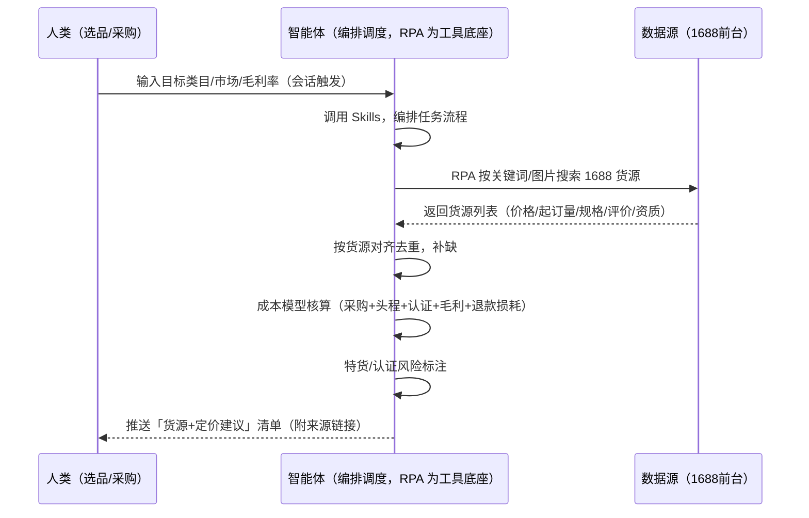
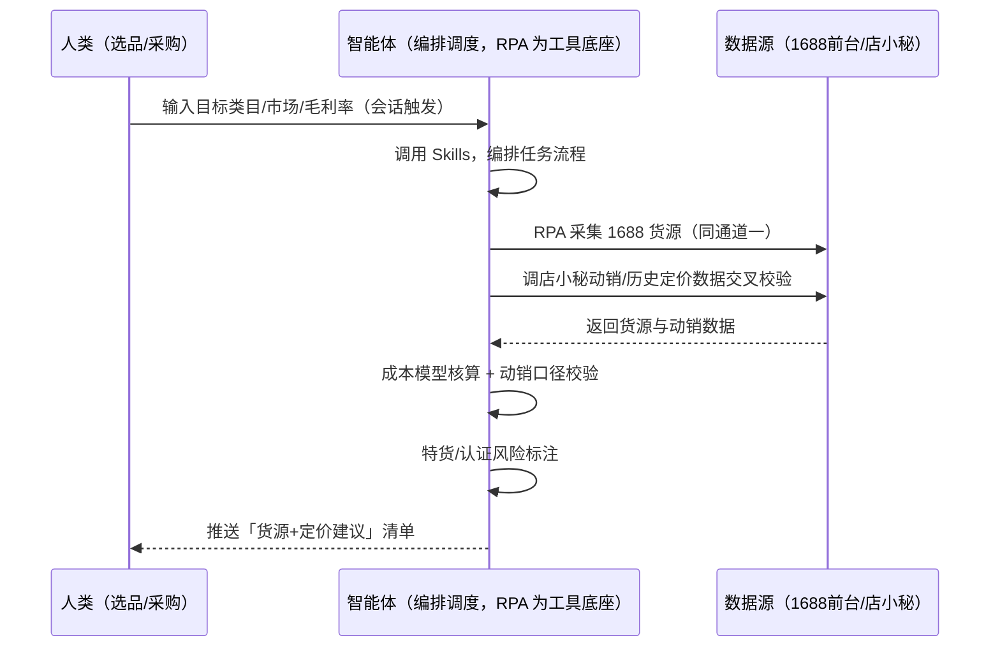

> 为速卖通卖家团队打造的供应链寻源与 1688 比价方案。手动刷 1688 逐条比价找 3 个合格货源要半天、定价凭感觉佣金+退款一扣没利润、忽略特货/认证成本上架后被下架或罚款。本方案由智能体调度多个工具执行按关键词/图片批量采集 1688 货源，核算可售定价区间。选品词出现即触发，输出「货源 + 定价建议」清单，供你上架/报价。

> Agent 自动化需开通企业功能
> 点击申请1个月免费权限
> [点击申请 →](https://skieer.feishu.cn/share/base/form/shrcnFwMayykP5iaL38fnZKTbrg)

## 一、用户与需求

核心矛盾：速卖通费率结构特殊（POP 总费率 6%-11.5% = 佣金 3.5%-9% + 交易服务费 2.5%，叠加退款率），定价凭感觉佣金+退款一扣没利润；手动刷 1688 比价费时、忽略特货/认证成本。

两类客户痛点同源，数据来源不同：

- 未购 SaaS 客户（新卖家/小团队）：人工打开 1688 逐条搜货比价、复制粘贴到表格，全靠手；
- 已购 SaaS 客户（店小秘 ERP 等）：店小秘管订单/上架，1688 找货源比价不覆盖，仍要人跨平台核对。

适用客户：需要找货比价的速卖通卖家。1688 前台公开可采（免登录现成应用直挂），本场景为低频按需触发。

### 1.1 不同模式卖家

| 类型 | 选择 | 建议 |
|-|-|-|
| POP | 首选 | 强烈推荐（自主定价，成本模型直接决定利润） |
| 半托管 | 次选 | 一般推荐（佣金介于中间，比价同样重要） |
| 全托管 | 任意 | 不推荐（平台代运营定价，寻源价值有限） |

### 1.2 不同类目卖家

| 类目 | 最关注维度 | 核心逻辑 |
|-|-|-|
| 3C 数码 | 认证成本 | CE/FCC 认证（带电类）成本高 |
| 家居家具 | 物流成本 | 大件头程占比高 |
| 美妆个护 | 资质合规 | 需检测报告 |
| 服装鞋帽 | 起订量 | 多尺码 SKU 平衡 |
| 户外运动 | 旺季备货 | 旺季前锁定货源 |
| 母婴用品 | 安全认证 | CPC 等认证门槛 |

### 1.3 不同角色用户

| 用户 | 需求 | 问题 | 投入时间（估算） |
|-|-|-|-|
| 老板 | 货源成本与利润空间 | 定价没底，一扣没利润 | 1 小时/周 |
| 选品/采购 | 货源候选+定价建议 | 1688 逐条比价费时 | 2-3 小时/周 |
| 运营 | 上架定价依据 | 忽略特货/认证成本 | 0.5 小时/周 |

---

## 二、现在的方法与问题

### 2.1 流程步骤与问题总结

人工方式（未购 SaaS 客户）

| 序号 | 步骤 | 现在的方法 | 问题缺陷 |
|-|-|-|-|
| 1 | 搜货源 | 手动刷 1688 关键词/图片搜索 | 找 3 个合格货源要半天 |
| 2 | 比价 | 逐条对比价格/起订量/规格 | 定价凭感觉 |
| 3 | 查资质 | 逐个看工厂资质/评价 | 忽略特货/认证成本 |
| 4 | 算成本 | 凭经验估算 | 佣金+退款一扣没利润 |
| 5 | 上架 | 手动填定价 | 无模型支撑 |

**SaaS 方式（已购 ERP 客户）**

| 序号 | 步骤 | 现在的方法 | 问题缺陷 |
|-|-|-|-|
| 1 | 搜货源 | 店小秘不覆盖 | 无自动化 |
| 2 | 比价 | 手动对比 | 无模型 |
| 3 | 查资质 | 手动看 | 特货/认证易忽略 |
| 4 | 算成本 | 凭经验 | 无成本模型沉淀 |
| 5 | 上架 | 手动 | 无定价建议 |

### 2.2 问题分析

人工方式根因

| 序号 | 根因 | 具体表现 |
|-|-|-|
| 1 | 比价费时 | 逐条手动，效率低 |
| 2 | 费率没算清 | 佣金+交易服务费+退款损耗遗漏 |
| 3 | 特货认知不足 | 上架后被下架或罚款 |

**SaaS 方式根因**

| 序号 | 根因 | 具体表现 |
|-|-|-|
| 1 | 店小秘不覆盖 | 1688 比价无工具 |
| 2 | 无闭环 | 动销数据不回填迭代成本模型 |

---

## 三、解决方案

### 3.1 功能概述

为速卖通卖家团队打造的供应链寻源与 1688 比价方案，按关键词/图片在 1688 批量采集货源，核算可售定价区间，输出「货源 + 定价建议」清单。

选品词出现即触发并调度多个工具，调起八爪鱼 RPA（Agent 的工具底座，能耦合多系统、完成自动化任务执行）在 1688 按关键词/图片搜索采集货源（价格/起订量/规格/评价/工厂资质），智能体核算「供货价 = 采购成本 + 头程物流 + 认证摊销 + 目标毛利 + 退款损耗」并标注特货/认证风险。选品词出现即触发，输出「货源 + 定价建议」清单，供你上架/报价。

### 3.2 系统结合

| 要素 | 说明 |
|-|-|
| 客户现有工具盘点 | **未购 SaaS 客户**：无第三方工具，找货源全靠手动刷 1688。     **已购 SaaS 客户**（主流组合）：店小秘 ERP（官方服务市场合作 ERP，管订单/上架，不覆盖 1688 找货） |
| 数据/能力来源 | **无 SaaS**：1688 前台关键词/图片搜索（价格/起订量/规格/评价/资质，公开可采，RPA 采集）。     **有 SaaS**：数据源同为 1688 前台（店小秘无货源接口），RPA 采集为主；成本模型与店小秘订单/动销数据可交叉校验 |
| RPA 耦合动作 | 作为 Agent 的工具底座，按需调度 1688 采集（关键词/图片搜索、翻页、抓价格/起订量/规格/评价/资质），按货源对齐去重，统一流转给智能体核算；登录墙或反爬时降级为免登录采集 |
| 耦合出的新价值 | 单工具给不了的端到端结论：1688 货源一次取齐 → 成本模型核算（含费率与退款损耗）→ 特货/认证风险标注 → 输出「货源 + 定价建议」清单，**只推送有定价价值的货源** |

### 3.3 智能体执行流程

用户向智能体输入会话（入参：目标类目、目标市场、成本口径、目标毛利率）。支持**两种数据通道**，部署时按客户现有工具选择：

**通道一：无 SaaS 方式（RPA 采集 1688 前台，适合未购 ERP 的客户）**

**通道二：有 SaaS 方式（成本模型与店小秘动销交叉校验，适合已购客户）**

> Agent 自动化需开通企业功能
> 点击申请1个月免费权限
> [点击申请 →](https://skieer.feishu.cn/share/base/form/shrcnFwMayykP5iaL38fnZKTbrg)

### 3.4 为何这么设计

要同时回答三个问题：**为什么不能只用 SaaS/API？为什么不能纯靠智能体写代码？为什么 RPA 是执行底座？** 本场景的核心是"批量搜索、翻页采集、成本模型、风险标注、挂了有人管"。

#### 1）逐项对比

| 对比维度 | SaaS/API 堆叠（店小秘） | 纯智能体（智能体写代码） | 智能体+自动化工具（RPA 工具底座） |
|-|-|-|-|
| 实现方式 | 店小秘管订单/上架，货源不覆盖 | 能抓 1688，数据可自拼，但全要自己接 | 1688 现成应用直挂（免登录公开采集） |
| 多系统耦合 | 单系统，无货源数据 | 全自建：搜索、翻页、去重逻辑 | 平台沉淀多源取数与对齐，可视化配置 |
| 成本核算 | 无模型 | 需自写成本模型与维护 | 成本模型模板化（含费率/退款损耗）、动销回填迭代 |
| 使用成本（总拥有成本） | 店小秘订阅费（主体另算） | 代理 IP + 服务器 + 开发维护人力，隐性成本高 | 一份平台订阅跑多流程，单方案边际成本 ≈ 0 |
| 维护人要求 | 低（工具现成） | 规则调整都要开发介入 | 可视化流程，采购自己可调毛利率/成本口径 |

#### 2）优劣势说明

|  | SaaS/API 堆叠（店小秘） | 纯智能体（智能体写代码） | 智能体+自动化工具（RPA 工具底座） |
|-|-|-|-|
| 优势 | 动销数据权威（可交叉校验） | 无订阅费；     可深度定制成本模型 | 1688 现成应用直挂（免登录）；     成本模型即开即用；     非技术人员可维护 |
| 劣势 | 货源采集无覆盖 | 反爬对抗全自建；     AI 生成代码是生成性的 | 本地电脑运行需保持开机；     订阅费；     灵活性受平台模板边界限制 |

#### 3）结论

| 论点 | 说明 |
|-|-|
| 费率=利润杀手 | 速卖通总费率约 6%-11.5%（佣金 3.5%-9% + 交易服务费 2.5%，实锤）叠加退款率（韩国/德国无理由退款比例高）后仍有利润才值得做 |
| 三态成本模型不同 | POP 总费率 6%-11.5%、全托管平台抽佣 25%-30%（实锤）、半托管佣金介于两者之间——模型按模式内置 |
| 只用店小秘无此场景 | 店小秘管订单/上架，1688 找货比价无接口覆盖——本方案填补空白 |
| 一个底座跑多流程 | 客户购买 RPA 平台是跑多个流程（寻源/选品/定价），本方案只是其中一个——平台订阅费被多流程摊薄 |
| 特货风险前置 | 带电/液体/粉末上架受限，认证成本（CE/FCC）影响定价与申报空间——模型内置标注 |
| 时间 | 采购要的是"一张可定价的货源清单"，不是"反复刷 1688" |

### 3.5 功能清单

| 功能 | 系统 | 功能说明（解决问题） |
|-|-|-|
| 会话/定时 | 智能体 | 1. 理解人类语言，调用已预设好的 Skills。     2. 编排多任务、调度多工具。 |
| 多系统数据取数 | RPA、指纹浏览器 | 1. 解决 1688 逐条比价费时、定价凭感觉问题。     2. 作为智能体工具底座被调度执行，登录墙或反爬时降级免登录采集。     3. **【无 SaaS 方式】** RPA 采集 1688 关键词/图片搜索货源。**【有 SaaS 方式】** 数据源同为 1688 前台 + 店小秘动销数据交叉校验。 |
| 数据清洗对齐 | 智能体 | 按货源对齐去重，解决重复货源问题。 |
| 成本核算 | 智能体 | 供货价 = 采购成本 + 头程物流 + 认证摊销 + 目标毛利 + 退款损耗（POP 建议毛利率 ≥25% 覆盖佣金与退款损耗）。 |
| 特货/认证风险标注 | 智能体 | 带电/液体/粉末标记 + 认证成本（CE/FCC）单独评估。 |
| 定价建议 | 智能体 | 按模式费率（POP 6%-11.5% / 全托管抽佣 25%-30%）测算可售定价区间。 |
| IM通知 | 飞书、钉钉、企微等 | 解决货源清单交付滞后问题。货源+定价建议自动推送。 |
| 数据资产储存 | 本地电脑、云储存 | 1. Skills 资产：速卖通成本模型技能。     2. 数据储存：货源库统一写入本地。     3. 经验知识库：动销数据回填迭代成本模型。 |

### 3.6 智能体执行落地过程

会话启动只需输入目标类目/市场/毛利率；下表其余配置项（成本口径、认证清单、数据通道）均为部署时一次性预设。

**⚠️ 部署前提（不满足则方案无法跑起来）**：①RPA 需部署在**常开电脑/云机**上（按需触发可接受任务时开机）；②1688 有登录墙与反爬，免登录采集为默认通道，采集失败自动降级重试；③成本口径（含税/不含税）、认证成本清单需按类目预设；④首次配置（成本模型、认证清单、费率口径）需服务方/技术人员介入一次，属实施成本。

#### 1）配置

| 类别 | 说明 |
|-|-|
| 智能体 | 主流智能体。 |
| 智能体工具 | 1. **数据通道（按客户现有工具二选一）**：【无 SaaS】1688 前台（RPA 采集）；【有 SaaS】1688 前台 + 店小秘动销数据交叉校验。     2. 数据取数与自动化执行：八爪鱼 RPA，MCP 配置完成。     3. 数据分析：智能体自带。     4. IM：企业办公 IM（飞书/钉钉/企微），MCP 或 webhook 配置。 |
| 工作知识 | 1. 目标类目与市场（影响认证与物流成本）。     2. 成本口径：含税/不含税。     3. 目标毛利率：POP 建议 ≥25%。     4. 认证成本清单：CE/FCC/CPC 按类目。     5. 费率口径：POP 6%-11.5% / 全托管 25%-30%。 |
| 本地数据库 | 1. 货源库地址。     2. 成本模型库地址。     3. 经验库地址。 |

#### 2）执行

| 任务 | 产出 | 产出物接收人 |
|-|-|-|
| 接收目标类目/市场/毛利率，会话触发 | 任务启动记录 | —— |
| 调用已预设 Skills，编排任务流程 | 任务编排方案 | —— |
| 经 MCP 向八爪鱼 RPA 下发取数任务 | 自动化任务指令 | —— |
| 多源取数并按货源对齐（无 SaaS：1688；有 SaaS：1688+店小秘，智能体监控状态） | 对齐后货源数据 | —— |
| 成本模型核算（含费率与退款损耗） | 定价区间 | 采购 |
| 特货/认证风险标注 | 风险标记清单 | 采购/老板 |
| 定价建议输出 | 货源+定价清单 | 选品/采购 |
| 推送货源与定价建议 | 群消息 | 选品/采购/老板 |

异常处理：

1688 登录墙/反爬 → 降级免登录采集；

搜索无结果 → 换关键词重试 2 次；

数据缺失 → 标注待补；

低置信度货源 → 转人工复核，不输出硬结论。

#### 3）结果

| 结果 | 说明 |
|-|-|
| 数据资产 | 货源库结构化数据（货源/价格/起订量/资质/来源链接），可审计可追溯。 |
| 分析报告 | 1. 货源+定价建议清单：可直接定价的货源候选。     2. 特货/认证风险标注。     3. 成本模型迭代记录。 |
| Skills | 智能体 Skills：速卖通成本模型技能，按动销数据回填迭代。 |

> Agent 自动化需开通企业功能
> 点击申请1个月免费权限
> [点击申请 →](https://skieer.feishu.cn/share/base/form/shrcnFwMayykP5iaL38fnZKTbrg)

---

## 四、使用前后预估

> 本方案价值 = **1688 批量寻源 → 成本模型核算（含费率与退款损耗）→ 特货/认证风险标注 → 「货源 + 定价建议」清单**。1688 前台公开可采（免登录现成应用直挂），无需额外 SaaS。

| 指标 | 人工 | SaaS/API（店小秘） | 智能体+自动化工具 |
|-|-|-|-|
| 找货源 | 手动刷 1688，半天找 3 个 | 不覆盖 | 批量搜索，一次取齐 |
| 比价 | 逐条对比 | 无 | 自动对齐、价格快照 |
| 成本核算 | 凭感觉 | 无模型 | 成本模型（含费率+退款损耗） |
| 特货/认证 | 易忽略 | 无 | 自动标注、认证成本单列 |
| 定价建议 | 无 | 无 | 按模式费率测算定价区间 |
| 方法论 | 无 | 无 | 可复用的成本模型（动销回填迭代） |

**说明**：本方案为低频按需触发（选品词出现即触发）；速卖通总费率约 6%-11.5%（佣金 3.5%-9% + 交易服务费 2.5%，实锤）叠加退款率（韩国/德国无理由退款比例高）后仍有利润才值得做；三态成本模型不同——POP 总费率 6%-11.5%、全托管平台抽佣 25%-30%（实锤）、半托管佣金介于两者之间。

---

## 五、效果证明

### 5.1 DEMO应用

1688-关键词找货源跨境商品采集：https://rpa.bazhuayu.com/appstore/app/dev\_-7jygx/taobao1688-01-rootadmin

1688-关键词商品信息采集-谷歌浏览器：https://rpa.bazhuayu.com/appstore/app/ffrpa/1688

---

## 六、备注

### 6.1 Agent 支持

本方案不绑定具体智能体，主流 Agent 均可运行（需支持技能/Skills 加载与工具调用）：

| Agent/智能体 | 说明 |
|-|-|
| Workbuddy | 本方案运行平台，支持技能/Skills 上传加载、定时任务、MCP 工具调用与表格/报告处理 |
| 豆包（国内·字节） | 国内主流个人智能体，支持技能上传、定时任务与工具调用，上手成本低 |
| 通义千问（国内·阿里） | 支持 Agent 编排与插件生态，集成阿里电商数据能力，适合电商场景 |
| DeepSeek（国内） | 推理能力强、成本低，适合规则打分与归因分析类任务 |
| ChatGPT（国外·OpenAI） | 海外主流通用智能体，支持 GPTs/Agent 模式与工具调用 |
| Claude（国外·Anthropic） | 长文本与结构化分析能力强，原生支持 MCP 连接外部工具 |

### 6.2 名词解释

| 术语 | 说明 |
|-|-|
| 供货价 | 采购成本 + 头程物流 + 认证摊销 + 目标毛利 + 退款损耗 |
| 总费率 | 佣金 3.5%-9% + 交易服务费 2.5%（POP，实锤） |
| 三态成本模型 | POP 6%-11.5% / 全托管抽佣 25%-30% / 半托管介于两者 |
| 退款损耗 | 无理由退款比例高的市场（韩国/德国）需在定价预留 |
| 特货 | 带电/液体/粉末类商品，上架受限、认证与物流成本上浮 |
| 认证摊销 | CE/FCC/CPC 等认证成本分摊到单件供货价 |
| 混合数据源 | 1688 前台公开采集（免登录，覆盖无 SaaS 客户）+ 店小秘动销数据交叉校验（有 SaaS 客户） |
| 有 SaaS 方式 | 已购店小秘 ERP，1688 采集 + 动销数据交叉校验 |
| 无 SaaS 方式 | 不购买第三方工具，由 RPA 采集 1688 前台 |
| POP | 自主运营模式（自主上架定价，总费率 6%-11.5%） |
| 全托管 | 平台代运营（无自主发布权，平台抽佣 25%-30%） |
| 半托管 | 佣金介于 POP 与全托管之间 |
| MCP | Model Context Protocol，智能体连接外部工具的标准化通道 |

> Agent 自动化需开通企业功能
> 点击申请1个月免费权限
> [点击申请 →](https://skieer.feishu.cn/share/base/form/shrcnFwMayykP5iaL38fnZKTbrg)

---

原文：[查看原文](https://skieer.feishu.cn/wiki/KnqXwQM4GibGPUk55Vcc73gsn9f)
