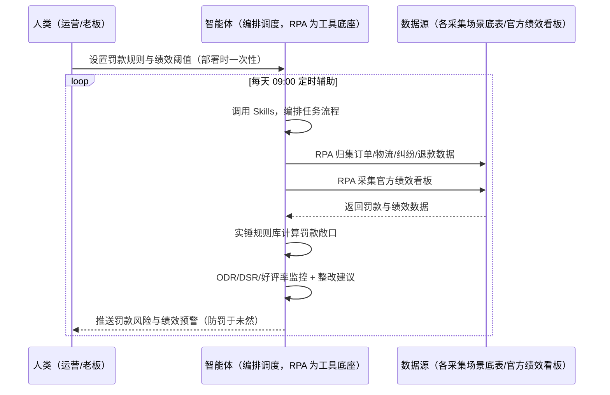
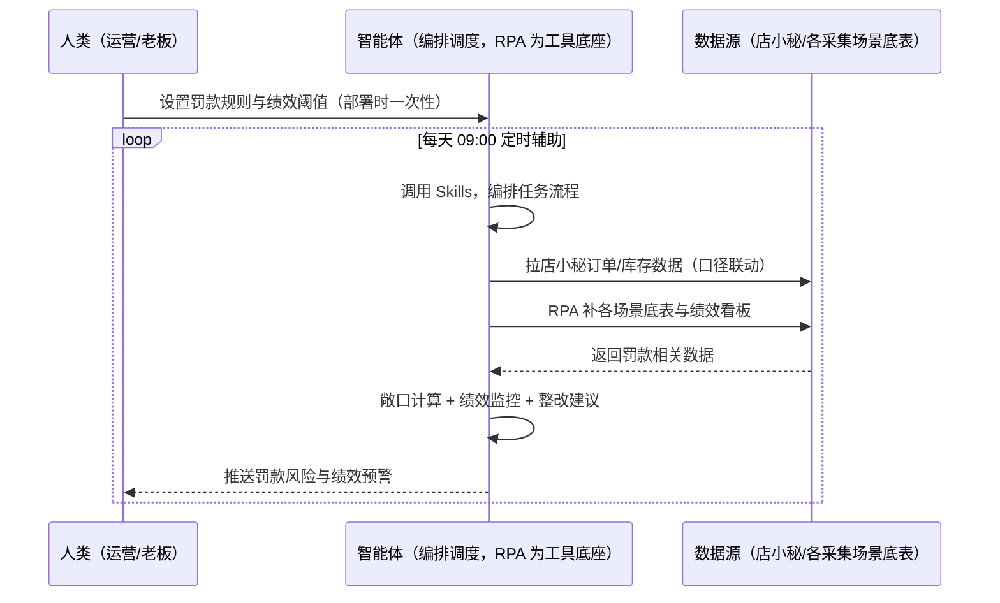

> 为速卖通卖家团队打造的罚款预警与绩效监控方案。晚发货/虚假发货/纠纷罚款口径多、ODR/DSR/好评率绩效不监控、罚款影响店铺权重。本方案由智能体调度多个工具执行归集各采集场景数据，按实锤规则库计算罚款敞口与绩效指标。每天定时辅助，只推送罚款风险与绩效预警，防罚于未然。

> Agent 自动化需开通企业功能
> 点击申请1个月免费权限
> [点击申请 →](https://skieer.feishu.cn/share/base/form/shrcnFwMayykP5iaL38fnZKTbrg)

## 一、用户与需求

核心矛盾：速卖通罚款口径多（晚发货/虚假发货/纠纷）且绩效指标（ODR/DSR/好评率）影响店铺权重与流量，被动等罚单才知道。

两类客户痛点同源，数据来源不同：

- 未购 SaaS 客户（新卖家/小团队）：人工盯各场景、被动等罚单，全靠手；
- 已购 SaaS 客户（店小秘 ERP 等）：店小秘管订单库存，罚款规则库与绩效指标不覆盖，仍要人盯。

适用客户：所有速卖通卖家（罚款与绩效影响店铺权重）。风险监控与测算可自动化，预防动作需人工执行。

### 1.1 不同模式卖家

| 类型 | 选择 | 建议 |
|-|-|-|
| POP | 首选 | 强烈推荐（自主履约，罚款/绩效影响权重） |
| 半托管 | 次选 | 一般推荐（半托管自主履约） |
| 全托管 | 任意 | 平台履约，罚款与绩效影响小 |

### 1.2 不同类目卖家

| 类目 | 最关注维度 | 核心逻辑 |
|-|-|-|
| 3C 数码 | 晚发货罚款 | 客单价高，罚款影响大 |
| 家居家具 | 虚假发货 | 大件物流风险 |
| 美妆个护 | ODR | 纠纷影响权重 |
| 服装鞋帽 | DSR | 服务分影响流量 |
| 户外运动 | 旺季罚款 | 旺季单量暴增 |
| 母婴用品 | 合规罚款 | 安全类目罚款高 |

### 1.3 不同角色用户

| 用户 | 需求 | 问题 | 投入时间（估算） |
|-|-|-|-|
| 老板 | 罚款可控绩效健康 | 被动等罚单 | 0.5 小时/周 |
| 运营 | 罚款敞口+绩效看板 | 口径多算不清 | 1-3 小时/周 |
| 合规 | 整改建议 | 罚后才知道 | 1 小时/周 |

---

## 二、现在的方法与问题

### 2.1 流程步骤与问题总结

人工方式（未购 SaaS 客户）

| 序号 | 步骤 | 现在的方法 | 问题缺陷 |
|-|-|-|-|
| 1 | 盯罚款 | 人工盯各场景 | 口径多记不住 |
| 2 | 盯绩效 | 手动看 ODR/DSR | 无系统跟踪 |
| 3 | 等罚单 | 被动接收 | 罚后才知道 |
| 4 | 整改 | 罚后补救 | 防不了 |
| 5 | 沉淀 | 无 | 规则不沉淀 |

SaaS 方式（已购店小秘 ERP 客户）

| 序号 | 步骤 | 现在的方法 | 问题缺陷 |
|-|-|-|-|
| 1 | 盯罚款 | 店小秘部分覆盖 | 罚款口径不覆盖 |
| 2 | 盯绩效 | 不覆盖 | 无看板 |
| 3 | 等罚单 | 被动 | 无预警 |
| 4 | 整改 | 罚后 | 无建议 |
| 5 | 沉淀 | 无 | 不迭代 |

### 2.2 问题分析

人工方式根因

| 序号 | 根因 | 具体表现 |
|-|-|-|
| 1 | 罚款口径多 | 晚发货/虚假发货/纠纷全口径，记不住 |
| 2 | 绩效不监控 | ODR/DSR 影响权重无感知 |
| 3 | 无敞口计算 | 罚款超利润无感知 |

**SaaS 方式根因**

| 序号 | 根因 | 具体表现 |
|-|-|-|
| 1 | 店小秘不覆盖 | 罚款规则与绩效无工具 |
| 2 | 无预警 | 各场景数据不联动 |

---

## 三、解决方案

### 3.1 功能概述

为速卖通卖家团队打造的罚款预警与绩效监控方案，归集各采集场景数据，按实锤规则库计算罚款敞口与绩效指标。

每天定时触发并调度多个工具，调起八爪鱼 RPA（Agent 的工具底座，能耦合多系统、完成自动化任务执行）归集各采集场景数据（订单/物流/纠纷/退款），智能体按实锤规则库（晚发货/虚假发货/纠纷）计算罚款敞口，监控 ODR/DSR/好评率绩效指标。每天定时辅助，只推送罚款风险与绩效预警，防罚于未然。

### 3.2 系统结合

| 要素 | 说明 |
|-|-|
| 客户现有工具盘点 | **未购 SaaS 客户**：无第三方工具，罚款全靠被动等罚单。    
**已购 SaaS 客户**（主流组合）：店小秘 ERP（官方服务市场合作 ERP，管订单库存，罚款规则不覆盖） |
| 数据/能力来源 | **无 SaaS**：各采集场景底表（订单/物流/纠纷/退款，RPA 归集）+ 官方绩效看板（ODR/DSR/好评率，登录采集）。    
**有 SaaS**：店小秘订单/库存数据 + 各场景底表（罚款口径联动） |
| RPA 耦合动作 | 作为 Agent 的工具底座，按计划归集各采集场景数据（按 SKU 对齐去重），统一流转给智能体；任一数据源失败自动重试、异常告警 |
| 耦合出的新价值 | 单工具给不了的端到端结论：各场景数据一次取齐 → 实锤规则库计算罚款敞口 → 绩效指标监控 → 风险分级与整改建议，**只推送罚款风险与绩效预警** |

### 3.3 智能体执行流程

智能体定时触发。支持**两种数据通道**，部署时按客户现有工具选择：

**通道一：无 SaaS 方式（RPA 归集各场景数据，适合未购 ERP 的客户）**

**通道二：有 SaaS 方式（店小秘数据联动 + RPA 补场景数据，适合已购客户）**

> Agent 自动化需开通企业功能
> 点击申请1个月免费权限
> [点击申请 →](https://skieer.feishu.cn/share/base/form/shrcnFwMayykP5iaL38fnZKTbrg)

### 3.4 为何这么设计

要同时回答三个问题：**为什么不能只用 SaaS/API？为什么不能纯靠智能体写代码？为什么 RPA 是执行底座？** 本场景的核心是"规则归集、敞口计算、绩效监控、挂了有人管"。

#### 1）逐项对比

| 对比维度 | SaaS/API 堆叠（店小秘） | 纯智能体（智能体写代码） | 智能体+自动化工具（RPA 工具底座） |
|-|-|-|-|
| 实现方式 | 店小秘管订单，罚款规则不覆盖 | 能抓数据能算，但全要自己接 | 各场景底表归集 + 规则库计算 |
| 规则维护 | 无规则库 | 需自建全口径规则 | 实锤规则库可视化配置 |
| 绩效监控 | 无 | 需自写指标逻辑 | ODR/DSR/好评率看板即开即用 |
| 使用成本（总拥有成本） | 店小秘订阅费（主体另算） | 代理 IP + 服务器 + 开发维护人力，隐性成本高 | 一份平台订阅跑多流程，单方案边际成本 ≈ 0 |
| 维护人要求 | 低（工具现成） | 规则调整都要开发介入 | 可视化流程，运营自己可调阈值 |

#### 2）优劣势说明

|  | SaaS/API 堆叠（店小秘） | 纯智能体（智能体写代码） | 智能体+自动化工具（RPA 工具底座） |
|-|-|-|-|
| 优势 | 订单/库存数据权威 | 无订阅费；    
可深度定制风控模型 | 规则库+敞口计算+绩效看板；    
防罚于未然；    
非技术人员可维护 |
| 劣势 | 罚款规则不覆盖 | 规则库与归集全自建；    
AI 生成代码是生成性的 | 本地电脑运行需保持开机；    
订阅费；    
依赖各采集场景数据就绪 |

#### 3）结论

| 论点 | 说明 |
|-|-|
| 罚款=权重杀手 | 晚发货/虚假发货/纠纷罚款直接扣减店铺权重与流量（实锤）——防罚于未然 |
| 绩效=流量分配 | ODR/DSR/好评率影响店铺服务分与流量分配——绩效看板必须 |
| 防罚 > 申诉 | 把「事后被罚」变成「事前预警」——规则库按实锤维护 |
| 一个底座跑多流程 | 客户购买 RPA 平台是跑多个流程（罚款/订单/物流），本方案只是其中一个——平台订阅费被多流程摊薄 |
| 汇总层定位 | 本场景 = 防罚段汇总层，依赖各采集场景数据就绪后价值最大化 |
| 时间 | 老板要的是"罚款敞口 + 绩效预警"，不是"被动等罚单" |

### 3.5 功能清单

| 功能 | 系统 | 功能说明（解决问题） |
|-|-|-|
| 会话/定时 | 智能体 | 1. 理解人类语言，调用已预设好的 Skills。    
2. 编排多任务、调度多工具。 |
| 多系统数据取数 | RPA、指纹浏览器 | 1. 解决被动等罚单、绩效不监控问题。    
2. 作为智能体工具底座被调度执行，各场景数据归集、失败自动重试。    
3. **【无 SaaS 方式】** RPA 归集各采集场景底表 + 官方绩效看板。**【有 SaaS 方式】** 店小秘数据联动 + RPA 补场景数据。 |
| 罚款敞口计算 | 智能体 | 实锤规则库：晚发货/虚假发货/纠纷全口径，按 SKU 计算敞口。 |
| 绩效监控 | 智能体 | ODR/DSR/好评率指标看板，跌破阈值预警。 |
| 风险分级 | 智能体 | 罚款敞口分级（高/中/低），高风险优先推送。 |
| 整改建议 | 智能体 | 按风险类型输出整改建议（发货/纠纷处理/服务优化）。 |
| IM通知 | 飞书、钉钉、企微等 | 解决罚款/绩效滞后问题。罚款风险与绩效预警自动推送。 |
| 数据资产储存 | 本地电脑、云储存 | 1. Skills 资产：速卖通罚款预警技能。    
2. 数据储存：罚款敞口库统一写入本地。    
3. 经验知识库：实际罚款案例回填迭代。 |

### 3.6 智能体执行落地过程

部署时一次性配置入参（罚款规则、绩效阈值、推送群、数据通道），会话中无需重复输入。

**⚠️ 部署前提（不满足则方案无法跑起来）**：①RPA 需部署在**常开电脑/云机**上，并配置漏跑补跑机制；②**依赖各采集场景数据就绪**（订单/物流/纠纷/退款底表）——建议与对应场景方案联动部署；③**有 SaaS 方式需店小秘账号**（口径联动，可选增强，无则走底表归集通道）；④首次配置（规则库、绩效阈值、底表映射）需服务方/技术人员介入一次，属实施成本。

#### 1）配置

| 类别 | 说明 |
|-|-|
| 智能体 | 主流智能体。 |
| 智能体工具 | 1. **数据通道（按客户现有工具二选一）**：【无 SaaS】各采集场景底表 + 官方绩效看板（RPA 归集）；【有 SaaS】店小秘数据联动 + RPA 补场景数据。    
2. 数据取数与自动化执行：八爪鱼 RPA，MCP 配置完成。    
3. 数据分析：智能体自带。    
4. 数据报告：智能体自带。    
5. IM：企业办公 IM（飞书/钉钉/企微），MCP 或 webhook 配置。 |
| 工作知识 | 1. 罚款规则库：晚发货/虚假发货/纠纷全口径。    
2. 绩效阈值：ODR/DSR/好评率。    
3. 风险阈值。    
4. 底表映射：订单/物流/纠纷/退款。 |
| 本地数据库 | 1. 罚款敞口库地址。    
2. 绩效看板库地址。    
3. 经验库地址。 |

#### 2）执行

| 任务 | 产出 | 产出物接收人 |
|-|-|-|
| 接收罚款规则，定时触发 | 任务启动记录 | —— |
| 调用已预设 Skills，编排任务流程 | 任务编排方案 | —— |
| 经 MCP 向八爪鱼 RPA 下发取数任务 | 自动化任务指令 | —— |
| 多源取数并按 SKU 对齐（无 SaaS：底表归集；有 SaaS：店小秘+底表，智能体监控状态） | 对齐后罚款数据 | —— |
| 罚款敞口计算（实锤规则库） | 敞口报告 | 运营/老板 |
| 绩效监控（ODR/DSR/好评率） | 绩效看板 | 运营 |
| 风险分级与整改建议 | 风险清单 | 运营/合规 |
| 推送罚款风险与绩效预警 | 群消息 | 运营/合规/老板 |

异常处理：

底表缺失 → 标注并降级为部分计算；

规则冲突 → 按最新实锤口径；

绩效跌破阈值 → 告警提醒；

置信度 &lt;70% → 转人工复核，不输出硬结论。

#### 3）结果

| 结果 | 说明 |
|-|-|
| 数据资产 | 罚款敞口库结构化数据（SKU/罚款类型/敞口金额/风险级），可审计可追溯。 |
| 分析报告 | 1. 罚款敞口报告：全口径计算。    
2. 绩效看板：ODR/DSR/好评率。    
3. 整改建议：按风险类型。 |
| Skills | 智能体 Skills：速卖通罚款预警技能，按实际罚款案例迭代规则库。 |

> Agent 自动化需开通企业功能
> 点击申请1个月免费权限
> [点击申请 →](https://skieer.feishu.cn/share/base/form/shrcnFwMayykP5iaL38fnZKTbrg)

---

## 四、使用前后预估

> 本方案价值 = **各场景数据归集 → 实锤规则库计算罚款敞口 → 绩效指标监控 → 风险分级与整改建议**。风险监控与测算可自动化，预防动作需人工执行。

| 指标 | 人工 | SaaS/API（店小秘） | 智能体+自动化工具 |
|-|-|-|-|
| 罚款盯守 | 被动等罚单 | 不覆盖 | 每日自动归集 |
| 敞口计算 | 算不清 | 无 | 规则库自动计算 |
| 绩效监控 | 无看板 | 无 | ODR/DSR 自动看板 |
| 风险分级 | 无 | 无 | 高/中/低自动分级 |
| 整改建议 | 罚后补救 | 无 | 按风险类型建议 |
| 方法论 | 无 | 单工具 | 可复用的 Skills 与规则库 |

**说明**：速卖通罚款与绩效（实锤）：晚发货/虚假发货/纠纷罚款直接扣减店铺权重与流量；ODR/DSR/好评率影响店铺服务分与流量分配；本场景 = 防罚段汇总层，依赖各采集场景数据就绪后价值最大化。

---

## 六、备注

### 6.1 Agent 支持

本方案不绑定具体智能体，主流 Agent 均可运行（需支持技能/Skills 加载与工具调用）：

| Agent/智能体 | 说明 |
|-|-|
| Workbuddy | 本方案运行平台，支持技能/Skills 上传加载、定时任务、MCP 工具调用与表格/报告处理 |
| 豆包（国内·字节） | 国内主流个人智能体，支持技能上传、定时任务与工具调用，上手成本低 |
| 通义千问（国内·阿里） | 支持 Agent 编排与插件生态，集成阿里电商数据能力，适合电商场景 |
| DeepSeek（国内） | 推理能力强、成本低，适合规则打分与归因分析类任务 |
| ChatGPT（国外·OpenAI） | 海外主流通用智能体，支持 GPTs/Agent 模式与工具调用 |
| Claude（国外·Anthropic） | 长文本与结构化分析能力强，原生支持 MCP 连接外部工具 |

### 6.2 名词解释

| 术语 | 说明 |
|-|-|
| 罚款敞口 | 按实锤规则计算的潜在罚款金额 |
| ODR | 订单缺陷率 |
| DSR | 卖家服务评分 |
| 全口径规则 | 晚发货/虚假发货/纠纷罚款规则库 |
| 防罚于未然 | 事前预警替代事后申诉 |
| 混合数据源 | 各采集场景底表（RPA 归集）+ 官方绩效看板 + 店小秘数据（有 SaaS 客户联动） |
| 有 SaaS 方式 | 已购店小秘 ERP，数据联动 + RPA 补场景数据 |
| 无 SaaS 方式 | 不购买第三方工具，RPA 归集各场景底表 |
| POP | 自主运营模式（自主上架定价，总费率 6%-11.5%） |
| 全托管 | 平台代运营（无自主发布权，平台抽佣 25%-30%） |
| 半托管 | 佣金介于 POP 与全托管之间 |
| MCP | Model Context Protocol，智能体连接外部工具的标准化通道 |

> Agent 自动化需开通企业功能
> 点击申请1个月免费权限
> [点击申请 →](https://skieer.feishu.cn/share/base/form/shrcnFwMayykP5iaL38fnZKTbrg)

---

原文：[查看原文](https://skieer.feishu.cn/wiki/JSXgwxsOBisKx3kowQJckf5knvz)
