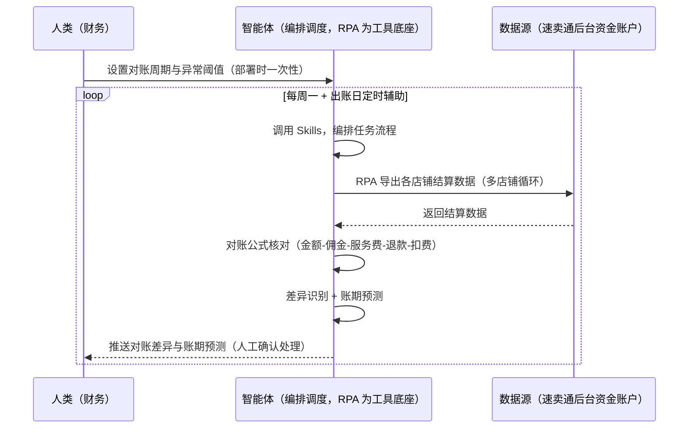
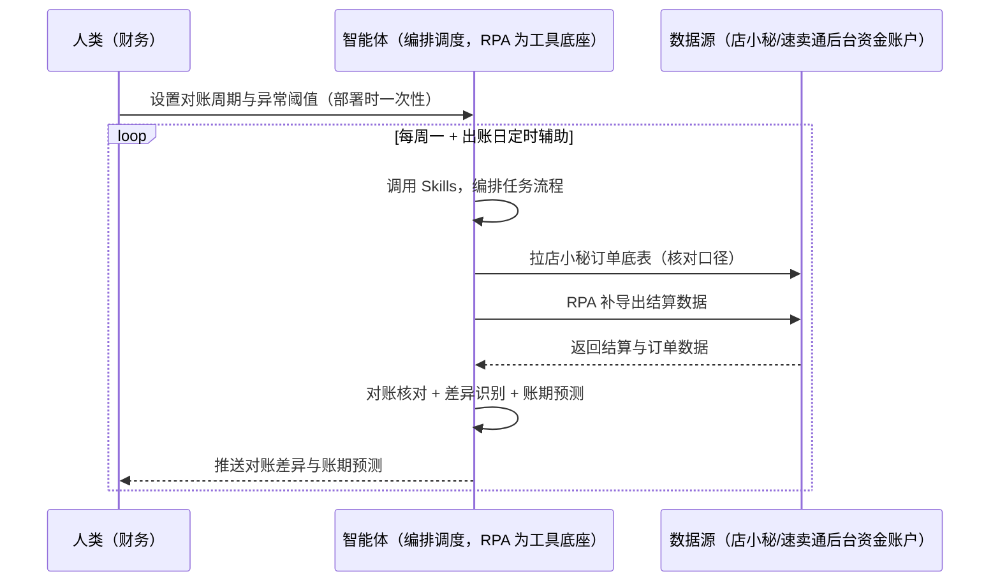

> 为速卖通卖家团队打造的结算对账方案。多店铺对账耗时易错、佣金/交易服务费拆分对不清、放款延迟没预警、差异发现晚。本方案由智能体调度多个工具执行导出各店铺结算数据，智能体按「订单金额-佣金-交易服务费-退款-广告/联盟扣费=应到账」自动对账。定时触发，只推送对账差异与账期预测，差异处理由人工确认。

> Agent 自动化需开通企业功能
> 点击申请1个月免费权限
> [点击申请 →](https://skieer.feishu.cn/share/base/form/shrcnFwMayykP5iaL38fnZKTbrg)

## 一、用户与需求

核心矛盾：多店铺对账耗时易错、佣金/交易服务费拆分对不清（2025.2 起佣金拆分）、放款延迟没预警、差异发现晚。

两类客户痛点同源，数据来源不同：

- 未购 SaaS 客户（新卖家/小团队）：人工下载结算数据、逐笔核对，全靠手；
- 已购 SaaS 客户（店小秘 ERP 等）：店小秘管订单库存，结算对账不覆盖，仍要人手动下载。

适用客户：多店铺/多站点卖家。数据导出与对账计算可自动化，差异处理与确认需人工。

### 1.1 不同模式卖家

| 类型 | 选择 | 建议 |
|-|-|-|
| POP | 首选 | 强烈推荐（自主结算，对账必须） |
| 半托管 | 次选 | 一般推荐（半托管结算含广告费等） |
| 全托管 | 次选 | 一般推荐（平台结算，对账仍要） |

### 1.2 不同类目卖家

| 类目 | 最关注维度 | 核心逻辑 |
|-|-|-|
| 3C 数码 | 放款周期 | 订单量大，对账笔数多 |
| 家居家具 | 大额结算 | 单笔金额大，差异影响大 |
| 美妆个护 | 退款扣项 | 退款多，需逐项核对 |
| 服装鞋帽 | 多 SKU | 明细核对量大 |
| 户外运动 | 旺季结算 | 旺季单量暴增 |
| 母婴用品 | 放款时效 | 放款延迟影响现金流 |

### 1.3 不同角色用户

| 用户 | 需求 | 问题 | 投入时间（估算） |
|-|-|-|-|
| 老板 | 资金安全 | 对账慢，差异默认认了 | 0.5 小时/周 |
| 财务 | 对账差异清单 | 逐笔核对费时 | 1-3 小时/周 |
| 运营 | 账期预测 | 放款延迟无预警 | 0.5 小时/周 |

---

## 二、现在的方法与问题

### 2.1 流程步骤与问题总结

**人工方式（未购 SaaS 客户）**

| 序号 | 步骤 | 现在的方法 | 问题缺陷 |
|-|-|-|-|
| 1 | 下结算 | 手动下载各店铺结算数据 | 多店铺逐个下，费时 |
| 2 | 核对 | 逐笔核对 | 佣金/服务费拆分对不清 |
| 3 | 找差异 | 凭经验找 | 差异默认认了 |
| 4 | 预测 | 凭记忆 | 放款延迟无预警 |
| 5 | 沉淀 | 无 | 对账规则不沉淀 |

**SaaS 方式（已购店小秘 ERP 客户）**

| 序号 | 步骤 | 现在的方法 | 问题缺陷 |
|-|-|-|-|
| 1 | 下结算 | 店小秘不覆盖 | 靠人下 |
| 2 | 核对 | 手动 | 无规则 |
| 3 | 找差异 | 凭经验 | 漏差异 |
| 4 | 预测 | 无 | 无账期预测 |
| 5 | 沉淀 | 无 | 不迭代 |

### 2.2 问题分析

**人工方式根因**

| 序号 | 根因 | 具体表现 |
|-|-|-|
| 1 | 逐笔核对费时 | 多店铺结算笔数多 |
| 2 | 佣金拆分不清 | 佣金+交易服务费对账不分开 |
| 3 | 差异默认认了 | 无系统比对 |

**SaaS 方式根因**

| 序号 | 根因 | 具体表现 |
|-|-|-|
| 1 | 店小秘不覆盖 | 结算对账无工具 |
| 2 | 无闭环 | 对账差异不申诉回填 |

---

## 三、解决方案

### 3.1 功能概述

为速卖通卖家团队打造的结算对账方案，导出各店铺结算数据，智能体按对账公式自动对账并输出账期预测。

定时触发并调度多个工具，调起八爪鱼 RPA（Agent 的工具底座，能耦合多系统、完成自动化任务执行）导出各店铺结算数据（后台资金账户，多店铺循环），智能体按「订单金额 - 佣金 - 交易服务费 - 退款 - 广告/联盟扣费 = 应到账」自动对账、异常差异识别、账期预测。定时触发，只推送对账差异与账期预测，差异处理由人工确认。

### 3.2 系统结合

| 要素 | 说明 |
|-|-|
| 客户现有工具盘点 | **未购 SaaS 客户**：无第三方工具，结算全靠人工下载核对。     **已购 SaaS 客户**（主流组合）：店小秘 ERP（官方服务市场合作 ERP，管订单库存，结算对账不覆盖） |
| 数据/能力来源 | **无 SaaS**：速卖通后台资金账户结算数据（多店铺循环，登录导出）。     **有 SaaS**：店小秘订单底表（辅助核对口径）+ RPA 补结算导出 |
| RPA 耦合动作 | 作为 Agent 的工具底座，按计划导出各店铺结算数据（多店铺循环容错、数据版本留档、导出校验），统一流转给智能体；重大差异即时告警 |
| 耦合出的新价值 | 单工具给不了的端到端结论：结算数据一次取齐 → 对账公式核对 → 差异清单 → 账期预测，**只推送对账差异与账期预测** |

### 3.3 智能体执行流程

智能体定时触发。支持**两种数据通道**，部署时按客户现有工具选择：

**通道一：无 SaaS 方式（RPA 导出结算数据，适合未购 ERP 的客户）**

**通道二：有 SaaS 方式（店小秘订单底表辅助核对 + RPA 补结算导出，适合已购客户）**

> Agent 自动化需开通企业功能
> 点击申请1个月免费权限
> [点击申请 →](https://skieer.feishu.cn/share/base/form/shrcnFwMayykP5iaL38fnZKTbrg)

### 3.4 为何这么设计

要同时回答三个问题：**为什么不能只用 SaaS/API？为什么不能纯靠智能体写代码？为什么 RPA 是执行底座？** 本场景的核心是"定时导出、规则核对、差异告警、挂了有人管"。

#### 1）逐项对比

| 对比维度 | SaaS/API 堆叠（店小秘） | 纯智能体（智能体写代码） | 智能体+自动化工具（RPA 工具底座） |
|-|-|-|-|
| 实现方式 | 店小秘管订单，结算对账不覆盖 | 能抓数据能算，但全要自己接 | 结算导出应用直挂 + 规则核对 |
| 定时导出 | 不覆盖 | 智能体无法常驻轮询 | RPA 定时导出防漏 |
| 差异核对 | 无 | 需自写对账规则 | 对账公式可视化配置 |
| 使用成本（总拥有成本） | 店小秘订阅费（主体另算） | 代理 IP + 服务器 + 开发维护人力，隐性成本高 | 一份平台订阅跑多流程，单方案边际成本 ≈ 0 |
| 维护人要求 | 低（工具现成） | 规则调整都要开发介入 | 可视化流程，财务自己可调口径 |

#### 2）优劣势说明

|  | SaaS/API 堆叠（店小秘） | 纯智能体（智能体写代码） | 智能体+自动化工具（RPA 工具底座） |
|-|-|-|-|
| 优势 | 订单底表权威（核对口径） | 无订阅费；     可深度定制对账模型 | 结算导出+规则核对即开即用；     非技术人员可维护 |
| 劣势 | 结算对账不覆盖 | 导出与解析全自建；     AI 生成代码是生成性的 | 本地电脑运行需保持开机；     订阅费；     差异处理需人工确认 |

#### 3）结论

| 论点 | 说明 |
|-|-|
| 放款规则实锤 | 买家确认收货或系统自动确认（物流签收后 15 天）后 15 天内放款；综合评估可提前放款（发货后 3-5 天） |
| 冻结风险 | 纠纷/风险订单冻结（纠纷冻结占比 18%）；放款金额 = 扣除佣金/交易服务费/退款后的净额 |
| 佣金拆分 | 佣金拆分（佣金+交易服务费 2.5%，2025.2 起）对账须分开核对（实锤） |
| 差异处理人工确认 | 差异处理与确认需人工（涉及资金） |
| 一个底座跑多流程 | 客户购买 RPA 平台是跑多个流程（对账/利润/日报），本方案只是其中一个——平台订阅费被多流程摊薄 |
| 时间 | 财务要的是"差异清单 + 账期预测"，不是"逐笔翻结算单" |

### 3.5 功能清单

| 功能 | 系统 | 功能说明（解决问题） |
|-|-|-|
| 会话/定时 | 智能体 | 1. 理解人类语言，调用已预设好的 Skills。     2. 编排多任务、调度多工具。 |
| 多系统数据取数 | RPA、指纹浏览器 | 1. 解决逐笔核对费时、差异默认认了问题。     2. 作为智能体工具底座被调度执行，多店铺循环容错、数据版本留档、导出校验。     3. **【无 SaaS 方式】** RPA 导出各店铺结算数据。**【有 SaaS 方式】** 店小秘订单底表辅助核对 + RPA 补结算导出。 |
| 对账公式 | 智能体 | 订单金额 - 佣金 - 交易服务费 - 退款 - 广告/联盟扣费 = 应到账。 |
| 差异识别 | 智能体 | 按单号匹配标记差异，差异 >1% 告警（阈值可配）。 |
| 账期预测 | 智能体 | 放款周期预测（确认收货/自动确认后 15 天；提前放款 3-5 天）。 |
| IM通知 | 飞书、钉钉、企微等 | 解决对账滞后问题。对账差异与账期预测自动推送。 |
| 数据资产储存 | 本地电脑、云储存 | 1. Skills 资产：速卖通对账技能。     2. 数据储存：结算底表统一写入本地。     3. 经验知识库：对账规则持续沉淀。 |

### 3.6 智能体执行落地过程

部署时一次性配置入参（店铺清单、对账周期、异常阈值、数据通道），会话中无需重复输入。

**⚠️ 部署前提（不满足则方案无法跑起来）**：①RPA 需部署在**常开电脑/云机**上（出账日定时需开机），并配置漏跑补跑机制；②后台需登录导出，登录失效自动告警；③**差异处理与确认由人工**，本方案只出清单与预测（涉及资金）；④**有 SaaS 方式需店小秘账号**（订单底表辅助，可选增强，无则走后台通道）；⑤首次配置（登录态、对账规则、周期口径）需服务方/技术人员介入一次，属实施成本。

#### 1）配置

| 类别 | 说明 |
|-|-|
| 智能体 | 主流智能体。 |
| 智能体工具 | 1. **数据通道（按客户现有工具二选一）**：【无 SaaS】速卖通后台资金账户（RPA 导出）；【有 SaaS】店小秘订单底表 + RPA 补结算导出。     2. 数据取数与自动化执行：八爪鱼 RPA，MCP 配置完成。     3. 数据分析：智能体自带。     4. 数据报告：智能体自带。     5. IM：企业办公 IM（飞书/钉钉/企微），MCP 或 webhook 配置。 |
| 工作知识 | 1. 店铺清单。     2. 对账周期。     3. 异常阈值：差异 >1% 告警。     4. 佣金拆分：佣金+交易服务费 2.5% 分开核对。 |
| 本地数据库 | 1. 结算底表库地址。     2. 对账台账库地址。     3. 经验库地址。 |

#### 2）执行

| 任务 | 产出 | 产出物接收人 |
|-|-|-|
| 接收对账周期，定时触发 | 任务启动记录 | —— |
| 调用已预设 Skills，编排任务流程 | 任务编排方案 | —— |
| 经 MCP 向八爪鱼 RPA 下发取数任务 | 自动化任务指令 | —— |
| 多源取数并按单号对齐（无 SaaS：结算导出；有 SaaS：店小秘+结算，智能体监控状态） | 对齐后结算数据 | —— |
| 对账公式核对 | 差异清单 | 财务 |
| 差异识别分级（>1% 告警） | 差异告警 | 财务 |
| 账期预测 | 账期报告 | 财务/老板 |
| 推送对账差异与账期预测（人工确认处理） | 群消息 | 财务/老板 |

异常处理：

导出失败 → 自动重试并告警；

结算数据缺失 → 标注待补；

重大差异 → 即时告警；

差异无法归因 → 转人工核对；

置信度 &lt;70% → 转人工复核，不输出硬结论。

#### 3）结果

| 结果 | 说明 |
|-|-|
| 数据资产 | 结算底表结构化数据（店铺/批次/明细/差异/状态），可审计可追溯。 |
| 分析报告 | 1. 对账差异清单：按单号标记差异。     2. 账期预测：放款周期。     3. 差异分级告警。 |
| Skills | 智能体 Skills：速卖通对账技能，按差异处理结果迭代。 |

> Agent 自动化需开通企业功能
> 点击申请1个月免费权限
> [点击申请 →](https://skieer.feishu.cn/share/base/form/shrcnFwMayykP5iaL38fnZKTbrg)

---

## 四、使用前后预估

> 本方案价值 = **结算数据自动导出 → 对账公式核对 → 差异清单与分级告警 → 账期预测**。数据导出与对账计算可自动化，差异处理与确认需人工。

| 指标 | 人工 | SaaS/API（店小秘） | 智能体+自动化工具 |
|-|-|-|-|
| 结算导出 | 多店铺逐个下 | 不覆盖 | 自动循环导出 |
| 佣金拆分 | 对不清 | 无 | 佣金+服务费分开核对 |
| 差异核对 | 逐笔手动 | 无 | 按单号规则核对 |
| 差异告警 | 无 | 无 | >1% 自动告警 |
| 账期预测 | 无预警 | 无 | 放款周期自动预测 |
| 方法论 | 无 | 单工具 | 可复用的 Skills 与对账规则 |

**说明**：放款规则实锤——买家确认收货或系统自动确认（物流签收后 15 天）后 15 天内放款；综合评估可提前放款（发货后 3-5 天）；纠纷/风险订单冻结（纠纷冻结占比 18%）；放款金额 = 扣除佣金/交易服务费/退款后的净额；佣金拆分（佣金+交易服务费 2.5%，2025.2 起）对账须分开核对。

---

## 五、效果证明

> Agent 自动化需开通企业功能
> 点击申请1个月免费权限
> [点击申请 →](https://skieer.feishu.cn/share/base/form/shrcnFwMayykP5iaL38fnZKTbrg)

### 5.1 客户案例

**《旺店通慧经营：10+ 平台 50+ 类账单自动采集直传 ERP》**

> 10+ 电商平台普遍缺乏开放 API，账单数据需人工逐个登录导出，财务每天花数小时"搬数据"。RPA 打包为"慧采集 RPA"嵌入产品，账单自动采集并 API 直传 ERP。

| 效果 | 说明 |
|-|-|
| 提效 | 财务取数效率提升 57%。原本 10+ 电商平台账单需人工逐个登录导出，财务每天花数小时「搬数据」，现在 50+ 类账单自动采集并直传 ERP。 |
| 降本 | 年节约人力成本 24 万元（约合 2 人·年，按 12 万元/人年折算）。原本需专人逐平台导表并手动上传 ERP，现在全自动完成，人力转向经营分析与资金管理等高价值工作。 |
| 任务 | 10+ 平台、50+ 类账单自动采集，数据直接 API 传入 ERP，支撑 T+1 经营分析。 |
| 任务 | 指纹浏览器环境、Cookie 登录、集中预登录三重升级，保障采集稳定运行。 |

案例详情：[取数：ERP厂商的多平台账单自动化采集实践](https://skieer.feishu.cn/wiki/CQydwouU9i0yCPkgCpgc13Bxnhg)

**《财务跨系统对账机器人：5 分钟完成 10 天对账工作》**

> 财务需将自行统计的应收账单（邮件汇总 + SaaS 导出）与代理商统计的应付账单（云盘人工汇总）人工二次核对，涉及 VAT 与 EPR 两个场景且代理商众多。

| 效果 | 说明 |
|-|-|
| 提效 | 跨系统对账由 10 天压缩至 5 分钟。原本代理商账单分散在邮件与线下表格，财务需人工提取核验、反复对数，现在自动汇总、比对并输出差异清单。 |
| 降本 | 免除人工提取邮件与重复对数的投入，财务团队投入转向差异复核与资金管理等重点环节。 |
| 任务 | 打通线上系统与线下台账双重对账机制，标准化账单可自动生成。 |
| 任务 | 对账不平与异常账单自动标记进入人工复核清单，不自动放行资金动作。 |

案例详情：[对账|财务跨系统对账机器人，5min完成10天对账工作八爪鱼RPA](https://skieer.feishu.cn/wiki/S364wc0Xsisz71k81xKc1pfJnah)

---

## 六、备注

### 6.1 Agent 支持

本方案不绑定具体智能体，主流 Agent 均可运行（需支持技能/Skills 加载与工具调用）：

| Agent/智能体 | 说明 |
|-|-|
| Workbuddy | 本方案运行平台，支持技能/Skills 上传加载、定时任务、MCP 工具调用与表格/报告处理 |
| 豆包（国内·字节） | 国内主流个人智能体，支持技能上传、定时任务与工具调用，上手成本低 |
| 通义千问（国内·阿里） | 支持 Agent 编排与插件生态，集成阿里电商数据能力，适合电商场景 |
| DeepSeek（国内） | 推理能力强、成本低，适合规则打分与归因分析类任务 |
| ChatGPT（国外·OpenAI） | 海外主流通用智能体，支持 GPTs/Agent 模式与工具调用 |
| Claude（国外·Anthropic） | 长文本与结构化分析能力强，原生支持 MCP 连接外部工具 |

### 6.2 名词解释

| 术语 | 说明 |
|-|-|
| 放款周期 | 确认收货/自动确认后 15 天内放款 |
| 佣金拆分 | 佣金 + 交易服务费 2.5%（2025.2 起分开核对） |
| 纠纷冻结 | 纠纷/风险订单冻结（占比 18%） |
| 对账公式 | 订单金额-佣金-服务费-退款-扣费 = 应到账 |
| 账期预测 | 放款周期预测（提前放款 3-5 天） |
| 混合数据源 | 速卖通后台资金账户（RPA 导出）+ 店小秘订单底表（有 SaaS 客户核对口径） |
| 有 SaaS 方式 | 已购店小秘 ERP，订单底表辅助核对 + RPA 补结算导出 |
| 无 SaaS 方式 | 不购买第三方工具，RPA 导出结算数据 |
| POP | 自主运营模式（自主上架定价，总费率 6%-11.5%） |
| 全托管 | 平台代运营（无自主发布权，平台抽佣 25%-30%） |
| 半托管 | 佣金介于 POP 与全托管之间 |
| MCP | Model Context Protocol，智能体连接外部工具的标准化通道 |

> Agent 自动化需开通企业功能
> 点击申请1个月免费权限
> [点击申请 →](https://skieer.feishu.cn/share/base/form/shrcnFwMayykP5iaL38fnZKTbrg)

---

原文：[查看原文](https://skieer.feishu.cn/wiki/G4QQwRM4BiK8WFkm1Lvcq00Cnoz)
