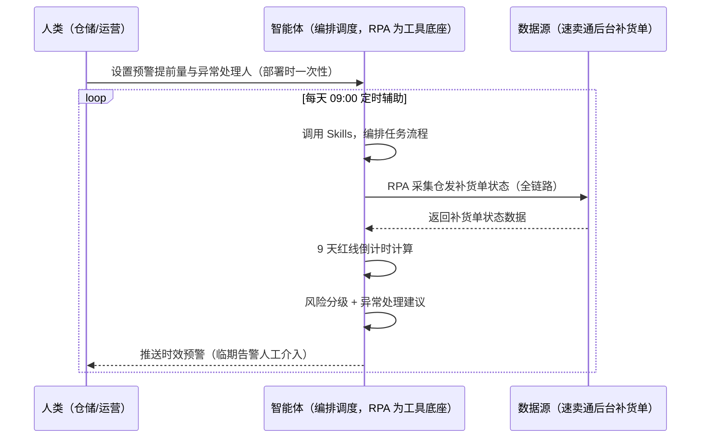
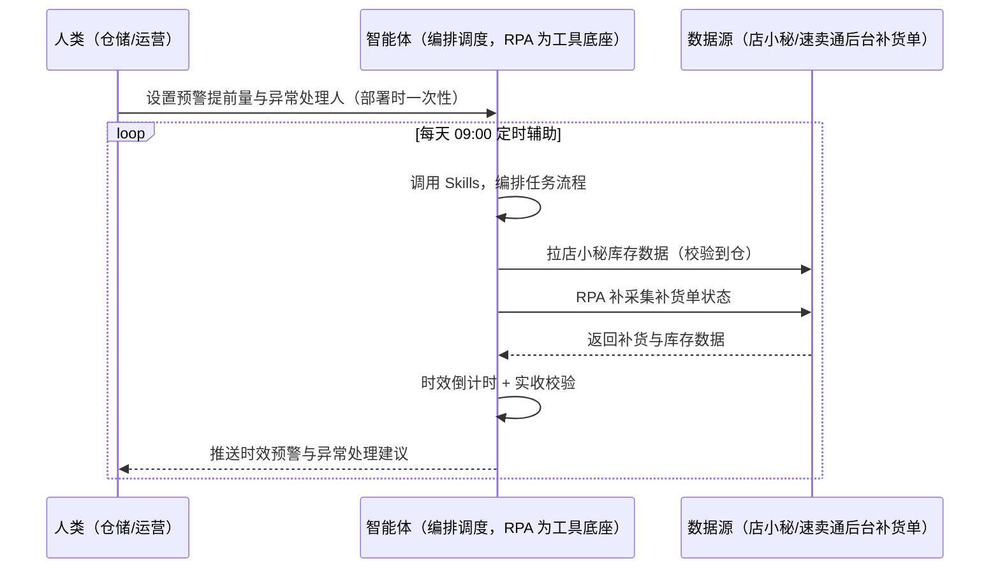

> 为速卖通全托管卖家打造的仓发补货时效监控方案。补货单状态散落多单、9 天红线算不清、入库失败才知道被罚。本方案由智能体调度多个工具执行监控仓发补货单状态（审核→入库单→发货单→到仓全链路），智能体做时效倒计时与风险分级。每天定时辅助，只推送时效预警与异常处理建议，无异常不打扰。

> Agent 自动化需开通企业功能
> 点击申请1个月免费权限
> [点击申请 →](https://skieer.feishu.cn/share/base/form/shrcnFwMayykP5iaL38fnZKTbrg)

## 一、用户与需求

核心矛盾：全托管仓发补货单审核后 9 天内未生成入库单/发货单罚 20 美金、实收 &lt; 确认量 80% 罚 20 美金；补货单状态散落多单、9 天红线算不清。

两类客户痛点同源，数据来源不同：

- 未购 SaaS 客户（新卖家/小团队）：人工登录后台逐单查补货单状态，全靠手；
- 已购 SaaS 客户（店小秘 ERP 等）：店小秘管订单库存，仓发补货单状态与 9 天红线监控不覆盖，仍要人盯。

适用客户：全托管卖家（无自主发布权，补货是核心履约动作）。后台状态采集可自动化，异常处理需人工。

### 1.1 不同模式卖家

| 类型 | 选择 | 建议 |
|-|-|-|
| 全托管 | 首选 | 强烈推荐（仓发补货=全托管核心履约动作） |
| 半托管 | 不适用 | 半托管无仓发补货机制 |
| POP | 不适用 | POP 自主备货（见备货与库存管理场景） |

### 1.2 不同类目卖家

| 类目 | 最关注维度 | 核心逻辑 |
|-|-|-|
| 3C 数码 | 时效红线 | 迭代快，补货频繁 |
| 家居家具 | 到仓验收 | 实收比例风险 |
| 美妆个护 | 效期管理 | 备货效期敏感 |
| 服装鞋帽 | 季节补货 | 换季补货窗口 |
| 户外运动 | 旺季前置 | 大促补货提前 |
| 母婴用品 | 安全库存 | 断货影响大 |

### 1.3 不同角色用户

| 用户 | 需求 | 问题 | 投入时间（估算） |
|-|-|-|-|
| 老板 | 减少罚款 | 超时被罚才知道 | 0.5 小时/周 |
| 仓储 | 时效看板+预警 | 逐单查状态费时 | 1-2 小时/周 |
| 运营 | 异常处理 | 入库失败才知道 | 1 小时/周 |

---

## 二、现在的方法与问题

### 2.1 流程步骤与问题总结

**人工方式（未购 SaaS 客户）**

| 序号 | 步骤 | 现在的方法 | 问题缺陷 |
|-|-|-|-|
| 1 | 看状态 | 手动逐单查补货单 | 状态散落多单 |
| 2 | 算时效 | 手动算 9 天红线 | 算不清 |
| 3 | 盯节点 | 手动盯审核→入库→发货 | 节点易漏 |
| 4 | 验收 | 手动核对实收 | 实收不足才知道 |
| 5 | 处理 | 事后补救 | 被罚 |

**SaaS 方式（已购店小秘 ERP 客户）**

| 序号 | 步骤 | 现在的方法 | 问题缺陷 |
|-|-|-|-|
| 1 | 看状态 | 店小秘不覆盖 | 靠人查 |
| 2 | 算时效 | 靠人 | 算不清 |
| 3 | 盯节点 | 靠人 | 易漏 |
| 4 | 验收 | 手动 | 无预警 |
| 5 | 处理 | 事后 | 被罚 |

### 2.2 问题分析

**人工方式根因**

| 序号 | 根因 | 具体表现 |
|-|-|-|
| 1 | 状态散落 | 补货单多，逐单查费时 |
| 2 | 无倒计时 | 9 天红线算不清 |
| 3 | 验收后知后觉 | 实收不足被罚 |

**SaaS 方式根因**

| 序号 | 根因 | 具体表现 |
|-|-|-|
| 1 | 店小秘不覆盖 | 仓发补货状态无工具 |
| 2 | 无预警 | 节点易漏 |

---

## 三、解决方案

### 3.1 功能概述

为速卖通全托管卖家打造的仓发补货时效监控方案，监控仓发补货单状态全链路，智能体做时效倒计时与风险分级。

每天定时触发并调度多个工具，调起八爪鱼 RPA（Agent 的工具底座，能耦合多系统、完成自动化任务执行）监控仓发补货单状态（审核→入库单→发货单→到仓全链路，后台可采），智能体按 9 天红线倒计时计算时效风险、输出异常处理建议。每天定时辅助，只推送时效预警与异常处理建议，无异常不打扰。

### 3.2 系统结合

| 要素 | 说明 |
|-|-|
| 客户现有工具盘点 | **未购 SaaS 客户**：无第三方工具，补货状态全靠人工盯后台。     **已购 SaaS 客户**（主流组合）：店小秘 ERP（官方服务市场合作 ERP，管订单库存，仓发补货不覆盖） |
| 数据/能力来源 | **无 SaaS**：速卖通后台仓发补货单状态（审核/入库单/发货单/到仓，登录采集）。     **有 SaaS**：店小秘库存数据（辅助校验）+ RPA 补补货单状态采集 |
| RPA 耦合动作 | 作为 Agent 的工具底座，按计划采集补货单状态（状态机解析、定时轮询、快照留档），统一流转给智能体；临期告警 |
| 耦合出的新价值 | 单工具给不了的端到端结论：补货单状态一次取齐 → 9 天红线倒计时 → 风险分级 → 异常处理建议，**只推送时效预警** |

### 3.3 智能体执行流程

智能体定时触发。支持**两种数据通道**，部署时按客户现有工具选择：

**通道一：无 SaaS 方式（RPA 采集补货单状态，适合未购 ERP 的客户）**

**通道二：有 SaaS 方式（店小秘库存辅助校验 + RPA 补状态采集，适合已购客户）**

> Agent 自动化需开通企业功能
> 点击申请1个月免费权限
> [点击申请 →](https://skieer.feishu.cn/share/base/form/shrcnFwMayykP5iaL38fnZKTbrg)

### 3.4 为何这么设计

要同时回答三个问题：**为什么不能只用 SaaS/API？为什么不能纯靠智能体写代码？为什么 RPA 是执行底座？** 本场景的核心是"定时轮询、倒计时预警、风险分级、挂了有人管"。

#### 1）逐项对比

| 对比维度 | SaaS/API 堆叠（店小秘） | 纯智能体（智能体写代码） | 智能体+自动化工具（RPA 工具底座） |
|-|-|-|-|
| 实现方式 | 店小秘管库存，补货状态不覆盖 | 能抓后台能算，但全要自己接 | 后台状态采集 + 倒计时 |
| 定时轮询 | 不覆盖 | 智能体无法常驻轮询 | RPA 定时轮询防漏 |
| 状态机解析 | 无 | 需自写状态机逻辑 | 状态机可视化配置 |
| 使用成本（总拥有成本） | 店小秘订阅费（主体另算） | 代理 IP + 服务器 + 开发维护人力，隐性成本高 | 一份平台订阅跑多流程，单方案边际成本 ≈ 0 |
| 维护人要求 | 低（工具现成） | 规则调整都要开发介入 | 可视化流程，仓储自己可调提前量 |

#### 2）优劣势说明

|  | SaaS/API 堆叠（店小秘） | 纯智能体（智能体写代码） | 智能体+自动化工具（RPA 工具底座） |
|-|-|-|-|
| 优势 | 库存数据权威（校验到仓） | 无订阅费；     可深度定制时效模型 | 状态采集+倒计时即开即用；     非技术人员可维护 |
| 劣势 | 补货状态不覆盖 | 轮询与登录保活全自建；     AI 生成代码是生成性的 | 本地电脑运行需保持开机；     订阅费；     后台登录态需保活 |

#### 3）结论

| 论点 | 说明 |
|-|-|
| 红线=罚款 | 全托管仓发补货单审核后 9 天内未生成入库单/发货单 = 罚 20 美金；实收 &lt; 确认量 80% 罚 20 美金（实锤） |
| JIT 异常件 | JIT/商家自寄入库异常件按供货价阶梯罚（2-3 倍，单笔 ≤1000 元/150 美金，实锤） |
| 全托管核心动作 | 全托管卖家（无自主发布权）补货是核心履约动作——时效监控必须 |
| 一个底座跑多流程 | 客户购买 RPA 平台是跑多个流程（仓发/备货/罚款预警），本方案只是其中一个——平台订阅费被多流程摊薄 |
| 时间 | 仓储要的是"时效自动倒计时 + 异常建议"，不是"逐单查后台" |

### 3.5 功能清单

| 功能 | 系统 | 功能说明（解决问题） |
|-|-|-|
| 会话/定时 | 智能体 | 1. 理解人类语言，调用已预设好的 Skills。     2. 编排多任务、调度多工具。 |
| 多系统数据取数 | RPA、指纹浏览器 | 1. 解决补货单状态散落、红线算不清问题。     2. 作为智能体工具底座被调度执行，状态机解析、定时轮询、临期告警。     3. **【无 SaaS 方式】** RPA 采集补货单状态全链路。**【有 SaaS 方式】** 店小秘库存校验 + RPA 补状态采集。 |
| 时效倒计时 | 智能体 | 9 天红线倒计时（审核→入库单→发货单→到仓）。 |
| 风险分级 | 智能体 | 时效风险分级（高/中/低），临期高危告警。 |
| 异常处理建议 | 智能体 | 入库失败/实收不足 → 处理建议（补发/申诉）。 |
| IM通知 | 飞书、钉钉、企微等 | 解决时效预警滞后问题。临期预警与异常建议自动推送。 |
| 数据资产储存 | 本地电脑、云储存 | 1. Skills 资产：全托管补货时效技能。     2. 数据储存：补货状态快照统一写入本地。     3. 经验知识库：罚款案例回填迭代。 |

### 3.6 智能体执行落地过程

部署时一次性配置入参（补货单范围、预警提前量、异常处理人、数据通道），会话中无需重复输入。

**⚠️ 部署前提（不满足则方案无法跑起来）**：①RPA 需部署在**常开电脑/云机**上，并配置漏跑补跑机制；②后台需登录采集，登录失效自动告警、人工介入后断点续跑；③**异常处理（补发/申诉）由人工执行**，本方案只做预警与建议；④**有 SaaS 方式需店小秘账号**（库存校验，可选增强，无则走后台通道）；⑤首次配置（登录态、状态机、提前量）需服务方/技术人员介入一次，属实施成本。

#### 1）配置

| 类别 | 说明 |
|-|-|
| 智能体 | 主流智能体。 |
| 智能体工具 | 1. **数据通道（按客户现有工具二选一）**：【无 SaaS】速卖通后台补货单（RPA 采集）；【有 SaaS】店小秘库存数据 + RPA 补状态采集。     2. 数据取数与自动化执行：八爪鱼 RPA，MCP 配置完成。     3. 数据分析：智能体自带。     4. IM：企业办公 IM（飞书/钉钉/企微），MCP 或 webhook 配置。 |
| 工作知识 | 1. 补货单范围。     2. 预警提前量：剩 3 天告警。     3. 异常处理人。     4. 罚款规则：9 天 20 美金 / 实收 80% 20 美金。 |
| 本地数据库 | 1. 补货状态库地址。     2. 时效台账库地址。     3. 经验库地址。 |

#### 2）执行

| 任务 | 产出 | 产出物接收人 |
|-|-|-|
| 接收补货单范围，定时触发 | 任务启动记录 | —— |
| 调用已预设 Skills，编排任务流程 | 任务编排方案 | —— |
| 经 MCP 向八爪鱼 RPA 下发取数任务 | 自动化任务指令 | —— |
| 多源取数并按补货单对齐（无 SaaS：后台采集；有 SaaS：店小秘+后台，智能体监控状态） | 对齐后补货状态数据 | —— |
| 9 天红线倒计时计算 | 时效预警 | 仓储 |
| 风险分级（高/中/低） | 风险清单 | 仓储/运营 |
| 异常处理建议（补发/申诉） | 处理建议 | 运营 |
| 推送时效预警与异常建议 | 群消息 | 仓储/运营/老板 |

异常处理：

采集失败 → 自动重试并告警；

状态解析异常 → 转人工核对；

临期高危 → 告警人工介入；

实收不足 → 标注并给处理建议；

置信度 &lt;70% → 转人工复核，不输出硬结论。

#### 3）结果

| 结果 | 说明 |
|-|-|
| 数据资产 | 补货状态快照结构化数据（补货单/状态节点/剩余天数/风险级），可审计可追溯。 |
| 分析报告 | 1. 时效预警：9 天倒计时。     2. 风险分级清单。     3. 异常处理建议。 |
| Skills | 智能体 Skills：全托管补货时效技能，按罚款案例迭代。 |

> Agent 自动化需开通企业功能
> 点击申请1个月免费权限
> [点击申请 →](https://skieer.feishu.cn/share/base/form/shrcnFwMayykP5iaL38fnZKTbrg)

---

## 四、使用前后预估

> 本方案价值 = **补货单状态自动采集 → 9 天红线倒计时 → 风险分级 → 异常处理建议**。后台状态采集可自动化，异常处理需人工。

| 指标 | 人工 | SaaS/API（店小秘） | 智能体+自动化工具 |
|-|-|-|-|
| 状态跟踪 | 逐单查后台 | 不覆盖 | 自动采集全链路 |
| 9 天倒计时 | 算不清 | 无 | 自动倒计时 |
| 风险分级 | 无 | 无 | 高/中/低自动分级 |
| 实收校验 | 后知后觉 | 无 | 自动校验告警 |
| 罚款风险 | 被罚才知道 | 无预警 | 临期自动告警 |
| 方法论 | 无 | 单工具 | 可复用的 Skills 与状态机 |

**说明**：全托管仓发补货单审核后 9 天内未生成入库单/发货单 = 罚 20 美金；实收 &lt; 确认量 80% 罚 20 美金（实锤）；JIT/商家自寄入库异常件按供货价阶梯罚（2-3 倍，单笔 ≤1000 元/150 美金，实锤）；全托管卖家（无自主发布权）补货是核心履约动作。

---

## 五、效果证明

> Agent 自动化需开通企业功能
> 点击申请1个月免费权限
> [点击申请 →](https://skieer.feishu.cn/share/base/form/shrcnFwMayykP5iaL38fnZKTbrg)

### 5.1 客户案例

**《唯世美：家具大件补货全流程自动化》**

> 首款内置 RGB 灯光展示柜上架两个月即拿下 Amazon 美加英德四站与 Walmart、Temu 美站 Best Seller。为应对数据源分散、人工操作耗时与 SKU 管理混乱，实现补货判断全流程自动化。

| 效果 | 说明 |
|-|-|
| 提效 | 补货整理重复工作量下降 80%。原本需人工从领星 ERP 与各海外仓平台逐项导出库存、库龄数据再手工清洗匹配 SKU，现在自动抓取、自动清洗，输出补货建议。 |
| 降本 | 免除人工导表与拼表的重复投入，供应链团队投入转向库存结构优化与周转率提升等重点工作。 |
| 任务 | 库存数据抓取与处理准确率达 99% 以上，分散数据源实时同步。 |
| 任务 | 自有 Excel 模板逻辑零改动保留，补货计算口径与原有习惯一致。 |

案例详情：[家具大件补货：补货全流程自动化，整理数据重复工作量下降 80%](https://skieer.feishu.cn/wiki/Gca3w8j1KixDXjkz0oScFwHAngf)

---

## 六、备注

### 6.1 Agent 支持

本方案不绑定具体智能体，主流 Agent 均可运行（需支持技能/Skills 加载与工具调用）：

| Agent/智能体 | 说明 |
|-|-|
| Workbuddy | 本方案运行平台，支持技能/Skills 上传加载、定时任务、MCP 工具调用与表格/报告处理 |
| 豆包（国内·字节） | 国内主流个人智能体，支持技能上传、定时任务与工具调用，上手成本低 |
| 通义千问（国内·阿里） | 支持 Agent 编排与插件生态，集成阿里电商数据能力，适合电商场景 |
| DeepSeek（国内） | 推理能力强、成本低，适合规则打分与归因分析类任务 |
| ChatGPT（国外·OpenAI） | 海外主流通用智能体，支持 GPTs/Agent 模式与工具调用 |
| Claude（国外·Anthropic） | 长文本与结构化分析能力强，原生支持 MCP 连接外部工具 |

### 6.2 名词解释

| 术语 | 说明 |
|-|-|
| 仓发补货 | 全托管仓发补货链路（审核→入库单→发货单→到仓） |
| 9 天红线 | 审核后 9 天内未生成入库单/发货单罚 20 美金 |
| 实收比例 | 实收 &lt; 确认量 80% 罚 20 美金 |
| JIT 异常件 | 按供货价阶梯罚（2-3 倍，单笔 ≤1000 元/150 美金） |
| 状态机 | 补货单状态流转解析（审核/入库/发货/到仓） |
| 混合数据源 | 速卖通后台补货单状态（登录采集）+ 店小秘库存数据（有 SaaS 客户校验） |
| 有 SaaS 方式 | 已购店小秘 ERP，库存校验 + RPA 补状态采集 |
| 无 SaaS 方式 | 不购买第三方工具，RPA 采集后台补货单状态 |
| 全托管 | 平台代运营（无自主发布权，仓发补货是核心履约动作） |
| POP | 自主运营模式（自主上架定价，总费率 6%-11.5%） |
| 半托管 | 佣金介于 POP 与全托管之间 |
| MCP | Model Context Protocol，智能体连接外部工具的标准化通道 |

> Agent 自动化需开通企业功能
> 点击申请1个月免费权限
> [点击申请 →](https://skieer.feishu.cn/share/base/form/shrcnFwMayykP5iaL38fnZKTbrg)

---

原文：[查看原文](https://skieer.feishu.cn/wiki/Hmm4wBBjei4m5WkYyAUcOUFynOI)
