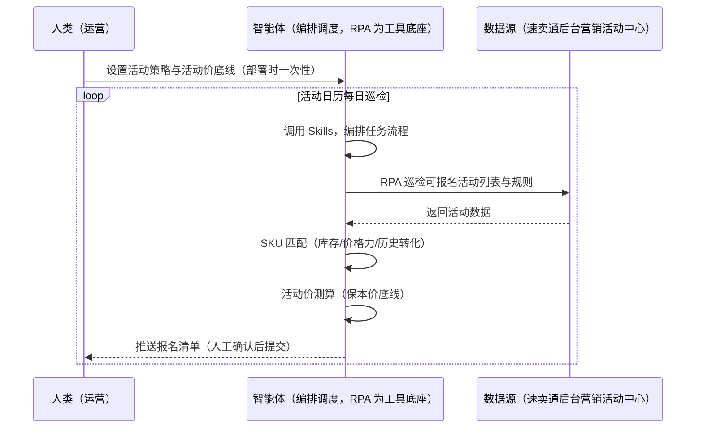
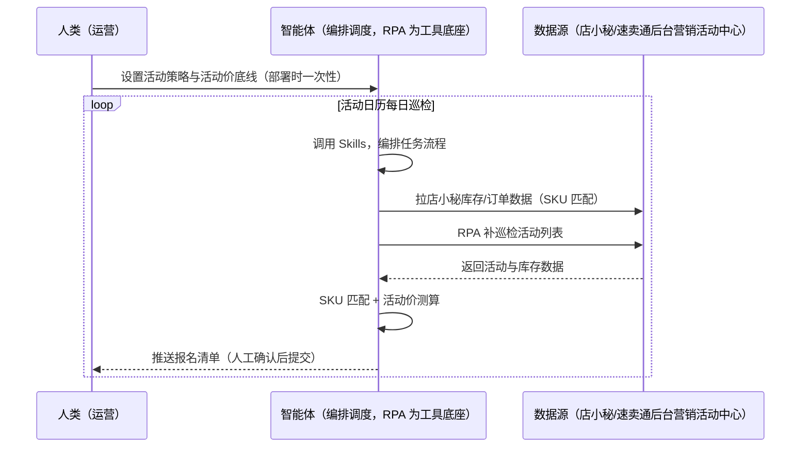

> 为速卖通卖家团队打造的活动报名与大促管理方案。活动报名窗口错过、328/双11 等大促备货节奏踩错、活动价算不清亏本、报名 SKU 与库存不匹配。本方案由智能体调度多个工具执行定时巡检可报名活动列表，智能体按库存/价格力/历史转化匹配 SKU 并测算活动价。活动日历定时巡检，报名执行由人工确认。

> Agent 自动化需开通企业功能
> 点击申请1个月免费权限
> [点击申请 →](https://skieer.feishu.cn/share/base/form/shrcnFwMayykP5iaL38fnZKTbrg)

## 一、用户与需求

核心矛盾：速卖通大促日历密集（328 周年庆/828 年中大促/双11/黑五/双12/618 全托管），报名窗口错过流量被抢；活动价算不清亏本；报名 SKU 与库存不匹配。

两类客户痛点同源，数据来源不同：

- 未购 SaaS 客户（新卖家/小团队）：人工翻后台营销活动中心、逐条报名，全靠手；
- 已购 SaaS 客户（店小秘 ERP 等）：店小秘管订单/库存，活动报名与活动价测算不覆盖，仍要人盯后台。

适用客户：POP/半托管卖家（活动是重要流量入口）。活动巡检与材料准备可自动化，报名执行与价格决策需人工确认。

### 1.1 不同模式卖家

| 类型 | 选择 | 建议 |
|-|-|-|
| POP | 首选 | 强烈推荐（大促是流量高峰，报名必须） |
| 半托管 | 次选 | 一般推荐（半托管可自主报名） |
| 全托管 | 任意 | 全托管有 618 等专属活动（平台主导） |

### 1.2 不同类目卖家

| 类目 | 最关注维度 | 核心逻辑 |
|-|-|-|
| 3C 数码 | 双11 | 全年流量最高峰 |
| 家居家具 | 328 备货 | 提前一个月备货 |
| 美妆个护 | 活动价底线 | 保本价测算 |
| 服装鞋帽 | 季节活动 | 换季清仓 |
| 户外运动 | 黑五 | 侧重美国市场 |
| 母婴用品 | 库存匹配 | 报名 SKU 与库存匹配 |

### 1.3 不同角色用户

| 用户 | 需求 | 问题 | 投入时间（估算） |
|-|-|-|-|
| 老板 | 大促流量与销量 | 窗口错过流量被抢 | 0.5 小时/周 |
| 运营 | 报名清单 | 多活动多入口漏报 | 1-2 小时/周 |
| 备货对接 | 大促备货联动 | 备货节奏踩错 | 1 小时/周 |

---

## 二、现在的方法与问题

### 2.1 流程步骤与问题总结

**人工方式（未购 SaaS 客户）**

| 序号 | 步骤 | 现在的方法 | 问题缺陷 |
|-|-|-|-|
| 1 | 找活动 | 手动翻营销活动中心 | 窗口错过 |
| 2 | 选品 | 凭感觉选 | 报错款亏本 |
| 3 | 算活动价 | 拍脑袋 | 活动价算不清 |
| 4 | 报名 | 逐条提交 | SKU 与库存不匹配 |
| 5 | 备货 | 临时备 | 大促节奏踩错 |

**SaaS 方式（已购店小秘 ERP 客户）**

| 序号 | 步骤 | 现在的方法 | 问题缺陷 |
|-|-|-|-|
| 1 | 找活动 | 店小秘不覆盖 | 靠人翻 |
| 2 | 选品 | 凭感觉 | 无策略 |
| 3 | 算活动价 | 拍脑袋 | 无测算 |
| 4 | 报名 | 手动 | 库存不匹配 |
| 5 | 备货 | 无联动 | 踩错节奏 |

### 2.2 问题分析

**人工方式根因**

| 序号 | 根因 | 具体表现 |
|-|-|-|
| 1 | 窗口错过 | 大促流量被抢 |
| 2 | 活动价拍脑袋 | 报错亏本 |
| 3 | 库存不匹配 | 报名 SKU 无库存支撑 |

**SaaS 方式根因**

| 序号 | 根因 | 具体表现 |
|-|-|-|
| 1 | 店小秘不覆盖 | 活动报名无工具 |
| 2 | 无备货联动 | 大促备货节奏踩错 |

---

## 三、解决方案

### 3.1 功能概述

为速卖通卖家团队打造的活动报名与大促管理方案，定时巡检可报名活动列表，智能体按库存/价格力/历史转化匹配 SKU 并测算活动价。

活动日历定时触发并调度多个工具，调起八爪鱼 RPA（Agent 的工具底座，能耦合多系统、完成自动化任务执行）巡检可报名活动列表（后台营销活动中心）、采集活动规则与报名要求，智能体按库存/价格力/历史转化筛选 SKU、测算活动价（保本价底线）、准备报名材料。活动日历定时巡检，报名执行由人工确认。

### 3.2 系统结合

| 要素 | 说明 |
|-|-|
| 客户现有工具盘点 | **未购 SaaS 客户**：无第三方工具，活动报名全靠人工翻后台。     **已购 SaaS 客户**（主流组合）：店小秘 ERP（官方服务市场合作 ERP，管订单/库存，活动报名不覆盖） |
| 数据/能力来源 | **无 SaaS**：速卖通后台营销活动中心（可报名活动/规则/要求，登录采集）。     **有 SaaS**：店小秘库存/订单数据（辅助活动库存核算与 SKU 匹配）+ RPA 补活动列表采集 |
| RPA 耦合动作 | 作为 Agent 的工具底座，按活动日历巡检活动列表（报名要求采集、截止倒计时、状态跟踪），统一流转给智能体；截止/库存告警 |
| 耦合出的新价值 | 单工具给不了的端到端结论：活动列表一次取齐 → SKU 匹配 → 活动价测算 → 报名清单 → 大促备货与广告联动提醒，**只推送报名清单与关键窗口提醒** |

### 3.3 智能体执行流程

智能体定时触发。支持**两种数据通道**，部署时按客户现有工具选择：

**通道一：无 SaaS 方式（RPA 巡检活动列表，适合未购 ERP 的客户）**

**通道二：有 SaaS 方式（店小秘库存辅助匹配 + RPA 补活动列表，适合已购客户）**

> Agent 自动化需开通企业功能
> 点击申请1个月免费权限
> [点击申请 →](https://skieer.feishu.cn/share/base/form/shrcnFwMayykP5iaL38fnZKTbrg)

### 3.4 为何这么设计

要同时回答三个问题：**为什么不能只用 SaaS/API？为什么不能纯靠智能体写代码？为什么 RPA 是执行底座？** 本场景的核心是"窗口提醒、SKU 匹配、活动价测算、备货联动、挂了有人管"。

#### 1）逐项对比

| 对比维度 | SaaS/API 堆叠（店小秘） | 纯智能体（智能体写代码） | 智能体+自动化工具（RPA 工具底座） |
|-|-|-|-|
| 实现方式 | 店小秘管库存（部分） | 能抓后台能算，但全要自己接 | 后台巡检活动 + SKU 匹配测算 |
| 窗口提醒 | 不覆盖 | 智能体无法常驻轮询 | RPA 定时巡检防漏报 |
| 活动价测算 | 无 | 需自写活动价模型 | 保本价规则可视化配置 |
| 使用成本（总拥有成本） | 店小秘订阅费（主体另算） | 代理 IP + 服务器 + 开发维护人力，隐性成本高 | 一份平台订阅跑多流程，单方案边际成本 ≈ 0 |
| 维护人要求 | 低（工具现成） | 规则调整都要开发介入 | 可视化流程，运营自己可调策略 |

#### 2）优劣势说明

|  | SaaS/API 堆叠（店小秘） | 纯智能体（智能体写代码） | 智能体+自动化工具（RPA 工具底座） |
|-|-|-|-|
| 优势 | 库存数据权威（SKU 匹配） | 无订阅费；     可深度定制活动策略 | 窗口提醒+SKU 匹配+活动价测算；     备货联动；     非技术人员可维护 |
| 劣势 | 活动报名不覆盖 | 轮询与登录保活全自建；     AI 生成代码是生成性的 | 本地电脑运行需保持开机；     订阅费；     报名执行需人工确认 |

#### 3）结论

| 论点 | 说明 |
|-|-|
| 大促日历=流量节奏 | 328 周年庆（每年 3 月 28 日，影响力仅次于双11，需提前一个月备货和报名）、828 年中大促（8 月 28 日）、双11（全年流量最高力度最大）、黑五（侧重美国市场）、双12（第二大年度促销）、618（全托管模式）（实锤） |
| 活动价底线 | 活动价底线（保本价）可配——报错亏本防不住 |
| 库存匹配 | 报名 SKU 与库存匹配（无库存支撑的报名无意义）——店小秘库存数据辅助 |
| 一个底座跑多流程 | 客户购买 RPA 平台是跑多个流程（活动/备货/日报），本方案只是其中一个——平台订阅费被多流程摊薄 |
| 时间 | 运营要的是"报名清单 + 窗口提醒 + 备货联动"，不是"翻后台" |

### 3.5 功能清单

| 功能 | 系统 | 功能说明（解决问题） |
|-|-|-|
| 会话/定时 | 智能体 | 1. 理解人类语言，调用已预设好的 Skills。     2. 编排多任务、调度多工具。 |
| 多系统数据取数 | RPA、指纹浏览器 | 1. 解决报名窗口错过、活动价算不清问题。     2. 作为智能体工具底座被调度执行，截止倒计时、状态跟踪。     3. **【无 SaaS 方式】** RPA 巡检后台营销活动中心。**【有 SaaS 方式】** 店小秘库存辅助匹配 + RPA 补活动列表。 |
| SKU 匹配 | 智能体 | 按库存/价格力/历史转化筛选报名 SKU。 |
| 活动价测算 | 智能体 | 活动价底线（保本价）测算，报错亏本预警。 |
| 报名清单 | 智能体 | 报名材料准备（商品/活动价/库存），人工确认后提交。 |
| 备货联动 | 智能体 | 大促备货提前一个月提醒（328）；活动与广告联动提醒。 |
| IM通知 | 飞书、钉钉、企微等 | 解决报名窗口错过问题。报名清单与截止提醒自动推送。 |
| 数据资产储存 | 本地电脑、云储存 | 1. Skills 资产：速卖通活动报名技能。     2. 数据储存：活动台账统一写入本地。     3. 经验知识库：大促复盘持续沉淀。 |

### 3.6 智能体执行落地过程

部署时一次性配置入参（目标活动、参报 SKU 池、活动价底线、备货能力、数据通道），会话中无需重复输入。

**⚠️ 部署前提（不满足则方案无法跑起来）**：①RPA 需部署在**常开电脑/云机**上（活动日历每日巡检需常开），并配置漏跑补跑机制；②**报名执行与价格决策由人工确认**；③**有 SaaS 方式需店小秘账号**（库存辅助匹配，可选增强，无则走后台通道）；④首次配置（登录态、活动策略、保本价规则）需服务方/技术人员介入一次，属实施成本。

#### 1）配置

| 类别 | 说明 |
|-|-|
| 智能体 | 主流智能体。 |
| 智能体工具 | 1. **数据通道（按客户现有工具二选一）**：【无 SaaS】速卖通后台营销活动中心（RPA 巡检）；【有 SaaS】店小秘库存数据 + RPA 补活动列表。     2. 数据取数与自动化执行：八爪鱼 RPA，MCP 配置完成。     3. 数据分析：智能体自带。     4. IM：企业办公 IM（飞书/钉钉/企微），MCP 或 webhook 配置。 |
| 工作知识 | 1. 目标活动：328/828/双11/黑五/双12/618。     2. 参报 SKU 池。     3. 活动价底线（保本价）。     4. 备货能力。     5. 大促备货节奏（328 提前一个月）。 |
| 本地数据库 | 1. 活动台账库地址。     2. 活动价模型库地址。     3. 经验库地址。 |

#### 2）执行

| 任务 | 产出 | 产出物接收人 |
|-|-|-|
| 接收活动策略，日历触发 | 任务启动记录 | —— |
| 调用已预设 Skills，编排任务流程 | 任务编排方案 | —— |
| 经 MCP 向八爪鱼 RPA 下发取数任务 | 自动化任务指令 | —— |
| 多源取数并按活动对齐（无 SaaS：后台活动；有 SaaS：店小秘+后台，智能体监控状态） | 对齐后活动数据 | —— |
| SKU 匹配（库存/价格力/历史转化） | 报名清单 | 运营 |
| 活动价测算（保本价底线） | 活动价建议 | 运营 |
| 报名提交（人工确认后执行） | 提交回执 | —— |
| 大促备货与广告联动提醒 | 联动提醒 | 运营/备货 |
| 大促复盘（销售额/流量回填） | 复盘报告 | 运营/老板 |

异常处理：

巡检失败 → 自动重试并告警；

截止临界 → 告警提醒；

活动价低于保本价 → 预警转人工；

库存不足 → 联动备货预警；

置信度 &lt;70% → 转人工复核，不输出硬结论。

#### 3）结果

| 结果 | 说明 |
|-|-|
| 数据资产 | 活动台账结构化数据（活动/商品/活动价/库存/报名状态），可审计可追溯。 |
| 分析报告 | 1. 报名清单：SKU 匹配 + 活动价测算。     2. 截止与备货联动提醒。     3. 大促复盘。 |
| Skills | 智能体 Skills：速卖通活动报名技能，按大促结果迭代策略。 |

> Agent 自动化需开通企业功能
> 点击申请1个月免费权限
> [点击申请 →](https://skieer.feishu.cn/share/base/form/shrcnFwMayykP5iaL38fnZKTbrg)

---

## 四、使用前后预估

> 本方案价值 = **活动列表自动巡检 → SKU 匹配 → 活动价测算 → 报名清单 → 大促备货与广告联动**。活动巡检与材料准备可自动化，报名执行与价格决策需人工确认。

| 指标 | 人工 | SaaS/API（店小秘） | 智能体+自动化工具 |
|-|-|-|-|
| 活动发现 | 手动翻后台 | 不覆盖 | 活动日历自动巡检 |
| SKU 匹配 | 凭感觉 | 无 | 库存/价格力/转化匹配 |
| 活动价 | 拍脑袋 | 无测算 | 保本价底线测算 |
| 报名窗口 | 易错过 | 无提醒 | 截止倒计时自动提醒 |
| 备货联动 | 踩错节奏 | 无联动 | 328 提前一个月提醒 |
| 复盘 | 无 | 无 | 大促数据回填复盘 |

**说明**：速卖通大促日历实锤——328 周年庆（每年 3 月 28 日，影响力仅次于双11，需提前一个月备货和报名）、828 年中大促（8 月 28 日，为下半年旺季打基础）、双11（全年流量最高力度最大，决定全年转化率）、黑五（侧重美国市场）、双12 年终大促（第二大年度促销）、618（全托管模式）；活动分官方大促/日常频道（Super Deals/Flash Deals 等）。

---

## 六、备注

### 6.1 Agent 支持

本方案不绑定具体智能体，主流 Agent 均可运行（需支持技能/Skills 加载与工具调用）：

| Agent/智能体 | 说明 |
|-|-|
| Workbuddy | 本方案运行平台，支持技能/Skills 上传加载、定时任务、MCP 工具调用与表格/报告处理 |
| 豆包（国内·字节） | 国内主流个人智能体，支持技能上传、定时任务与工具调用，上手成本低 |
| 通义千问（国内·阿里） | 支持 Agent 编排与插件生态，集成阿里电商数据能力，适合电商场景 |
| DeepSeek（国内） | 推理能力强、成本低，适合规则打分与归因分析类任务 |
| ChatGPT（国外·OpenAI） | 海外主流通用智能体，支持 GPTs/Agent 模式与工具调用 |
| Claude（国外·Anthropic） | 长文本与结构化分析能力强，原生支持 MCP 连接外部工具 |

### 6.2 名词解释

| 术语 | 说明 |
|-|-|
| 大促日历 | 328/828/双11/黑五/双12/618 |
| 保本价 | 活动价底线（低于此价报亏） |
| SKU 匹配 | 按库存/价格力/历史转化筛选报名 SKU |
| Super Deals/Flash Deals | 日常频道活动 |
| 报名清单 | 报名材料（商品/活动价/库存），人工确认后提交 |
| 混合数据源 | 速卖通后台营销活动中心（RPA 巡检）+ 店小秘库存数据（有 SaaS 客户匹配） |
| 有 SaaS 方式 | 已购店小秘 ERP，库存辅助匹配 + RPA 补活动列表 |
| 无 SaaS 方式 | 不购买第三方工具，RPA 巡检后台活动中心 |
| POP | 自主运营模式（自主上架定价，总费率 6%-11.5%） |
| 全托管 | 平台代运营（无自主发布权，平台抽佣 25%-30%） |
| 半托管 | 佣金介于 POP 与全托管之间 |
| MCP | Model Context Protocol，智能体连接外部工具的标准化通道 |

> Agent 自动化需开通企业功能
> 点击申请1个月免费权限
> [点击申请 →](https://skieer.feishu.cn/share/base/form/shrcnFwMayykP5iaL38fnZKTbrg)

---

原文：[查看原文](https://skieer.feishu.cn/wiki/K4uXwLBMeiNL8okfnl7cQcWgnVg)
