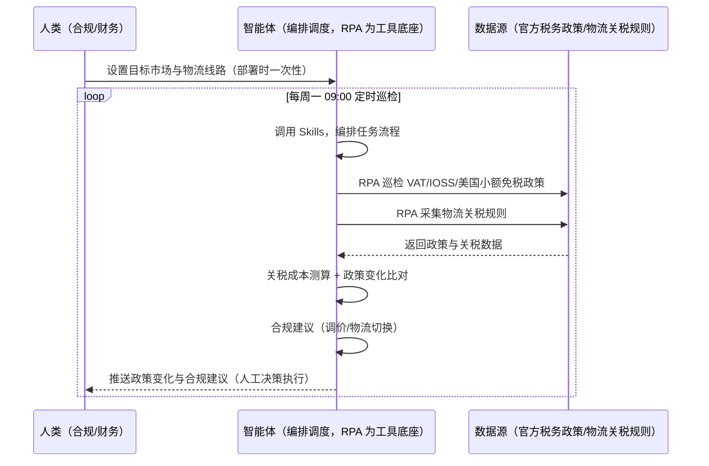
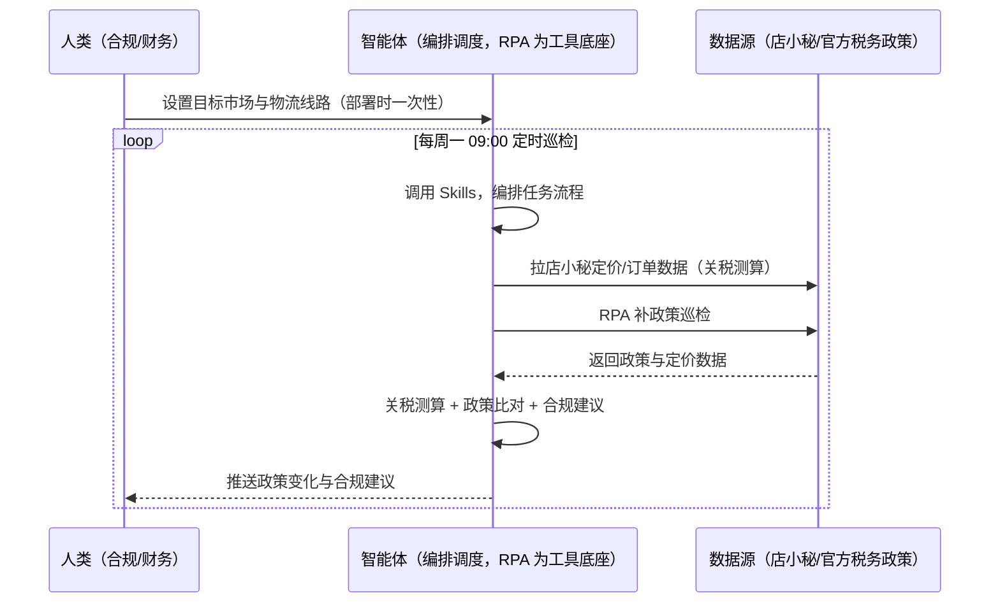

> 为速卖通卖家团队打造的税务与关税合规管理方案。VAT/IOSS/美国小额免税政策变化不知情、关税成本算不清、物流线路与政策不匹配。本方案由智能体调度多个工具执行巡检税务政策与成本测算，智能体按目标市场输出合规建议。定时巡检，只推送政策变化与合规建议，调价/物流切换由人工决策。

> Agent 自动化需开通企业功能
> 点击申请1个月免费权限
> [点击申请 →](https://skieer.feishu.cn/share/base/form/shrcnFwMayykP5iaL38fnZKTbrg)

## 一、用户与需求

核心矛盾：跨境税务复杂（VAT/IOSS/美国小额免税 800 美元门槛），政策变化不知情；关税成本算不清、物流线路与政策不匹配导致成本失控或被扣关。

两类客户痛点同源，数据来源不同：

- 未购 SaaS 客户（新卖家/小团队）：人工查政策、凭经验选物流，全靠手；
- 已购 SaaS 客户（店小秘 ERP 等）：店小秘管订单库存，税务政策巡检与关税测算不覆盖，仍要人盯。

适用客户：欧盟/美国等税务复杂市场卖家。政策巡检与成本测算可自动化，调价/物流切换需人工决策执行。

### 1.1 不同模式卖家

| 类型 | 选择 | 建议 |
|-|-|-|
| POP | 首选 | 强烈推荐（自主运营，VAT/IOSS 合规必须） |
| 半托管 | 次选 | 一般推荐（半托管自主运营） |
| 全托管 | 不适用 | 平台代运营（税务平台处理） |

### 1.2 不同类目卖家

| 类目 | 最关注维度 | 核心逻辑 |
|-|-|-|
| 3C 数码 | 关税成本 | 带电类关税高 |
| 家居家具 | 大件关税 | 大件关税占比高 |
| 美妆个护 | VAT | 欧盟 VAT 合规 |
| 服装鞋帽 | IOSS | 跨境电商申报 |
| 户外运动 | 美国免税 | 800 美元门槛 |
| 母婴用品 | 认证+关税 | 双成本评估 |

### 1.3 不同角色用户

| 用户 | 需求 | 问题 | 投入时间（估算） |
|-|-|-|-|
| 老板 | 税务合规成本可控 | 政策变化不知情 | 0.5 小时/周 |
| 合规 | 政策巡检 | 查政策费时 | 1 小时/周 |
| 财务 | 关税测算 | 成本算不清 | 1 小时/周 |

---

## 二、现在的方法与问题

### 2.1 流程步骤与问题总结

人工方式（未购 SaaS 客户）

| 序号 | 步骤 | 现在的方法 | 问题缺陷 |
|-|-|-|-|
| 1 | 查政策 | 手动搜 | 政策变化不知情 |
| 2 | 算关税 | 凭经验 | 成本算不清 |
| 3 | 选线路 | 凭经验 | 与政策不匹配 |
| 4 | 调价 | 费率变更后手动 | 关税变化旧价未重算 |
| 5 | 沉淀 | 无 | 政策不沉淀 |

SaaS 方式（已购店小秘 ERP 客户）

| 序号 | 步骤 | 现在的方法 | 问题缺陷 |
|-|-|-|-|
| 1 | 查政策 | 店小秘不覆盖 | 靠人搜 |
| 2 | 算关税 | 无 | 算不清 |
| 3 | 选线路 | 凭经验 | 无建议 |
| 4 | 调价 | 手动 | 旧价未重算 |
| 5 | 沉淀 | 无 | 不迭代 |

### 2.2 问题分析

人工方式根因

| 序号 | 根因 | 具体表现 |
|-|-|-|
| 1 | 政策变化不知情 | 合规风险与成本失控 |
| 2 | 关税算不清 | 定价失真 |
| 3 | 线路不匹配 | 被扣关或成本高 |

**SaaS 方式根因**

| 序号 | 根因 | 具体表现 |
|-|-|-|
| 1 | 店小秘不覆盖 | 税务政策无工具 |
| 2 | 无闭环 | 政策变化不回填定价 |

---

## 三、解决方案

### 3.1 功能概述

为速卖通卖家团队打造的税务与关税合规管理方案，巡检税务政策与成本测算，智能体按目标市场输出合规建议。

定时巡检并调度多个工具，调起八爪鱼 RPA（Agent 的工具底座，能耦合多系统、完成自动化任务执行）巡检目标市场税务政策（VAT/IOSS/美国小额免税）与物流线路关税规则，智能体按目标市场测算关税成本、输出合规建议与调价/物流切换建议。定时巡检，只推送政策变化与合规建议，调价/物流切换由人工决策。

### 3.2 系统结合

| 要素 | 说明 |
|-|-|
| 客户现有工具盘点 | **未购 SaaS 客户**：无第三方工具，税务全靠人工查。     **已购 SaaS 客户**（主流组合）：店小秘 ERP（官方服务市场合作 ERP，管订单库存，税务政策不覆盖） |
| 数据/能力来源 | **无 SaaS**：官方税务政策页（VAT/IOSS/美国小额免税，公开源）+ 物流关税规则（公开源，RPA 采集）。     **有 SaaS**：店小秘订单/定价数据（辅助关税成本测算）+ RPA 补政策巡检 |
| RPA 耦合动作 | 作为 Agent 的工具底座，按计划巡检税务政策与关税规则（快照留档、变更比对），统一流转给智能体；政策变化告警 |
| 耦合出的新价值 | 单工具给不了的端到端结论：政策/关税一次取齐 → 关税成本测算 → 合规建议 → 调价/物流切换建议，**只推送政策变化与合规建议** |

### 3.3 智能体执行流程

智能体定时触发。支持**两种数据通道**，部署时按客户现有工具选择：

**通道一：无 SaaS 方式（RPA 巡检政策，适合未购 ERP 的客户）**

**通道二：有 SaaS 方式（店小秘定价数据辅助测算 + RPA 补政策巡检，适合已购客户）**

> Agent 自动化需开通企业功能
> 点击申请1个月免费权限
> [点击申请 →](https://skieer.feishu.cn/share/base/form/shrcnFwMayykP5iaL38fnZKTbrg)

### 3.4 为何这么设计

要同时回答三个问题：**为什么不能只用 SaaS/API？为什么不能纯靠智能体写代码？为什么 RPA 是执行底座？** 本场景的核心是"政策巡检、关税测算、合规建议、挂了有人管"。

#### 1）逐项对比

| 对比维度 | SaaS/API 堆叠（店小秘） | 纯智能体（智能体写代码） | 智能体+自动化工具（RPA 工具底座） |
|-|-|-|-|
| 实现方式 | 店小秘管定价，税务政策不覆盖 | 能抓政策能算，但全要自己接 | 政策巡检 + 关税测算 |
| 政策巡检 | 不覆盖 | 智能体无法常驻轮询 | RPA 定时巡检、快照比对 |
| 关税测算 | 无 | 需自建测算模型 | 关税规则可视化配置 |
| 使用成本（总拥有成本） | 店小秘订阅费（主体另算） | 代理 IP + 服务器 + 开发维护人力，隐性成本高 | 一份平台订阅跑多流程，单方案边际成本 ≈ 0 |
| 维护人要求 | 低（工具现成） | 规则调整都要开发介入 | 可视化流程，合规自己可调线路 |

#### 2）优劣势说明

|  | SaaS/API 堆叠（店小秘） | 纯智能体（智能体写代码） | 智能体+自动化工具（RPA 工具底座） |
|-|-|-|-|
| 优势 | 定价数据权威（关税测算） | 无订阅费；     可深度定制税务模型 | 政策巡检+关税测算即开即用；     非技术人员可维护 |
| 劣势 | 税务政策不覆盖 | 政策采集与测算全自建；     AI 生成代码是生成性的 | 本地电脑运行需保持开机；     订阅费；     调价/物流切换需人工 |

#### 3）结论

| 论点 | 说明 |
|-|-|
| 政策=合规与成本 | VAT/IOSS/美国小额免税（800 美元门槛）政策变化直接影响合规与定价——政策巡检必须 |
| 关税=定价成本 | 关税成本测算进定价（与「定价与运费模板」场景联动） |
| 人工决策执行 | 调价/物流切换需人工决策执行（涉及运营动作） |
| 一个底座跑多流程 | 客户购买 RPA 平台是跑多个流程（税务/定价/物流），本方案只是其中一个——平台订阅费被多流程摊薄 |
| 时间 | 合规要的是"政策变化 + 关税测算 + 合规建议"，不是"手动搜政策" |

### 3.5 功能清单

| 功能 | 系统 | 功能说明（解决问题） |
|-|-|-|
| 会话/定时 | 智能体 | 1. 理解人类语言，调用已预设好的 Skills。     2. 编排多任务、调度多工具。 |
| 多系统数据取数 | RPA、指纹浏览器 | 1. 解决政策变化不知情、关税算不清问题。     2. 作为智能体工具底座被调度执行，快照留档、变更比对。     3. **【无 SaaS 方式】** RPA 巡检官方税务政策与物流关税规则。**【有 SaaS 方式】** 店小秘定价数据辅助测算 + RPA 补政策巡检。 |
| 关税成本测算 | 智能体 | 按目标市场（VAT/IOSS/美国小额免税）测算关税成本。 |
| 政策变化比对 | 智能体 | 政策快照比对，变化自动告警。 |
| 合规建议 | 智能体 | 调价建议（关税变化旧价重算）/ 物流线路切换建议。 |
| IM通知 | 飞书、钉钉、企微等 | 解决政策滞后问题。政策变化与合规建议自动推送。 |
| 数据资产储存 | 本地电脑、云储存 | 1. Skills 资产：速卖通税务合规技能。     2. 数据储存：政策快照统一写入本地。     3. 经验知识库：政策案例持续沉淀。 |

### 3.6 智能体执行落地过程

部署时一次性配置入参（目标市场、物流线路、关税规则、数据通道），会话中无需重复输入。

**⚠️ 部署前提（不满足则方案无法跑起来）**：①RPA 需部署在**常开电脑/云机**上（每周巡检可接受任务时开机），并配置漏跑补跑机制；②**调价/物流切换由人工决策执行**，本方案只出建议；③关税规则需及时维护（官方公示为准）；④**有 SaaS 方式需店小秘账号**（定价数据辅助，可选增强，无则走公开源通道）；⑤首次配置（目标市场、线路清单、关税规则）需服务方/技术人员介入一次，属实施成本。

#### 1）配置

| 类别 | 说明 |
|-|-|
| 智能体 | 主流智能体。 |
| 智能体工具 | 1. **数据通道（按客户现有工具二选一）**：【无 SaaS】官方税务政策/物流关税规则（RPA 采集）；【有 SaaS】店小秘定价数据 + RPA 补政策巡检。     2. 数据取数与自动化执行：八爪鱼 RPA，MCP 配置完成。     3. 数据分析：智能体自带。     4. IM：企业办公 IM（飞书/钉钉/企微），MCP 或 webhook 配置。 |
| 工作知识 | 1. 目标市场：欧盟（VAT/IOSS）/美国（小额免税 800 美元）。     2. 物流线路清单。     3. 关税规则。     4. 调价联动：与定价场景联动。 |
| 本地数据库 | 1. 政策快照库地址。     2. 关税规则库地址。     3. 经验库地址。 |

#### 2）执行

| 任务 | 产出 | 产出物接收人 |
|-|-|-|
| 接收目标市场，定时巡检触发 | 任务启动记录 | —— |
| 调用已预设 Skills，编排任务流程 | 任务编排方案 | —— |
| 经 MCP 向八爪鱼 RPA 下发取数任务 | 自动化任务指令 | —— |
| 多源取数（无 SaaS：政策/关税；有 SaaS：店小秘+政策，智能体监控状态） | 对齐后税务数据 | —— |
| 关税成本测算 | 关税报告 | 财务 |
| 政策变化比对（快照比对） | 政策变化清单 | 合规 |
| 合规建议（调价/物流切换） | 合规建议 | 合规/财务 |
| 推送政策变化与合规建议（人工决策执行） | 群消息 | 合规/财务/老板 |

异常处理：

政策源不可用 → 用上次快照并标注；

关税规则缺失 → 标注待补；

政策变化 → 告警提醒；

建议低置信度 → 转人工；

置信度 &lt;70% → 转人工复核，不输出硬结论。

#### 3）结果

| 结果 | 说明 |
|-|-|
| 数据资产 | 政策快照结构化数据（市场/政策/关税/变更记录），可审计可追溯。 |
| 分析报告 | 1. 关税成本测算报告。     2. 政策变化清单。     3. 合规建议（调价/物流切换）。 |
| Skills | 智能体 Skills：速卖通税务合规技能，按政策案例迭代。 |

> Agent 自动化需开通企业功能
> 点击申请1个月免费权限
> [点击申请 →](https://skieer.feishu.cn/share/base/form/shrcnFwMayykP5iaL38fnZKTbrg)

---

## 四、使用前后预估

> 本方案价值 = **税务政策自动巡检 → 关税成本测算 → 政策变化比对 → 合规建议**。政策巡检与成本测算可自动化，调价/物流切换需人工决策执行。

| 指标 | 人工 | SaaS/API（店小秘） | 智能体+自动化工具 |
|-|-|-|-|
| 政策巡检 | 手动搜 | 不覆盖 | 自动巡检快照比对 |
| 关税测算 | 算不清 | 无 | 按市场自动测算 |
| 政策变化 | 不知情 | 无 | 自动告警 |
| 调价联动 | 旧价未重算 | 无 | 关税变化联动定价 |
| 合规建议 | 无 | 无 | 调价/物流切换建议 |
| 方法论 | 无 | 单工具 | 可复用的 Skills 与关税规则库 |

**说明**：跨境税务复杂（VAT/IOSS/美国小额免税 800 美元门槛），政策变化直接影响合规与定价；关税成本测算进定价（与「定价与运费模板」场景联动）；调价/物流切换需人工决策执行（涉及运营动作）。

---

## 五、效果证明

> Agent 自动化需开通企业功能
> 点击申请1个月免费权限
> [点击申请 →](https://skieer.feishu.cn/share/base/form/shrcnFwMayykP5iaL38fnZKTbrg)

### 5.1 客户案例

**《高端小家电龙头：多税种、多平台、多主体申报与对账自动化》**

> 国内小家电龙头，天猫旗舰店粉丝 160 万 +，线上渠道贡献绝大部分营收。RPA 自动完成数据导出、规则整理、核对表与差异表生成、差异归因，并支持企业微信通知与中台工单闭环。

| 效果 | 说明 |
|-|-|
| 提效 | 多主体、多税种申报与多平台对账全流程自动化。原本财务需为每个分公司主体分别申报、逐税种重复填表，并从 SAP 手工下载处理数据，现在由机器人自动导出、整理、生成核对表与差异表并完成申报流转。 |
| 降本 | 免除逐主体重复填报与人工核对的人力投入，财务与共享中心投入转向资金分析、税务筹划等重点工作。 |
| 任务 | 覆盖天猫、京东、官网、视频号等渠道及京东/菜鸟仓出入库全场景数据核对。 |
| 任务 | 差异自动归因并生成差异表，支持企业微信通知与中台工单创建、提交、审核到验货完结闭环。 |

案例详情：[财务|报税&对账：高端小家电龙头借助八爪鱼，搞定多税种、多平台、多主体对账&申报](https://skieer.feishu.cn/wiki/U4SXwL6Zvix6RrkYud8caE3enze)

---

## 六、备注

### 6.1 Agent 支持

本方案不绑定具体智能体，主流 Agent 均可运行（需支持技能/Skills 加载与工具调用）：

| Agent/智能体 | 说明 |
|-|-|
| Workbuddy | 本方案运行平台，支持技能/Skills 上传加载、定时任务、MCP 工具调用与表格/报告处理 |
| 豆包（国内·字节） | 国内主流个人智能体，支持技能上传、定时任务与工具调用，上手成本低 |
| 通义千问（国内·阿里） | 支持 Agent 编排与插件生态，集成阿里电商数据能力，适合电商场景 |
| DeepSeek（国内） | 推理能力强、成本低，适合规则打分与归因分析类任务 |
| ChatGPT（国外·OpenAI） | 海外主流通用智能体，支持 GPTs/Agent 模式与工具调用 |
| Claude（国外·Anthropic） | 长文本与结构化分析能力强，原生支持 MCP 连接外部工具 |

### 6.2 名词解释

| 术语 | 说明 |
|-|-|
| VAT | 欧盟增值税 |
| IOSS | 进口一站式申报（跨境电商） |
| 小额免税 | 美国 800 美元以下小额包裹免税门槛 |
| 关税成本 | 按目标市场与物流线路测算的关税 |
| 政策快照 | 税务政策定期存档用于变更比对 |
| 混合数据源 | 官方税务政策页（公开源）+ 物流关税规则 + 店小秘定价数据（有 SaaS 客户） |
| 有 SaaS 方式 | 已购店小秘 ERP，定价数据辅助测算 + RPA 补政策巡检 |
| 无 SaaS 方式 | 不购买第三方工具，RPA 巡检官方政策 |
| POP | 自主运营模式（自主上架定价，总费率 6%-11.5%） |
| 全托管 | 平台代运营（无自主发布权，平台抽佣 25%-30%） |
| 半托管 | 佣金介于 POP 与全托管之间 |
| MCP | Model Context Protocol，智能体连接外部工具的标准化通道 |

> Agent 自动化需开通企业功能
> 点击申请1个月免费权限
> [点击申请 →](https://skieer.feishu.cn/share/base/form/shrcnFwMayykP5iaL38fnZKTbrg)

---

原文：[查看原文](https://skieer.feishu.cn/wiki/RQ1SwLJgOiKVq5kvbXMc30k6nAg)
