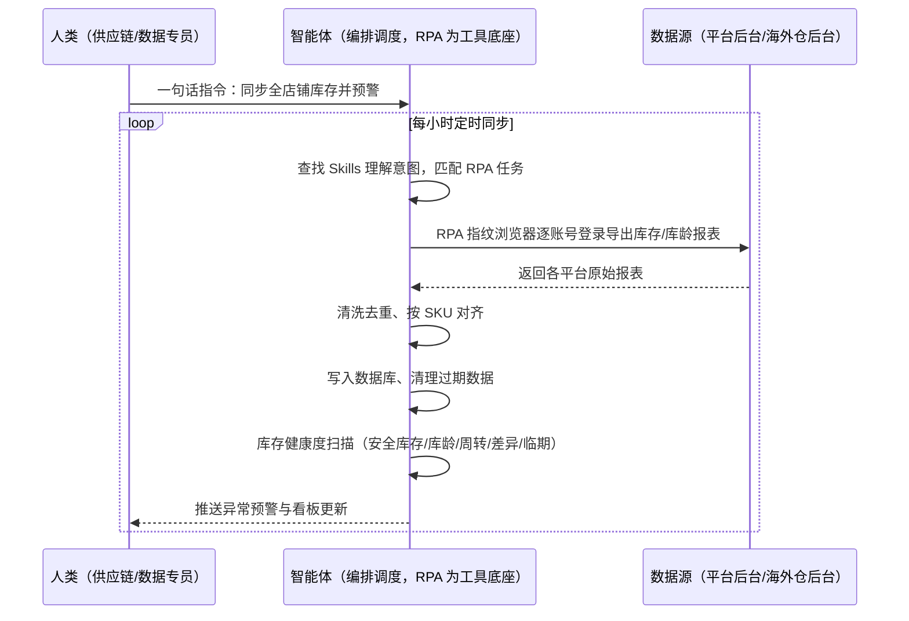
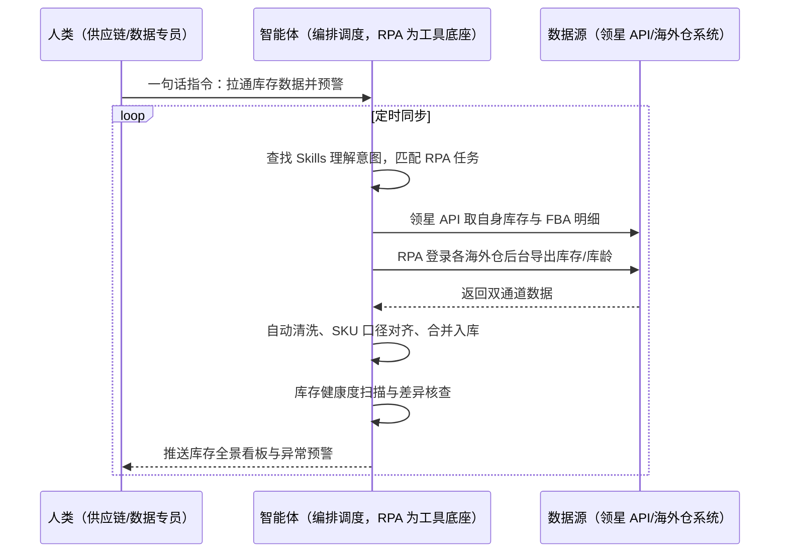

> 为跨境多平台卖家团队打造的多平台库存自动同步与预警方案。卖家在亚马逊/Temu/速卖通/虾皮等平台与多家海外仓之间多账号运营，库存报表靠人工逐个登录导出），格式不一清洗复杂，库存数据 T+2 才能进看板，断货与压货发现滞后。本方案由智能体调度多个工具执行多平台库存报表自动导出（指纹浏览器多账号登录）+ 自动清洗去重入库 + 库存健康度预警，输出实时库存 BI 看板与分级预警。定时自动执行，全程自动化，无异常不打扰。

> Agent 自动化需开通企业功能
> 点击申请1个月免费权限
> [点击申请 →](https://skieer.feishu.cn/share/base/form/shrcnFwMayykP5iaL38fnZKTbrg)

## 一、用户与需求

核心矛盾：

- 多平台多账号库存报表下载量巨大：平台多、账号多，人工逐个登录导出占用全职人力（案例口径：7 平台 16 账号 400 张报表/小时）
- 数据格式不统一：各平台库存表字段、口径各异，清洗去重复杂，人工合并易错
- 数据时效滞后：人工导入数据库 T+2 才能形成看板，库存调配决策慢半拍
- 断货与压货两头挨打：安全库存、库龄、周转没有统一监控，易断货的没及时补、滞销的没及时清

适用客户：多平台多店铺运营的跨境卖家（数据专员/供应链/运营负责人）。已有 ERP（领星等）的客户把自有数据与平台/海外仓数据统一拉通；没有 ERP 的客户用平台后台与海外仓后台导出兜底；部署后业务人员不需要写代码，一句话下达指令即可执行。

### 1.1 不同模式卖家

| 类型 | 选择 | 建议 |
|-|-|-|
| 品牌卖家 | 首选 | 强烈推荐（多平台多账号规模大，库存数据统一是刚需） |
| 精铺卖家 | 首选 | 强烈推荐（SKU 多，人工盯库存根本盯不过来） |
| 铺货型 | 次选 | 一般推荐（只做重点店铺的库存同步） |

### 1.2 不同类目卖家

| 类目 | 最关注维度 | 核心逻辑 |
|-|-|-|
| 家居家具 | 库存资金占用 | 大件单 SKU 资金高，压货成本远高于断货 |
| 3C 数码 | 周转率与安全库存 | 周转快，安全库存线要按日均销动态算 |
| 服装鞋帽 | 季节库存与库龄 | 换季库龄超 90 天必须清，否则砸手里 |
| 美妆个护 | 临期监控 | 有保质期约束，临期阈值要提前预警 |
| 母婴用品 | 多平台库存差异 | 平台间调拨频繁，差异核查是重点 |
| 汽配 | 长尾 SKU 全覆盖 | SKU 多且销量分散，人工盘点不现实 |

### 1.3 不同角色用户

| 用户 | 需求 | 问题 | 投入时间（估算） |
|-|-|-|-|
| 数据专员 | 报表自动导出入库 | 每天导表导到麻木 | 2-4 小时/天 |
| 供应链负责人 | 库存实时可视 | 看板滞后 2 天 | 每周复盘 2 小时 |
| 运营负责人 | 断货/压货预警 | 事后才知道 | 随时响应 |

---

## 二、现在的方法与问题

### 2.1 流程步骤与问题总结

人工方式（未购 ERP 客户）

| 序号 | 步骤 | 现在的方法 | 问题缺陷 |
|-|-|-|-|
| 1 | 登录平台后台 | 逐个账号手动登录 | 16 个账号切换，登录态频繁失效 |
| 2 | 导出库存报表 | 手动筛选条件逐张导出 | 量大耗时（案例口径 400 张/小时） |
| 3 | 清洗合并 | 人工调整格式对齐 | 字段口径不一，易错 |
| 4 | 导入数据库 | 手动导入 | 费时且易出错 |
| 5 | 更新看板 | 人工刷新 BI | T+2 滞后 |
| 6 | 盯断货压货 | 人工翻看板 | 无统一预警规则 |

ERP/SaaS 方式（已购领星等 ERP 客户）

| 序号 | 步骤 | 现在的方法 | 问题缺陷 |
|-|-|-|-|
| 1 | 看 FBA 库存 | 领星网页端人工查看 | 自有数据有了，但平台侧口径仍要核对 |
| 2 | 导海外仓数据 | 逐家海外仓后台导出 | 多家海外仓系统割裂 |
| 3 | 合并分析 | 人工对齐合并 | 数据源分散，SKU 口径不统一 |
| 4 | 出库存结论 | 人工判断 | 无自动预警，靠经验 |

### 2.2 问题分析

人工方式根因

| 序号 | 根因 | 具体表现 |
|-|-|-|
| 1 | 纯手动导出 | 账号多报表多，占用全职人力 |
| 2 | 格式不统一 | 清洗去重复杂，人工易错 |
| 3 | 时效差 | T+2 才能形成看板，决策滞后 |

ERP/SaaS 方式根因

| 序号 | 根因 | 具体表现 |
|-|-|-|
| 1 | 系统割裂 | 领星管 FBA、各家海外仓各管一段，库存全景拼不起来 |
| 2 | 人工整合 | 多系统导出后仍要人工对齐合并 |
| 3 | 无主动预警 | 断货、压货、库龄异常没有统一规则盯守 |

---

## 三、解决方案

### 3.1 功能概述

为跨境多平台卖家打造的库存自动同步与预警方案，一句话调度多平台库存报表自动导出 + 自动清洗入库 + 库存健康度预警，输出实时库存看板与分级预警。

一句话下达指令（如「把全部店铺的库存数据同步一遍，有异常的报给我」），智能体通过查找 Skills 文档库理解意图、匹配 N 个 RPA 自动化任务（多账号登录导出→清洗去重→入库→预警扫描），经 MCP 调度八爪鱼 RPA 以指纹浏览器逐账号登录各平台后台与海外仓系统，导出库存/库龄报表，自动清洗去重、按 SKU 对齐后写入数据库，最后生成库存健康度预警（安全库存/库龄/周转/差异核查/临期）并推送。全程自动化，运行状态实时反馈，跑完推送结果。

### 3.2 系统结合

| 要素 | 说明 |
|-|-|
| 客户现有工具盘点 | **未购 ERP 客户**：无统一系统，库存数据散在各平台后台与海外仓后台。      
**已购 ERP 客户**（主流）：领星 ERP（管 FBA 库存与自身进销存，开放 API 需企业客户申请权限）+ 各海外仓系统（无忧达/中运/乐歌等，各家后台独立） |
| 数据/能力来源 | **无 ERP**：各平台后台库存报表导出 + 海外仓后台导出（指纹浏览器多账号登录）。      
**有 ERP**：领星 API 取自身库存与 FBA 明细 + 海外仓后台导出补齐 + RPA 补平台侧程序化缺口 |
| RPA 耦合动作 | 作为 Agent 的工具底座被调度执行：指纹浏览器多店铺登录、批量导出库存/库龄报表、自动清洗去重、按 SKU 对齐入库、定时清理过期数据，统一流转给智能体做健康度判断 |
| 耦合出的新价值 | 单系统给不了的端到端结论：多平台多账号库存全景一张表 + 自动预警（安全库存/库龄/周转/差异/临期），**只推送异常预警与健康度日报** |

### 3.3 智能体执行流程

一句话下达指令，智能体自动调度。支持**两种数据通道**，部署时按客户现有工具选择：

**通道一：无 ERP 方式（平台后台+海外仓后台导出，适合未购系统的客户）**

**通道二：有 ERP 方式（领星 API+海外仓导出，适合已购系统客户）**

> Agent 自动化需开通企业功能
> 点击申请1个月免费权限
> [点击申请 →](https://skieer.feishu.cn/share/base/form/shrcnFwMayykP5iaL38fnZKTbrg)

### 3.4 为何这么设计

要同时回答三个问题：**为什么不能只用纯代码 Agent？为什么不能只用纯 RPA？为什么两者要结合？** 本场景的核心是"多账号高频可靠取数、数据口径统一、异常主动预警"。

#### 1）逐项对比

| 对比维度 | SaaS/API 堆叠（领星+海外仓系统） | 纯智能体（智能体写代码） | 智能体+自动化工具（RPA 工具底座） |
|-|-|-|-|
| 实现方式 | 各系统各管一段，人工拼接 | 能写爬虫能处理，但全要自己建 | 一个底座拉通全渠道 |
| 多账号登录与取数 | 领星只覆盖自身数据，海外仓仍要人工导 | 16 账号登录保活、指纹隔离全自建 | 指纹浏览器多账号批量登录，失败自动重试 |
| 高频调度可靠性 | 无统一调度 | 定时任务与漏跑补跑全自建 | 平台级调度，断点续跑 |
| 风控与多账号隔离 | 不涉及 | 需自建指纹环境 | 指纹浏览器原生隔离 |
| 使用成本（总拥有成本） | 领星企业版订阅 + 多海外仓系统费 | 代理 IP + 服务器 + 开发维护人力 | 一份平台订阅跑多流程，单方案边际成本 ≈ 0 |
| 维护人要求 | 低（系统现成） | 规则调整都要开发介入 | 可视化流程，运营自己可改阈值 |

#### 2）优劣势说明

|  | SaaS/API 堆叠（领星+海外仓系统） | 纯智能体（智能体写代码） | 智能体+自动化工具（RPA 工具底座） |
|-|-|-|-|
| 优势 | 数据口径权威；      
系统现成上手快 | 无订阅费；      
可深度定制清洗规则 | 多账号批量取数稳定；      
清洗入库预警一条链；      
非技术人员可维护 |
| 劣势 | 系统割裂，库存全景拼不起来；      
无主动预警 | 登录保活/指纹隔离/调度全自建；      
AI 生成代码是生成性的 | 本地电脑运行需保持开机；      
有 ERP 方式仍需系统订阅；      
后台导出受平台规则影响 |

**特别提醒**：多账号高频登录需用指纹浏览器隔离环境并控制访问频率，遵守各平台数据导出规则；有 ERP 方式需领星企业客户申请 API 权限，未开通则该通道自动降级为后台导出。

#### 3）结论

| 论点 | 说明 |
|-|-|
| 确定性 vs 生成性 | 库存取数是确定性任务，RPA 流程行为可预期；AI 生成代码能跑通 ≠ 能稳定跑一年 |
| 资产沉淀 | 多账号登录态、报表解析模板沉淀在平台是活的，换人接手、多店复用都成立 |
| 一个底座跑多流程 | 客户购买 RPA 平台是跑多个流程（库存/补货/报表/对账），本方案只是其中一个，订阅费被摊薄 |
| token 消耗极低 | 库存同步是规则化流水线，采集清洗不调用大模型；仅预警结论生成消耗少量 token |
| 数据全景 | 多平台多账号库存一张表 + 统一预警规则，单系统给不了 |
| 时间 | 供应链要的是"每天打开看板就是最新的、异常自动找上门"，不是"导一天表再人工核对" |

### 3.5 功能清单

| 功能 | 系统 | 功能说明（解决问题） |
|-|-|-|
| 会话/一句话指令 | 智能体 | 1. 理解自然语言意图，查找 Skills 文档库。      
2. 匹配对应 RPA 自动化任务、编排多任务。 |
| 多账号库存取数 | RPA、指纹浏览器 | 1. 解决多平台多账号人工导表问题。      
2. 作为智能体工具底座被调度执行，失败重试、断点续跑。      
3. **【无 ERP 方式】** 指纹浏览器逐账号登录平台/海外仓后台，批量导出库存与库龄报表。**【有 ERP 方式】** 领星 API 取数 + RPA 补海外仓与平台侧缺口。 |
| 数据清洗入库 | 智能体 | 去重、字段口径对齐、按 SKU 归档，解决格式不统一、人工合并易错问题。 |
| 库存健康度预警 | 智能体 | 安全库存监控/库龄预警/库存周转分析/库存差异核查/临期商品监控，输出分级预警。 |
| 库存看板 | 数据库、BI | 库存流转分布看板自动更新（案例口径：T+2 提升至 T+1，部分平台准实时）。 |
| IM通知 | 飞书、钉钉、企微等 | 解决异常发现滞后问题，断货/压货/库龄异常即时推送。 |
| 数据资产储存 | 本地电脑、云储存 | 1. Skills 资产：库存同步与预警技能。      
2. 数据储存：库存明细库统一写入本地。      
3. 经验知识库：预警阈值与处置经验回填迭代。 |

### 3.6 智能体执行落地过程

部署时一次性配置入参（账号清单、平台清单、同步频率、预警阈值），会话中一句话即可触发，无需重复输入。

**⚠️ 部署前提（不满足则方案无法跑起来）**：①RPA 需部署在**常开电脑/云机**上，并配置漏跑补跑机制；②多账号登录需**指纹浏览器环境**与稳定登录态，登录失效自动告警；③数据库/表格存储需提前就绪；④有 ERP 方式需领星企业客户 API 权限，未开通自动降级为后台导出通道；⑤首次配置（账号环境、阈值、模板）需服务方/技术人员介入一次，属实施成本。

#### 1）配置（五步）

| 步骤 | 操作 | 说明 |
|-|-|-|
| 第一步 | 下载八爪鱼 RPA，导入跨境电商自动化模板 | 官网免费下载客户端；MCP 工具→添加应用→选择已搭建应用 |
| 第二步 | 开启八爪鱼 RPA 的 MCP 服务端口 | 客户端→API-K→创建 API（名称自定义） |
| 第三步 | 在智能体中添加 MCP Server 连接 | 复制连接配置→智能体连接器→自定义连接器→配置 MCP→粘贴保存→刷新重连 |
| 第四步 | 验证工具列表 | 确认工具全部启用（即八爪鱼客户端内工具） |
| 第五步 | 测试运行效果 | 输入一句话指令，验证多账号取数与预警推送 |

| 类别 | 说明 |
|-|-|
| 智能体 | 主流智能体（支持 MCP 连接、Skills 加载、定时任务）。 |
| 智能体工具 | 1. **数据通道（按客户现有工具二选一）**：【无 ERP】平台后台+海外仓后台（RPA 指纹浏览器导出）；【有 ERP】领星 API+海外仓后台。      
2. 数据取数与自动化执行：八爪鱼 RPA（MCP 协议接入），MCP 配置完成。      
3. 数据分析：智能体自带。      
4. IM：企业办公 IM（飞书/钉钉/企微），MCP 或 webhook 配置。 |
| 工作知识 | 1. 店铺/账号清单。      
2. 平台与海外仓清单。      
3. 预警阈值（安全库存线/库龄天数/周转下限）。      
4. 同步频率与时段。 |
| 本地数据库 | 1. 库存明细库地址。      
2. 预警记录库地址。      
3. 看板数据源地址。 |

#### 2）执行

| 任务 | 产出 | 产出物接收人 |
|-|-|-|
| 接收一句话指令，匹配 RPA 任务 | 任务启动记录 | —— |
| 调用已预设 Skills，编排任务流程 | 任务编排方案 | —— |
| 经 MCP 向八爪鱼 RPA 下发取数任务 | 自动化任务指令 | —— |
| 多账号登录导出库存/库龄报表（智能体监控状态） | 原始报表数据 | —— |
| 自动清洗去重、SKU 对齐 | 清洗后数据 | —— |
| 清洗结果写入数据库 | 库存明细库更新 | 数据库 |
| 库存健康度扫描 | 分级预警清单 | 供应链 |
| 推送预警与看板更新 | 群消息/看板 | 供应链/运营/老板 |

异常处理：

登录失效 → 自动重试 2 次，仍失败告警推 IM；

导出失败 → 跳过并记录，下一轮自动补采；

数据缺失字段 → 降级说明本次覆盖率；

差异核查置信度低 → 转人工复核，不输出硬结论。

#### 3）结果

| 结果 | 说明 |
|-|-|
| 数据资产 | 全渠道库存明细结构化存储（平台/账号/SKU/数量/库龄/仓位/来源），可审计可追溯。 |
| 分析报告 | 库存健康度日报：安全库存命中清单/库龄超期清单/周转异常/差异核查结论/临期预警。 |
| Skills | 智能体 Skills：库存同步与预警技能，按周迭代阈值规则。 |

> Agent 自动化需开通企业功能
> 点击申请1个月免费权限
> [点击申请 →](https://skieer.feishu.cn/share/base/form/shrcnFwMayykP5iaL38fnZKTbrg)

---

## 四、使用前后预估

> 本方案价值 = **多账号自动取数 → 口径统一入库 → 健康度自动预警**。把数据专员从每天导表导到麻木的机械活中解放出来。

| 指标 | 人工 | SaaS/API（领星+海外仓系统） | 智能体+自动化工具 |
|-|-|-|-|
| 报表导出 | 手动逐账号导出，量大耗时 | 系统内人工导出核对 | 多账号批量自动导出 |
| 数据时效 | T+2 形成看板 | 部分准实时，人工拼接 | T+1 甚至准实时（案例口径） |
| 数据准确性 | 人工合并易错 | 口径不统一需人工对齐 | 自动清洗对齐，可追溯 |
| 人力占用 | 全职数据专员（案例口径：省 2 名，年降本 50 万元） | 部分释放 | 取数全自动，人工转异常处置 |
| 预警能力 | 无，事后发现 | 无主动预警 | 断货/压货/库龄分级预警 |
| 方法论 | 换人标准不同 | 依赖系统固定口径 | 可复用的 Skills 与阈值资产 |

**说明**：案例数字均来自八爪鱼客户实践（案例口径：某家电头部品牌 7 平台 16 账号每小时 400 张报表、T+2 提升至 T+1、减少 2 名全职数据专员、年成本降低 50 万元）；本方案为按同口径复刻的实施路径，具体数值随账号数与平台而异（估算）。

---

## 五、效果证明

> Agent 自动化需开通企业功能
> 点击申请1个月免费权限
> [点击申请 →](https://skieer.feishu.cn/share/base/form/shrcnFwMayykP5iaL38fnZKTbrg)

### 5.1 客户案例

**《小天鹅：7 平台 16 账号库存数据自动化，年省成本 50 万》**

> 美的集团旗下小天鹅事业部，7 个电商平台、16 个账号、每日 86 张报表原需专员逐个登录导出 7 小时/天。八爪鱼 RPA 替代全部人工采集，7 大系统、25 类报表自动采集入库。

| 效果 | 说明 |
|-|-|
| 提效 | 多平台报表采集效率提升约 85%。原本 7 个平台 16 个账号、86 张报表需逐个登录导出，每天耗 7 小时，现在全自动采集入库；数据时效由 T+2 提升至 T+1，部分平台已 T+0。 |
| 降本 | 减少数据专员 2 人（原文：2 名全职数据专员的「搬数据」工作被完全替代，年节省人力成本 50 万元）。原本需 2 人全职导表，现在 0 人；2 名专员转岗至数据分析岗，投入库存分析、周转率优化、滞销品预警等高价值工作。 |
| 任务 | 7 个电商平台 16 个账号、25 类报表自动采集入库；错误率降至 0.1%。 |
| 任务 | 天猫指纹浏览器、苏宁每 2 小时定时抓取、京东按事业部隔离账号，多平台差异化策略稳定运行。 |

案例详情：[小天鹅：百亿级洗衣机巨头的多平台库存数据自动化实践](https://skieer.feishu.cn/wiki/Q6Qjw2FtDiNFgWkOVHacEFJ0nlh)

**《唯世美：家具大件补货全流程自动化》**

> 首款内置 RGB 灯光展示柜上架两个月即拿下 Amazon 美加英德四站与 Walmart、Temu 美站 Best Seller。为应对数据源分散、人工操作耗时与 SKU 管理混乱，实现补货判断全流程自动化。

| 效果 | 说明 |
|-|-|
| 提效 | 补货整理重复工作量下降 80%。原本需人工从领星 ERP 与各海外仓平台逐项导出库存、库龄数据再手工清洗匹配 SKU，现在自动抓取、自动清洗，输出补货建议。 |
| 降本 | 免除人工导表与拼表的重复投入，供应链团队投入转向库存结构优化与周转率提升等重点工作。 |
| 任务 | 库存数据抓取与处理准确率达 99% 以上，分散数据源实时同步。 |
| 任务 | 自有 Excel 模板逻辑零改动保留，补货计算口径与原有习惯一致。 |

案例详情：[家具大件补货：补货全流程自动化，整理数据重复工作量下降 80%](https://skieer.feishu.cn/wiki/Gca3w8j1KixDXjkz0oScFwHAngf)

---

## 六、备注

### 6.1 Agent 支持

本方案不绑定具体智能体，主流 Agent 均可运行（需支持 MCP 连接、技能/Skills 加载与工具调用）：

| Agent/智能体 | 说明 |
|-|-|
| Workbuddy | 本方案运行平台，支持技能/Skills 上传加载、定时任务、MCP 工具调用与表格/报告处理 |
| 豆包（国内·字节） | 国内主流个人智能体，支持技能上传、定时任务与工具调用，上手成本低 |
| 通义千问（国内·阿里） | 支持 Agent 编排与插件生态，集成阿里电商数据能力，适合电商场景 |
| DeepSeek（国内） | 推理能力强、成本低，适合规则打分与归因分析类任务 |
| ChatGPT（国外·OpenAI） | 海外主流通用智能体，支持 GPTs/Agent 模式与工具调用 |
| Claude（国外·Anthropic） | 长文本与结构化分析能力强，原生支持 MCP 连接外部工具 |

### 6.2 名词解释

| 术语 | 说明 |
|-|-|
| 库龄 | 库存从入库起计的存放时长，超期意味着资金沉淀与滞销风险 |
| 安全库存 | 为防断货设置的最低库存线，低于即触发补货预警 |
| 库存周转率 | 一段时间内库存周转次数，衡量库存变现速度 |
| 库存差异核查 | 多系统间同一 SKU 库存数量比对，发现账实不符 |
| 临期监控 | 对有保质期商品的剩余效期监控，临期阈值提前预警 |
| T+1 | 数据在发生后第二天可见的时效口径 |
| 领星 | 跨境电商 ERP，管 FBA 库存与自身进销存，开放 API 需企业客户申请权限 |
| 海外仓系统 | 第三方海外仓服务商的仓储管理系统（如无忧达、中运、乐歌），各家独立 |
| 指纹浏览器 | 隔离 Cookie/浏览器指纹的工具，多店铺防关联 |
| BI 看板 | 库存流转分布的可视化面板，数据自动更新 |
| MCP | Model Context Protocol，智能体连接外部工具的标准化通道 |
| 一句话指令 | 用自然语言描述任务，智能体自动翻译为自动化流程 |
| 无 ERP 方式 | 未购统一系统，平台后台与海外仓后台导出兜底 |
| 有 ERP 方式 | 已购领星等 ERP，API 取数 + RPA 补程序化缺口 |
| Skills | 智能体可加载的预设技能资产，含流程与知识 |

> Agent 自动化需开通企业功能
> 点击申请1个月免费权限
> [点击申请 →](https://skieer.feishu.cn/share/base/form/shrcnFwMayykP5iaL38fnZKTbrg)

---

原文：[查看原文](https://skieer.feishu.cn/wiki/HPALwbVukiw5pWkBzR0cgdGRnyd)
