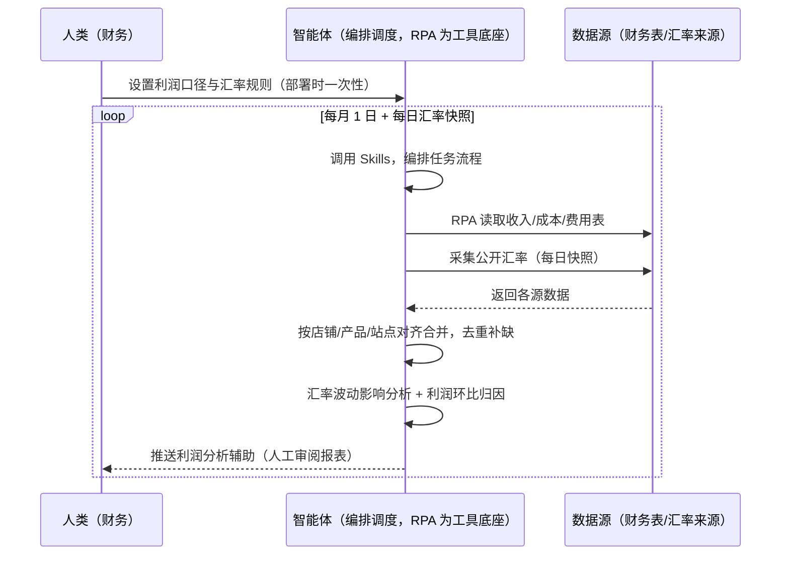
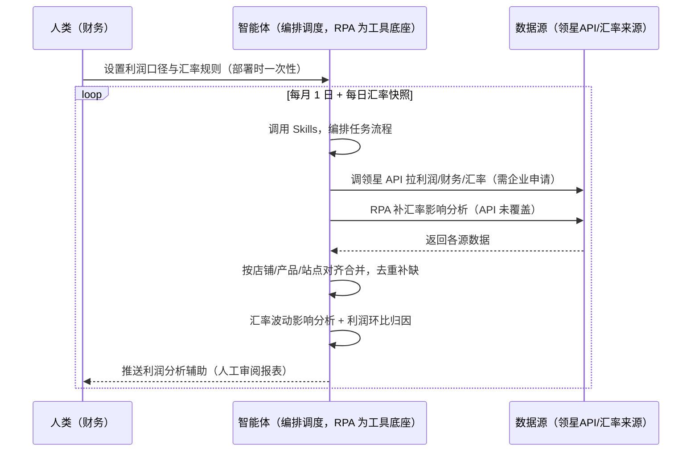

> 为亚马逊卖家团队打造的利润报表与汇率换算衔接方案。该场景主体能力由领星/ERP 承担（利润计算、报表生成、汇率数据）补领星未覆盖的跨系统部分（汇率波动影响分析、利润环比归因、多店铺口径统一）。报表由人工审阅，本方案只做分析辅助。

> Agent 自动化需开通企业功能
> 点击申请1个月免费权限
> [点击申请 →](https://skieer.feishu.cn/share/base/form/shrcnFwMayykP5iaL38fnZKTbrg)

## 一、用户与需求

核心矛盾：收入成本费用分散在多张表格，逐行计算利润易出错，出一份报表要一两天；多币种结算还受汇率波动影响——利润表算不准，经营决策就失真。

两类客户痛点同源，数据来源不同：

- 未购 SaaS 客户（新卖家/小团队）：人工从多张表收集收入成本费用、逐行手算、手动查汇率换算，全靠手；
- 已购 SaaS 客户（领星 ERP）：领星有利润报表能力（每日实时利润报表、财务数据），但汇率波动影响分析、利润环比归因、多店铺口径统一仍要人做。

适用客户：多店铺多站点、利润核算频次高的卖家。已购领星客户建议用本衔接方案（领星已覆盖主体）；未购领星客户可先评估是否值得购买 ERP 或保留人工流程（本方案单独价值有限）。

### 1.1 不同模式卖家

| 类型 | 选择 | 建议 |
|-|-|-|
| 品牌 | 首选 | 强烈推荐（多店铺多站点，利润核算频次高） |
| 精铺 | 次选 | 一般推荐，聚焦主力店铺利润报表 |
| 铺货 | 任意 | 不推荐，SKU 太多利润核算不划算 |

### 1.2 不同类目卖家

| 类目 | 最关注维度 | 核心逻辑 |
|-|-|-|
| 3C 数码 | 毛利+广告费 | 广告费占比高，净利核算要看广告 |
| 家居家具 | 物流成本 | 大件物流成本占比高，重点核算 |
| 美妆个护 | 退货+毛利 | 退货率影响利润，核算含退货 |
| 服装鞋帽 | 多币种 | 多站点多币种，汇率换算影响大 |
| 户外运动 | 费用归集 | 功能件费用项多，归集要全 |
| 母婴用品 | 合规成本 | 认证与合规成本计入核算 |

### 1.3 不同角色用户

| 用户 | 需求 | 问题 | 投入时间（估算） |
|-|-|-|-|
| 老板 | 利润清晰可决策 | 出报表慢，利润失真 | 0.5 小时/月 |
| 财务 | 利润报表+波动归因 | 逐行手算易错 | 1-2 天/月 |
| 运营 | 最赚钱/最亏钱产品 | 说不清哪个产品赚钱 | 0.5 小时/周 |

---

## 二、现在的方法与问题

### 2.1 流程步骤与问题总结

**人工方式（未购 SaaS 客户）**

| 序号 | 步骤 | 现在的方法 | 问题缺陷 |
|-|-|-|-|
| 1 | 收数据 | 从多张表收集收入成本费用 | 数据分散，收集费时 |
| 2 | 算利润 | 逐行手工计算 | 计算量大易出错 |
| 3 | 换汇率 | 手动查汇率换算 | 汇率天天变，更新不及时 |
| 4 | 做报表 | 手工汇总成报表 | 出一份要一两天 |
| 5 | 看波动 | 凭感觉判断利润变化 | 波动归因靠猜 |

**SaaS 方式（已购领星 ERP 客户）**

| 序号 | 步骤 | 现在的方法 | 问题缺陷 |
|-|-|-|-|
| 1 | 收数据 | 领星利润报表（自动） | 已覆盖主体 |
| 2 | 算利润 | 领星每日利润报表 | 已覆盖 |
| 3 | 换汇率 | 领星汇率数据 | 汇率影响分析靠人 |
| 4 | 做报表 | 领星报表 | 多店铺口径统一靠人 |
| 5 | 看波动 | 人工分析 | 环比归因靠人 |

### 2.2 问题分析

**人工方式根因**

| 序号 | 根因 | 具体表现 |
|-|-|-|
| 1 | 数据分散 | 收入成本费用多表分散，收集费时 |
| 2 | 手算易错 | 逐行计算量大易出错 |
| 3 | 汇率滞后 | 汇率天天变，更新不及时 |
| 4 | 波动归因靠猜 | 利润变化说不清原因 |

**SaaS 方式根因**

| 序号 | 根因 | 具体表现 |
|-|-|-|
| 1 | 主体已覆盖 | 领星利润报表/汇率成熟，无需重复建设 |
| 2 | 汇率影响靠人 | 汇率波动对利润的影响分析无自动化 |
| 3 | 环比归因靠人 | 利润环比变化归因靠经验 |

---

## 三、解决方案

### 3.1 功能概述

为亚马逊卖家团队打造的利润报表与汇率换算衔接方案，主体能力由领星/ERP 承担，本方案补跨系统衔接缺口。

每月定时触发并调度多个工具，调起八爪鱼 RPA（Agent 的工具底座，能耦合多系统、完成自动化任务执行）读取领星/ERP 财务数据，输出衔接层分析，涵盖「汇率波动影响分析、利润环比归因、多店铺口径统一」。报表由人工审阅，本方案只做分析辅助。

### 3.2 系统结合

| 要素 | 说明 |
|-|-|
| 客户现有工具盘点 | 未购 SaaS 客户：无第三方工具，利润全靠人工。   已购 SaaS 客户（主流组合）：领星 ERP（每日实时利润报表、财务数据、汇率数据，开放 API 需企业申请） |
| 数据/能力来源 | 未购 SaaS：多张财务表（收入/成本/费用，本地 Excel）+ 汇率来源（公开汇率）。   已购 SaaS：领星开放 API（利润/财务/汇率数据，需企业申请权限）+ RPA 补汇率影响分析（API 未覆盖） |
| RPA 耦合动作 | 作为 Agent 的工具底座，按计划调度多数据源取数（API 优先 + 文件读取兜底），按店铺/产品/站点对齐去重合并，统一流转给智能体分析；任一数据源失败自动重试、异常告警 |
| 耦合出的新价值 | 衔接增量：领星管好利润报表主体，本方案补「汇率波动影响 → 利润环比归因 → 多店铺口径统一」，免去财务逐行手算 |

### 3.3 智能体执行流程

智能体定时触发（每月 1 日 + 每日汇率快照）。支持两种数据通道，部署时按客户现有工具选择：

通道一：无 SaaS 方式（RPA 读取财务表，适合未购领星的客户）

通道二：有 SaaS 方式（领星 API 拿利润核心，RPA 补汇率分析，适合已购客户）

> Agent 自动化需开通企业功能
> 点击申请1个月免费权限
> [点击申请 →](https://skieer.feishu.cn/share/base/form/shrcnFwMayykP5iaL38fnZKTbrg)

### 3.4 为何这么设计

要同时回答三个问题：为什么主体归领星/ERP？为什么不能只用 SaaS/API？为什么不能纯靠智能体写代码？ 本场景的核心是"利润报表主体已由领星解决，本方案只做跨系统衔接增量"。

#### 1）逐项对比

| 对比维度 | SaaS/API 堆叠（领星） | 纯智能体（智能体写代码） | 智能体+自动化工具（RPA 工具底座） |
|-|-|-|-|
| 实现方式 | 领星利润报表/汇率（主体） | 能调 API 能读文件，数据可自拼，但全要自己接 | 衔接领星为主，补汇率影响与环比归因 |
| 多系统耦合 | 领星单系统，汇率影响不覆盖 | 全自建：API 鉴权、文件读取、对齐逻辑 | 平台沉淀多源取数与对齐，可视化配置 |
| 主体价值 | 已覆盖（每日利润报表+汇率） | 重复建设领星已有能力，无增量 | 不重复建设，只做衔接增量 |
| 使用成本（总拥有成本） | 领星 500-1500/月（主体） | 代理 IP + 服务器 + 开发维护人力，隐性成本高 | 一份平台订阅跑多流程，衔接增量边际成本 ≈ 0 |
| 维护人要求 | 低（工具已成熟） | 规则调整都要开发介入 | 可视化流程，财务自己可调口径、规则 |

#### 2）优劣势说明

|  | SaaS/API 堆叠（领星） | 纯智能体（智能体写代码） | 智能体+自动化工具（RPA 工具底座） |
|-|-|-|-|
| 优势 | 利润报表/汇率成熟（主体已解决） | 无订阅费；   可深度定制利润口径 | 衔接层即开即用；   汇率影响/环比归因补缺口；   非技术人员可维护 |
| 劣势 | 汇率影响靠人；环比归因靠猜 | 重复建设领星已有能力；   AI 生成代码是生成性的 | 本地电脑运行需保持开机；   订阅费；   灵活性受平台模板边界限制 |

#### 3）结论

| 论点 | 说明 |
|-|-|
| 主体归领星 | 每日利润报表与汇率数据是领星成熟能力，不重复建设——本方案明确让位，只做衔接 |
| 衔接增量在哪 | 汇率波动影响分析、利润环比归因、多店铺口径统一是领星未覆盖的跨系统部分 |
| 纯智能体缺"工程底座" | 数据取数与对齐 70% 的工作在工程（读取/对齐/调度/重试）；RPA 作为工具底座把这 70% 已经造好 |
| 一个底座跑多流程 | 客户购买 RPA 平台是跑多个流程，本衔接方案只是其中一个——平台订阅费被多流程摊薄 |
| 时间 | 财务要的是"汇率影响自动算、波动归因自动出"，不是"重复造领星的轮子" |

### 3.5 功能清单

| 功能 | 系统 | 功能说明（解决问题） |
|-|-|-|
| 会话/定时 | 智能体 | 1. 理解人类语言，调用已预设好的 Skills。   2. 编排多任务、调度多工具。 |
| 多系统数据取数 | RPA、指纹浏览器 | 1. 解决汇率影响靠人、环比归因靠猜问题。   2. 作为智能体工具底座被调度执行，读取失败自动重试并告警。   3. 【无 SaaS 方式】 RPA 读取财务表 + 采集公开汇率。【有 SaaS 方式】 调领星 API 拉利润/财务/汇率（需企业申请）+ RPA 补汇率影响分析。 |
| 数据清洗对齐 | 智能体 | 按店铺/产品/站点对齐去重，解决多表口径不一致问题。 |
| 汇率波动影响 | 智能体 | 汇率变动对利润的影响量化（估算，附汇率来源），标注影响幅度。 |
| 利润环比归因 | 智能体 | 利润环比变化归因（销量/成本/费用/汇率），按贡献度排序。 |
| 多店铺口径统一 | 智能体 | 多店铺多币种统一折算口径（估算，附方法）。 |
| IM通知 | 飞书、钉钉、企微等 | 解决利润波动无感知问题。汇率影响、环比归因自动推送。 |
| 数据资产储存 | 本地电脑、云储存 | 1. Skills 资产：利润口径与归因规则。   2. 数据储存：利润分析记录统一写入本地，可审计。   3. 经验知识库：利润波动案例持续沉淀。 |

### 3.6 智能体执行落地过程

部署时一次性配置入参（利润口径、汇率规则、推送群、数据通道），会话中无需重复输入。

⚠️ 部署前提（不满足则方案无法跑起来）：①RPA 需部署在常开电脑/云机上，并配置漏跑补跑机制；②有 SaaS 方式需领星企业客户申请开放 API 权限（未开通自动降级为无 SaaS 通道，走文件读取）；③报表由人工审阅，本方案只做分析辅助；④首次配置（API 鉴权、对齐规则、利润口径）需服务方/技术人员介入一次，属实施成本。

#### 1）配置

| 类别 | 说明 |
|-|-|
| 智能体 | 主流智能体。 |
| 智能体工具 | 1. 数据通道（按客户现有工具二选一）：【无 SaaS】财务表 + 公开汇率（RPA 读取）；【有 SaaS】领星开放 API（需企业申请）+ RPA 补汇率分析。   2. 数据取数与自动化执行：八爪鱼 RPA，MCP 配置完成。   3. 数据分析：智能体自带。   4. IM：企业办公 IM（飞书/钉钉/企微），MCP 或 webhook 配置。 |
| 工作知识 | 1. 利润口径：毛利/净利公式。   2. 汇率来源与折算规则。   3. 归因维度：销量/成本/费用/汇率。   4. 多店铺口径配置。 |
| 本地数据库 | 1. 利润分析记录地址。   2. 汇率快照地址。   3. 经验库地址。 |

#### 2）执行

| 任务 | 产出 | 产出物接收人 |
|-|-|-|
| 接收财务数据，定时触发 | 任务启动记录 | —— |
| 调用已预设 Skills，编排任务流程 | 任务编排方案 | —— |
| 经 MCP 向八爪鱼 RPA 下发取数任务 | 自动化任务指令 | —— |
| 多源取数并按店铺/产品/站点对齐（无 SaaS：财务表；有 SaaS：领星 API，智能体监控状态） | 对齐后财务数据 | —— |
| 汇率波动影响分析 | 汇率影响报告 | 财务 |
| 利润环比归因（销量/成本/费用/汇率） | 归因结论 | 财务/老板 |
| 多店铺口径统一 | 口径统一表 | 财务 |
| 推送利润分析辅助（人工审阅报表） | 群消息 | 财务/老板 |

异常处理：读取失败 → 自动重试并告警；汇率缺失 → 用最近有效汇率并标注；利润口径缺失 → 标注"默认假设"；归因置信度低 → 转人工判断；置信度 &lt;70% → 转人工复核，不输出硬结论。

#### 3）结果

| 结果 | 说明 |
|-|-|
| 数据资产 | 利润分析结构化数据（店铺/产品/站点/汇率影响/归因/状态），可审计。 |
| 分析报告 | 1. 汇率影响报告：汇率变动对利润的影响量化。   2. 环比归因：销量/成本/费用/汇率按贡献度排序。   3. 口径统一表：多店铺多币种折算。 |
| Skills | 智能体 Skills：利润口径与归因规则。 |

> Agent 自动化需开通企业功能
> 点击申请1个月免费权限
> [点击申请 →](https://skieer.feishu.cn/share/base/form/shrcnFwMayykP5iaL38fnZKTbrg)

---

## 四、使用前后预估

> 本方案价值 = 衔接层增量（汇率影响 + 环比归因 + 口径统一）。主体（利润报表/汇率）由领星/ERP 承担，本方案不替代。未购领星客户单独价值有限，建议先评估是否购买 ERP。

| 指标 | 人工 | SaaS/API（领星） | 智能体+自动化工具（衔接层） |
|-|-|-|-|
| 利润报表 | 手算一两天 | 领星每日利润报表 | 不重复建设 |
| 汇率数据 | 手动查 | 领星汇率 | 不重复建设 |
| 汇率影响 | 靠猜 | 靠人 | 自动量化影响 |
| 环比归因 | 凭感觉 | 靠人 | 自动归因排序 |
| 口径统一 | 多表手工 | 领星单系统 | 多店铺口径统一 |
| 方法论 | 无 | 领星规则（单系统） | 可复用的 Skills 与规则库 |

说明：本方案为衔接层，主体能力（利润报表/汇率数据）由领星/ERP 承担；已购领星客户价值集中在汇率影响分析与环比归因；未购客户建议先评估 ERP，本方案单独价值有限。

---

## 五、效果证明

> Agent 自动化需开通企业功能
> 点击申请1个月免费权限
> [点击申请 →](https://skieer.feishu.cn/share/base/form/shrcnFwMayykP5iaL38fnZKTbrg)

### 5.1 客户案例

**《财务跨系统对账机器人：5 分钟完成 10 天对账工作》**

> 财务需将自行统计的应收账单（邮件汇总 + SaaS 导出）与代理商统计的应付账单（云盘人工汇总）人工二次核对，涉及 VAT 与 EPR 两个场景且代理商众多。

| 效果 | 说明 |
|-|-|
| 提效 | 跨系统对账由 10 天压缩至 5 分钟。原本代理商账单分散在邮件与线下表格，财务需人工提取核验、反复对数，现在自动汇总、比对并输出差异清单。 |
| 降本 | 免除人工提取邮件与重复对数的投入，财务团队投入转向差异复核与资金管理等重点环节。 |
| 任务 | 打通线上系统与线下台账双重对账机制，标准化账单可自动生成。 |
| 任务 | 对账不平与异常账单自动标记进入人工复核清单，不自动放行资金动作。 |

案例详情：[对账|财务跨系统对账机器人，5min完成10天对账工作八爪鱼RPA](https://skieer.feishu.cn/wiki/S364wc0Xsisz71k81xKc1pfJnah)

---

## 六、备注

### 6.1 Agent 支持

本方案不绑定具体智能体，主流 Agent 均可运行（需支持技能/Skills 加载与工具调用）：

| Agent/智能体 | 说明 |
|-|-|
| Workbuddy | 本方案运行平台，支持技能/Skills 上传加载、定时任务、MCP 工具调用与表格/报告处理 |
| 豆包（国内·字节） | 国内主流个人智能体，支持技能上传、定时任务与工具调用，上手成本低 |
| 通义千问（国内·阿里） | 支持 Agent 编排与插件生态，集成阿里电商数据能力，适合电商场景 |
| DeepSeek（国内） | 推理能力强、成本低，适合规则打分与归因分析类任务 |
| ChatGPT（国外·OpenAI） | 海外主流通用智能体，支持 GPTs/Agent 模式与工具调用 |
| Claude（国外·Anthropic） | 长文本与结构化分析能力强，原生支持 MCP 连接外部工具 |

### 6.2 名词解释

| 术语 | 说明 |
|-|-|
| 衔接层 | 主体能力由领星/ERP 承担，本方案只做跨系统衔接增量（汇率影响/环比归因/口径统一） |
| 汇率波动影响 | 汇率变动对利润的影响量化（估算，附汇率来源） |
| 利润环比归因 | 销量/成本/费用/汇率对利润变化的贡献排序 |
| 多店铺口径统一 | 多店铺多币种统一折算（估算，附方法） |
| 每日利润报表 | 领星每日实时利润报表（主体） |
| 混合数据源 | 官方导出/API 优先（更稳更合规）+ 文件读取兜底（免费、覆盖无 SaaS 客户与 API 缺口） |
| 有 SaaS 方式 | 已购领星，开放 API 拿利润核心 + RPA 补汇率分析（需企业申请权限） |
| 无 SaaS 方式 | 不购买第三方工具，由 RPA 读取财务表 + 汇率来源 |
| ERP | Enterprise Resource Planning，企业资源计划系统 |
| MCP | Model Context Protocol，智能体连接外部工具的标准化通道 |

> Agent 自动化需开通企业功能
> 点击申请1个月免费权限
> [点击申请 →](https://skieer.feishu.cn/share/base/form/shrcnFwMayykP5iaL38fnZKTbrg)

---

原文：[查看原文](https://skieer.feishu.cn/wiki/SXlKwkoF7iiYEAkYZhscX27unse)
