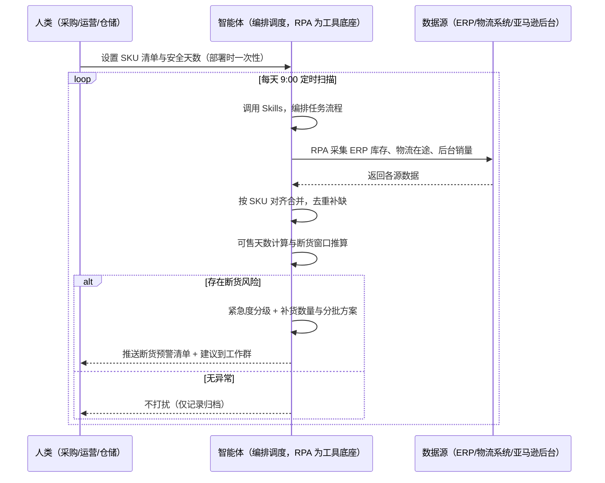
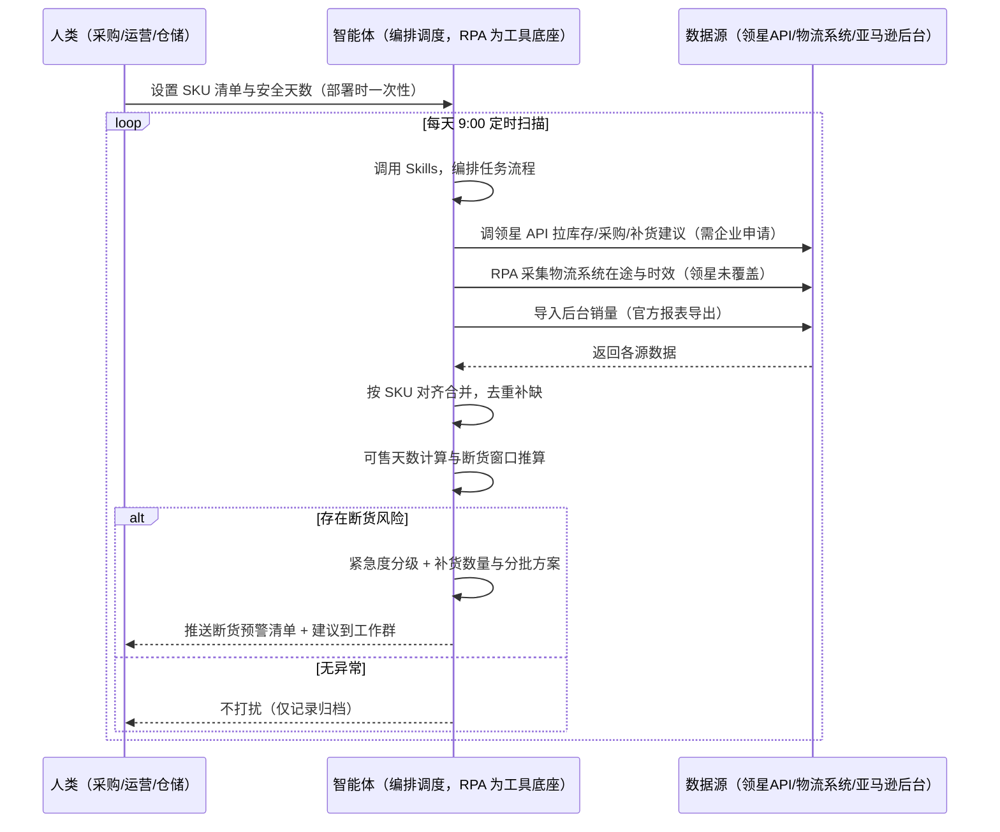

> 为亚马逊卖家团队打造的库存补货提醒方案。库存和在途数据分散在 ERP、物流系统、亚马逊后台多个系统，本方案由智能体调度多个工具统一取数，每天定时计算可售天数与断货窗口，有断货风险才推送，无异常不打扰。

> Agent 自动化需开通企业功能
> 点击申请1个月免费权限
> [点击申请 →](https://skieer.feishu.cn/share/base/form/shrcnFwMayykP5iaL38fnZKTbrg)

## 一、用户与需求

核心矛盾：库存和在途数据分散在 ERP、物流系统、亚马逊后台多个系统，运营要在它们之间反复手动执行——查完 ERP 现有库存切物流看在途、再切后台看销量，手动算可售天数，凭感觉判断该不该补货。补早了压资金，补晚了断货掉排名，两头都是损失。两类客户痛点同源，数据来源不同：

- 未购 SaaS 客户（新卖家/小团队）：人工登录 ERP 查库存、物流系统看在途、后台看销量，再手工算可售天数，全靠手；
- 已购 SaaS 客户（领星 ERP）：领星有库存预警与智能补货建议（自动生成补货方案），但多店铺/多平台库存汇总、跨系统断货窗口推算、分批方案仍要人核对。

适用客户：SKU 多、库存分散多系统、需统一补货口径的卖家。只做几个爆款、库存集中在一个系统的小卖家价值有限（人工每周看一次即可，本方案不推荐）。

### 1.1 不同模式卖家

| 类型 | 选择 | 建议 |
|-|-|-|
| 品牌 | 首选 | 强烈推荐（SKU 多、断货影响排名，需每日盯守） |
| 精铺 | 次选 | 一般推荐，聚焦主力款库存预警 |
| 铺货 | 任意 | 不推荐，SKU 太多，只盯爆款即可 |

### 1.2 不同类目卖家

| 类目 | 最关注维度 | 核心逻辑 |
|-|-|-|
| 3C 数码 | 补货周期 | 迭代快，断货窗口短，需高频预警 |
| 家居家具 | 资金占用 | 大件库存金额高，避免过度备货 |
| 美妆个护 | 效期管理 | 需结合效期判断，避免过期库存 |
| 服装鞋帽 | 季节窗口 | 换季前精准补货，避免过季积压 |
| 户外运动 | 旺季备货 | 旺季前提前预警，按季节基线补货 |
| 母婴用品 | 安全库存 | 安全敏感类目，安全天数提高，宁可多备 |

### 1.3 不同角色用户

| 用户 | 需求 | 问题 | 投入时间（估算） |
|-|-|-|-|
| 老板 | 库存资金合理、不断货 | 断货损失与积压说不清 | 0.5 小时/周 |
| 采购/运营 | 断货预警清单+补货建议 | 库存分散核对费时，补货时机难把握 | 1-3 小时/周 |
| 仓储 | 知道哪些 SKU 快断货 | 靠人工盘点，发现滞后 | 1 小时/周 |

---

## 二、现在的方法与问题

### 2.1 流程步骤与问题总结

人工方式（未购 SaaS 客户）

| 序号 | 步骤 | 现在的方法 | 问题缺陷 |
|-|-|-|-|
| 1 | 查库存 | 登录 ERP 查现有库存 | 数据分散，核对费时 |
| 2 | 看在途 | 查物流系统在途数量 | 多系统切换，易漏算 |
| 3 | 算可售 | 手工算可售天数 | 无统一口径，估算不准 |
| 4 | 判预警 | 凭感觉判断是否该补货 | 无安全天数标准，时机难把握 |
| 5 | 定补货 | 拍板补多少 | 无分批方案，空运海运组合不清 |
| 6 | 汇报 | 口头汇报断货风险 | 无清单沉淀，风险不可查 |

SaaS 方式（已购领星 ERP 客户）

| 序号 | 步骤 | 现在的方法 | 问题缺陷 |
|-|-|-|-|
| 1 | 查库存 | 领星库存预警模型（29+ 预警） | 单系统内预警，多店铺/多系统汇总缺 |
| 2 | 看在途 | 领星看采购/在途 | 物流系统在途需人工补 |
| 3 | 算可售 | 领星智能补货建议 | 已有补货方案，但多店铺统一口径与分批决策靠人 |
| 4 | 判预警 | 领星预警推送（短信/邮件/钉钉） | 单点事件告警，不跨系统归因 |
| 5 | 定补货 | 人工核对后下单 | 空运海运分批组合建议需人工算 |
| 6 | 汇报 | 领星看库存报表 | 无跨系统断货窗口汇总 |

### 2.2 问题分析

人工方式根因

| 序号 | 根因 | 具体表现 |
|-|-|-|
| 1 | 数据跨系统分散 | 库存/在途多系统，人工核对易漏 |
| 2 | 无统一预警口径 | 可售天数无标准，补货时机靠感觉 |
| 3 | 断货发现滞后 | 无每日自动预警，断货才发现 |
| 4 | 无分批方案 | 不分空运海运，资金与时效平衡不了 |
| 5 | 经验不沉淀 | 补货规则在人脑里，换人就不一样 |

SaaS 方式根因

| 序号 | 根因 | 具体表现 |
|-|-|-|
| 1 | 单系统内预警 | 领星预警覆盖自身数据，多店铺/物流系统在途不自动汇总 |
| 2 | 跨系统断货窗口缺 | 断货窗口 = 现有库存 + 在途 + 物流时效，跨系统推算靠人 |
| 3 | 分批决策靠人 | 领星给补货建议，空运/海运分批组合仍人工算 |
| 4 | 规则不跨系统沉淀 | 安全天数、分批规则在个人经验里，换人就不一样 |

---

## 三、解决方案

### 3.1 功能概述

为亚马逊卖家团队打造的智能体驱动库存补货提醒方案，解决库存和在途数据跨系统分散、人工反复手动执行、补货口径不统一的问题。

定时触发并调度多个工具，调起八爪鱼 RPA（Agent 的工具底座，能耦合多系统、完成自动化任务执行）统一取数，按 SKU 对齐合并，输出补货分析，涵盖「可售天数计算、断货窗口推算、紧急度分级、补货数量与分批方案」。每天定时扫描，有断货风险才推送，无异常不打扰。

### 3.2 系统结合

| 要素 | 说明 |
|-|-|
| 客户现有工具盘点 | 未购 SaaS 客户：无第三方工具，库存靠 ERP/物流/后台多系统人工翻。  
已购 SaaS 客户（主流组合）：领星 ERP（库存/采购/预警，开放 API 需企业申请，已有智能补货建议能力）、物流系统（在途/时效，多为独立系统） |
| 数据/能力来源 | 未购 SaaS：ERP 库存页（现有库存）+ 物流系统（在途/时效）+ 亚马逊后台（销量，官方报表导出），RPA 采集。  
已购 SaaS：领星开放 API（库存/采购/补货建议，需企业申请权限）+ 物流系统在途（RPA 采集）+ 后台销量（官方导出） |
| RPA 耦合动作 | 作为 Agent 的工具底座，按计划调度多数据源取数（API 优先 + 页面采集兜底），按 SKU 对齐去重合并，统一流转给智能体计算；任一数据源失败自动重试、异常告警 |
| 耦合出的新价值 | 单系统给不了的端到端结论：多系统库存/在途一次取齐 → 可售天数 → 跨系统断货窗口 → 紧急分级 → 分批方案，有断货风险自动推送工作群，免去人工在多系统间反复切换 |

### 3.3 智能体执行流程

用户向智能体输入会话（入参：SKU 清单）或智能体定时触发。支持两种数据通道，部署时按客户现有工具选择：

通道一：无 SaaS 方式（RPA 采集 ERP/物流/后台，适合未购领星的客户）

通道二：有 SaaS 方式（领星 API 拿库存核心，RPA 补物流在途，适合已购客户）

> Agent 自动化需开通企业功能
> 点击申请1个月免费权限
> [点击申请 →](https://skieer.feishu.cn/share/base/form/shrcnFwMayykP5iaL38fnZKTbrg)

### 3.4 为何这么设计

要同时回答三个问题：为什么不能只用 SaaS/API？为什么不能纯靠智能体写代码？ 本场景的核心是"每天定时、跨多系统取数、按 SKU 对齐、公式化计算、有风险推送、挂了有人管"。

#### 1）逐项对比

| 对比维度 | SaaS/API 堆叠（领星） | 纯智能体（智能体写代码） | 智能体+自动化工具（RPA 工具底座） |
|-|-|-|-|
| 实现方式 | 领星单系统预警+补货建议，物流在途需人工补 | 能调 API 能抓页面，数据可自拼，但全要自己接 | 一个底座跑多个流程（补货/采购/利润/选品……），数据一处对齐 |
| 多系统耦合 | 领星管自身库存，物流系统/多店铺不自动汇总 | 全自建：API 鉴权、页面采集、对齐逻辑 | 平台沉淀多源取数与对齐，可视化配置 |
| 计算与判断 | 领星有补货建议（单系统口径） | 计算逻辑自写，灵活但工程量大 | 判断交给智能体（断货窗口+分批方案），执行交给 RPA |
| 定时与推送 | 领星预警推送（单系统事件） | 调度器/进程常驻/告警通道全自建 | 平台调度稳定触发，失败重试 + 异常告警，有风险才推送 |
| 使用成本（总拥有成本） | 一系统一订阅：领星 500-1500/月……随流程数增长 | 代理 IP + 服务器 + 开发维护人力，隐性成本高 | 一份平台订阅跑所有流程，单方案边际成本 ≈ 0 |
| 维护人要求 | 低（工具已成熟） | 系统字段/阈值调整都要开发介入，团队无开发即卡死 | 可视化流程，运营自己可调安全天数、重跑任务 |

#### 2）优劣势说明

|  | SaaS/API 堆叠（领星） | 纯智能体（智能体写代码） | 智能体+自动化工具（RPA 工具底座） |
|-|-|-|-|
| 优势 | 库存数据权威、预警与补货建议成熟 | 无订阅费；  
可深度定制预测模型；  
技术上完全可行 | 一个底座跑多流程、数据一处对齐；  
跨系统断货窗口推算；分批方案可沉淀；  
调度/重试/告警开箱即用 |
| 劣势 | 单系统口径，物流/多店铺不自动汇总；  
分批决策靠人 | 库存采集与公式维护全自建，口径一变预警全错；  
AI 生成代码是生成性的，行为不完全可控 | 本地电脑运行需保持开机；  
订阅费；  
灵活性受平台模板边界限制 |

#### 3）结论

| 论点 | 说明 |
|-|-|
| 只用 SaaS/API 缺"跨系统断货窗口" | 领星解决单系统库存预警与补货建议，但断货窗口 = 现有库存 + 在途 + 物流时效，跨系统推算领星不覆盖——这是本方案的增量 |
| 纯智能体缺"工程底座" | 跨系统取数 70% 的工作在工程（采集/对齐/调度/重试），不在"写计算逻辑"；  
RPA 作为工具底座把这 70% 已经造好 |
| 一个底座跑多流程 | 客户购买 RPA 平台是跑多个流程（补货/采购/利润/选品/后台操作），本方案只是其中一个——平台订阅费被多流程摊薄，单方案边际成本接近 0 |
| 确定性 vs 生成性 | 库存采集与可售天数计算是确定性任务——同样的数据、同样的公式，要求"每天算得一致、可审计"。AI 生成的代码是生成性的，能跑通和口径长期一致是两回事 |
| 时间 | 运营要的是"每天 9:00 拿到断货预警清单"，不是"每天 9:00 修脚本"；  
判断层交给智能体，执行层交给工具底座 |

### 3.5 功能清单

| 功能 | 系统 | 功能说明（解决问题） |
|-|-|-|
| 会话/定时 | 智能体 | 1. 理解人类语言，调用已预设好的 Skills。  
2. 编排多任务、调度多工具。 |
| 多系统数据取数 | RPA、指纹浏览器 | 1. 解决库存和在途数据分散多系统、手动核对易漏问题。  
2. 作为智能体工具底座被调度执行，系统接口不通时读取本地备份表。  
3. 【无 SaaS 方式】 RPA 采集 ERP 库存页、物流系统在途、后台销量。【有 SaaS 方式】 调领星 API 拉库存/采购/补货建议（需企业申请）+ RPA 补物流在途。 |
| 数据清洗对齐 | 智能体 | 按 SKU 对齐库存字段，数据缺失的 SKU 标记待人工确认。 |
| 断货窗口推算 | 智能体 | 可售天数 = 现有库存 ÷ 日均销量（近 30 天，缺数据用近 7 天均值并标注）；断货窗口 = 现有库存 + 在途 − 日均销量 × 到货周期，叠加物流时效推算最终断货时间点。 |
| 紧急度分级 | 智能体 | 可售天数 ≤ 补货周期 + 安全天数 → 触发补货；≤7 天 → 高优先级；≤3 天 → 紧急空运加急；在途+现有 >安全库存×2 → 暂不补货。 |
| 补货分批方案 | 智能体 | 紧急批次 = 日均销量×(补货周期+安全天数)（空运小批量），常规批次 = 日均销量×30 天 − 紧急批次（海运大批量），附断货损失 vs 空运溢价对比。下单需人工确认。 |
| IM通知 | 飞书、钉钉、企微等 | 解决断货发现滞后问题。有断货风险才推送预警清单到工作群，无异常不打扰。 |
| 数据资产储存 | 本地电脑、云储存 | 1. Skills 资产：断货预警阈值与补货规则库，被调度直接调用。  
2. 数据储存：预警表.xlsx 按日沉淀，可售天数计算过程透明。  
3. 经验知识库：审核通过的补货决策持续沉淀。 |

### 3.6 智能体执行落地过程

部署时一次性配置入参（SKU 清单、安全天数、物流参数、推送群、数据通道），会话中无需重复输入。

⚠️ 部署前提（不满足则方案无法跑起来）：①RPA 需部署在常开电脑/云机上（每天定时扫描，关机即停），并配置漏跑补跑机制；②有 SaaS 方式需领星企业客户申请开放 API 权限（未开通自动降级为无 SaaS 通道，走页面采集+官方导出）；③物流系统在途数据需 RPA 登录采集，受系统登录态影响，失败自动重试；④首次配置（API 鉴权、对齐规则、安全天数）需服务方/技术人员介入一次，属实施成本。

#### 1）配置

| 类别 | 说明 |
|-|-|
| 智能体 | 主流智能体。 |
| 智能体工具 | 1. 数据通道（按客户现有工具二选一）：【无 SaaS】ERP/物流/后台（RPA 采集+官方导出）；【有 SaaS】领星开放 API（需企业申请）+ RPA 补物流在途。  
2. 数据取数与自动化执行：八爪鱼 RPA，MCP 配置完成。  
3. 数据分析：智能体自带。  
4. IM：企业办公 IM（飞书/钉钉/企微），MCP 或 webhook 配置。 |
| 工作知识 | 1. SKU 清单。  
2. 安全库存天数：默认 7 天。  
3. 预期销量波动（大促/新品起量，可填增幅%）。  
4. 空运单价：默认 \$5/kg。  
5. 海运单价：默认 \$2/kg。  
6. 单件毛利（分批建议成本对比用）。 |
| 本地数据库 | 1. 库存预警库地址。  
2. 报告库地址。  
3. 经验库地址。 |

#### 2）执行

| 任务 | 产出 | 产出物接收人 |
|-|-|-|
| 接收 SKU 清单，定时执行 | 任务启动记录 | —— |
| 调用已预设 Skills，编排任务流程 | 任务编排方案 | —— |
| 经 MCP 向八爪鱼 RPA 下发取数任务 | 自动化任务指令 | —— |
| 多源取数并按 SKU 对齐（无 SaaS：ERP/物流/后台；有 SaaS：领星 API+物流，智能体监控状态） | 对齐后库存数据 | —— |
| 可售天数计算与断货窗口推算 | 断货窗口标签 | 采购 |
| 紧急度分级与补货建议 | 补货建议清单 | 采购/运营 |
| 分批方案生成（空运/海运组合） | 分批补货方案 | 采购 |
| 推送断货预警清单（有风险才推送） | 断货预警消息 | 采购/老板 |

异常处理：

系统接口不通 → 读取本地备份表；

数据缺失 SKU → 标记待人工确认；

在途数据缺失 → 仅按现有库存计算并标注"未含在途"；

参数未填 → 用默认值计算并标注"默认假设"；

置信度 &lt;70% → 转人工复核，不输出硬结论。

#### 3）结果

| 结果 | 说明 |
|-|-|
| 数据资产 | 全量 SKU 库存预警数据（现有库存/在途/可售天数/断货窗口/紧急度/建议补货量），可审计。 |
| 分析报告 | 1. 断货预警清单：哪个 SKU 快断货、剩几天、什么级别，直接告诉团队"最该补什么"。  
2. 补货数量建议：紧急批次 = 日均销量×(补货周期+安全天数)，常规批次 = 日均销量×30 天 − 紧急批次。  
3. 分批方案：空运海运组合，附断货损失 vs 空运溢价对比。 |
| Skills | 智能体 Skills：断货预警阈值与补货规则库。 |

> Agent 自动化需开通企业功能
> 点击申请1个月免费权限
> [点击申请 →](https://skieer.feishu.cn/share/base/form/shrcnFwMayykP5iaL38fnZKTbrg)

---

## 四、使用前后预估

> 本方案价值 = 跨系统库存一次取齐 + 断货窗口推算 + 分批方案。不承诺替代补货决策——下单需人工确认。适合 SKU 多、库存分散多系统、愿配环境的卖家。

| 指标 | 人工 | SaaS/API（领星） | 智能体+自动化工具 |
|-|-|-|-|
| 库存核对耗时 | 每周 1-3 小时（估算） | 领星自动，但物流在途需人工补 | 取数全自动；人工转为审核预警（每周约 0.5 小时） |
| 预警时效 | 断货才发现 | 领星单系统预警 | 每天 9:00 跨系统扫描，有风险即推 |
| 断货窗口 | 靠感觉 | 单系统口径 | 跨系统推算（库存+在途+物流时效） |
| 补货判断 | 凭感觉 | 领星补货建议（单系统） | 可售天数数据驱动 + 分批方案 |
| 资金占用 | 过度备货 | 领星建议参考 | 分批方案平衡资金，附成本对比 |
| 方法论 | 无，换人结论不同 | 领星规则（单系统） | 可复用的 Skills 与规则库 |

说明：日均销量为历史均值（估算），断货窗口推算基于现有数据；已购领星客户以领星库存数据为主，本方案增量在跨系统断货窗口、物流在途补充与分批方案。

---

## 五、效果证明

> Agent 自动化需开通企业功能
> 点击申请1个月免费权限
> [点击申请 →](https://skieer.feishu.cn/share/base/form/shrcnFwMayykP5iaL38fnZKTbrg)

### 5.1 客户案例

**《唯世美：家具大件补货全流程自动化》**

> 首款内置 RGB 灯光展示柜上架两个月即拿下 Amazon 美加英德四站与 Walmart、Temu 美站 Best Seller。为应对数据源分散、人工操作耗时与 SKU 管理混乱，实现补货判断全流程自动化。

| 效果 | 说明 |
|-|-|
| 提效 | 补货整理重复工作量下降 80%。原本需人工从领星 ERP 与各海外仓平台逐项导出库存、库龄数据再手工清洗匹配 SKU，现在自动抓取、自动清洗，输出补货建议。 |
| 降本 | 免除人工导表与拼表的重复投入，供应链团队投入转向库存结构优化与周转率提升等重点工作。 |
| 任务 | 库存数据抓取与处理准确率达 99% 以上，分散数据源实时同步。 |
| 任务 | 自有 Excel 模板逻辑零改动保留，补货计算口径与原有习惯一致。 |

案例详情：[家具大件补货：补货全流程自动化，整理数据重复工作量下降 80%](https://skieer.feishu.cn/wiki/Gca3w8j1KixDXjkz0oScFwHAngf)

**《小天鹅：7 平台 16 账号库存数据自动化，年省成本 50 万》**

> 美的集团旗下小天鹅事业部，7 个电商平台、16 个账号、每日 86 张报表原需专员逐个登录导出 7 小时/天。八爪鱼 RPA 替代全部人工采集，7 大系统、25 类报表自动采集入库。

| 效果 | 说明 |
|-|-|
| 提效 | 多平台报表采集效率提升约 85%。原本 7 个平台 16 个账号、86 张报表需逐个登录导出，每天耗 7 小时，现在全自动采集入库；数据时效由 T+2 提升至 T+1，部分平台已 T+0。 |
| 降本 | 减少数据专员 2 人（原文：2 名全职数据专员的「搬数据」工作被完全替代，年节省人力成本 50 万元）。原本需 2 人全职导表，现在 0 人；2 名专员转岗至数据分析岗，投入库存分析、周转率优化、滞销品预警等高价值工作。 |
| 任务 | 7 个电商平台 16 个账号、25 类报表自动采集入库；错误率降至 0.1%。 |
| 任务 | 天猫指纹浏览器、苏宁每 2 小时定时抓取、京东按事业部隔离账号，多平台差异化策略稳定运行。 |

案例详情：[小天鹅：百亿级洗衣机巨头的多平台库存数据自动化实践](https://skieer.feishu.cn/wiki/Q6Qjw2FtDiNFgWkOVHacEFJ0nlh)

---

## 六、备注

### 6.1 Agent 支持

本方案不绑定具体智能体，主流 Agent 均可运行（需支持技能/Skills 加载与工具调用）：

| Agent/智能体 | 说明 |
|-|-|
| Workbuddy | 本方案运行平台，支持技能/Skills 上传加载、定时任务、MCP 工具调用与表格/报告处理 |
| 豆包（国内·字节） | 国内主流个人智能体，支持技能上传、定时任务与工具调用，上手成本低 |
| 通义千问（国内·阿里） | 支持 Agent 编排与插件生态，集成阿里电商数据能力，适合电商场景 |
| DeepSeek（国内） | 推理能力强、成本低，适合规则打分与归因分析类任务 |
| ChatGPT（国外·OpenAI） | 海外主流通用智能体，支持 GPTs/Agent 模式与工具调用 |
| Claude（国外·Anthropic） | 长文本与结构化分析能力强，原生支持 MCP 连接外部工具 |

### 6.2 名词解释

| 术语 | 说明 |
|-|-|
| 可售天数 | 现有库存 ÷ 日均销量，衡量库存还能卖多少天 |
| 断货窗口 | 叠加在途到货时间推算的最终断货时间点 |
| 安全库存天数 | 默认 7 天，低于此线触发补货 |
| 高优先级 | 可售天数 ≤7 天，需尽快补货 |
| 紧急空运加急 | 可售天数 ≤3 天，空运小批量紧急补货 |
| 分批方案 | 紧急空运小批量 + 常规海运大批量的组合补货 |
| 在途数量 | 已下单未到货的数量，计算时叠加 |
| 混合数据源 | 官方导出/API 优先（更稳更合规）+ 页面采集兜底（免费、覆盖无 SaaS 客户与 API 缺口） |
| 有 SaaS 方式 | 已购领星，开放 API 拿库存核心 + RPA 补物流在途（需企业申请权限） |
| 无 SaaS 方式 | 不购买第三方工具，由 RPA 采集 ERP/物流/后台数据 |
| ERP | Enterprise Resource Planning，企业资源计划系统 |
| MCP | Model Context Protocol，智能体连接外部工具的标准化通道 |

> Agent 自动化需开通企业功能
> 点击申请1个月免费权限
> [点击申请 →](https://skieer.feishu.cn/share/base/form/shrcnFwMayykP5iaL38fnZKTbrg)

---

原文：[查看原文](https://skieer.feishu.cn/wiki/ElrMwVBpKiWw4RkTvVJcD4Esneg)
