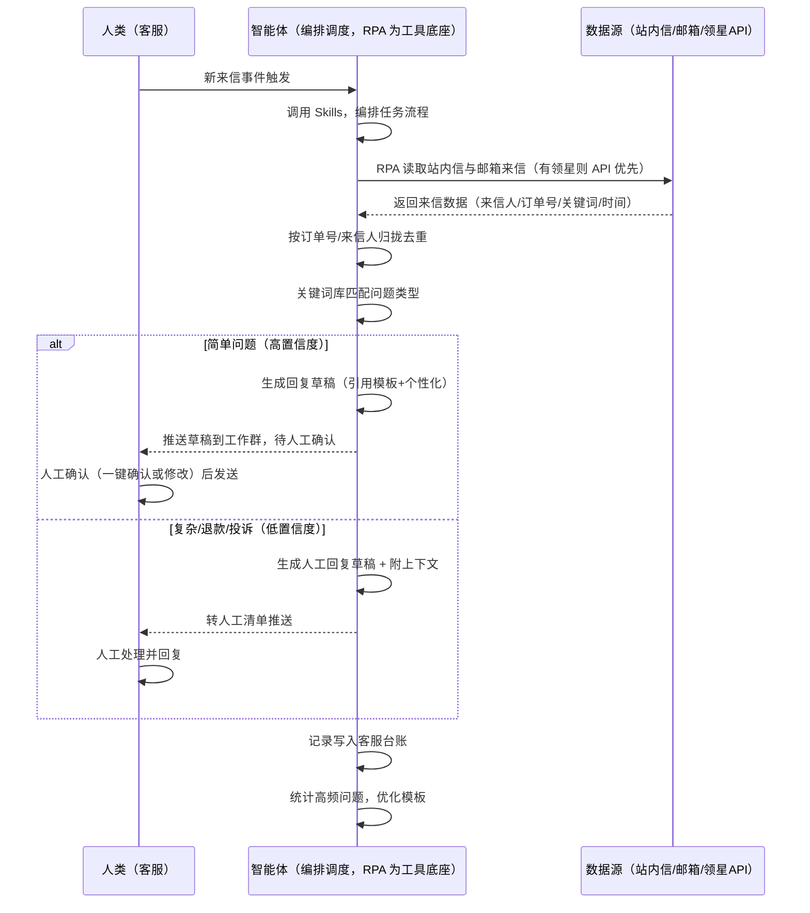

> 为亚马逊卖家团队打造的站内信与邮件自动回复方案。买家来信分散在站内信与邮箱，本方案由智能体调度多工具，统一取数、生成回复草稿，人工确认后发送（半自动）。简单问题草稿可一键确认，涉及退款/投诉等一律人工复核，回复记录写入客服台账并持续优化模板。

> Agent 自动化需开通企业功能
> 点击申请1个月免费权限
> [点击申请 →](https://skieer.feishu.cn/share/base/form/shrcnFwMayykP5iaL38fnZKTbrg)

## 一、用户与需求

核心矛盾：来信分散在站内信和邮箱，客服要反复手动执行——逐封打开读、判断问题类型、翻找对应话术、复制粘贴修改再回复。简单问题回复慢了影响体验，复杂问题转同事又慢——客服时间花在重复劳动上。

两类客户痛点同源，数据来源不同：

- 未购 SaaS 客户（新卖家/小团队）：人工逐封读信、挑模板回复，全靠手；
- 已购 SaaS 客户（领星 ERP 有客服模块、第三方客服工具）：工具能聚合来信，但回复草稿仍要人写，高频问题不沉淀。

适用客户：来信量大、需统一回复口径的卖家。来信量少的小卖家价值有限（人工回复即可，本方案不推荐）。客服量大的卖家建议用半自动模式：智能体生成草稿、人工确认后发送。

### 1.1 不同模式卖家

| 类型 | 选择 | 建议 |
|-|-|-|
| 品牌 | 首选 | 强烈推荐（来信量大、客服体验影响品牌） |
| 精铺 | 次选 | 一般推荐，聚焦主力 SKU 的来信处理 |
| 铺货 | 任意 | 不推荐，来信量少人工回复即可 |

### 1.2 不同类目卖家

| 类目 | 最关注维度 | 核心逻辑 |
|-|-|-|
| 3C 数码 | 产品咨询 | 参数咨询多，产品知识库要全 |
| 家居家具 | 物流+安装 | 大件物流与安装咨询多 |
| 美妆个护 | 合规回复 | 功效咨询回复要合规 |
| 服装鞋帽 | 尺码咨询 | 尺码/退换咨询高频 |
| 户外运动 | 售后咨询 | 功能使用咨询多 |
| 母婴用品 | 谨慎回复 | 安全类目，回复话术要克制合规 |

### 1.3 不同角色用户

| 用户 | 需求 | 问题 | 投入时间（估算） |
|-|-|-|-|
| 老板 | 回复及时、体验好 | 回复慢，差评风险 | 0.5 小时/周 |
| 客服 | 常见问题快速回复 | 逐封开信挑模板费时 | 1-3 小时/天 |
| 运营 | 高频问题沉淀 | 回复质量不一 | 0.5 小时/周 |

---

## 二、现在的方法与问题

### 2.1 流程步骤与问题总结

| 序号 | 步骤 | 现在的方法 | 问题缺陷 |
|-|-|-|-|
| 1 | 收信 | 站内信和邮箱来回切 | 渠道分散，漏信 |
| 2 | 判断 | 逐封读判断问题类型 | 分类靠人，慢 |
| 3 | 挑模板 | 翻找对应话术 | 模板找半天，版本不一 |
| 4 | 回复 | 复制粘贴修改 | 回复质量参差 |
| 5 | 转办 | 复杂问题找同事 | 转办慢，客户等 |

### 2.2 问题分析

| 序号 | 根因 | 具体表现 |
|-|-|-|
| 1 | 渠道分散 | 站内信/邮箱来回切，易漏 |
| 2 | 分类靠人 | 逐封读判断，效率低 |
| 3 | 模板混乱 | 话术散落，版本不一 |
| 4 | 回复滞后 | 简单问题也要等人工 |
| 5 | 经验不沉淀 | 高频问题不优化模板 |

---

## 三、解决方案

### 3.1 功能概述

为亚马逊卖家团队打造的智能体驱动站内信与邮件自动回复方案，解决来信分散、人工逐封处理、回复口径不统一的问题。

新来信事件触发（每 5 分钟轮询），调起八爪鱼 RPA（Agent 的工具底座，能耦合多系统、完成自动化任务执行）读取站内信与邮箱来信，输出客服回复分析，涵盖「来信自动分类、回复草稿生成、人工确认发送、复杂来信转人工、客服台账与模板优化」。半自动模式：草稿由智能体生成，发送由人工确认。

### 3.2 系统结合

| 要素 | 说明 |
|-|-|
| 客户现有工具盘点 | 未购 SaaS 客户：无第三方工具，来信全靠逐封人工处理。  
已购 SaaS 客户（主流组合）：领星 ERP（有客服/消息模块，开放 API 需企业申请）、第三方客服工具（聚合站内信+邮箱） |
| 数据/能力来源 | 未购 SaaS：亚马逊站内信后台 + 邮箱（RPA 读取来信人/订单号/问题关键词/时间）。  
已购 SaaS：领星开放 API（消息/订单数据，需企业申请）+ RPA 补站内信与邮箱（API 未覆盖字段） |
| RPA 耦合动作 | 作为 Agent 的工具底座，按事件调度多数据源取数（API 优先 + 页面采集兜底），按订单号/来信人归拢去重，统一流转给智能体分类；任一数据源失败自动重试、异常告警 |
| 耦合出的新价值 | 单工具给不了的端到端结论：多来源来信一次归拢 → 自动分类 → 回复草稿 → 人工确认发送 → 台账沉淀，免去客服逐封开信挑模板 |

### 3.3 智能体执行流程

新来信事件触发（每 5 分钟轮询）；智能体编排任务时调用已预设好的 Skills，再经 MCP 调度八爪鱼 RPA 等多个工具。

> Agent 自动化需开通企业功能
> 点击申请1个月免费权限
> [点击申请 →](https://skieer.feishu.cn/share/base/form/shrcnFwMayykP5iaL38fnZKTbrg)

### 3.4 为何这么设计

要同时回答两个问题：为什么不能只用 SaaS/API？为什么不能纯靠智能体写代码？ 本场景的核心是"事件触发、双渠道取数、按订单归拢、分类匹配、草稿生成、人工确认、台账沉淀、挂了有人管"。

#### 1）逐项对比

| 对比维度 | SaaS/API 堆叠（领星/客服工具） | 纯智能体（智能体写代码） | 智能体+自动化工具（RPA 工具底座） |
|-|-|-|-|
| 实现方式 | 客服工具聚合来信，回复草稿靠人写 | 能调 API 能读邮件，但全要自己接 | 一个底座跑多个流程（客服/售后/VOC/选品……），数据一处对齐 |
| 多来源耦合 | 站内信+邮箱+客服工具，无人归拢 | 全自建：IMAP/站内信读取、归拢逻辑 | 平台沉淀多源取数与归拢，可视化配置 |
| 分类与草稿 | 工具无分类无草稿 | 分类逻辑自写，灵活但工程量大 | 判断交给智能体（分类+草稿），执行交给 RPA（读取+记录） |
| 事件触发与台账 | 各工具单点提醒 | 轮询/调度/台账全自建 | 平台事件触发稳定，失败重试 + 异常告警，台账自动记录 |
| 使用成本（总拥有成本） | 一工具一订阅：领星 500-1500/月……随流程数增长 | 代理 IP + 服务器 + 开发维护人力，隐性成本高 | 一份平台订阅跑所有流程，单方案边际成本 ≈ 0 |
| 维护人要求 | 低 | 模板/词库调整都要开发介入 | 可视化流程，客服自己可调分类词库、模板 |

#### 2）优劣势说明

|  | SaaS/API 堆叠（领星/客服工具） | 纯智能体（智能体写代码） | 智能体+自动化工具（RPA 工具底座） |
|-|-|-|-|
| 优势 | 来信聚合、订单数据权威 | 无订阅费；  
可深度定制分类逻辑；  
技术上完全可行 | 一个底座跑多流程、数据一处对齐；  
双渠道读取/分类/草稿即开即用；  
台账自动沉淀；  
非技术人员可维护 |
| 劣势 | 无分类无草稿；  
回复口径靠人；  
不沉淀 | 双渠道读取、分类、草稿、分流全自建；  
AI 生成代码是生成性的，误回复风险不可控 | 本地电脑运行需保持开机；  
订阅费；  
灵活性受平台模板边界限制 |

#### 3）结论

| 论点 | 说明 |
|-|-|
| 只用 SaaS/API 缺"草稿与沉淀" | 领星/客服工具解决来信聚合，但"自动分类 + 回复草稿 + 高频问题沉淀"它们给不了——这是本方案的增量 |
| 纯智能体缺"工程底座" | 双渠道读取与归拢 70% 的工作在工程（IMAP/站内信/对齐/调度/重试），不在"写分类逻辑"；  
RPA 作为工具底座把这 70% 已经造好 |
| 一个底座跑多流程 | 客户购买 RPA 平台是跑多个流程（客服/售后/VOC/选品/后台操作），本方案只是其中一个——平台订阅费被多流程摊薄，单方案边际成本接近 0 |
| 半自动是安全边界 | 涉及退款金额、投诉的来信一律转人工，不自动回复；  
简单问题草稿也需人工确认后发送——自动化提升效率，但对外沟通的人工审核不能省 |
| 时间 | 客服要的是"常见问题草稿秒出、复杂问题自动转人工"，不是"逐封开信读一遍"；  
判断层交给智能体，执行层交给工具底座 |

### 3.5 功能清单

| 功能 | 系统 | 功能说明（解决问题） |
|-|-|-|
| 会话/定时 | 智能体 | 1. 理解人类语言，调用已预设好的 Skills。  
2. 编排多任务、调度多工具。 |
| 多系统数据取数 | RPA、指纹浏览器 | 1. 解决来信分散多渠道、逐封开信费时问题。  
2. 作为智能体工具底座被调度执行，模板发送失败自动重试、涉及退款金额的来信一律转人工审核。  
3. 【无 SaaS 方式】 RPA 读取站内信与邮箱来信（来信人/订单号/关键词/时间）。【有 SaaS 方式】 调领星 API 拉消息/订单（需企业申请）+ RPA 补站内信与邮箱。 |
| 数据清洗归拢 | 智能体 | 按订单号/来信人归拢，解决同一客户多渠道来信分散问题。 |
| 自动分类与草稿 | 智能体 | 关键词库匹配问题类型（物流/退换/发票/产品咨询），生成回复草稿（模板+个性化）；复杂或低置信度来信转人工，附个性化草稿与上下文。 |
| 人工确认发送 | 人工 | 草稿推送到工作群，客服一键确认或修改后发送。涉及退款金额、投诉一律人工复核后处理。 |
| 台账与模板优化 | 智能体 | 回复记录写入客服台账（来信人/订单号/问题类型/模板版本/确认人），可追溯；统计高频问题持续优化模板。 |
| IM通知 | 飞书、钉钉、企微等 | 解决复杂来信转办慢问题。草稿待确认、转人工清单、回复异常自动推送。 |
| 数据资产储存 | 本地电脑、云储存 | 1. Skills 资产：问题分类词库与回复模板库。  
2. 数据储存：客服台账统一写入本地，可追溯。  
3. 经验知识库：高频问题处理经验持续沉淀。 |

### 3.6 智能体执行落地过程

部署时配置词库与模板即可自动运行；下表其余配置项（智能体工具、Webhook、分类词库、模板）均为部署时一次性预设，会话中无需重复输入。

⚠️ 部署前提（不满足则方案无法跑起来）：①RPA 需部署在常开电脑/云机上（事件触发轮询，关机即停），并配置漏跑补跑机制；②有 SaaS 方式需领星企业客户申请开放 API 权限（未开通自动降级为无 SaaS 通道，走页面采集）；③对外回复为半自动模式：草稿由智能体生成、发送由人工确认，涉及退款/投诉一律人工复核；④首次配置（账号读取权限、词库、模板）需服务方/技术人员介入一次，属实施成本。

#### 1）配置

| 类别 | 说明 |
|-|-|
| 智能体 | 主流智能体。 |
| 智能体工具 | 1. 数据通道（按客户现有工具二选一）：【无 SaaS】站内信+邮箱（RPA 读取）；【有 SaaS】领星开放 API（需企业申请）+ RPA 补站内信与邮箱。  
2. 数据取数与自动化执行：八爪鱼 RPA，MCP 配置完成。  
3. 数据分析：智能体自带。  
4. IM：企业办公 IM（飞书/钉钉/企微），MCP 或 webhook 配置。 |
| 工作知识 | 1. 站内信/邮箱账号与读取配置。  
2. 问题分类词库：物流/退换/发票/产品咨询等。  
3. 回复模板：按问题类型预设。  
4. 置信度阈值：默认高置信度才生成可确认草稿。  
5. 转人工规则：涉及退款金额、低置信度、投诉一律转人工。  
6. 台账模板与归档路径。 |
| 本地数据库 | 1. 客服台账地址。  
2. 模板库地址。  
3. 经验库地址。 |

#### 2）执行

| 任务 | 产出 | 产出物接收人 |
|-|-|-|
| 接收来信，事件触发 | 任务启动记录 | —— |
| 调用已预设 Skills，编排任务流程 | 任务编排方案 | —— |
| 经 MCP 向八爪鱼 RPA 下发取数任务 | 自动化任务指令 | —— |
| 读取站内信/邮箱来信（智能体监控状态） | 来信数据 | —— |
| 数据清洗：按订单号/来信人归拢 | 归拢后来信 | —— |
| 关键词库匹配问题类型 | 分类结果 | 客服 |
| 高置信度来信生成回复草稿 | 草稿（待确认） | 客服 |
| 复杂/退款来信转人工（附草稿与上下文） | 转人工清单 | 客服 |
| 人工确认后发送 / 人工处理 | 回复记录 | 客服 |
| 记录写入客服台账 + 高频问题统计 | 台账更新 + 模板优化建议 | 客服/运营 |

异常处理：

模板发送失败 → 自动重试；

涉及退款金额 → 一律转人工审核；

置信度低 → 转人工并附草稿；

渠道读取失败 → 重试并告警；

模板匹配失败 → 转人工处理。

#### 3）结果

| 结果 | 说明 |
|-|-|
| 数据资产 | 全量来信结构化数据（来信人/订单号/问题类型/回复状态/模板版本/确认人），可审计。 |
| 分析报告 | 1. 回复记录：谁回的、回的什么模板、何时回、谁确认，可追溯。  
2. 转人工清单：复杂来信附个性化草稿与上下文。  
3. 高频问题统计：持续优化模板。 |
| Skills | 智能体 Skills：问题分类词库与回复模板库。 |

> Agent 自动化需开通企业功能
> 点击申请1个月免费权限
> [点击申请 →](https://skieer.feishu.cn/share/base/form/shrcnFwMayykP5iaL38fnZKTbrg)

---

## 四、使用前后预估

> 本方案价值 = 来信自动归拢 + 分类草稿 + 人工确认 + 台账沉淀。半自动模式保留人工审核，对外沟通不省人工把关。适合来信量大、愿配环境的卖家。

| 指标 | 人工 | SaaS/API（领星/客服工具） | 智能体+自动化工具（半自动） |
|-|-|-|-|
| 回复耗时 | 每天 1-3 小时（估算） | 聚合来信，草稿靠人写 | 草稿自动生成，人工确认（省 60-80% 时间） |
| 响应时效 | 逐封排队，慢 | 聚合后仍人回 | 草稿秒出，确认即回 |
| 分类准确 | 靠人读，易错 | 无分类 | 词库自动分类，口径统一 |
| 退款风险 | 误回退款承诺 | 无自动回复风险 | 涉及退款一律转人工，合规可控 |
| 台账追溯 | 回复散落 | 工具内记录 | 台账可查（含确认人） |
| 方法论 | 无，换人结论不同 | 工具内规则 | 可复用的 Skills 与规则库 |

说明：来信内容为准确字段（读取时点值）；分类与草稿为智能体辅助，最终回复由人工确认后发送；涉及退款金额、投诉的来信一律人工复核，不自动回复。

---

## 五、效果证明

> Agent 自动化需开通企业功能
> 点击申请1个月免费权限
> [点击申请 →](https://skieer.feishu.cn/share/base/form/shrcnFwMayykP5iaL38fnZKTbrg)

### 5.1 客户案例

**《AI 智能回评：多平台多店铺评论自动回复》**

> 某纸巾品牌在 3 个平台拥有 22 家店铺，每天后台收到上千条评论，部分平台要求中差评 24 小时内回复，人工逐一回复压力大。RPA 自动打开后台、AI 识别好差评并生成话术逐一回复。

| 效果 | 说明 |
|-|-|
| 提效 | 多平台多店铺评论回复由人工逐条处理变为 24×7 自动响应。原本需人工切换店铺后台逐条查看并回复，现在自动获取评价内容并按话术库自动回复。 |
| 降本 | 免除客服逐条回评的重复投入，投入转向复杂评价处理与客户关系维护等重点工作。 |
| 任务 | 支持多店铺后台自动切换登录，批量获取评价内容并统一回复口径。 |
| 任务 | 回复话术按店铺与场景配置，提升店铺 DSR 与客户满意度。 |

案例详情：[回评|AI智能回评自动化应用方案|八爪鱼RPA](https://skieer.feishu.cn/wiki/Xrg6wWsNYiUDNrk7Gs5cTYLpnof)

### 5.2 DEMO应用

Amazon-自动获取买家消息数量-紫鸟浏览器：https://rpa.bazhuayu.com/appstore/app/nailong/amazon--zi-dong-huo-qu-mai-jia-xiao-xi-shu-liang-zi-niao-liu

---

## 六、备注

### 6.1 Agent 支持

本方案不绑定具体智能体，主流 Agent 均可运行（需支持技能/Skills 加载与工具调用）：

| Agent/智能体 | 说明 |
|-|-|
| Workbuddy | 本方案运行平台，支持技能/Skills 上传加载、定时任务、MCP 工具调用与表格/报告处理 |
| 豆包（国内·字节） | 国内主流个人智能体，支持技能上传、定时任务与工具调用，上手成本低 |
| 通义千问（国内·阿里） | 支持 Agent 编排与插件生态，集成阿里电商数据能力，适合电商场景 |
| DeepSeek（国内） | 推理能力强、成本低，适合规则打分与归因分析类任务 |
| ChatGPT（国外·OpenAI） | 海外主流通用智能体，支持 GPTs/Agent 模式与工具调用 |
| Claude（国外·Anthropic） | 长文本与结构化分析能力强，原生支持 MCP 连接外部工具 |

### 6.2 名词解释

| 术语 | 说明 |
|-|-|
| 站内信 | 亚马逊站内买家消息系统 |
| 问题分类词库 | 按关键词匹配问题类型（物流/退换/发票/产品咨询）的规则库 |
| 置信度 | 分类匹配的可靠程度，默认高置信度才生成可确认草稿 |
| 回复模板 | 按问题类型预设的标准话术 |
| 客服台账 | 来信与回复的记录表（含确认人） |
| 转人工 | 复杂/退款/低置信度来信分流给人工客服 |
| 半自动 | 草稿由智能体生成、发送由人工确认的回复模式 |
| 高频问题 | 出现频次高的问题类型，优先优化模板 |
| 个性化草稿 | 转人工来信附带的人工回复初稿 |
| 混合数据源 | 官方导出/API 优先（更稳更合规）+ 页面采集兜底（免费、覆盖无 SaaS 客户与 API 缺口） |
| 有 SaaS 方式 | 已购领星，开放 API 拿消息/订单 + RPA 补站内信与邮箱（需企业申请权限） |
| 无 SaaS 方式 | 不购买第三方工具，由 RPA 读取站内信与邮箱 |
| MCP | Model Context Protocol，智能体连接外部工具的标准化通道 |
| 指纹浏览器 | 隔离 Cookie/浏览器指纹的工具，多店铺防关联 |

> Agent 自动化需开通企业功能
> 点击申请1个月免费权限
> [点击申请 →](https://skieer.feishu.cn/share/base/form/shrcnFwMayykP5iaL38fnZKTbrg)

---

原文：[查看原文](https://skieer.feishu.cn/wiki/BT0mwPfSciN4mYkBeqAc0URPnnh)
