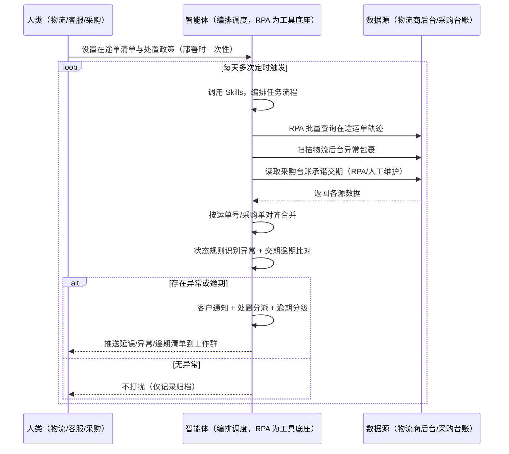
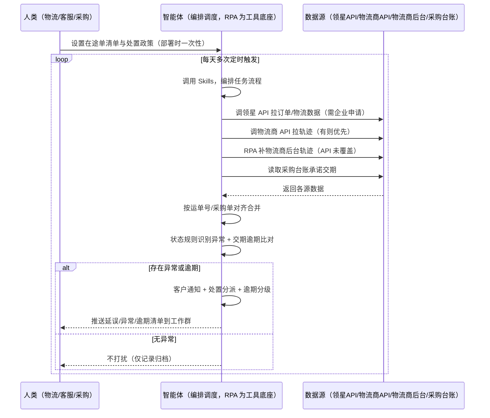

> 为亚马逊卖家团队打造的物流跟踪与异常件处理方案。物流轨迹分散在多个物流商系统，异常包裹靠人工翻找，供应商交期靠逐个催问，本方案由智能体调度多个工具完成自动化任务，每日多次批量查询，延误与异常才推送，自动跟进至闭环。

> Agent 自动化需开通企业功能
> 点击申请1个月免费权限
> [点击申请 →](https://skieer.feishu.cn/share/base/form/shrcnFwMayykP5iaL38fnZKTbrg)

## 一、用户与需求

核心矛盾：快递单号要逐个查、延误异常手动记录、客户通知不及时；异常包裹还要人工翻物流后台找、手动安排处理流程；供应商交期靠逐个催问、逾期难及时发现——一个包裹滞留几天，客户差评就来了；一批货延期，补货窗口错过排名就掉了。两类客户痛点同源，数据来源不同：

- 未购 SaaS 客户（新卖家/小团队）：人工逐个输运单号查轨迹、手动记延误、翻物流后台找异常件，全靠手；
- 已购 SaaS 客户（领星 ERP 管订单、有物流模块）：领星有订单与部分物流数据，但多物流商轨迹批量查询、异常件扫描分派、供应商交期逾期预警仍要人做。

适用客户：订单量大、在途单多、需系统化物流跟踪的卖家。单量少的小卖家价值有限（人工跟得过来，本方案不推荐）。

### 1.1 不同模式卖家

| 类型 | 选择 | 建议 |
|-|-|-|
| 品牌 | 首选 | 强烈推荐（订单量大、在途单多，跟踪频次高） |
| 精铺 | 次选 | 一般推荐，聚焦主力渠道在途单 |
| 铺货 | 任意 | 不推荐，单量少人工跟得过来 |

### 1.2 不同类目卖家

| 类目 | 最关注维度 | 核心逻辑 |
|-|-|-|
| 3C 数码 | 高价值理赔 | 货值高，异常件理赔金额大 |
| 家居家具 | 破损处理 | 大件易破损，破损理赔是重点 |
| 美妆个护 | 时效安抚 | 时效敏感，延误客户安抚要及时 |
| 服装鞋帽 | 派送失败 | 款式季性强，派送失败影响体验 |
| 户外运动 | 滞留监控 | 功能件大件滞留占仓，要及时催派 |
| 母婴用品 | 异常升级 | 安全类目，异常件处理要快 |

### 1.3 不同角色用户

| 用户 | 需求 | 问题 | 投入时间（估算） |
|-|-|-|-|
| 老板 | 不丢件、不差评、不断货 | 异常处理慢，客户流失 | 0.5 小时/周 |
| 物流/客服 | 延误清单+处置任务+逾期清单 | 逐个查单、手动跟进费时 | 1-3 小时/天 |
| 采购 | 供应商交期逾期预警 | 逐个催问费时，记录易乱 | 1-3 小时/周 |
| 财务 | 理赔及时 | 破损丢失理赔遗漏 | 0.5 小时/周 |

---

## 二、现在的方法与问题

### 2.1 流程步骤与问题总结

**人工方式（未购 SaaS 客户）**

| 序号 | 步骤 | 现在的方法 | 问题缺陷 |
|-|-|-|-|
| 1 | 查轨迹 | 逐个输运单号查 | 单多查不完，延误发现晚 |
| 2 | 记异常 | 手动记录延误包裹 | 记录不全，易漏 |
| 3 | 通知客户 | 客户问起才解释 | 通知不及时，客户差评 |
| 4 | 找异常件 | 人工翻物流后台 | 滞留破损包裹靠翻，易漏 |
| 5 | 安排处置 | 手动走理赔/催派流程 | 流程繁琐，跟进靠盯 |
| 6 | 查供应商交期 | 逐个催问供应商发货进度 | 靠人工催问，逾期发现滞后 |

**SaaS 方式（已购领星 ERP 客户）**

| 序号 | 步骤 | 现在的方法 | 问题缺陷 |
|-|-|-|-|
| 1 | 查轨迹 | 领星有部分物流数据 | 多物流商轨迹批量查询靠人 |
| 2 | 记异常 | 手动记录 | 记录不全，易漏 |
| 3 | 通知客户 | 客户问起才解释 | 通知不及时 |
| 4 | 找异常件 | 人工翻物流后台 | 异常件扫描分派靠人 |
| 5 | 安排处置 | 手动走流程 | 跟进靠盯 |
| 6 | 查供应商交期 | 领星有采购数据，实际到货对比靠人 | 逾期预警不自动 |

### 2.2 问题分析

**人工方式根因**

| 序号 | 根因 | 具体表现 |
|-|-|-|
| 1 | 查询靠手 | 逐个查单，在途单多查不完 |
| 2 | 无状态规则 | 滞留/失败/退回识别靠人 |
| 3 | 通知滞后 | 客户问起才解释，差评风险 |
| 4 | 异常件分散 | 滞留破损包裹人工翻找易漏 |
| 5 | 处置无跟进 | 理赔/催派流程靠盯，易拖 |
| 6 | 交期靠催问 | 承诺交期与实际到货不自动对比 |

**SaaS 方式根因**

| 序号 | 根因 | 具体表现 |
|-|-|-|
| 1 | 多物流商不统一 | 领星数据单系统，多物流商轨迹批量查询靠人 |
| 2 | 单点数据不归因 | 有物流数据，但异常识别与分派靠人 |
| 3 | 交期不自动对比 | 承诺交期与实际到货的逾期预警靠人盯 |

---

## 三、解决方案

### 3.1 功能概述

为亚马逊卖家团队打造的智能体驱动物流跟踪与异常件处理方案，解决物流轨迹跨系统分散、人工反复手动执行、异常发现滞后的问题。

定时触发并调度多个工具，调起八爪鱼 RPA（Agent 的工具底座，能耦合多系统、完成自动化任务执行）统一取数，按运单号/采购单对齐合并，输出物流跟踪分析，涵盖「轨迹批量查询、异常状态识别、客户自动通知、异常件分级分派、处置自动跟进、供应商交期逾期预警」。每日多次批量查询，延误与异常才推送。

### 3.2 系统结合

| 要素 | 说明 |
|-|-|
| 客户现有工具盘点 | 未购 SaaS 客户：无第三方工具，轨迹全靠逐个查。   已购 SaaS 客户（主流组合）：领星 ERP（订单/物流模块数据，开放 API 需企业申请）、各物流商系统（UPS/DHL/FedEx/海外仓，前台轨迹可查或有 API） |
| 数据/能力来源 | 未购 SaaS：物流商后台轨迹查询页（RPA 采集）+ 采购台账（承诺交期，本地 Excel）。   已购 SaaS：领星开放 API（订单/物流数据，需企业申请）+ 物流商 API（有则优先，按接口付费）+ RPA 后台采集兜底 + 采购台账交期对比 |
| RPA 耦合动作 | 作为 Agent 的工具底座，按计划调度多数据源取数（API 优先 + 后台采集兜底），按运单号/采购单对齐去重合并，统一流转给智能体分析；任一数据源失败自动重试、异常告警 |
| 耦合出的新价值 | 单系统给不了的端到端结论：多物流商轨迹一次取齐 → 异常识别 → 客户通知 → 处置分派 → 跟进闭环 → 供应商交期逾期预警，延误与异常自动推送工作群，免去人工逐个查单盯流程 |

### 3.3 智能体执行流程

用户向智能体输入会话（入参：在途运单清单 + 处置政策）或智能体定时触发扫异常件。支持两种数据通道，部署时按客户现有工具选择：

通道一：无 SaaS 方式（RPA 采集物流商后台，适合未购领星的客户）

通道二：有 SaaS 方式（领星/物流商 API 拿核心，RPA 后台兜底，适合已购客户）

> Agent 自动化需开通企业功能
> 点击申请1个月免费权限
> [点击申请 →](https://skieer.feishu.cn/share/base/form/shrcnFwMayykP5iaL38fnZKTbrg)

### 3.4 为何这么设计

要同时回答三个问题：为什么不能只用 SaaS/API？为什么不能纯靠智能体写代码？ 本场景的核心是"每日高频定时、跨多系统取数、按运单号/采购单对齐、规则判定、通知跟进、挂了有人管"。

#### 1）逐项对比

| 对比维度 | SaaS/API 堆叠（领星/物流商 API） | 纯智能体（智能体写代码） | 智能体+自动化工具（RPA 工具底座） |
|-|-|-|-|
| 实现方式 | 领星管订单、各物流商 API 各管一段，人工对照 | 能调 API 能抓后台，数据可自拼，但全要自己接 | 一个底座跑多个流程（物流/订单/售后/选品……），数据一处对齐 |
| 多系统耦合 | 多物流商 + 领星各自为政，无人组装 | 全自建：API 鉴权、后台采集、对齐逻辑 | 平台沉淀多源取数与对齐，可视化配置 |
| 判定与跟进 | 物流商 API 给轨迹不解释；领星有部分数据 | 判定逻辑自写，灵活但工程量大 | 判断交给智能体（异常识别+分派+交期逾期），执行交给 RPA |
| 定时与推送 | 各系统单点查询，无跨系统结论推送 | 调度器/进程常驻/告警通道全自建 | 平台调度稳定触发，失败重试 + 异常告警，有异常才推送 |
| 使用成本（总拥有成本） | 一系统一订阅：物流商 API 按接口付费 + 领星 500-1500/月……随流程数增长 | 代理 IP + 服务器 + 开发维护人力，隐性成本高 | 一份平台订阅跑所有流程，单方案边际成本 ≈ 0 |
| 维护人要求 | 低（工具已成熟） | 每次接口变更/规则调整都要开发介入 | 可视化流程，物流自己可调阈值、处置政策 |

#### 2）优劣势说明

|  | SaaS/API 堆叠（领星/物流商 API） | 纯智能体（智能体写代码） | 智能体+自动化工具（RPA 工具底座） |
|-|-|-|-|
| 优势 | 物流轨迹数据权威、接口稳定 | 无订阅费；   可深度定制判定逻辑；   技术上完全可行 | 一个底座跑多流程、数据一处对齐；   批量查询/状态判定/通知跟进即开即用；   非技术人员可维护 |
| 劣势 | 多系统各自为政；   异常识别分派靠人；   交期不自动对比；   接口订阅成本随流程数增长 | 接口对接、判定、通知、跟进全自建；   AI 生成代码是生成性的，漏判风险不可控 | 本地电脑运行需保持开机；   订阅费；   灵活性受平台模板边界限制 |

#### 3）结论

| 论点 | 说明 |
|-|-|
| 只用 SaaS/API 缺"跨系统归因与跟进" | 领星/物流商 API 解决数据获取，但"异常识别 → 客户通知 → 处置分派 → 跟进闭环 → 交期逾期预警"跨系统链路它们给不了——这是本方案的增量 |
| 纯智能体缺"工程底座" | 多系统取数 70% 的工作在工程（接口对接/采集/对齐/调度/重试），不在"写判定逻辑"；RPA 作为工具底座把这 70% 已经造好 |
| 一个底座跑多流程 | 客户购买 RPA 平台是跑多个流程（物流/订单/售后/选品/后台操作），本方案只是其中一个——平台订阅费被多流程摊薄，单方案边际成本接近 0 |
| 确定性 vs 生成性 | 轨迹判定与异常分派是确定性任务——同样的状态，要求"每次判定一致、不重不漏"。RPA 流程行为可预期，AI 生成的代码能跑通 ≠ 长期不漏判 |
| 时间 | 物流要的是"延误自动通知、异常自动分派跟进"，不是"每天手动查单盯流程"；判断层交给智能体，执行层交给工具底座 |

### 3.5 功能清单

| 功能 | 系统 | 功能说明（解决问题） |
|-|-|-|
| 会话/定时 | 智能体 | 1. 理解人类语言，调用已预设好的 Skills。   2. 编排多任务、调度多工具。 |
| 多系统数据取数 | RPA、指纹浏览器 | 1. 解决逐个查单、异常件靠翻问题。   2. 作为智能体工具底座被调度执行，单号查询失败重试 3 次、物流接口维护时延后查询并标注。   3. 【无 SaaS 方式】 RPA 批量查询物流商后台轨迹 + 扫描异常包裹 + 读取采购台账。【有 SaaS 方式】 调领星 API 拉订单/物流（需企业申请）+ 调物流商 API 拉轨迹（有则优先）+ RPA 后台兜底。 |
| 数据清洗对齐 | 智能体 | 按运单号/采购单对齐去重，解决多物流商状态口径不一致问题。 |
| 异常识别 | 智能体 | 滞留超 48 小时 → 黄色延误；派送失败 → 红色异常；   退回 → 红色立即排查；预计超到货日 3 天 → 延误预警。 |
| 客户通知 | 智能体 | 延误包裹自动通知客户（按异常类型预设模板，附补偿分级 >7 天发优惠券）。通知内容需合规，人工可审核。 |
| 处置分派与跟进 | 智能体 | 破损走理赔（≥\$50 申请物流理赔）、滞留走催派、地址错走改址；   客户投诉/高价值 → A 级立即处理；   处置超 3 天未完成 → 黄色升级；   自动跟进至签收/关闭。 |
| 交期逾期预警 | 智能体 | 采购台账承诺交期 vs 实际到货进度对比：   逾期 ≤3 天 → 黄色预警；>3 天 → 橙色催单；   >7 天 → 红色升级（影响补货窗口），生成催单邮件草稿。   催单由人工确认发送。 |
| IM通知 | 飞书、钉钉、企微等 | 解决延误通知不及时、异常处理无跟进问题。有异常才推送延误清单、处置任务单、逾期清单到处理群，无异常不打扰。 |
| 数据资产储存 | 本地电脑、云储存 | 1. Skills 资产：物流异常判定规则、安抚话术库、交期预警规则。   2. 数据储存：物流状态表与处置记录统一写入本地，可追溯。   3. 经验知识库：高频异常处理经验持续沉淀。 |

### 3.6 智能体执行落地过程

部署时一次性配置入参（在途运单清单、处置政策、交期台账、推送群、数据通道），会话中无需重复输入。

⚠️ 部署前提（不满足则方案无法跑起来）：

①RPA 需部署在常开电脑/云机上（每日多次定时，关机即停），并配置漏跑补跑机制；

②有 SaaS 方式需领星企业客户申请开放 API 权限或物流商 API 付费账号（未开通自动降级为无 SaaS 通道，走后台采集）；

③供应商交期比对需维护采购台账（承诺交期/采购单号），无台账则仅做物流异常跟踪；

④首次配置（API 鉴权、对齐规则、判定阈值）需服务方/技术人员介入一次，属实施成本。

#### 1）配置

| 类别 | 说明 |
|-|-|
| 智能体 | 主流智能体。 |
| 智能体工具 | 1. 数据通道（按客户现有工具二选一）：【无 SaaS】物流商后台（RPA 采集）+ 采购台账；【有 SaaS】领星开放 API（需企业申请）+ 物流商 API（有则优先）+ RPA 后台兜底。   2. 数据取数与自动化执行：八爪鱼 RPA，MCP 配置完成。   3. 数据分析：智能体自带。   4. IM：企业办公 IM（飞书/钉钉/企微），MCP 或 webhook 配置。 |
| 工作知识 | 1. 在途运单清单与物流商列表。   2. 滞留判定阈值：默认 48 小时无更新。   3. 延误预警：预计超到货日 3 天。   4. 处置政策：默认破损补发、丢失退款、信息错误修正后重发。   5. 理赔门槛：默认 ≥\$50。   6. 客户通知模板：按异常类型预设，附补偿分级（>7 天发优惠券）。   7. 交期逾期阈值：≤3 天预警 / >3 天催单 / >7 天升级。 |
| 本地数据库 | 1. 物流状态表地址。   2. 处置记录地址。   3. 采购台账地址。   4. 经验库地址。 |

#### 2）执行

| 任务 | 产出 | 产出物接收人 |
|-|-|-|
| 接收在途运单清单，定时触发 | 任务启动记录 | —— |
| 调用已预设 Skills，编排任务流程 | 任务编排方案 | —— |
| 经 MCP 向八爪鱼 RPA 下发取数任务 | 自动化任务指令 | —— |
| 多源取数并按运单号/采购单对齐（无 SaaS：物流商后台+台账；有 SaaS：领星/物流商 API+后台兜底，智能体监控状态） | 对齐后物流数据 | —— |
| 状态规则识别异常（滞留/失败/退回） | 延误清单 | 物流/客服 |
| 交期逾期比对（台账承诺 vs 实际到货） | 逾期清单 | 采购 |
| 延误包裹自动通知客户 | 客户通知记录 | 客服 |
| 扫描物流后台异常包裹 | 异常件数据 | —— |
| 按异常类型分派处置流程 | 处置任务单 | 物流/客服 |
| 自动跟进至签收/关闭（有异常才推送） | 跟进记录 | 物流/客服/采购 |

异常处理：

单号查询失败 → 重试 3 次；

物流接口维护 → 延后查询并标注覆盖率；

无法自动分类的包裹 → 转人工处理；

理赔被拒 → 自动升级提醒；

处置超 3 天未完成 → 黄色升级；交期台账缺失 → 仅做物流异常跟踪并标注；

置信度 &lt;70% → 转人工复核，不输出硬结论。

#### 3）结果

| 结果 | 说明 |
|-|-|
| 数据资产 | 全量物流结构化数据（运单号/轨迹/状态/异常类型/处置状态/客户通知记录/交期对比），可审计。 |
| 分析报告 | 1. 物流状态表：全部在途单实时状态可查。   2. 延误清单：滞留/失败/退回包裹附原因与通知记录。   3. 处置任务单：破损理赔/滞留催派/地址改址分派清晰。   4. 交期逾期清单：逾期天数分级（预警/催单/升级）+ 催单邮件草稿。   5. 异常报告：异常率与物流商风险标记（异常率 >5%）。 |
| Skills | 智能体 Skills：物流异常判定规则、安抚话术库、交期预警规则。 |

> Agent 自动化需开通企业功能
> 点击申请1个月免费权限
> [点击申请 →](https://skieer.feishu.cn/share/base/form/shrcnFwMayykP5iaL38fnZKTbrg)

---

## 四、使用前后预估

> 本方案价值 = 多系统轨迹一次取齐 + 异常识别分派 + 客户通知 + 交期逾期预警。不承诺替代人工处置——对外通知与催单由人工确认。适合订单量大、在途单多、愿配环境的卖家。

| 指标 | 人工 | SaaS/API（领星/物流商 API） | 智能体+自动化工具 |
|-|-|-|-|
| 跟踪耗时 | 每天 1-3 小时（估算） | 数据自动但识别分派靠人 | 全自动；人工转为审核通知（每天约 0.5 小时） |
| 延误发现 | 客户问起才知道 | 单系统数据，无跨系统判定 | 48 小时规则自动识别，提前发现 |
| 客户通知 | 不及时，差评 | 无自动通知 | 自动通知附安抚文案 |
| 异常处理 | 靠翻靠盯 | 单系统数据 | 自动分派跟进闭环，不漏不拖 |
| 交期逾期 | 靠催问，发现滞后 | 领星有采购数据，对比靠人 | 台账自动比对，分级预警 + 催单草稿 |
| 方法论 | 无，换人结论不同 | 工具内规则（不可跨系统复用） | 可复用的 Skills 与规则库 |

说明：物流轨迹来自物流商后台/API（准确字段，采集时点值）；供应商交期比对依赖采购台账（人工维护承诺交期），逾期分级为规则判断；对外通知与催单保留人工确认。

---

## 五、效果证明

> Agent 自动化需开通企业功能
> 点击申请1个月免费权限
> [点击申请 →](https://skieer.feishu.cn/share/base/form/shrcnFwMayykP5iaL38fnZKTbrg)

### 5.1 客户案例

**《云仓物流状态同步：微信 – 飞书 – 物流群全链路自动化》**

> 涉及多个客户群与数十个快递群，高峰期每分钟都有新消息弹出，客服需在微信、飞书、快递系统、OMS 间反复切换，单条消息处理耗时 2-3 分钟。

| 效果 | 说明 |
|-|-|
| 提效 | 物流信息处理由人工盯群变为自动流转。原本客服需同时盯数十个客户群与快递群，单条消息处理耗时 2-3 分钟，现在机器人 7×24 自动处理，覆盖拦截、查询、改地址等 7 大场景。 |
| 降本 | 日均节省 2-3 小时/人的无效盯群时间，人力投入转向异常件处理与客户关系维护等重点工作。 |
| 任务 | 打通微信 – 飞书 – 物流群全链路，微信群消息与飞书指令自动流转分发。 |
| 任务 | 降低手工复制单号导致的错漏，减少退款率与赔付损失。 |

案例详情：[云仓物流状态同步](https://skieer.feishu.cn/wiki/OKy0wkYLximV2rkRCqRcl7FcnUh)

---

## 六、备注

### 6.1 Agent 支持

本方案不绑定具体智能体，主流 Agent 均可运行（需支持技能/Skills 加载与工具调用）：

| Agent/智能体 | 说明 |
|-|-|
| Workbuddy | 本方案运行平台，支持技能/Skills 上传加载、定时任务、MCP 工具调用与表格/报告处理 |
| 豆包（国内·字节） | 国内主流个人智能体，支持技能上传、定时任务与工具调用，上手成本低 |
| 通义千问（国内·阿里） | 支持 Agent 编排与插件生态，集成阿里电商数据能力，适合电商场景 |
| DeepSeek（国内） | 推理能力强、成本低，适合规则打分与归因分析类任务 |
| ChatGPT（国外·OpenAI） | 海外主流通用智能体，支持 GPTs/Agent 模式与工具调用 |
| Claude（国外·Anthropic） | 长文本与结构化分析能力强，原生支持 MCP 连接外部工具 |

### 6.2 名词解释

| 术语 | 说明 |
|-|-|
| 在途运单 | 已发货未签收的包裹运单 |
| 物流轨迹 | 包裹的物流流转记录（位置/状态/时间） |
| 滞留 | 运单超 48 小时无状态更新 |
| 派送失败 | 快递员派送不成功，需重新安排 |
| 退回 | 包裹因各种原因退回发货地 |
| 异常件 | 滞留、破损、信息不全、地址错误的包裹 |
| 理赔 | 向物流商申请破损/丢失赔偿，默认 ≥\$50 触发 |
| 处置任务单 | 按异常类型生成的处置任务，跟进至闭环 |
| 安抚文案 | 给客户的延误解释话术，含补偿分级 |
| 交期逾期 | 实际到货超过台账承诺交期，按逾期天数分级预警/催单/升级 |
| 异常率 | 异常包裹占全部包裹的比例，>5% 标记物流商风险 |
| 混合数据源 | 官方导出/API 优先（更稳更合规）+ 后台采集兜底（免费、覆盖无 SaaS 客户与 API 缺口） |
| 有 SaaS 方式 | 已购领星/物流商 API，开放接口拿核心数据 + RPA 后台兜底（需企业申请权限） |
| 无 SaaS 方式 | 不购买第三方工具，由 RPA 采集物流商后台 + 采购台账 |
| MCP | Model Context Protocol，智能体连接外部工具的标准化通道 |
| 指纹浏览器 | 隔离 Cookie/浏览器指纹的工具，多店铺防关联 |

> Agent 自动化需开通企业功能
> 点击申请1个月免费权限
> [点击申请 →](https://skieer.feishu.cn/share/base/form/shrcnFwMayykP5iaL38fnZKTbrg)

---

原文：[查看原文](https://skieer.feishu.cn/wiki/LhEswWbzjidOv1kp9rVclTfAntb)
