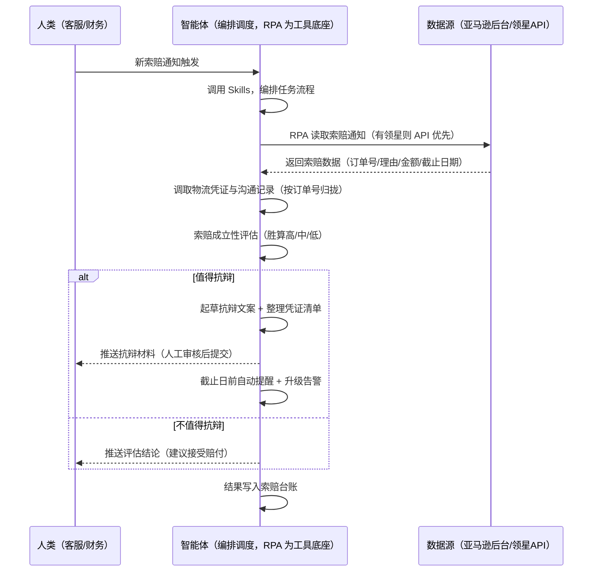

> 为亚马逊卖家团队打造的 A-to-z 索赔处理方案。索赔通知来了要手动查凭证、准备应对材料，漏掉截止时间就可能被判赔，本方案由智能体调度多个工具统一取数，索赔事件触发，有索赔才推送，不遗漏、不超期、抗辩有据。

> Agent 自动化需开通企业功能
> 点击申请1个月免费权限
> [点击申请 →](https://skieer.feishu.cn/share/base/form/shrcnFwMayykP5iaL38fnZKTbrg)

## 一、用户与需求

核心矛盾：索赔通知来了要手动查凭证、准备应对材料，漏掉截止时间就可能被判赔——一个本可抗辩成功的索赔，因为超期或材料不全直接赔钱。两类客户痛点同源，数据来源不同：

- 未购 SaaS 客户（新卖家/小团队）：人工关注索赔通知邮件、翻物流/聊天记录、凭经验判断该不该抗辩、手动写材料记截止时间，全靠手；
- 已购 SaaS 客户（领星 ERP 管订单/物流）：领星有订单与物流数据，但索赔成立性评估、抗辩材料组装、截止日管理仍要人做。

适用客户：订单量大、索赔概率高的卖家。索赔少的小卖家价值有限（人工处理即可，本方案不推荐）。

### 1.1 不同模式卖家

| 类型 | 选择 | 建议 |
|-|-|-|
| 品牌 | 首选 | 强烈推荐（订单量大、索赔概率高） |
| 精铺 | 次选 | 一般推荐，聚焦主力 SKU 索赔处理 |
| 铺货 | 任意 | 不推荐，索赔少人工处理即可 |

### 1.2 不同类目卖家

| 类目 | 最关注维度 | 核心逻辑 |
|-|-|-|
| 3C 数码 | 金额+证据 | 货值高，抗辩材料要全 |
| 家居家具 | 物流证据 | 大件物流问题索赔，签收证明是关键 |
| 美妆个护 | 描述证据 | 描述不符索赔，看产品描述截图 |
| 服装鞋帽 | 误判索赔 | 尺码/颜色误判，抗辩空间大 |
| 户外运动 | 功能证据 | 功能问题索赔，看产品说明与沟通记录 |
| 母婴用品 | 从严处理 | 安全类目，索赔处理谨慎合规 |

### 1.3 不同角色用户

| 用户 | 需求 | 问题 | 投入时间（估算） |
|-|-|-|-|
| 老板 | 少赔钱、不被判赔 | 索赔超期被判赔 | 0.5 小时/周 |
| 客服 | 抗辩材料就绪 | 手动查凭证费时 | 1-2 小时/周 |
| 财务 | 索赔金额可控 | 赔了不知道为什么 | 0.5 小时/周 |

---

## 二、现在的方法与问题

### 2.1 流程步骤与问题总结

| 序号 | 步骤 | 现在的方法 | 问题缺陷 |
|-|-|-|-|
| 1 | 收通知 | 关注索赔通知邮件 | 通知分散，容易漏 |
| 2 | 查凭证 | 手动翻物流/聊天记录 | 凭证分散，收集费时 |
| 3 | 判胜算 | 凭经验判断该不该抗辩 | 胜算评估无口径 |
| 4 | 写材料 | 手动起草抗辩文案 | 文案无模板，质量不一 |
| 5 | 提交 | 记截止时间手动提交 | 漏掉截止时间被判赔 |

### 2.2 问题分析

| 序号 | 根因 | 具体表现 |
|-|-|-|
| 1 | 通知分散 | 索赔通知靠人盯，易漏 |
| 2 | 凭证分散 | 物流/沟通/描述截图散落 |
| 3 | 胜算凭经验 | 抗辩与否判断不一致 |
| 4 | 截止风险 | 漏掉截止时间被判赔 |
| 5 | 经验不沉淀 | 抗辩方法在人脑里 |

---

## 三、解决方案

### 3.1 功能概述

为亚马逊卖家团队打造的智能体驱动 A-to-z 索赔处理方案，解决索赔通知易漏、凭证收集费时、截止日难管理的问题。

新索赔通知事件触发，调起八爪鱼 RPA（Agent 的工具底座，能耦合多系统、完成自动化任务执行）统一取数，输出索赔处理，涵盖「索赔成立性评估、抗辩文案起草、凭证清单整理、截止日前自动提交提醒、索赔台账与升级告警」。有索赔才推送，不遗漏、不超期。

### 3.2 系统结合

| 要素 | 说明 |
|-|-|
| 客户现有工具盘点 | 未购 SaaS 客户：无第三方工具，索赔全靠人工盯。   已购 SaaS 客户（主流组合）：领星 ERP（订单/物流数据，开放 API 需企业申请） |
| 数据/能力来源 | 未购 SaaS：亚马逊后台（索赔通知：订单号/理由/金额/截止日期，RPA 采集）+ 物流/沟通记录（后台导出）。   已购 SaaS：领星开放 API（订单/物流凭证，需企业申请权限）+ RPA 后台兜底（API 未覆盖字段） |
| RPA 耦合动作 | 作为 Agent 的工具底座，按事件调度多数据源取数（API 优先 + 后台采集兜底），按订单号归拢去重合并，统一流转给智能体评估；   任一数据源失败自动重试、异常告警 |
| 耦合出的新价值 | 单工具给不了的端到端结论：索赔一次取齐 → 成立性评估 → 凭证组装 → 抗辩文案 → 截止日管理，有索赔自动推送工作群，免去人工盯通知查凭证 |

### 3.3 智能体执行流程

新索赔通知事件触发，每日 10:00 补扫；智能体编排任务时调用已预设好的 Skills，再经 MCP 调度八爪鱼 RPA 等多个工具。

> Agent 自动化需开通企业功能
> 点击申请1个月免费权限
> [点击申请 →](https://skieer.feishu.cn/share/base/form/shrcnFwMayykP5iaL38fnZKTbrg)

### 3.4 为何这么设计

要同时回答两个问题：为什么不能只用 SaaS/API？为什么不能纯靠智能体写代码？ 本场景的核心是"事件触发、取数、评估、材料组装、截止日管理、挂了有人管"。

#### 1）逐项对比

| 对比维度 | SaaS/API 堆叠（领星） | 纯智能体（智能体写代码） | 智能体+自动化工具（RPA 工具底座） |
|-|-|-|-|
| 实现方式 | 领星管订单/物流数据，索赔处理靠人 | 能调 API 能抓后台，但全要自己接 | 一个底座跑多个流程（索赔/售后/VOC/选品……），数据一处对齐 |
| 多源耦合 | 领星单系统，无自动组装 | 全自建：API 鉴权、后台采集、归拢逻辑 | 平台沉淀多源取数与归拢，可视化配置 |
| 评估与文案 | 领星无索赔评估 | 评估逻辑自写，灵活但工程量大 | 判断交给智能体（成立性评估+抗辩文案），执行交给 RPA |
| 截止日管理 | 无自动提醒 | 截止日计算/提醒全自建 | 平台按截止日前自动提醒 + 升级告警 |
| 使用成本（总拥有成本） | 一系统一订阅：领星 500-1500/月……随流程数增长 | 代理 IP + 服务器 + 开发维护人力，隐性成本高 | 一份平台订阅跑所有流程，单方案边际成本 ≈ 0 |
| 维护人要求 | 低 | 规则调整都要开发介入 | 可视化流程，客服自己可调评估规则、模板 |

#### 2）优劣势说明

|  | SaaS/API 堆叠（领星） | 纯智能体（智能体写代码） | 智能体+自动化工具（RPA 工具底座） |
|-|-|-|-|
| 优势 | 订单/物流数据权威 | 无订阅费；   可深度定制评估逻辑；   技术上完全可行 | 一个底座跑多流程、数据一处对齐；   索赔采集/凭证组装/截止日提醒即开即用；   非技术人员可维护 |
| 劣势 | 无索赔评估/材料组装；   截止日靠人记 | 采集、组装、评估、截止日管理全自建；   AI 生成代码是生成性的，漏案风险不可控 | 本地电脑运行需保持开机；   订阅费；   灵活性受平台模板边界限制 |

#### 3）结论

| 论点 | 说明 |
|-|-|
| 只用 SaaS/API 缺"索赔链路" | 领星解决订单/物流数据，但"索赔评估 + 凭证组装 + 截止日管理"它不覆盖——这是本方案的增量 |
| 纯智能体缺"工程底座" | 索赔取数与凭证组装 70% 的工作在工程（采集/归拢/调度/重试），不在"写评估逻辑"；   RPA 作为工具底座把这 70% 已经造好 |
| 一个底座跑多流程 | 客户购买 RPA 平台是跑多个流程（索赔/售后/VOC/选品/后台操作），本方案只是其中一个——平台订阅费被多流程摊薄，单方案边际成本接近 0 |
| 确定性 vs 生成性 | 索赔评估与截止日管理是确定性任务——同样的索赔，要求"每次评估一致、截止日前必提醒"。RPA 流程行为可预期，AI 生成的代码能跑通 ≠ 长期不漏案 |
| 时间 | 客服要的是"索赔材料自动就绪、截止日自动提醒"，不是"每天手动盯通知查凭证"；   判断层交给智能体，执行层交给工具底座 |

### 3.5 功能清单

| 功能 | 系统 | 功能说明（解决问题） |
|-|-|-|
| 会话/定时 | 智能体 | 1. 理解人类语言，调用已预设好的 Skills。   2. 编排多任务、调度多工具。 |
| 多系统数据取数 | RPA、指纹浏览器 | 1. 解决索赔通知易漏、凭证收集费时问题。   2. 作为智能体工具底座被调度执行，凭证收集失败自动重试并标注。   3. 【无 SaaS 方式】 RPA 读取后台索赔通知（订单号/理由/金额/截止日期）+ 导出物流/沟通记录。【有 SaaS 方式】 调领星 API 拉订单/物流凭证（需企业申请）+ RPA 后台兜底。 |
| 数据清洗归拢 | 智能体 | 按订单号归拢索赔与凭证数据，解决多来源分散问题。 |
| 成立性评估 | 智能体 | 按索赔理由对照政策评估胜算（高/中/低）：物流问题有签收证明 → 高；描述不符有截图 → 中；无凭证 → 低。 |
| 抗辩材料组装 | 智能体 | 起草抗辩文案（模板+定制）+ 整理凭证清单（签收/聊天/描述截图）。提交由人工确认后执行。 |
| 截止日管理 | 智能体 | 截止日前 3 天提醒、前 1 天升级告警，超期自动标记风险。 |
| IM通知 | 飞书、钉钉、企微等 | 解决索赔遗漏与超期问题。有索赔才推送评估结论与抗辩材料到工作群，截止日提醒自动触发。 |
| 数据资产储存 | 本地电脑、云储存 | 1. Skills 资产：索赔评估规则与抗辩模板库。   2. 数据储存：索赔台账统一写入本地，可追溯。   3. 经验知识库：历史索赔案例持续沉淀。 |

### 3.6 智能体执行落地过程

部署时一次性配置入参（凭证来源、评估规则、截止日提醒阈值、推送群、数据通道），会话中无需重复输入。

⚠️ 部署前提（不满足则方案无法跑起来）：①RPA 需部署在常开电脑/云机上（事件触发轮询，关机即停），并配置漏跑补跑机制；②有 SaaS 方式需领星企业客户申请开放 API 权限（未开通自动降级为无 SaaS 通道，走后台采集）；③索赔提交涉及平台流程，由人工确认后执行；④首次配置（API 鉴权、评估规则、凭证来源）需服务方/技术人员介入一次，属实施成本。

#### 1）配置

| 类别 | 说明 |
|-|-|
| 智能体 | 主流智能体。 |
| 智能体工具 | 1. 数据通道（按客户现有工具二选一）：【无 SaaS】亚马逊后台（RPA 采集）+ 物流/沟通记录导出；【有 SaaS】领星开放 API（需企业申请）+ RPA 后台兜底。   2. 数据取数与自动化执行：八爪鱼 RPA，MCP 配置完成。   3. 数据分析：智能体自带。   4. IM：企业办公 IM（飞书/钉钉/企微），MCP 或 webhook 配置。 |
| 工作知识 | 1. 索赔通知来源与读取配置。   2. 评估规则：物流问题有签收证明 → 胜算高；描述不符有截图 → 中；无凭证 → 低。   3. 抗辩模板：按索赔类型预设。   4. 截止日提醒：前 3 天提醒、前 1 天升级。   5. 凭证范围：签收记录/沟通记录/描述截图。 |
| 本地数据库 | 1. 索赔台账地址。   2. 凭证库地址。   3. 经验库地址。 |

#### 2）执行

| 任务 | 产出 | 产出物接收人 |
|-|-|-|
| 接收索赔通知，事件触发 | 任务启动记录 | —— |
| 调用已预设 Skills，编排任务流程 | 任务编排方案 | —— |
| 经 MCP 向八爪鱼 RPA 下发取数任务 | 自动化任务指令 | —— |
| 多源取数并按订单号归拢（无 SaaS：后台+导出；有 SaaS：领星 API+后台兜底，智能体监控状态） | 归拢后索赔数据 | —— |
| 调取物流凭证与沟通记录 | 凭证包 | —— |
| 索赔成立性评估（胜算高/中/低） | 评估结论 | 客服 |
| 起草抗辩文案 + 整理凭证清单 | 抗辩材料 | 客服 |
| 推送抗辩材料（人工确认后提交） | 材料消息 | 客服/财务 |
| 截止日前自动提醒 + 升级告警 | 截止日提醒 | 客服/财务 |

异常处理：

凭证收集失败 → 自动重试并标注；

索赔通知读取失败 → 补扫重试；

评估置信度低 → 转人工判断；

超期未提交 → 红色告警标记风险；

数据缺失 → 标注并沿用上次快照；

置信度 &lt;70% → 转人工复核，不输出硬结论。

#### 3）结果

| 结果 | 说明 |
|-|-|
| 数据资产 | 全量索赔结构化数据（订单号/理由/金额/截止日期/评估结论/凭证清单/提交状态），可审计。 |
| 分析报告 | 1. 索赔台账：每笔索赔状态可查（评估/材料/提交/结果）。   2. 抗辩材料：文案 + 凭证清单，人工确认即可提交。   3. 截止日风险：超期或临期索赔红色标记。   4. 索赔归因：高频索赔原因统计，反推产品/物流问题。 |
| Skills | 智能体 Skills：索赔评估规则与抗辩模板库。 |

> Agent 自动化需开通企业功能
> 点击申请1个月免费权限
> [点击申请 →](https://skieer.feishu.cn/share/base/form/shrcnFwMayykP5iaL38fnZKTbrg)

---

## 四、使用前后预估

> 本方案价值 = 索赔自动取齐 + 成立性评估 + 材料组装 + 截止日管理。不承诺替代人工抗辩——提交由人工确认。适合订单量大、索赔概率高、愿配环境的卖家。

| 指标 | 人工 | SaaS/API（领星） | 智能体+自动化工具 |
|-|-|-|-|
| 处理耗时 | 每周 1-2 小时（估算） | 数据自动但处理靠人 | 全自动；人工转为审核材料（每周约 0.5 小时） |
| 遗漏风险 | 通知靠人盯，易漏 | 无索赔处理链路 | 事件触发 + 每日补扫，不漏案 |
| 超期风险 | 漏掉截止时间 | 无提醒 | 截止日前自动提醒 + 升级告警 |
| 抗辩质量 | 凭经验，材料不全 | 无组装 | 模板+凭证自动组装，抗辩有据 |
| 台账追溯 | 赔了不知道为什么 | 领星记录单系统 | 索赔台账可审计 |
| 方法论 | 无，换人结论不同 | 无 | 可复用的 Skills 与规则库 |

说明：索赔数据为准确字段（采集时点值）；成立性评估为规则辅助（胜算高/中/低），最终抗辩提交由人工按平台流程确认后执行。

---

## 五、效果证明

> Agent 自动化需开通企业功能
> 点击申请1个月免费权限
> [点击申请 →](https://skieer.feishu.cn/share/base/form/shrcnFwMayykP5iaL38fnZKTbrg)

### 5.1 客户案例

**《三只松鼠：29 家店铺退款工单 AI+RPA 全流程自动化》**

> 天猫、淘宝等平台近 30 家店铺，日均退款工单量大，客服需逐单阅读聊天记录、判断退款原因、从 50+ 三级标签中选择、核对金额。AI+RPA 实现退款工单全流程自动化。

| 效果 | 说明 |
|-|-|
| 提效 | 退款工单处理效率翻倍。原本客服需逐单核对聊天记录、判断退款原因、人工匹配标签并校验金额，现在由「大模型解析 + RPA 执行」完成 18 步全流程自动化。 |
| 降本 | 客服从重复的标签匹配与金额核对中解放，投入真正需要人工判断的复杂场景与客户沟通等重点工作。 |
| 任务 | 覆盖天猫/淘宝 29 家店铺，50+ 三级退款标签体系智能匹配，日均退款工单全量处理。 |
| 任务 | 退款金额按 1 元阈值精准校验，减少人工误判造成的资损风险。 |

案例详情：[退款：国民休闲零食品牌电商退款工单AI自动化实践](https://skieer.feishu.cn/wiki/S0XuwLL0aiwLfbkEqAqc2BEXnzx)

---

## 六、备注

### 6.1 Agent 支持

本方案不绑定具体智能体，主流 Agent 均可运行（需支持技能/Skills 加载与工具调用）：

| Agent/智能体 | 说明 |
|-|-|
| Workbuddy | 本方案运行平台，支持技能/Skills 上传加载、定时任务、MCP 工具调用与表格/报告处理 |
| 豆包（国内·字节） | 国内主流个人智能体，支持技能上传、定时任务与工具调用，上手成本低 |
| 通义千问（国内·阿里） | 支持 Agent 编排与插件生态，集成阿里电商数据能力，适合电商场景 |
| DeepSeek（国内） | 推理能力强、成本低，适合规则打分与归因分析类任务 |
| ChatGPT（国外·OpenAI） | 海外主流通用智能体，支持 GPTs/Agent 模式与工具调用 |
| Claude（国外·Anthropic） | 长文本与结构化分析能力强，原生支持 MCP 连接外部工具 |

### 6.2 名词解释

| 术语 | 说明 |
|-|-|
| A-to-z 索赔 | 亚马逊买家保障计划下的索赔机制，卖家需在截止日前应对 |
| 索赔成立性评估 | 按索赔理由与凭证判断胜算（高/中/低） |
| 抗辩材料 | 抗辩文案 + 凭证清单（签收/沟通/描述截图） |
| 截止日管理 | 截止日前 3 天提醒、前 1 天升级告警 |
| 索赔台账 | 索赔全流程记录（评估/材料/提交/结果） |
| 胜算评估 | 物流问题有签收证明 → 高；描述不符有截图 → 中；无凭证 → 低 |
| 混合数据源 | 官方导出/API 优先（更稳更合规）+ 后台采集兜底（免费、覆盖无 SaaS 客户与 API 缺口） |
| 有 SaaS 方式 | 已购领星，开放 API 拿订单/物流凭证 + RPA 后台兜底（需企业申请权限） |
| 无 SaaS 方式 | 不购买第三方工具，由 RPA 读取后台索赔通知与记录 |
| MCP | Model Context Protocol，智能体连接外部工具的标准化通道 |
| 指纹浏览器 | 隔离 Cookie/浏览器指纹的工具，多店铺防关联 |

> Agent 自动化需开通企业功能
> 点击申请1个月免费权限
> [点击申请 →](https://skieer.feishu.cn/share/base/form/shrcnFwMayykP5iaL38fnZKTbrg)

---

原文：[查看原文](https://skieer.feishu.cn/wiki/KdGjw9RVgisi4KkLyJpcCjTFncg)
