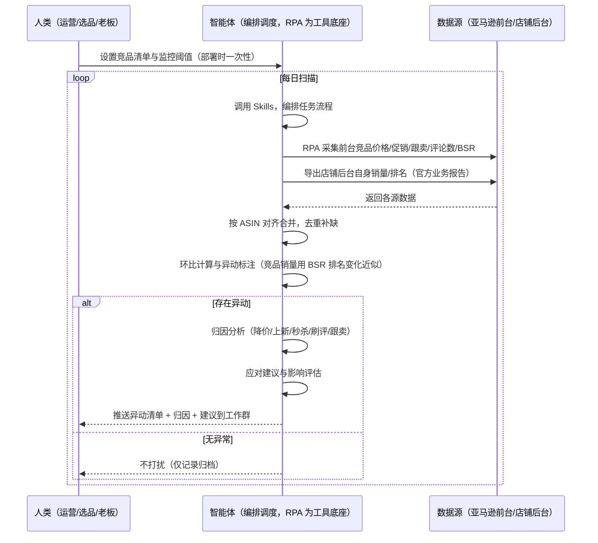
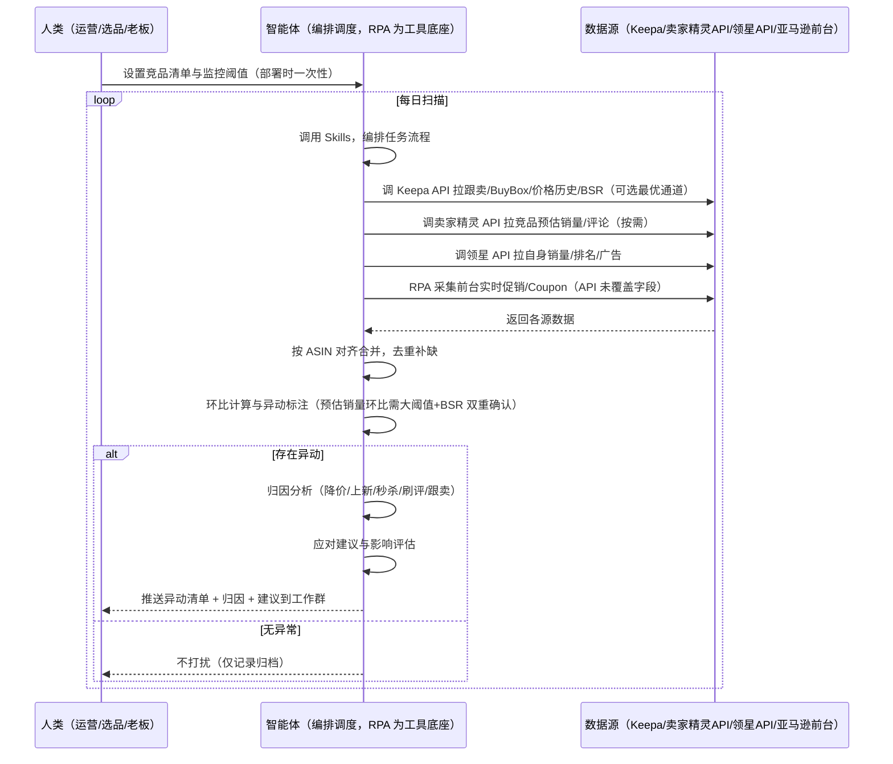

> 为亚马逊卖家团队打造的，由智能体调度多工具执行竞品异动监控任务的方案。竞品数据分散在多个平台与工具，统一取数——未购 SaaS 走前台自动化采集，已购 SaaS 走"API 取核心 + 前台补可程序化缺口"。每日扫描，有异动才推送，无异常不打扰。

> Agent 自动化需开通企业功能
> 点击申请1个月免费权限
> [点击申请 →](https://skieer.feishu.cn/share/base/form/shrcnFwMayykP5iaL38fnZKTbrg)

## 一、用户与需求

核心矛盾：竞品数据分散在多个平台与工具，运营要在它们之间反复手动执行——查完价格切工具看销量、再切后台看自己、手动贴表、凭感觉写结论。等发现竞品降价冲量，已经慢了一周。

两类客户痛点同源，数据来源不同：

- 未购 SaaS 客户（新卖家/小团队）：人工打开前台逐页翻竞品价格、评论、BSR，再切自己后台看销量，全靠手抄；
- 已购 SaaS 客户（卖家精灵看竞品、领星看运营财务、优麦云看跟卖）：多个工具各自为政，仍要人打开对照；且跟卖、实时促销这些字段要人打开看，进不了自动化流程。

适用客户：竞品清单 ≥10 个、或多店铺需统一汇总、或需要归因分析的卖家。只盯 3-5 个竞品的小卖家价值有限（人工每周查看即可，本方案不推荐）。

### 1.1 不同模式卖家

| 类型 | 选择 | 建议 |
|-|-|-|
| 品牌 | 首选 | 强烈推荐（核心竞品多、需持续盯守） |
| 精铺 | 次选 | 仅建议监控核心对标 ASIN（竞品数量少则价值有限） |
| 铺货 | 任意 | 不推荐，只做站内核心款竞品监控 |

### 1.2 不同类目卖家

| 类目 | 最关注维度 | 核心逻辑 |
|-|-|-|
| 3C 数码 | 价格 + 功能参数 | 竞品迭代快，重点对比参数配置与降价冲击 |
| 家居家具 | 价格 + 评价增速 | 大件比价敏感，评价增速异常（刷评嫌疑）需关注 |
| 美妆个护 | 卖点 + 评分 | 成分卖点差异大，评分差距直接反映产品力 |
| 户外运动 | 价格 + 评论缺口 | 功能性产品，看竞品差评缺口找改进机会 |

### 1.3 不同角色用户

| 用户 | 需求 | 问题 | 投入时间（估算） |
|-|-|-|-|
| 老板 | 看竞品异动对生意的影响 | 月底才看到汇总，且无归因无数据支撑 | 0.5 小时/周 |
| 选品 | 竞品差距清单 + 机会方向 | 数据散在各平台，横向对比 ASIN 靠手工贴表，方向靠拍脑袋 | 2-4 小时/周 |
| 运营 | 盯竞品价格变动、销量异动 | 竞品调价/上新靠手动翻，反应慢 | 1-2 小时/周 |

---

## 二、现在的方法与问题

### 2.1 流程步骤与问题总结

**人工方式（未购 SaaS 客户）**

| 序号 | 步骤 | 现在的方法 | 问题缺陷 |
|-|-|-|-|
| 1 | 找竞品 | 手动搜类目，记下竞品 ASIN | 漏记、错记，竞品清单不全 |
| 2 | 查数据 | 前台逐页翻竞品价格/评论/BSR，切自己后台看销量，手抄 | 多页面反复切换、每天多次，登录态频繁失效、手抄易错 |
| 3 | 贴表 | 手抄进 Excel | 字段乱、多期对不上 |
| 4 | 判断变化 | 凭印象"好像降了" | 无环比、无阈值 |
| 5 | 找原因 | 猜"可能降价了" | 无归因逻辑 |
| 6 | 汇报 | 月底口头汇总 | 无对比表、无结论 |

**SaaS 方式（已购卖家精灵/领星/优麦云客户）**

| 序号 | 步骤 | 现在的方法 | 问题缺陷 |
|-|-|-|-|
| 1 | 找竞品 | 手动搜类目，记下竞品 ASIN | 漏记、错记 |
| 2 | 查数据 | 开卖家精灵查竞品预估销量、开领星看自己、开优麦云看跟卖，多工具来回切 | 三个工具各自为政，每天多次切换 |
| 3 | 贴表 | 工具导出后贴表 | 各工具字段口径不一，多期对不上 |
| 4 | 判断变化 | 凭印象"好像降了" | 无跨系统环比口径 |
| 5 | 找原因 | 猜"可能降价了" | 跟卖/促销因素进不了分析 |
| 6 | 汇报 | 月底口头汇总 | 无对比表、无结论 |

### 2.2 问题分析

**人工方式根因**

| 序号 | 根因 | 具体表现 |
|-|-|-|
| 1 | 效率低 | 前台翻页 + 手抄，每天多次，耗时长、易漏看 |
| 2 | 频率做不到 | 竞品变化以天计，人工盯守以周计 |
| 3 | 无环比口径 | 价格降 5%、BSR 下滑无人感知 |
| 4 | 归因靠猜 | 说不清异动是降价/上新/秒杀引起 |
| 5 | 经验不沉淀 | 判断规则在人脑里，换个人结论就不一样 |

**SaaS 方式根因**

| 序号 | 根因 | 具体表现 |
|-|-|-|
| 1 | 数据割裂 | 卖家精灵管竞品、领星管自己、优麦云管跟卖，无人组装 |
| 2 | 单点告警不解释 | 优麦云告诉你"被跟卖了"，但不说这次销量下滑里跟卖贡献多少 |
| 3 | 可程序化缺口 | 跟卖/实时促销只能人看或单点告警，进不了自动化归因 |
| 4 | Agent 深度受限 | 卖家精灵 Agent 只能查数据（单次 10 条），做不了深度分析 |
| 5 | 成本叠加 | 订阅费之外，开放 API 按接口另收费 |

---

## 三、解决方案

### 3.1 功能概述

为亚马逊卖家团队打造的智能体驱动竞品异动监控方案，解决竞品数据跨多平台分散、人工反复手动执行的问题。

定时触发并调度多个工具，调起八爪鱼 RPA（Agent 的工具底座，能耦合多系统、完成自动化任务执行）统一取数，按 ASIN 对齐合并，输出竞品异动监控结论，涵盖「环比计算、异动标注、归因分析、应对建议、对自身影响评估」。每日扫描、有异动才推送。

### 3.2 系统结合

| 要素 | 说明 |
|-|-|
| 客户现有工具盘点 | 未购 SaaS 客户：无第三方工具，数据全靠前台翻页 + 后台导出。   已购 SaaS 客户（主流组合）：卖家精灵（竞品预估销量/BSR/评论/价格历史，插件端另有跟卖监控）、领星 ERP（自身销量/广告/财务，网页端有竞品监控/关键词排名）、优麦云（卖家精灵旗下，跟卖监控 + 自动调价、微信报警） |
| 数据/能力来源 | 未购 SaaS：亚马逊前台（价格/促销/跟卖/评论数/BSR，RPA 采集）+ 店铺后台官方业务报告导出（自身销量/排名）。   已购 SaaS：Keepa API（跟卖/BuyBox/Deals/价格历史最全最稳，€49/月起，可选最优通道）+ 卖家精灵开放 API（竞品预估销量/销额/BSR/价格历史/评论，按接口付费）+ 领星开放 API（自身销量/广告/财务，需企业申请权限）+ RPA 前台采集兜底（覆盖无 SaaS 客户与 API 未覆盖字段） |
| RPA 耦合动作 | 作为 Agent 的工具底座，按计划调度多数据源取数（官方导出/API 优先 + 前台采集兜底），按 ASIN 对齐去重合并，统一流转给智能体分析；任一数据源失败自动重试、异常告警 |
| 耦合出的新价值 | 单平台/单工具给不了的端到端结论：跨平台数据一次取齐 → 异动归因（含跟卖/促销因素）→ 应对建议，有异动自动推送工作群，免去人工在多平台间反复切换 |

### 3.3 智能体执行流程

用户向智能体输入会话（入参：竞品 ASIN 清单 + 自身 ASIN）或智能体定时触发（每日扫描）。支持两种数据通道，部署时按客户现有工具选择：

通道一：无 SaaS 方式（RPA 采集亚马逊前台，适合未购卖家精灵/领星的客户）

通道二：有 SaaS 方式（Keepa/卖家精灵/领星 API 拿核心，RPA 前台兜底，适合已购客户）

> Agent 自动化需开通企业功能
> 点击申请1个月免费权限
> [点击申请 →](https://skieer.feishu.cn/share/base/form/shrcnFwMayykP5iaL38fnZKTbrg)

### 3.4 为何这么设计

要同时回答三个问题：为什么不能只用 SaaS/API？为什么不能纯靠智能体写代码？ 本场景的核心是"每日定时、跨多个平台取数、按 ASIN 对齐、出归因结论、有异动推送、挂了有人管"。

#### 1）逐项对比

| 对比维度 | SaaS/API 堆叠（Keepa/卖家精灵/领星） | 纯智能体（智能体写代码） | 智能体+自动化工具（RPA 工具底座） |
|-|-|-|-|
| 实现方式 | 每个流程一个工具：数据获取各管一段，数据互不相通，人工对照 | 能调 API 能抓前台，字段可自拼，但全要自己接 | 一个底座跑多个流程（竞品/选品/VOC/趋势……），数据一处对齐，一个口径 |
| 多系统耦合 | 卖家精灵管竞品、领星管自己、优麦云管跟卖，无人组装 | 全自建：API 鉴权、前台反爬、登录态、对齐逻辑 | 平台沉淀多源取数与对齐，可视化配置 |
| 自动判断与归因 | Keepa 给数据不解释；卖家精灵 Agent 受限（单次 10 条）做不了深度归因；领星/优麦云只有单点告警 | 判断逻辑自写，灵活但工程量大 | 判断交给智能体（深度归因+应对建议），执行交给 RPA |
| 定时与推送 | 各工具定时导出/单系统告警，无跨系统结论推送 | 调度器/进程常驻/告警通道全自建 | 平台调度稳定触发，失败重试 + 异常告警，异动触发推送 |
| 使用成本（总拥有成本） | 一流程一订阅：Keepa €49 + 卖家精灵 88 + 领星 500-1500……随流程数线性增长 | 代理 IP + 服务器 + 开发维护人力，隐性成本高 | 一份平台订阅跑所有流程，单方案边际成本 ≈ 0（客户本就要为多流程买单） |
| 维护人要求 | 低（工具已成熟） | 每次改版/接口变更/规则调整都要开发介入 | 可视化流程，运营自己可调清单/阈值/推送群 |

#### 2）优劣势说明

|  | SaaS/API 堆叠（Keepa/卖家精灵/领星） | 纯智能体（智能体写代码） | 智能体+自动化工具（RPA 工具底座） |
|-|-|-|-|
| 优势 | 核心数据权威、功能成熟、跟卖/调价有单点能力（优麦云） | 无订阅费；   可深度定制任意逻辑；   技术上完全可行 | 一个底座跑多流程、数据一处对齐；   调度/重试/告警开箱即用；   判断层比 SaaS Agent 深；非技术人员可维护 |
| 劣势 | 各系统各自为政；   跟卖/促销只能人看或单点告警，进不了归因；   Agent 深度受限；   无跨系统结论推送；   多工具订阅成本随流程数增长 | 多平台取数、登录态、对齐、调度、告警全自建；   AI 生成代码是生成性的，长跑不稳；   无人维护即失效 | 本地电脑运行需保持开机（建议部署常开电脑/云机）；   订阅费；   灵活性受平台模板边界限制 |

#### 3）结论

| 论点 | 说明 |
|-|-|
| 只用 SaaS/API 缺"程序化归因" | Keepa/卖家精灵/领星解决核心数据与单点告警，但跟卖、实时促销只能人看或单点提醒，无法程序化进归因——"这次异动是跟卖还是降价引起"它们答不了 |
| 纯智能体缺"工程底座" | 多系统耦合 70% 的工作在工程（取数/登录态/对齐/调度/重试），不在"写判断逻辑"；RPA 作为工具底座把这 70% 已经造好 |
| 一个底座跑多流程 | 客户购买 RPA 平台是跑多个流程（竞品/选品/VOC/趋势/后台操作），本方案只是其中一个流程——平台订阅费被多流程摊薄，单方案边际成本接近 0，总拥有成本低于"一流程一工具"的 SaaS 堆叠 |
| 确定性 vs 生成性 | 跨平台取数是确定性任务——每天同样的流程，要求"准点、不漏、口径一致"。RPA 流程行为可预期，AI 生成的代码能跑通 ≠ 能稳定跑一年 |
| 时间 | 卖家要的是"异动当天收到归因和建议"，不是"每天修脚本"；判断层交给智能体，执行层交给工具底座 |

### 3.5 功能清单

| 功能 | 系统 | 功能说明（解决问题） |
|-|-|-|
| 会话/定时 | 智能体 | 1. 理解人类语言，调用已预设好的 Skills。   2. 编排多任务、调度多工具。 |
| 多系统数据取数 | RPA、指纹浏览器 | 1. 解决竞品数据分散在多平台、人工反复切换手动抄录易漏易错问题。   2. 作为智能体工具底座被调度执行，登录态自动维持、失败自动重试、异常告警。   3. 【无 SaaS 方式】 RPA 采集亚马逊前台竞品价格/促销/跟卖/评论数/BSR，竞品销量用 BSR 排名变化近似；自身数据走官方业务报告导出。【有 SaaS 方式】 调 Keepa API 拉跟卖/BuyBox/价格历史/BSR（€49/月起，可选最优通道）、调卖家精灵 API 拉竞品预估销量/评论（查竞品 ¥2999 + ASIN 详情 ¥988 + 商品趋势 ¥5500 + 查评论 ¥9999/月，按需购买）、调领星 API 拉自身销量/广告（需企业申请权限）；RPA 前台采集补实时促销/Coupon。 |
| 数据清洗对齐 | 智能体 | 按 ASIN 对齐多源数据，去重合并、字段统一，解决手动贴表对不齐、字段不统一问题。 |
| 异动识别 | 智能体 | 以准确字段为主：价格环比%、BSR 排名变化、评价增量、跟卖数变化；标注价格降幅 >5% 或 BSR 明显下滑的竞品。预估销量作参考，环比需 >20% 且配合 BSR 变化双重确认，避免估算噪声误报。 |
| 归因分析 | 智能体 | 关联同期事件（降价/上新/秒杀活动/评论增长/跟卖），按贡献度排序，给出"为什么异动"——含 SaaS 只能单点告警、本方案可程序化纳入的跟卖因素。归因结论为辅助参考，置信度 &lt;70% 转人工复核。 |
| 应对建议 | 智能体 | 基于预设 Skills 输出应对建议：跟价/避让/促销/广告调整，附影响评估（对自身销量冲击预估）。建议需人工确认后执行。 |
| IM通知 | 飞书、钉钉、企微等 | 解决竞品变化发现滞后、需人工盯守问题。有异动才推送异动清单、归因、应对建议到工作群，无异常不打扰。 |
| 数据资产储存 | 本地电脑、云储存 | 1. Skills 资产：异动阈值与归因规则，被调度直接调用。   2. 数据储存：竞品库.xlsx 按周沉淀，可审计可追溯。   3. 经验知识库：审核通过的归因与应对规则持续沉淀。 |

### 3.6 智能体执行落地过程

部署时一次性配置入参（竞品 ASIN 清单、自身 ASIN、异动阈值、推送群、数据通道），会话中无需重复输入。

⚠️ 部署前提（不满足则方案无法跑起来）：①RPA 需部署在常开电脑/云机上（本地电脑关机即停跑），并配置漏跑补跑机制；②有 SaaS 方式需卖家精灵企业认证开通开放平台（个人版不支持，以官方政策为准）或 Keepa API 付费账号，未开通则自动降级为无 SaaS 通道；③领星 API 需企业客户申请权限，未开通则自身数据走官方业务报告导出；④首次配置（API 鉴权、对齐规则、阈值）需服务方/技术人员介入一次，属实施成本。

#### 1）配置

| 类别 | 说明 |
|-|-|
| 智能体 | 主流智能体。 |
| 智能体工具 | 1. 数据通道（按客户现有工具二选一）：【无 SaaS】亚马逊前台（RPA 采集）+ 官方业务报告导出；【有 SaaS】Keepa API（€49/月起）+ 卖家精灵开放 API（查竞品 ¥2999/ASIN 详情 ¥988/商品趋势 ¥5500/查评论 ¥9999 每接口月付，按需购买）+ 领星开放 API（已购且申请权限客户）+ RPA 前台补实时促销/Coupon。   2. 数据取数与自动化执行：八爪鱼 RPA，MCP 配置完成。   3. 数据分析：智能体自带。   4. IM：企业办公 IM（飞书/钉钉/企微），MCP 或 webhook 配置。 |
| 工作知识 | 1. 竞品 ASIN 清单（含自身 ASIN）。   2. 异动阈值：价格降幅 >5%、BSR 排名下滑、评价增量异常、跟卖数变化标记重要。   3. 归因维度：降价/上新/秒杀/评论增长/跟卖。   4. 品类利润率基准：默认 25%。 |
| 本地数据库 | 1. 竞品库地址。   2. 报告库地址。   3. 经验库地址。 |

#### 2）执行

| 任务 | 产出 | 产出物接收人 |
|-|-|-|
| 接收竞品 ASIN 清单，定时或会话 | 任务启动记录 | —— |
| 调用已预设 Skills，编排任务流程 | 任务编排方案 | —— |
| 经 MCP 向八爪鱼 RPA 下发取数任务 | 自动化任务指令 | —— |
| 多平台取数并按 ASIN 对齐（无 SaaS：前台采集+官方导出；有 SaaS：Keepa/卖家精灵/领星 API + 前台补促销，智能体监控状态） | 对齐后竞品数据 | —— |
| 环比计算与异动标注 | 竞品变化标签 | 运营/选品 |
| 归因分析与影响评估（仅异动时，置信度 &lt;70% 转人工） | 异动归因结论 | 选品 |
| 生成应对建议（仅异动时，需人工确认） | 应对建议 | 运营 |
| 推送异动清单与摘要到工作群（无异动不推送） | 竞品异动通知 | 运营/选品/老板 |

异常处理：

前台采集遇反爬拦截 → 自动降频重试，仍失败转下轮补采；

API 限频 → 自动降频重试；

数据缺失 → 标注缺失并下轮补拉；

对齐失败 → 降级说明本次覆盖率；

置信度 &lt;70% → 转人工复核，不输出硬结论。

#### 3）结果

| 结果 | 说明 |
|-|-|
| 数据资产 | 竞品全量结构化数据（价格/BSR/评论/促销/跟卖/环比/标签），多期可审计。 |
| 分析报告 | 1. 竞品异动通知：谁动了、动多少、为什么、该怎么应对（仅异动时）。   2. 低价冲击告警：价格降幅 >10% 即时推送。   3. 对自身影响评估：异动对自身销量的冲击预估。   4. 周度趋势：按周沉淀可回看。 |
| Skills | 智能体 Skills：异动阈值与归因规则库。 |

> Agent 自动化需开通企业功能
> 点击申请1个月免费权限
> [点击申请 →](https://skieer.feishu.cn/share/base/form/shrcnFwMayykP5iaL38fnZKTbrg)

---

## 四、使用前后预估

> 本方案价值 = 跨系统归因 + 可程序化数据 + 主动推送结论。不承诺替代人工决策——人工审核是关键环节（建议人工确认后执行、低置信度转人工复核）。适合竞品 ≥10 个、愿配环境、接受半自动的卖家。

| 指标 | 人工 | SaaS/API（Keepa/卖家精灵/领星） | 智能体+自动化工具 |
|-|-|-|-|
| 取数耗时 | 每周 2-4 小时（估算） | 每周 0.5-1 小时（估算，仍需人工跨系统对照） | 取数全自动；人工转为审核推送（每周约 0.5 小时） |
| 取数切换 | 每天多次 | 减少但仍需跨系统对照 | 取数环节 0 切换 |
| 监控频率 | 不定期 | 有主动告警（微信/钉钉，单点事件） | 每日扫描，异动即推 |
| 变化感知 | 事后发现（降价一周才知道） | 单点告警（被跟卖/超预算等预设事件） | 异动当天推送（归因置信度 &lt;70% 转人工） |
| 归因能力 | 凭感觉猜"可能降价了" | 无跨系统归因，不解释"这次下滑跟卖贡献多少" | 自动归因（辅助参考，人工复核兜底） |
| 结论可读性 | 口头汇报 | 各系统报表自行查看 | 异动通知随时可查 |
| 方法论沉淀 | 无，换人结论不同 | 工具内规则（不可跨系统复用） | 可复用的 Skills 与规则库 |

说明：竞品销量为预估数据（SaaS API 估算值 / 无 SaaS 用 BSR 排名近似），本方案核心判断基于价格、BSR、评论、跟卖等准确字段；需要精确竞品销量的客户建议叠加卖家精灵 API 或人工抽查。

---

## 五、效果证明

> Agent 自动化需开通企业功能
> 点击申请1个月免费权限
> [点击申请 →](https://skieer.feishu.cn/share/base/form/shrcnFwMayykP5iaL38fnZKTbrg)

### 5.1 客户案例

**《北美汽配冠军：500+ 核心 ASIN 7×24 价格与链接监控》**

> 北美汽配第一梯队品牌（占有率约 28.89%），需对所有核心 ASIN 实现 7×24 不间断监控，确保商品稳定在售、价格体系不被冲击；计划监控 500+ 链接，市面无 ERP 可满足。

| 效果 | 说明 |
|-|-|
| 提效 | 核心 ASIN 监控由人工随机抽查变为 7×24 全量巡检。原本仅能人工随机抽查少量 ASIN、无固定频次，现在 500+ 核心 ASIN 全天候自动巡检。 |
| 降本 | 省去人工盯链、盯价的重复投入，运营团队投入转向链接治理与价格体系维护等重点工作。 |
| 任务 | 全维度商品数据（销量、价格、评论、物流、排名等）批量沉淀为可参考的运营数据集。 |
| 任务 | 在售状态与价格体系风险即时告警，减少链接降权、订单流失等损失。 |

案例详情：[监控：北美汽配冠军，用RPA＋钉钉AI表格给200+ASIN上了24小时保险](https://skieer.feishu.cn/wiki/ZZsTwbsHsi5UJykMwX9c6zoLnmh)

**《竞品 AI 快报：多平台动态 7×24 监控与自动出报》**

> 某大型教培集团需盯多家竞品公众号、课程与活动动态，人工巡查信息零散难汇总。RPA 自动巡查多平台账号并生成竞品快报。

| 效果 | 说明 |
|-|-|
| 提效 | 竞品动态巡查由人工每日逐平台翻阅变为 7×24 自动监控。原本市场团队需人工登录多平台逐篇查看推文、课程与活动，现在自动抓取、自动分析、自动出报告。 |
| 降本 | 市场团队用于公众号巡查、内容摘抄与情报汇总的重复性工作量降低约 80%，投入转向课程优化、活动策划与市场竞争策略等重点工作。 |
| 任务 | 竞品课程、价格及营销动态识别准确率提升至 95% 以上，减少遗漏与误判。 |
| 任务 | 多平台账号自动巡查，情报按周期自动汇总成报。 |

案例详情：[快报|社媒监控：竞品AI快报生成自动化](https://skieer.feishu.cn/wiki/UNA7wUatCih1D2kXL5Fco3MpnGe)

### 5.2 DEMO应用

Amazon-批量实时查询竞品数据（卖家精灵）：https://rpa.bazhuayu.com/appstore/app/nailong/ya-ma-xun-pi-liang-shi-shi-cha-xun-jing-pin-shu-ju--mai-jia-jing-ling-

---

## 六、备注

### 6.1 Agent 支持

本方案不绑定具体智能体，主流 Agent 均可运行（需支持技能/Skills 加载与工具调用）：

| Agent/智能体 | 说明 |
|-|-|
| Workbuddy | 本方案运行平台，支持技能/Skills 上传加载、定时任务、MCP 工具调用与表格/报告处理 |
| 豆包（国内·字节） | 国内主流个人智能体，支持技能上传、定时任务与工具调用，上手成本低 |
| 通义千问（国内·阿里） | 支持 Agent 编排与插件生态，集成阿里电商数据能力，适合电商场景 |
| DeepSeek（国内） | 推理能力强、成本低，适合规则打分与归因分析类任务 |
| ChatGPT（国外·OpenAI） | 海外主流通用智能体，支持 GPTs/Agent 模式与工具调用 |
| Claude（国外·Anthropic） | 长文本与结构化分析能力强，原生支持 MCP 连接外部工具 |

### 6.2 名词解释

| 术语 | 说明 |
|-|-|
| 环比 | 本期与上一周期对比的变化率，如本周价格 vs 上周价格 |
| 低价冲击 | 竞品价格降幅 >10%，红色告警 |
| 异动归因 | 通过关联同期事件（降价/上新/秒杀/评论增长/跟卖）解释竞品数据变化的原因 |
| 多平台耦合 | 通过 RPA 把亚马逊前台、Keepa/卖家精灵/领星、店铺后台等多个系统的数据取数与流转统一起来 |
| 预估销量 | 竞品销量为估算值：SaaS API 为算法估算（误差 ±15%），无 SaaS 方式用 BSR 排名变化近似，两者均非真实销量，仅供趋势参考 |
| SaaS 开放 API 能力边界 | 卖家精灵开放 API（46 接口）无跟卖接口、促销仅历史趋势；Keepa API 有跟卖/BuyBox/Deals/价格历史（€49/月起，数据通道最全最稳）；跟卖/实时促销/Coupon 部分在插件端/网页端有人可看，开放 API 未必全含，由 RPA 前台采集兜底 |
| 混合数据源 | 官方导出/API 优先（更稳更合规）+ 前台采集兜底（免费、覆盖无 SaaS 客户与 API 缺口），按客户总成本与稳定性选通道 |
| 可程序化缺口 | 只能人看或开放 API 取不到的字段（部分实时促销/Coupon），由 RPA 前台采集补齐，使其可进入自动化归因 |
| 无 SaaS 方式 | 不购买第三方数据工具，由 RPA 采集亚马逊前台公开数据 + 官方业务报告导出，竞品销量用 BSR 排名变化近似 |
| 有 SaaS 方式 | 已购 Keepa/卖家精灵/领星，开放 API 拿核心字段 + RPA 前台兜底（字段最全，API 按接口付费、需企业认证开通） |
| ASIN | Amazon Standard Identification Number，亚马逊商品标识号 |
| MCP | Model Context Protocol，智能体连接外部工具的标准化通道 |

> Agent 自动化需开通企业功能
> 点击申请1个月免费权限
> [点击申请 →](https://skieer.feishu.cn/share/base/form/shrcnFwMayykP5iaL38fnZKTbrg)

---

原文：[查看原文](https://skieer.feishu.cn/wiki/Njaaw7gEAi130ekxGv2cOytynxh)
