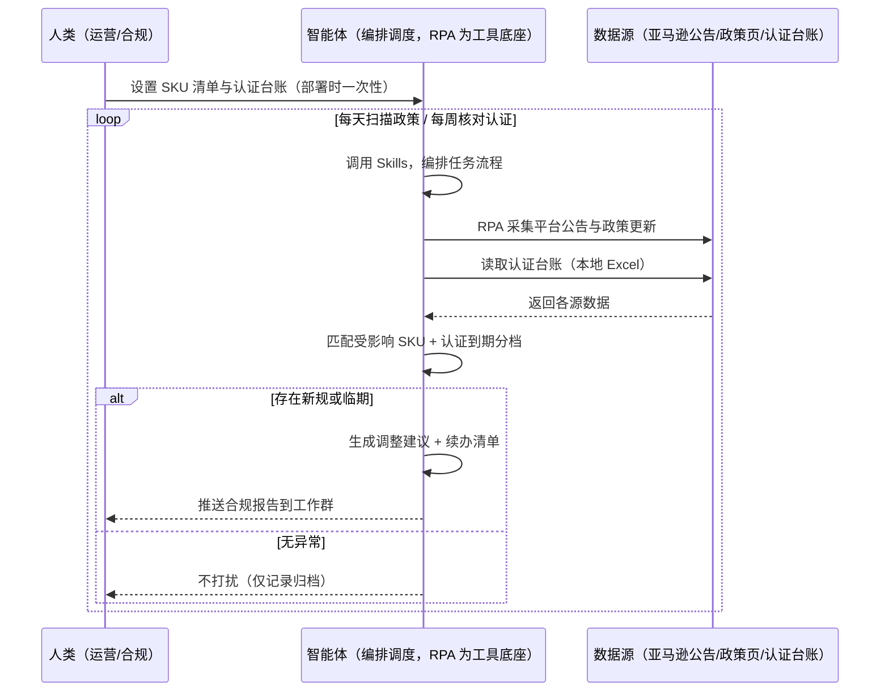
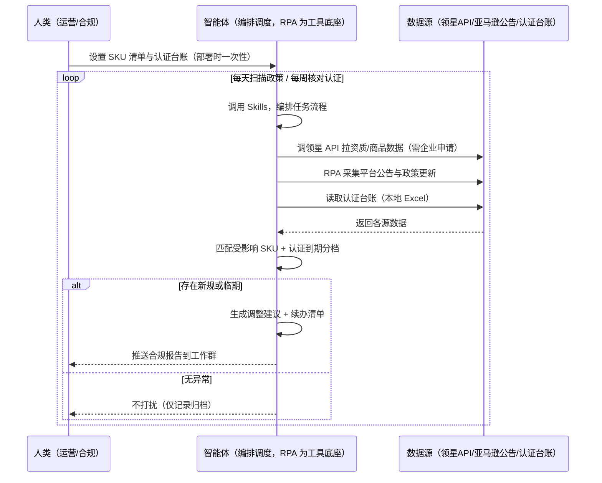

> 为亚马逊卖家团队打造的，智能体调度多工具执行政策与认证合规监控任务的方案。平台新规要靠自己一条条读、认证有效期手动记录，本方案由智能体调度八爪鱼 RPA（Agent 的工具底座，能耦合多系统、完成自动化任务执行）统一取数。每天监控政策更新、按认证到期日分档预警，有新规或临期才推送。

> Agent 自动化需开通企业功能
> 点击申请1个月免费权限
> [点击申请 →](https://skieer.feishu.cn/share/base/form/shrcnFwMayykP5iaL38fnZKTbrg)

## 一、用户与需求

核心矛盾：平台新规要靠自己一条条读、对照商品判断影响费时；认证有效期手动记录、快到期才发现来不及——漏一条新规可能下架，过期一个认证可能罚款。

两类客户痛点同源，数据来源不同：

- 未购 SaaS 客户（新卖家/小团队）：人工一条条看平台公告、逐 SKU 判断影响、手动记录认证有效期，全靠手；
- 已购 SaaS 客户（领星 ERP 有合规/资质模块）：领星有部分资质管理数据，但平台政策更新扫描、受影响 SKU 匹配、认证分档预警仍要人做。

适用客户：多站点多认证、合规监控频次高的卖家。单一站点、认证少的小卖家价值有限（人工每周看一次即可，本方案不推荐）。

### 1.1 不同模式卖家

| 类型 | 选择 | 建议 |
|-|-|-|
| 品牌 | 首选 | 强烈推荐（多站点多认证，合规监控频次高） |
| 精铺 | 次选 | 一般推荐，聚焦主力站点合规 |
| 铺货 | 任意 | 不推荐，SKU 太多逐条判断不划算 |

### 1.2 不同类目卖家

| 类目 | 最关注维度 | 核心逻辑 |
|-|-|-|
| 3C 数码 | FCC/CE 认证 | 电子认证多，到期预警是重点 |
| 家居家具 | 类目新规 | 大件类目政策变化影响大 |
| 美妆个护 | FDA 合规 | 认证与成分合规从严 |
| 服装鞋帽 | 禁售词新规 | 面料/成分新规影响 SKU |
| 户外运动 | 认证+新规 | 功能件认证多，政策变化快 |
| 母婴用品 | 安全认证 | 安全类目，认证过期即下架风险 |

### 1.3 不同角色用户

| 用户 | 需求 | 问题 | 投入时间（估算） |
|-|-|-|-|
| 老板 | 合规无罚款无下架 | 新规漏读、认证过期 | 0.5 小时/周 |
| 运营 | 受影响清单+调整建议 | 逐条读新规费时 | 1-2 小时/周 |
| 合规/行政 | 认证续办清单 | 到期靠记，易漏 | 1 小时/周 |

---

## 二、现在的方法与问题

### 2.1 流程步骤与问题总结

| 序号 | 步骤 | 现在的方法 | 问题缺陷 |
|-|-|-|-|
| 1 | 读新规 | 一条条看平台公告 | 公告多，靠人盯易漏 |
| 2 | 对商品 | 对照自家商品判断影响 | 逐 SKU 判断费时 |
| 3 | 记认证 | 手动记录有效期 | 快到期才发现来不及 |
| 4 | 办续期 | 到期前找文件办理 | 找文件翻箱倒柜 |
| 5 | 整改 | 手动调整受影响 Listing | 无清单，整改漏项 |

### 2.2 问题分析

| 序号 | 根因 | 具体表现 |
|-|-|-|
| 1 | 新规分散 | 公告/邮件/论坛分散，靠人盯易漏 |
| 2 | 影响判断靠人 | 受影响 SKU 范围判断费时 |
| 3 | 认证靠记 | 有效期手动记录，到期才发现 |
| 4 | 无分档预警 | 90/30/7 天分档预警缺失 |
| 5 | 经验不沉淀 | 合规规则在人脑里 |

---

## 三、解决方案

### 3.1 功能概述

为亚马逊卖家团队打造的政策与认证合规监控方案，解决新规分散易漏、认证靠记过期的问题。

定时触发并调度多个工具，调起八爪鱼 RPA（Agent 的工具底座，能耦合多系统、完成自动化任务执行）统一取数，输出合规分析，涵盖「政策更新监控、受影响 SKU 匹配、调整建议、认证到期分档预警、续办清单」。有新规或临期才推送。

### 3.2 系统结合

| 要素 | 说明 |
|-|-|
| 客户现有工具盘点 | 未购 SaaS 客户：无第三方工具，合规全靠人工盯。   已购 SaaS 客户（主流组合）：领星 ERP（资质/合规模块，开放 API 需企业申请） |
| 数据/能力来源 | 未购 SaaS：亚马逊后台公告/政策页（RPA 采集）+ 自家 SKU 与认证台账（本地 Excel）。   已购 SaaS：领星开放 API（资质/商品数据，需企业申请权限）+ RPA 政策页兜底 |
| RPA 耦合动作 | 作为 Agent 的工具底座，按计划调度多数据源取数（API 优先 + 后台采集兜底），按 SKU/认证项对齐去重合并，统一流转给智能体分析；任一数据源失败自动重试、异常告警 |
| 耦合出的新价值 | 单工具给不了的端到端结论：政策更新一次取齐 → 受影响 SKU 匹配 → 调整建议 → 认证分档预警，免去人工逐条读新规记认证 |

### 3.3 智能体执行流程

智能体定时触发。支持两种数据通道，部署时按客户现有工具选择：

通道一：无 SaaS 方式（RPA 采集政策页+认证台账，适合未购领星的客户）

通道二：有 SaaS 方式（领星 API 拿资质核心，RPA 政策页兜底，适合已购客户）

> Agent 自动化需开通企业功能
> 点击申请1个月免费权限
> [点击申请 →](https://skieer.feishu.cn/share/base/form/shrcnFwMayykP5iaL38fnZKTbrg)

### 3.4 为何这么设计

要同时回答三个问题：为什么不能只用 SaaS/API？为什么不能纯靠智能体写代码？ 本场景的核心是"每天扫政策、按 SKU 匹配影响、认证分档预警、挂了有人管"。

#### 1）逐项对比

| 对比维度 | SaaS/API 堆叠（领星） | 纯智能体（智能体写代码） | 智能体+自动化工具（RPA 工具底座） |
|-|-|-|-|
| 实现方式 | 领星有资质数据，政策扫描靠人 | 能调 API 能抓后台，但全要自己接 | 一个底座跑多个流程（合规/健康/售后/选品……），数据一处对齐 |
| 多源耦合 | 领星单系统，政策页不覆盖 | 全自建：API 鉴权、后台采集、对齐逻辑 | 平台沉淀多源取数与对齐，可视化配置 |
| 匹配与预警 | 领星无自动匹配 | 匹配逻辑自写，灵活但工程量大 | 判断交给智能体（受影响匹配+分档预警），执行交给 RPA |
| 定时与推送 | 领星无政策扫描 | 调度器/进程常驻/告警通道全自建 | 平台调度稳定触发，失败重试 + 异常告警，有新规才推送 |
| 使用成本（总拥有成本） | 一系统一订阅：领星 500-1500/月……随流程数增长 | 代理 IP + 服务器 + 开发维护人力，隐性成本高 | 一份平台订阅跑所有流程，单方案边际成本 ≈ 0 |
| 维护人要求 | 低 | 规则调整都要开发介入 | 可视化流程，运营自己可调台账、预警阈值 |

#### 2）优劣势说明

|  | SaaS/API 堆叠（领星） | 纯智能体（智能体写代码） | 智能体+自动化工具（RPA 工具底座） |
|-|-|-|-|
| 优势 | 资质/商品数据权威 | 无订阅费；   可深度定制匹配规则；   技术上完全可行 | 一个底座跑多流程、数据一处对齐；   政策扫描/认证预警即开即用；非技术人员可维护 |
| 劣势 | 政策扫描空白；匹配靠人；   无分档预警 | 采集、匹配、台账全自建；   AI 生成代码是生成性的，漏读风险不可控 | 本地电脑运行需保持开机；   订阅费；   灵活性受平台模板边界限制 |

#### 3）结论

| 论点 | 说明 |
|-|-|
| 只用 SaaS/API 缺"政策扫描与分档预警" | 领星解决资质数据，但"平台政策更新扫描 + 受影响 SKU 匹配 + 认证分档预警"它不覆盖——这是本方案的增量 |
| 纯智能体缺"工程底座" | 政策扫描与台账管理 70% 的工作在工程（采集/对齐/调度/重试），不在"写匹配逻辑"；   RPA 作为工具底座把这 70% 已经造好 |
| 一个底座跑多流程 | 客户购买 RPA 平台是跑多个流程（合规/健康/售后/选品/后台操作），本方案只是其中一个——平台订阅费被多流程摊薄，单方案边际成本接近 0 |
| 确定性 vs 生成性 | 政策匹配与认证预警是确定性任务——同样的公告与台账，要求"每次匹配一致、预警不漏项"。RPA 流程行为可预期，AI 生成的代码能跑通 ≠ 长期不漏读 |
| 时间 | 运营要的是"新规自动进群、认证到期提前预警"，不是"每天手动读公告记认证"；   判断层交给智能体，执行层交给工具底座 |

### 3.5 功能清单

| 功能 | 系统 | 功能说明（解决问题） |
|-|-|-|
| 会话/定时 | 智能体 | 1. 理解人类语言，调用已预设好的 Skills。   2. 编排多任务、调度多工具。 |
| 多系统数据取数 | RPA、指纹浏览器 | 1. 解决新规分散易漏、认证靠记问题。   2. 作为智能体工具底座被调度执行，公告抓取失败自动重试、台账缺失标注待补。   3. 【无 SaaS 方式】 RPA 采集平台公告/政策页 + 读取本地认证台账。【有 SaaS 方式】 调领星 API 拉资质/商品数据（需企业申请）+ RPA 政策页兜底。 |
| 数据清洗对齐 | 智能体 | 按 SKU/认证项对齐去重，解决多来源数据口径不一致问题。 |
| 政策匹配 | 智能体 | 平台政策更新 → 匹配受影响 SKU（按类目/关键词/认证要求），输出影响范围。 |
| 调整建议 | 智能体 | 受影响 SKU 生成调整建议（改 Listing/补认证/下架），按紧急度排序。整改动作由人工执行。 |
| 认证分档预警 | 智能体 | 认证到期 90 天 → 黄色提醒；30 天 → 橙色续办；7 天 → 红色紧急。 |
| IM通知 | 飞书、钉钉、企微等 | 解决新规漏读、认证过期问题。有新规或临期才推送合规报告到工作群，无异常不打扰。 |
| 数据资产储存 | 本地电脑、云储存 | 1. Skills 资产：合规规则与认证台账模板。   2. 数据储存：合规记录与认证台账统一写入本地，可审计。   3. 经验知识库：整改案例持续沉淀。 |

### 3.6 智能体执行落地过程

部署时一次性配置入参（SKU 清单、认证台账、预警阈值、推送群、数据通道），会话中无需重复输入。

⚠️ 部署前提（不满足则方案无法跑起来）：①RPA 需部署在常开电脑/云机上（每天定时扫描，关机即停），并配置漏跑补跑机制；②认证台账需人工维护（认证项/到期日，无台账则仅做政策扫描）；③有 SaaS 方式需领星企业客户申请开放 API 权限（未开通自动降级为无 SaaS 通道）；④首次配置（API 鉴权、台账模板、匹配规则）需服务方/技术人员介入一次，属实施成本。

#### 1）配置

| 类别 | 说明 |
|-|-|
| 智能体 | 主流智能体。 |
| 智能体工具 | 1. 数据通道（按客户现有工具二选一）：【无 SaaS】亚马逊公告/政策页（RPA 采集）+ 本地认证台账；【有 SaaS】领星开放 API（需企业申请）+ RPA 政策页兜底。   2. 数据取数与自动化执行：八爪鱼 RPA，MCP 配置完成。   3. 数据分析：智能体自带。   4. IM：企业办公 IM（飞书/钉钉/企微），MCP 或 webhook 配置。 |
| 工作知识 | 1. SKU 清单（类目/认证要求）。   2. 认证台账：认证项/到期日（人工维护）。   3. 预警阈值：90/30/7 天分档。   4. 匹配规则：按类目/关键词/认证要求匹配。   5. 整改模板：按影响类型预设。 |
| 本地数据库 | 1. 合规记录地址。   2. 认证台账地址。   3. 经验库地址。 |

#### 2）执行

| 任务 | 产出 | 产出物接收人 |
|-|-|-|
| 接收 SKU 清单与台账，定时触发 | 任务启动记录 | —— |
| 调用已预设 Skills，编排任务流程 | 任务编排方案 | —— |
| 经 MCP 向八爪鱼 RPA 下发取数任务 | 自动化任务指令 | —— |
| 多源取数并按 SKU/认证项对齐（无 SaaS：政策页+台账；有 SaaS：领星 API+政策页，智能体监控状态） | 对齐后合规数据 | —— |
| 平台政策更新 → 匹配受影响 SKU | 受影响清单 | 运营 |
| 认证到期分档预警（90/30/7 天） | 续办清单 | 合规/行政 |
| 生成调整建议（按紧急度排序） | 调整建议 | 运营 |
| 推送合规报告（有新规或临期才推送） | 群消息 | 运营/老板 |

异常处理：

公告抓取失败 → 自动重试；

台账缺失 → 标注待人工维护；

匹配置信度低 → 转人工判断；

数据缺失 → 标注并沿用上次快照；

置信度 &lt;70% → 转人工复核，不输出硬结论。

#### 3）结果

| 结果 | 说明 |
|-|-|
| 数据资产 | 全量合规结构化数据（政策更新/受影响 SKU/认证到期日/预警级别/整改状态），可审计。 |
| 分析报告 | 1. 合规报告：新规摘要 + 受影响 SKU + 调整建议。   2. 续办清单：认证分档预警（90/30/7 天）。   3. 整改跟踪：受影响 Listing 调整状态。 |
| Skills | 智能体 Skills：合规规则与认证台账模板。 |

> Agent 自动化需开通企业功能
> 点击申请1个月免费权限
> [点击申请 →](https://skieer.feishu.cn/share/base/form/shrcnFwMayykP5iaL38fnZKTbrg)

---

## 四、使用前后预估

> 本方案价值 = 政策扫描 + 受影响匹配 + 认证分档预警。不承诺替代人工整改——整改动作由人工执行。适合多站点多认证、愿配环境的卖家。

| 指标 | 人工 | SaaS/API（领星） | 智能体+自动化工具 |
|-|-|-|-|
| 合规监控耗时 | 每周 1-2 小时（估算） | 资质数据自动，政策扫描靠人 | 全自动；人工转为整改（每周约 0.5 小时） |
| 新规发现 | 靠人盯，易漏 | 领星无政策扫描 | 每天扫描，新规即推 |
| 影响判断 | 逐 SKU 人工判断 | 领星有数据，匹配靠人 | 自动匹配受影响 SKU |
| 认证管理 | 到期才发现 | 领星部分资质数据 | 90/30/7 天分档预警 |
| 整改质量 | 无清单 | 无 | 调整建议按紧急度排序 |
| 方法论 | 无，换人结论不同 | 领星规则（单系统） | 可复用的 Skills 与规则库 |

说明：平台政策更新为公开信息（采集时点值）；认证台账需人工维护（认证项/到期日）；受影响匹配为规则辅助，整改动作由人工确认执行。

---

## 六、备注

### 6.1 Agent 支持

本方案不绑定具体智能体，主流 Agent 均可运行（需支持技能/Skills 加载与工具调用）：

| Agent/智能体 | 说明 |
|-|-|
| Workbuddy | 本方案运行平台，支持技能/Skills 上传加载、定时任务、MCP 工具调用与表格/报告处理 |
| 豆包（国内·字节） | 国内主流个人智能体，支持技能上传、定时任务与工具调用，上手成本低 |
| 通义千问（国内·阿里） | 支持 Agent 编排与插件生态，集成阿里电商数据能力，适合电商场景 |
| DeepSeek（国内） | 推理能力强、成本低，适合规则打分与归因分析类任务 |
| ChatGPT（国外·OpenAI） | 海外主流通用智能体，支持 GPTs/Agent 模式与工具调用 |
| Claude（国外·Anthropic） | 长文本与结构化分析能力强，原生支持 MCP 连接外部工具 |

### 6.2 名词解释

| 术语 | 说明 |
|-|-|
| 平台政策更新 | 亚马逊类目/合规政策变化（公告/邮件/后台通知） |
| 受影响 SKU | 政策变化后需要调整的自家商品 |
| 认证台账 | 认证项/到期日的记录表（人工维护） |
| 分档预警 | 到期 90/30/7 天分别黄色/橙色/红色预警 |
| 续办清单 | 需办理续期的认证清单 |
| 调整建议 | 受影响 SKU 的整改方案（改 Listing/补认证/下架） |
| 混合数据源 | 官方导出/API 优先（更稳更合规）+ 后台采集兜底（免费、覆盖无 SaaS 客户与 API 缺口） |
| 有 SaaS 方式 | 已购领星，开放 API 拿资质数据 + RPA 政策页兜底（需企业申请权限） |
| 无 SaaS 方式 | 不购买第三方工具，由 RPA 采集政策页 + 本地认证台账 |
| MCP | Model Context Protocol，智能体连接外部工具的标准化通道 |
| 指纹浏览器 | 隔离 Cookie/浏览器指纹的工具，多店铺防关联 |

> Agent 自动化需开通企业功能
> 点击申请1个月免费权限
> [点击申请 →](https://skieer.feishu.cn/share/base/form/shrcnFwMayykP5iaL38fnZKTbrg)

---

原文：[查看原文](https://skieer.feishu.cn/wiki/VXP9wDQcxi6ZVAkBk41cpeA2nch)
