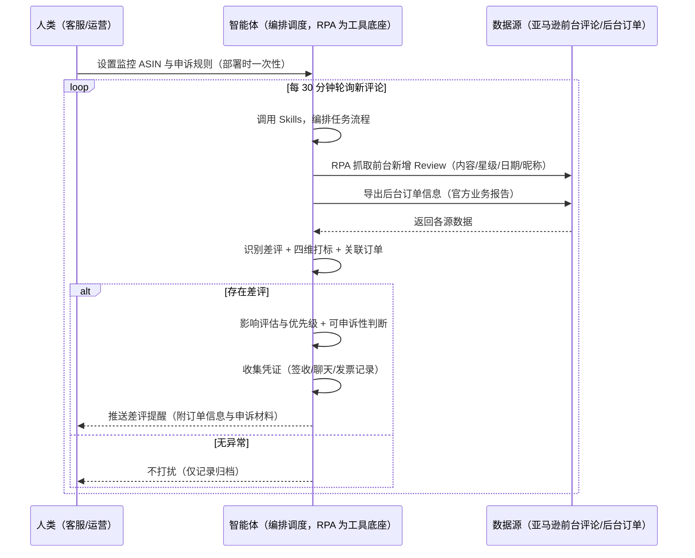
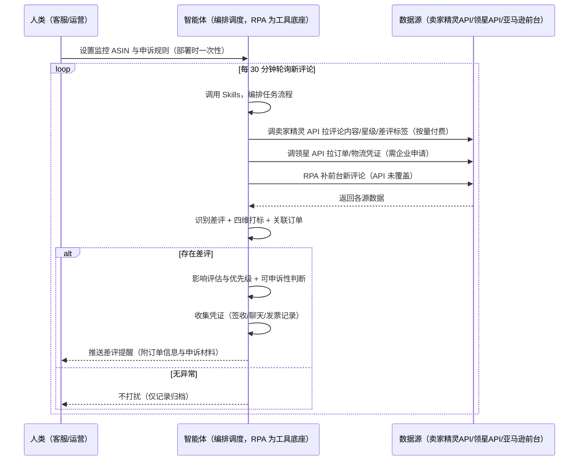

> 为亚马逊卖家团队打造的 Review 差评预警与申诉方案。差评出现后要手动刷新评论页才发现，还要翻订单、查凭证、起草申诉，本方案由智能体调度多个工具，统一取数，差评实时监控、有差评才推送，能申诉的不漏。

> Agent 自动化需开通企业功能
> 点击申请1个月免费权限
> [点击申请 →](https://skieer.feishu.cn/share/base/form/shrcnFwMayykP5iaL38fnZKTbrg)

## 一、用户与需求

核心矛盾：差评出现后手动刷新评论页才发现，还要翻订单、查凭证、起草申诉——处理不及时影响转化，可申诉的差评没申诉白白损失评分。两类客户痛点同源，数据来源不同：

- 未购 SaaS 客户（新卖家/小团队）：人工刷新评论页找差评、翻订单、手动收集凭证，全靠手；
- 已购 SaaS 客户（卖家精灵看评论、领星看订单）：卖家精灵有评论数据与差评标签，但"差评实时预警 → 关联订单 → 凭证收集 → 可申诉性判断 → 申诉提交"链路仍要人做。

适用客户：评分影响转化与品牌信任、核心 ASIN 多的卖家。SKU 少、评论量小的小卖家价值有限（人工每周看一次即可，本方案不推荐）。

### 1.1 不同模式卖家

| 类型 | 选择 | 建议 |
|-|-|-|
| 品牌 | 首选 | 强烈推荐（评分影响转化与品牌信任） |
| 精铺 | 次选 | 一般推荐，聚焦主力 ASIN 的差评管理 |
| 铺货 | 任意 | 不推荐，SKU 太多逐条盯不划算 |

### 1.2 不同类目卖家

| 类目 | 最关注维度 | 核心逻辑 |
|-|-|-|
| 3C 数码 | 功能差评 | 功能问题差评影响大，优先申诉 |
| 家居家具 | 物流差评 | 大件物流差评可申诉概率高 |
| 美妆个护 | 描述差评 | 描述不符差评看证据充分性 |
| 服装鞋帽 | 尺码差评 | 尺码误评可申诉（买家个人因素） |
| 户外运动 | 质量差评 | 质量差评归因产品问题，先处理再申诉 |
| 母婴用品 | 安全差评 | 安全差评从严处理，谨慎申诉 |

### 1.3 不同角色用户

| 用户 | 需求 | 问题 | 投入时间（估算） |
|-|-|-|-|
| 老板 | 评分稳定健康 | 差评发现晚、申诉漏 | 0.5 小时/周 |
| 客服 | 差评预警+申诉材料 | 手动刷评论、查凭证费时 | 1-3 小时/天 |
| 运营 | 差评归因分析 | 差评原因说不清 | 0.5 小时/周 |

---

## 二、现在的方法与问题

### 2.1 流程步骤与问题总结

**人工方式（未购 SaaS 客户）**

| 序号 | 步骤 | 现在的方法 | 问题缺陷 |
|-|-|-|-|
| 1 | 找差评 | 手动刷新评论页 | 刷新不及时，发现晚 |
| 2 | 查订单 | 差评出现后翻订单记录 | 关联订单费时 |
| 3 | 判影响 | 凭经验看要不要紧 | 无优先级口径 |
| 4 | 找凭证 | 手动翻物流签收/聊天记录 | 凭证分散，收集费时 |
| 5 | 申诉 | 判断能不能申诉、起草材料 | 可申诉性判断靠经验，材料不全 |

**SaaS 方式（已购卖家精灵/领星客户）**

| 序号 | 步骤 | 现在的方法 | 问题缺陷 |
|-|-|-|-|
| 1 | 找差评 | 卖家精灵看评论分布 | 有数据但差评预警不实时 |
| 2 | 查订单 | 领星查订单 | 评论与订单两系统，关联靠人 |
| 3 | 判影响 | 卖家精灵有差评标签 | 无优先级口径 |
| 4 | 找凭证 | 手动翻 | 凭证分散，收集费时 |
| 5 | 申诉 | 判断能不能申诉、起草材料 | 可申诉性判断靠经验 |

### 2.2 问题分析

**人工方式根因**

| 序号 | 根因 | 具体表现 |
|-|-|-|
| 1 | 监控靠手 | 手动刷新，差评发现滞后 |
| 2 | 无四维打标 | 差评原因说不清，处置无方向 |
| 3 | 优先级无口径 | 影响评估靠感觉 |
| 4 | 凭证分散 | 物流/聊天/发票散落，收集费时 |
| 5 | 申诉凭经验 | 可申诉性判断不一致，漏申诉 |

**SaaS 方式根因**

| 序号 | 根因 | 具体表现 |
|-|-|-|
| 1 | 评论与订单割裂 | 卖家精灵管评论、领星管订单，关联靠人 |
| 2 | 预警不实时 | 差评发现靠刷新，无事件触发 |
| 3 | 申诉链路断 | 凭证收集、可申诉性判断、申诉提交无自动化 |

---

## 三、解决方案

### 3.1 功能概述

为亚马逊卖家团队打造的智能体驱动 Review 差评预警与申诉方案，解决差评发现滞后、凭证收集费时、申诉凭经验的问题。

定时触发并调度多个工具，调起八爪鱼 RPA（Agent 的工具底座，能耦合多系统、完成自动化任务执行）统一取数，按 ASIN 对齐合并，输出差评管理，涵盖「差评实时监控、四维打标、影响评估与优先级、可申诉性判断、申诉提交与跟进」。差评实时监控，有差评才推送。

### 3.2 系统结合

| 要素 | 说明 |
|-|-|
| 客户现有工具盘点 | 未购 SaaS 客户：无第三方工具，评论全靠前台刷新。   已购 SaaS 客户（主流组合）：卖家精灵（评论数据/差评标签，开放 API 查评论按量付费）、领星 ERP（订单/物流数据，开放 API 需企业申请） |
| 数据/能力来源 | 未购 SaaS：亚马逊前台评论页（内容/星级/日期/昵称，RPA 采集）+ 后台订单（关联订单信息，官方导出）。   已购 SaaS：卖家精灵开放 API（评论内容/星级/差评标签，按接口付费）+ 领星开放 API（订单/物流凭证，需企业申请）+ RPA 前台兜底 |
| RPA 耦合动作 | 作为 Agent 的工具底座，按计划调度多数据源取数（API 优先 + 前台采集兜底），按 ASIN 对齐去重合并，统一流转给智能体分析；   任一数据源失败自动重试、异常告警 |
| 耦合出的新价值 | 单工具给不了的端到端结论：评论一次取齐 → 四维打标 → 关联订单 → 凭证收集 → 可申诉性判断 → 申诉材料，差评自动推送工作群，免去人工刷新评论翻订单 |

### 3.3 智能体执行流程

智能体定时触发（定时轮询新评论，差评预警后按规则触发申诉）。支持两种数据通道，部署时按客户现有工具选择：

通道一：无 SaaS 方式（RPA 采集前台评论+后台订单，适合未购卖家精灵/领星的客户）

通道二：有 SaaS 方式（卖家精灵/领星 API 拿核心，RPA 前台兜底，适合已购客户）

> Agent 自动化需开通企业功能
> 点击申请1个月免费权限
> [点击申请 →](https://skieer.feishu.cn/share/base/form/shrcnFwMayykP5iaL38fnZKTbrg)

### 3.4 为何这么设计

要同时回答三个问题：为什么不能只用 SaaS/API？为什么不能纯靠智能体写代码？ 本场景的核心是"高频轮询、跨系统取数、按 ASIN 对齐、判断与材料、有差评推送、挂了有人管"。

#### 1）逐项对比

| 对比维度 | SaaS/API 堆叠（卖家精灵/领星） | 纯智能体（智能体写代码） | 智能体+自动化工具（RPA 工具底座） |
|-|-|-|-|
| 实现方式 | 卖家精灵管评论、领星管订单，各管一段人工对照 | 能调 API 能抓前台，数据可自拼，但全要自己接 | 一个底座跑多个流程（差评/VOC/异动/选品……），数据一处对齐 |
| 多系统耦合 | 两工具各自为政，无人组装 | 全自建：API 鉴权、前台反爬、对齐逻辑 | 平台沉淀多源取数与对齐，可视化配置 |
| 判断与材料 | 卖家精灵有差评标签（粗），申诉材料靠人 | 判断逻辑自写，灵活但工程量大 | 判断交给智能体（打标+优先级+可申诉性），执行交给 RPA |
| 定时与推送 | 各工具单点提醒，无差评事件触发推送 | 调度器/进程常驻/告警通道全自建 | 平台调度稳定触发，失败重试 + 异常告警，有差评才推送 |
| 使用成本（总拥有成本） | 一系统一订阅：卖家精灵查评论按量付费 + 领星 500-1500/月……随流程数增长 | 代理 IP + 服务器 + 开发维护人力，隐性成本高 | 一份平台订阅跑所有流程，单方案边际成本 ≈ 0 |
| 维护人要求 | 低（工具已成熟） | 每次改版/规则调整都要开发介入 | 可视化流程，运营自己可调 ASIN、申诉规则 |

#### 2）优劣势说明

|  | SaaS/API 堆叠（卖家精灵/领星） | 纯智能体（智能体写代码） | 智能体+自动化工具（RPA 工具底座） |
|-|-|-|-|
| 优势 | 评论/订单数据权威、差评标签成熟 | 无订阅费；   可深度定制申诉逻辑；   技术上完全可行 | 一个底座跑多流程、数据一处对齐；   高频轮询/凭证收集/申诉材料即开即用；   非技术人员可维护 |
| 劣势 | 评论与订单割裂；   预警不实时；   申诉链路断 | 高频调度、评论采集、订单关联、凭证收集全自建；   AI 生成代码是生成性的，漏申诉风险不可控 | 本地电脑运行需保持开机（建议部署常开电脑/云机）；   订阅费；   灵活性受平台模板边界限制 |

#### 3）结论

| 论点 | 说明 |
|-|-|
| 只用 SaaS/API 缺"链路组装" | 卖家精灵/领星解决评论与订单数据，但"差评预警 → 关联订单 → 凭证收集 → 申诉材料"跨系统链路它们给不了——这是本方案的增量 |
| 纯智能体缺"工程底座" | 跨系统取数 70% 的工作在工程（采集/关联/调度/重试），不在"写申诉逻辑"；RPA 作为工具底座把这 70% 已经造好 |
| 一个底座跑多流程 | 客户购买 RPA 平台是跑多个流程（差评/VOC/异动/选品/后台操作），本方案只是其中一个——平台订阅费被多流程摊薄，单方案边际成本接近 0 |
| 确定性 vs 生成性 | 差评识别与可申诉性判断是确定性任务——同样的评论，要求"每次识别一致、不重不漏"。RPA 流程行为可预期，AI 生成的代码能跑通 ≠ 高频轮询一年不漏判 |
| 时间 | 客服要的是"差评第一时间进群、能申诉的不漏"，不是"每天手动刷评论翻订单"；判断层交给智能体，执行层交给工具底座 |

### 3.5 功能清单

| 功能 | 系统 | 功能说明（解决问题） |
|-|-|-|
| 会话/定时 | 智能体 | 1. 理解人类语言，调用已预设好的 Skills。   2. 编排多任务、调度多工具。 |
| 多系统数据取数 | RPA、指纹浏览器 | 1. 解决差评发现滞后、凭证收集费时问题。   2. 作为智能体工具底座被调度执行，页面抓取失败自动重试、凭证收集失败标注待人工。   3. 【无 SaaS 方式】 RPA 抓取前台新增 Review + 导出后台订单。【有 SaaS 方式】 调卖家精灵 API 拉评论（按量付费）+ 调领星 API 拉订单/凭证（需企业申请）+ RPA 前台兜底。 |
| 数据清洗对齐 | 智能体 | 按 ASIN 对齐评论与订单，解决两系统数据拼不起来问题。 |
| 差评识别与打标 | 智能体 | 识别 1-3 星差评并四维打标（物流/质量/描述/功能），输出差评原因。 |
| 影响评估 | 智能体 | 按星级、差评数量、类目影响评估优先级：核心 ASIN 差评 → 高优先；可申诉类型（物流/误评）→ 标记申诉机会。 |
| 凭证收集与申诉材料 | 智能体 | 收集签收记录/聊天记录/发票/退货记录，生成申诉理由与证据清单。申诉提交由人工确认后执行。 |
| IM通知 | 飞书、钉钉、企微等 | 解决差评发现滞后问题。有差评才推送差评提醒（附订单信息与申诉材料）到工作群，无异常不打扰。 |
| 数据资产储存 | 本地电脑、云储存 | 1. Skills 资产：差评打标规则与申诉模板库。   2. 数据储存：申诉台账统一写入本地，可追溯。   3. 经验知识库：申诉被拒案例与新证据持续沉淀。 |

### 3.6 智能体执行落地过程

部署时一次性配置入参（监控 ASIN、申诉规则、推送群、数据通道），会话中无需重复输入。

⚠️ 部署前提（不满足则方案无法跑起来）：①RPA 需部署在常开电脑/云机上（高频轮询关机即停），并配置漏跑补跑机制；②有 SaaS 方式需卖家精灵企业认证开通开放平台或领星企业客户申请 API 权限（未开通自动降级为无 SaaS 通道）；③申诉提交涉及平台规则，由人工确认后执行；④首次配置（API 鉴权、对齐规则、申诉规则）需服务方/技术人员介入一次，属实施成本。

#### 1）配置

| 类别 | 说明 |
|-|-|
| 智能体 | 主流智能体。 |
| 智能体工具 | 1. 数据通道（按客户现有工具二选一）：【无 SaaS】亚马逊前台评论 + 后台订单（RPA 采集）；【有 SaaS】卖家精灵开放 API（按接口付费）+ 领星开放 API（需企业申请）+ RPA 前台兜底。   2. 数据取数与自动化执行：八爪鱼 RPA，MCP 配置完成。   3. 数据分析：智能体自带。   4. IM：企业办公 IM（飞书/钉钉/企微），MCP 或 webhook 配置。 |
| 工作知识 | 1. 监控 ASIN 清单。   2. 差评阈值：默认 1-3 星。   3. 四维打标：物流/质量/描述/功能。   4. 可申诉类型：物流问题、误评（买家个人因素）、描述不符。   5. 凭证范围：签收记录/聊天记录/发票/退货记录。   6. 申诉规则：可申诉性判断与材料模板。 |
| 本地数据库 | 1. 申诉台账地址。   2. 凭证库地址。   3. 经验库地址。 |

#### 2）执行

| 任务 | 产出 | 产出物接收人 |
|-|-|-|
| 接收监控 ASIN，定时触发 | 任务启动记录 | —— |
| 调用已预设 Skills，编排任务流程 | 任务编排方案 | —— |
| 经 MCP 向八爪鱼 RPA 下发取数任务 | 自动化任务指令 | —— |
| 多源取数并按 ASIN 对齐（无 SaaS：前台+后台导出；有 SaaS：卖家精灵/领星 API + 前台兜底，智能体监控状态） | 对齐后评论与订单数据 | —— |
| 识别差评 + 四维打标 + 关联订单 | 差评标签 | 客服 |
| 影响评估与优先级 | 优先级标签 | 客服 |
| 可申诉性判断 + 凭证收集 | 申诉材料包 | 客服 |
| 生成申诉理由与证据清单（人工确认后提交） | 申诉材料 | 客服 |
| 推送差评提醒（有差评才推送） | 群提醒 | 客服/运营/老板 |

异常处理：

页面抓取失败 → 自动重试；

凭证收集失败 → 标注待人工；

评论页反爬 → 降频重试；

申诉被拒 → 记录原因，提示收集新证据重提；

数据缺失 → 标注并沿用上次快照；

置信度 &lt;70% → 转人工复核，不输出硬结论。

#### 3）结果

| 结果 | 说明 |
|-|-|
| 数据资产 | 全量差评管理结构化数据（ASIN/评论内容/星级/打标/订单关联/凭证/申诉状态），可审计。 |
| 分析报告 | 1. 差评预警：谁给了差评、什么问题、关联哪个订单，附申诉材料。   2. 差评归因：四维打标统计，直接告诉团队"最该改什么"。   3. 申诉台账：可申诉/已申诉/被拒/成功状态跟进。 |
| Skills | 智能体 Skills：差评打标规则与申诉模板库。 |

> Agent 自动化需开通企业功能
> 点击申请1个月免费权限
> [点击申请 →](https://skieer.feishu.cn/share/base/form/shrcnFwMayykP5iaL38fnZKTbrg)

---

## 四、使用前后预估

> 本方案价值 = 差评实时预警 + 跨系统归因 + 申诉材料自动组装。不承诺替代人工申诉——申诉提交由人工确认。适合核心 ASIN 多、评分影响生意的卖家。

| 指标 | 人工 | SaaS/API（卖家精灵/领星） | 智能体+自动化工具 |
|-|-|-|-|
| 监控耗时 | 每天 1-3 小时（估算） | 每周 0.5 小时（估算，数据自动但链路靠人） | 取数全自动；人工转为审核申诉（每周约 0.5 小时） |
| 差评发现 | 手动刷新，滞后 | 卖家精灵有数据，不实时预警 | 30 分钟轮询，有差评即推 |
| 归因能力 | 凭经验 | 卖家精灵有粗标签 | 四维打标 + 订单关联 |
| 凭证收集 | 分散费时 | 两系统割裂 | 自动收集组装，材料就绪 |
| 申诉覆盖 | 凭经验漏申诉 | 无自动化 | 可申诉性判断 + 台账跟进 |
| 方法论 | 无，换人结论不同 | 工具内规则（不可跨系统复用） | 可复用的 Skills 与规则库 |

说明：评论内容/星级/日期为准确字段（前台/API 实时值）；可申诉性判断为规则辅助（物流问题/误评/描述不符），最终申诉由人工按平台规则确认后提交。

---

## 五、效果证明

> Agent 自动化需开通企业功能
> 点击申请1个月免费权限
> [点击申请 →](https://skieer.feishu.cn/share/base/form/shrcnFwMayykP5iaL38fnZKTbrg)

### 5.1 客户案例

**《AI 智能回评：多平台多店铺评论自动回复》**

> 某纸巾品牌在 3 个平台拥有 22 家店铺，每天后台收到上千条评论，部分平台要求中差评 24 小时内回复，人工逐一回复压力大。RPA 自动打开后台、AI 识别好差评并生成话术逐一回复。

| 效果 | 说明 |
|-|-|
| 提效 | 多平台多店铺评论回复由人工逐条处理变为 24×7 自动响应。原本需人工切换店铺后台逐条查看并回复，现在自动获取评价内容并按话术库自动回复。 |
| 降本 | 免除客服逐条回评的重复投入，投入转向复杂评价处理与客户关系维护等重点工作。 |
| 任务 | 支持多店铺后台自动切换登录，批量获取评价内容并统一回复口径。 |
| 任务 | 回复话术按店铺与场景配置，提升店铺 DSR 与客户满意度。 |

案例详情：[回评|AI智能回评自动化应用方案|八爪鱼RPA](https://skieer.feishu.cn/wiki/Xrg6wWsNYiUDNrk7Gs5cTYLpnof)

---

## 六、备注

### 6.1 Agent 支持

本方案不绑定具体智能体，主流 Agent 均可运行（需支持技能/Skills 加载与工具调用）：

| Agent/智能体 | 说明 |
|-|-|
| Workbuddy | 本方案运行平台，支持技能/Skills 上传加载、定时任务、MCP 工具调用与表格/报告处理 |
| 豆包（国内·字节） | 国内主流个人智能体，支持技能上传、定时任务与工具调用，上手成本低 |
| 通义千问（国内·阿里） | 支持 Agent 编排与插件生态，集成阿里电商数据能力，适合电商场景 |
| DeepSeek（国内） | 推理能力强、成本低，适合规则打分与归因分析类任务 |
| ChatGPT（国外·OpenAI） | 海外主流通用智能体，支持 GPTs/Agent 模式与工具调用 |
| Claude（国外·Anthropic） | 长文本与结构化分析能力强，原生支持 MCP 连接外部工具 |

### 6.2 名词解释

| 术语 | 说明 |
|-|-|
| Review | 买家对商品的评论（星级+内容），影响评分与转化 |
| 四维打标 | 差评按物流/质量/描述/功能四个维度分类标记 |
| 可申诉性判断 | 判断差评是否属于可申诉类型（物流问题/误评/描述不符） |
| 申诉材料 | 凭证（签收/聊天/发票/退货记录）+ 申诉理由 + 证据清单 |
| 优先级 | 按星级与影响评估的差评处理顺序 |
| 申诉台账 | 差评申诉全流程记录（可申诉/已申诉/被拒/成功） |
| 误评 | 买家个人因素导致的差评（如尺码误选），可申诉 |
| 混合数据源 | 官方导出/API 优先（更稳更合规）+ 前台采集兜底（免费、覆盖无 SaaS 客户与 API 缺口） |
| 有 SaaS 方式 | 已购卖家精灵/领星，开放 API 拿评论/订单 + RPA 前台兜底 |
| 无 SaaS 方式 | 不购买第三方数据工具，由 RPA 采集前台评论 + 后台订单 |
| ASIN | Amazon Standard Identification Number，亚马逊商品标识号 |
| MCP | Model Context Protocol，智能体连接外部工具的标准化通道 |
| 指纹浏览器 | 隔离 Cookie/浏览器指纹的工具，多店铺防关联 |

> Agent 自动化需开通企业功能
> 点击申请1个月免费权限
> [点击申请 →](https://skieer.feishu.cn/share/base/form/shrcnFwMayykP5iaL38fnZKTbrg)

---

原文：[查看原文](https://skieer.feishu.cn/wiki/FaWJwmyAkiA7dpkXYd7c0FGInyf)
