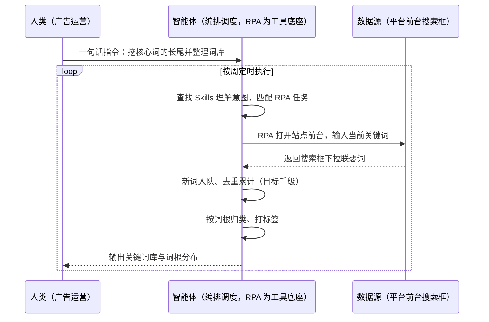
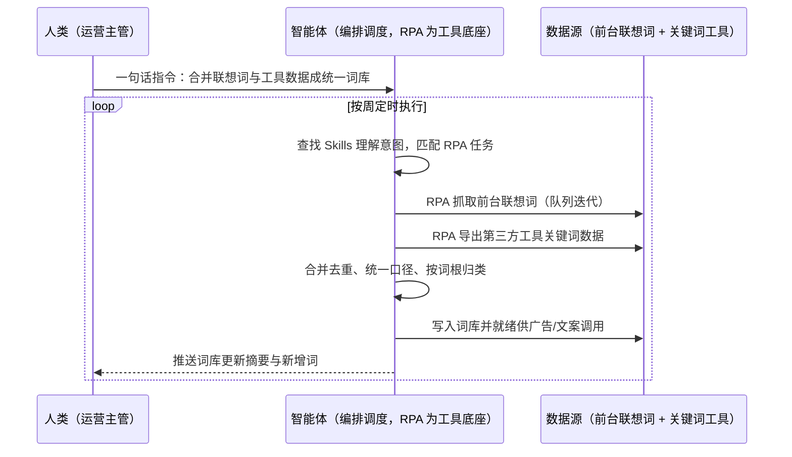

> 为亚马逊卖家打造的长尾词挖掘方案。平台流量竞争日益激烈，头部关键词被大卖与精品卖家垄断，中小卖家与精铺卖家只能靠精准长尾词触达客户；而搜索联想词随用户行为与季节动态变化，传统人工抓取极易中断且数据滞后，词库长期停在几十个核心词上。本方案由智能体调度多个工具执行搜索框联想词批量抓取 + 队列迭代扩展 + 词库清洗归类，输出千级关键词库与词根分布结果。按周定时执行，全程自动化，无异常不打扰。

> Agent 自动化需开通企业功能
> 点击申请1个月免费权限
> [点击申请 →](https://skieer.feishu.cn/share/base/form/shrcnFwMayykP5iaL38fnZKTbrg)

## 一、用户与需求

核心矛盾：

- 头部词被垄断：头部关键词被大卖/精品卖家垄断，中小卖家需依赖精准长尾词触达客户（案例口径）
- 人工抓取易中断：搜索联想词随用户行为/季节动态变化，传统人工抓取极易中断且数据滞后（案例口径）
- 词库规模上不去：人工一天抓几十个词，长尾覆盖远远不够
- 词与投放脱节：抓来的词没有归类、没有词根结构，投广告时还要再筛一遍

适用客户：亚马逊中小卖家、精铺卖家与精品卖家（广告运营/选品岗）。已用第三方关键词工具的客户由本方案补搜索联想词的持续采集与词库更新；无工具的客户可直接起步；部署后业务人员不需要写代码，一句话下达指令即可执行。

### 1.1 不同模式卖家

| 类型 | 选择 | 建议 |
|-|-|-|
| 精铺卖家 | 首选 | 强烈推荐（海量 ASIN 依赖长尾流量，词库即弹药） |
| 中小卖家 | 首选 | 强烈推荐（正面刚头部词不现实，长尾是主战场） |
| 精品卖家 | 次选 | 一般推荐（补长尾覆盖与季节性词） |

### 1.2 不同类目卖家

| 类目 | 最关注维度 | 核心逻辑 |
|-|-|-|
| 汽配 | 车型适配词 | 长尾极多，靠词量吃精准需求 |
| 家居家具 | 场景与尺寸词 | 用户搜法多样，长尾词转化高 |
| 3C 数码 | 型号与兼容词 | 型号后缀组合产生大量长尾 |
| 户外运动 | 季节词 | 随季节波动，需持续更新词库 |
| 宠物用品 | 品种与规格词 | 品种×规格组合空间大 |
| 五金工具 | 规格参数词 | 参数化长尾精准度高 |

### 1.3 不同角色用户

| 用户 | 需求 | 问题 | 投入时间（估算） |
|-|-|-|-|
| 广告运营 | 长尾词投放 | 词库更新慢，投放词受限 | 每周 2-3 小时手工找词 |
| 选品/listing 运营 | 文案关键词 | 文案关键词靠人工凑 | 每个 listing 1-2 小时 |
| 运营主管 | 词库资产 | 词库散落各人表格 | 无统一沉淀 |

---

## 二、现在的方法与问题

### 2.1 流程步骤与问题总结

人工方式（无工具辅助）

| 序号 | 步骤 | 现在的方法 | 问题缺陷 |
|-|-|-|-|
| 1 | 想核心词 | 人工凭经验定几个核心词 | 覆盖面窄 |
| 2 | 前台搜词 | 人工在搜索框输入看下拉词 | 一次只看 10 个，量太小 |
| 3 | 手工记录 | 复制粘贴到 Excel | 易中断、易漏 |
| 4 | 二次搜索 | 偶尔用新词再搜一轮 | 迭代不系统，很快停止 |
| 5 | 去重归类 | 人工去重与分类 | 词量大时做不下去 |
| 6 | 用于投放 | 手工挑词投广告 | 词库与投放脱节 |

SaaS/工具方式（已购关键词工具）

| 序号 | 步骤 | 现在的方法 | 问题缺陷 |
|-|-|-|-|
| 1 | 工具查词 | 用第三方工具查关键词 | 数据有滞后，需付费额度 |
| 2 | 前台联想词 | 仍需人工看搜索框下拉 | 工具不覆盖实时联想词（案例口径） |
| 3 | 汇总去重 | 人工合并工具与手工数据 | 两份数据口径不一 |
| 4 | 词库维护 | 人工定期整理 | 更新周期长，季节性词错过 |

### 2.2 问题分析

人工方式根因

| 序号 | 根因 | 具体表现 |
|-|-|-|
| 1 | 采集动作手工 | 搜索框逐词查看，效率极低 |
| 2 | 无迭代机制 | 新词不回灌再搜，扩展很快停止 |
| 3 | 无结构化词库 | 词散落表格，无词根与标签 |

SaaS 方式根因

| 序号 | 根因 | 具体表现 |
|-|-|-|
| 1 | 联想词不覆盖 | 第三方工具拿不到实时搜索联想词（案例口径） |
| 2 | 时效性不足 | 用户行为与季节变化快，工具数据滞后 |
| 3 | 未沉淀为资产 | 词库不维护，换人重新找词 |

---

## 三、解决方案

### 3.1 功能概述

为亚马逊卖家打造的长尾词挖掘方案，一句话调度联想词抓取 + 队列迭代 + 去重归类，输出千级关键词库与词根分布结果。

一句话下达指令（如「把这几个核心词的长尾词都挖一遍，整理成词库」，智能体通过查找 Skills 文档库理解意图、匹配 N 个 RPA 自动化任务（核心词入队→搜索框抓取→新词回灌→去重归类→词库输出），经 MCP 调度八爪鱼 RPA 打开对应平台站点的前台，在搜索框输入当前关键词，抓取搜索框下拉推荐的联想词；将新词加入待处理队列，重复上述步骤，累计获取上千个关键词，最终形成可投放、可写文案的关键词库。全程自动化，运行状态实时反馈，跑完推送结果。

### 3.2 系统结合

| 要素 | 说明 |
|-|-|
| 客户现有工具盘点 | **未购 SaaS 客户**：平台前台搜索框 + Excel 词表。      
**已购 SaaS 客户**（主流）：卖家精灵/领星等选品与关键词工具（开放 API 需企业客户申请权限）+ 前台联想词 + 词库表 |
| 数据/能力来源 | 平台前台搜索框联想词（公开页面低频只读）、第三方工具关键词数据（已购客户）、历史广告投放词与转化数据、竞品 listing 关键词 |
| RPA 耦合动作 | 作为 Agent 的工具底座被调度执行：①解决逐词查看与记录的机械动作；②被智能体调度执行核心词入队与联想词抓取；③把新词回灌队列迭代并把结果落库 |
| 耦合出的新价值 | 单系统给不了的端到端结论：实时联想词 + 工具数据 + 投放词收口到一个词库，**只推送抓取失败与词库缺口** |

### 3.3 智能体执行流程

一句话下达指令，智能体自动调度。支持**两种数据通道**，部署时按客户现有工具选择：

**通道一：无 SaaS 方式（前台联想词队列迭代）**

**通道二：有 SaaS 方式（联想词 + 工具数据合并，适合已购工具客户）**

> Agent 自动化需开通企业功能
> 点击申请1个月免费权限
> [点击申请 →](https://skieer.feishu.cn/share/base/form/shrcnFwMayykP5iaL38fnZKTbrg)

### 3.4 为何这么设计

要同时回答三个问题：**为什么不能只用纯代码 Agent？为什么不能只用纯 RPA？为什么两者要结合？** 本场景的核心是"前台抓取稳定不被拦、队列迭代能收敛、词库结构化可复用"。

#### 1）逐项对比

| 对比维度 | SaaS/API 堆叠（关键词工具+词表） | 纯智能体（智能体写代码） | 智能体+自动化工具（RPA 工具底座） |
|-|-|-|-|
| 实现方式 | 工具给词，人工整理 | 写脚本抓前台联想词 | 抓取动作平台级封装 |
| 联想词覆盖 | 工具不覆盖实时联想词（案例口径） | 反爬对抗成本高 | 前台访问，联想词拿得到 |
| 队列迭代 | 人工迭代易中断 | 可代码化但需自建调度 | 队列迭代稳定跑 |
| 使用成本（总拥有成本） | 工具订阅 + 人工整理 | 开发维护人力，隐性成本高 | 一份平台订阅跑多流程，单方案边际成本 ≈ 0 |
| 词库沉淀 | 表在各人手里 | 脚本目录 | 词库结构化沉淀 |
| 维护人要求 | 低（但整理靠人） | 规则调整都要开发介入 | 可视化流程，运营可改词根规则 |

技术栈速览：纯智能体路线需 Python（无头浏览器/队列/去重算法）等自行实现反爬对抗、联想词解析、迭代队列管理与词库存储，站点改版即需维护。

#### 2）优劣势说明

|  | SaaS/API 堆叠（关键词工具+词表） | 纯智能体（智能体写代码） | 智能体+自动化工具（RPA 工具底座） |
|-|-|-|-|
| 优势 | 工具数据规范；      
有搜索量与竞争度参考 | 无订阅费；      
迭代与去重逻辑可定制 | 实时联想词持续迭代；      
词库自动结构化 |
| 劣势 | 联想词覆盖不足、数据滞后（案例口径） | 反爬与站点改版维护自担；      
AI 生成代码是生成性的 | 本地电脑运行需保持开机；      
需控制访问频率避免触发风控 |

**特别提醒**：联想词抓取须以**公开页面低频只读**为原则，控制频率与并发，避免触发平台风控；词库中的品牌词、他人商标词需在投放前做合规筛查。

#### 3）结论

| 论点 | 说明 |
|-|-|
| 确定性 vs 生成性 | 抓取与去重是确定性动作，RPA 行为可预期；词根归类规则可配置 |
| 资产沉淀 | 核心词表、词根规则、词库沉淀在平台是活的，越用越厚 |
| 一个底座跑多流程 | 客户购买 RPA 平台是跑多个流程（长尾词/广告/选品），本方案只是其中一个，订阅费被摊薄 |
| token 消耗可控 | 抓取与去重是规则化流水线，不调用大模型；仅词根归类与摘要消耗少量 token |
| 规模与时效 | 案例口径：队列迭代累计获取上千个关键词，持续更新而非一次性抓取 |
| 时间 | 广告运营要的是"词库每周自己变厚"，不是"每周手工复制几十个联想词" |

### 3.5 功能清单

| 功能 | 系统 | 功能说明（解决问题） |
|-|-|-|
| 会话/一句话指令 | 智能体 | 1. 理解自然语言意图，查找 Skills 文档库。      
2. 匹配对应 RPA 自动化任务、编排多任务。 |
| 联想词抓取 | RPA | 1. 解决逐词人工查看问题。      
2. 作为工具被调度执行，打开对应站点前台，在搜索框输入关键词抓取下拉推荐词。      
3. 覆盖多站点与多语种。 |
| 队列迭代扩展 | 智能体 | 新词入队继续搜索，反复迭代累计获取上千个关键词，解决人工迭代易中断问题。 |
| 去重与词根归类 | 智能体 | 按词根归类、打标签、去重，解决词库无结构问题。 |
| 工具数据合并 | 智能体 | **【有 SaaS 方式】** 合并第三方工具关键词数据，统一口径，解决两份数据口径不一问题。 |
| 词库就绪供调用 | 智能体、数据库 | 词库写入中央库供广告挂词与 listing 文案调用，解决词与投放脱节问题。 |
| 更新摘要推送 | 智能体、企微 | 每周新增词与词根变化推送责任人，解决更新不可见问题。 |
| 数据资产储存 | 本地电脑、云储存 | 1. Skills 资产：长尾词挖掘技能。      
2. 数据储存：关键词库与词根表。      
3. 经验知识库：词转化效果回填。 |

### 3.6 智能体执行落地过程

部署时一次性配置入参（核心词表、目标站点、迭代深度、词根规则、推送人），会话中一句话即可触发，无需重复输入。

**⚠️ 部署前提（不满足则方案无法跑起来）**：①RPA 需部署在**常开电脑/云机**上，并配置漏跑补跑机制；②抓取频率需控制为低频只读，避免触发平台风控；③核心词表与词根规则需与广告负责人确认一次；④词库字段结构与下游调用方式（挂词/文案）需对齐；⑤首次配置（词表、规则、库表）需服务方/技术人员介入一次，属实施成本。

#### 1）配置（五步）

| 步骤 | 操作 | 说明 |
|-|-|-|
| 第一步 | 下载八爪鱼 RPA，导入跨境电商自动化模板 | 官网免费下载客户端；MCP 工具→添加应用 |
| 第二步 | 开启八爪鱼 RPA 的 MCP 服务端口 | 客户端→API-K→创建 API（名称自定义） |
| 第三步 | 在智能体中添加 MCP Server 连接 | 复制连接配置→智能体连接器→自定义连接器→配置 MCP→粘贴保存 |
| 第四步 | 验证工具列表 | 确认工具全部启用（即八爪鱼客户端内工具） |
| 第五步 | 测试运行效果 | 输入一句话指令，验证联想词抓取与词库输出 |

| 类别 | 说明 |
|-|-|
| 智能体 | 主流智能体（支持 MCP 连接、Skills 加载、定时任务）。 |
| 智能体工具 | 1. **数据通道（按客户现有工具二选一）**：【无 SaaS】前台联想词队列迭代；【有 SaaS】联想词 + 工具数据合并。      
2. 数据取数与自动化执行：八爪鱼 RPA（MCP 协议接入）。      
3. 数据分析：智能体自带。      
4. IM：企业微信/飞书（MCP 或 webhook 配置）。 |
| 工作知识 | 1. 核心词表与目标站点。      
2. 迭代深度与去重规则。      
3. 词根归类与标签体系。      
4. 合规筛查词表。 |
| 本地数据库 | 1. 关键词库地址。      
2. 词根表地址。      
3. 更新日志存档地址。 |

#### 2）执行

| 任务 | 产出 | 产出物接收人 |
|-|-|-|
| 接收一句话指令，匹配 RPA 任务 | 任务启动记录 | —— |
| 调用已预设 Skills，编排任务流程 | 任务编排方案 | —— |
| 经 MCP 向八爪鱼 RPA 下发抓取任务 | 自动化任务指令 | —— |
| 前台抓取联想词并迭代 | 长尾词原始集 | —— |
| 去重、词根归类、打标签 | 结构化词库 | 广告运营/选品 |
| 合并工具数据（有 SaaS） | 统一口径词库 | 广告运营 |
| 合规筛查 | 合规提示清单 | 广告负责人 |
| 推送更新摘要 | 群消息 | 广告团队 |

异常处理：

抓取被拦截 → 降低频率并重试，连续失败暂停并告警；

联想词页面结构变化 → 该项跳过并告警，需更新流程；

重复词占比过高 → 判定该词根已收敛，提前结束该分支迭代；

词库写入失败 → 记录断点，恢复后续跑不重写。

#### 3）结果

| 结果 | 说明 |
|-|-|
| 数据资产 | 关键词库（词/词根/来源/时间/标签），可复用可追溯。 |
| 分析报告 | 词库更新周报：新增词量/词根分布/高潜词提示。 |
| Skills | 智能体 Skills：长尾词挖掘技能，词根规则按月迭代。 |

> Agent 自动化需开通企业功能
> 点击申请1个月免费权限
> [点击申请 →](https://skieer.feishu.cn/share/base/form/shrcnFwMayykP5iaL38fnZKTbrg)

---

## 四、使用前后预估

> 本方案价值 = **核心词入队 → 联想词自动迭代 → 词库自动变厚**。把广告运营从手工复制联想词中解放出来，长尾覆盖从几十个词扩到千级。

| 指标 | 人工 | SaaS/API（关键词工具+词表） | 智能体+自动化工具 |
|-|-|-|-|
| 单次获取词量 | 人工几十个 | 工具数据量大但无联想词 | 案例口径：累计上千个关键词 |
| 联想词覆盖 | 人工逐词看 | 工具不覆盖（案例口径） | 实时抓取并迭代 |
| 更新频率 | 想起来才抓 | 受额度与周期限制 | 按周自动更新 |
| 词库结构 | 手工去重分类 | 工具标签 | 词根归类 + 标签 |
| 时效性 | 滞后且易中断 | 数据滞后（案例口径） | 持续更新，季节性词不漏 |
| 沉淀方式 | 各人表格 | 工具账号内 | 中央词库资产 |

**说明**：案例数字来自八爪鱼客户实践（案例口径：打开对应平台站点前台，在搜索框输入当前关键词抓取下拉推荐的联想词，将新词加入待处理队列重复搜索，累计获取上千个关键词；用于优化产品文案与 PPC 广告）；本方案为按同口径复刻的实施路径，具体数值随站点数量与迭代深度而异（估算）。

---

## 六、备注

### 6.1 Agent 支持

本方案不绑定具体智能体，主流 Agent 均可运行（需支持 MCP 连接、技能/Skills 加载与工具调用）：

| Agent/智能体 | 说明 |
|-|-|
| Workbuddy | 本方案运行平台，支持技能/Skills 上传加载、定时任务、MCP 工具调用与表格/报告处理 |
| 豆包（国内·字节） | 国内主流个人智能体，支持技能上传、定时任务与工具调用，上手成本低 |
| 通义千问（国内·阿里） | 支持 Agent 编排与插件生态，集成阿里电商数据能力，适合电商场景 |
| DeepSeek（国内） | 推理能力强、成本低，适合规则打分与归因分析类任务 |
| ChatGPT（国外·OpenAI） | 海外主流通用智能体，支持 GPTs/Agent 模式与工具调用 |
| Claude（国外·Anthropic） | 长文本与结构化分析能力，原生支持 MCP 连接外部工具 |

### 6.2 名词解释

| 术语 | 说明 |
|-|-|
| 长尾词 | 搜索量较低但更精准、竞争更小的一类关键词 |
| 联想词 | 搜索框下拉自动推荐的词，反映用户真实搜索习惯 |
| 核心词 | 描述商品品类的主关键词，通常竞争激烈 |
| 队列迭代 | 把新抓到的词重新作为输入继续抓取，逐层扩展词量 |
| 词根 | 关键词的构成基元（如品类词/属性词/场景词），用于归类 |
| 词库 | 结构化存放关键词的库，供广告投放与文案使用 |
| PPC 广告 | 按点击付费的广告，依赖关键词覆盖与出价 |
| ABA 数据 | 亚马逊品牌分析关键词数据，含搜索排名与转化 |
| 站点 | 亚马逊不同国家/地区站点，各站点联想词不同 |
| 合规筛查 | 过滤品牌词、商标词等不可投放词汇的检查 |
| 去重 | 剔除重复词，避免词库虚高与重复投放 |
| 低频只读 | 控制访问频率、只读取不修改，降低平台风控风险 |
| MCP | Model Context Protocol，智能体连接外部工具的标准化通道 |
| Skills | 智能体可加载的预设技能资产，含流程与知识 |

> Agent 自动化需开通企业功能
> 点击申请1个月免费权限
> [点击申请 →](https://skieer.feishu.cn/share/base/form/shrcnFwMayykP5iaL38fnZKTbrg)

---

原文：[查看原文](https://skieer.feishu.cn/wiki/M0CWwPNWKiFSggkbfxVceMQWnXc)
