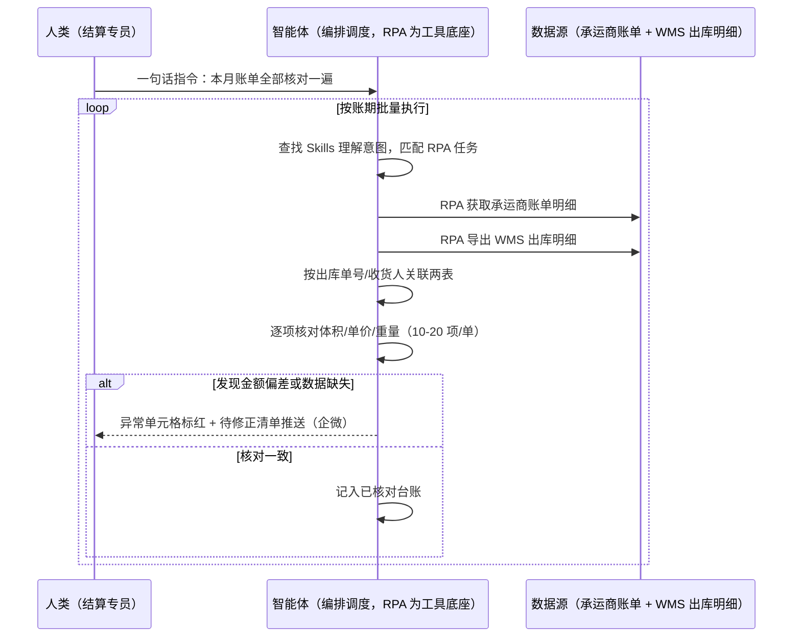
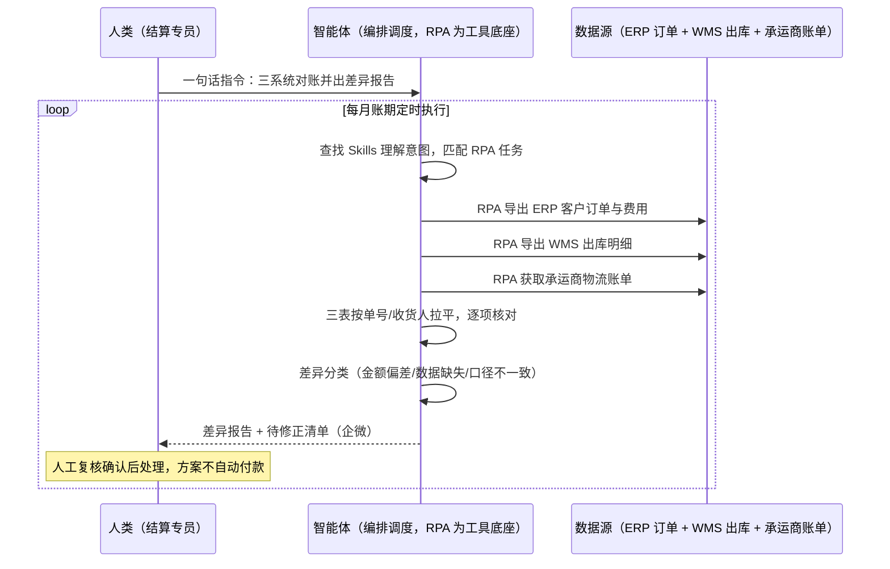

> 为货代/跨境物流公司打造的跨系统对账方案。跨境仓储物流链条中，货代是连接客户与供应商的核心枢纽，对账是其业务流程中至关重要的环节；跨境物流涉及订舱费、报关费、派送费等多环节费用，人工需逐一对接客户订单与物流账单，核对项达 10-20 项/单，效率极低。本方案由智能体调度多个工具执行物流单与出库明细自动一一核对（体积/单价/重量）+ 金额偏差与数据缺失自动标红 + 待修正清单推送，输出对账差异报告与修正闭环台账。每月定时执行，全程自动化，差异才打扰；资金结算动作保留人工复核确认。

> Agent 自动化需开通企业功能
> 点击申请1个月免费权限
> [点击申请 →](https://skieer.feishu.cn/share/base/form/shrcnFwMayykP5iaL38fnZKTbrg)

## 一、用户与需求

核心矛盾：

- 对账是枢纽刚需：货代连接客户与供应商，对账是业务流程中至关重要的环节（案例口径）
- 核对项多效率低：跨境物流涉及订舱费、报关费、派送费等多环节费用，人工逐一对接订单与账单，核对项达 10-20 项/单（案例口径）
- 跨系统数据割裂：物流单在承运商系统、出库明细在 WMS、客户订单在 ERP，人工来回导表比对
- 差错清零难：金额偏差和数据缺失靠人眼扫，量大必有漏网，月底结账压力集中

适用客户：货代公司、跨境物流商、自发货大卖（财务/结算/运营岗）。已有 ERP 的客户拉通三系统自动核对；未购系统的客户两表比对兜底；部署后业务人员不需要写代码，一句话下达指令即可执行。

### 1.1 不同类型物流商

| 类型 | 选择 | 建议 |
|-|-|-|
| 一级/二级货代 | 首选 | 强烈推荐（客户账单+供应商账单双向核对，体量最大） |
| 尾程派送商 | 首选 | 强烈推荐（派送费计费项多，重量/体积复核争议高发） |
| 海外仓 | 次选 | 一般推荐（重点核对仓储费与操作费账单） |

### 1.2 不同费用类型

| 费用 | 最关注维度 | 核心逻辑 |
|-|-|-|
| 订舱费 | 基价与附加费拆分 | 账单合并计价时人工拆不齐 |
| 报关费 | 票数口径 | 拼票/分票口径不一致就差一截 |
| 派送费 | 重量/体积复核 | 计费重与实际重偏差是争议高发区 |
| 仓储费 | 天数与计费单位 | 入出库日期截断口径要对齐 |
| 操作费 | 件数与动作项 | 换标/贴标等动作项漏记多 |

### 1.3 不同角色用户

| 用户 | 需求 | 问题 | 投入时间（估算） |
|-|-|-|-|
| 财务/结算专员 | 账单核对 | 10-20 项/单人工逐项过 | 每月 5-8 个工作日 |
| 运营主管 | 费用异常发现 | 差异靠人眼扫 | 月底集中爆发 |
| 客服/商务 | 差异沟通 | 拿不出证据链 | 争议单处理 1-2 天/单 |

---

## 二、现在的方法与问题

### 2.1 流程步骤与问题总结

人工方式（无系统辅助）

| 序号 | 步骤 | 现在的方法 | 问题缺陷 |
|-|-|-|-|
| 1 | 收客户订单 | 从 ERP/表格导出订单明细 | 格式口径不一 |
| 2 | 收物流账单 | 承运商/供应商账单邮件收集 | 账期分散易漏收 |
| 3 | 逐单核对 | 人工比对体积/单价/重量 | 核对项 10-20 项/单（案例口径） |
| 4 | 标记差异 | 人工发现金额偏差 | 漏检率高 |
| 5 | 沟通修正 | 电话/邮件找对方改 | 证据链散乱 |
| 6 | 结账归档 | 人工确认后付款 | 差异单拖累整体结账 |

系统方式（有 ERP/WMS 辅助）

| 序号 | 步骤 | 现在的方法 | 问题缺陷 |
|-|-|-|-|
| 1 | 导三系统报表 | ERP 订单/WMS 出库/账单各自导出 | 三表口径要人工对齐 |
| 2 | Excel 比对 | VLOOKUP 人工比对 | 公式易错，维护靠个别熟手 |
| 3 | 差异筛查 | 人工过滤异常行 | 量大漏筛 |
| 4 | 修正闭环 | 人工登记待修正清单 | 跟踪靠表格自觉更新 |

### 2.2 问题分析

人工方式根因

| 序号 | 根因 | 具体表现 |
|-|-|-|
| 1 | 跨系统割裂 | 物流单/出库明细/客户订单三处数据 |
| 2 | 核对项太多 | 10-20 项/单人工逐项过（案例口径） |
| 3 | 证据链散 | 争议单拿不出完整单据链 |

系统方式根因

| 序号 | 根因 | 具体表现 |
|-|-|-|
| 1 | 系统不对账 | ERP/WMS 各管一段，账单在外部 |
| 2 | 比对靠熟手 | Excel 公式技巧集中在个人手里 |
| 3 | 无闭环跟踪 | 待修正清单状态更新靠自觉 |

---

## 三、解决方案

### 3.1 功能概述

为货代/跨境物流公司打造的跨系统对账方案，一句话调度物流单与出库明细自动核对 + 差异自动标红清单化，输出对账差异报告与修正闭环台账。

一句话下达指令（如「把这个月的物流账单都对一遍，有差异的标出来给我」），智能体通过查找 Skills 文档库理解意图、匹配 N 个 RPA 自动化任务（账单获取→订单查询→逐项核对→差异标记→清单推送→闭环跟踪），根据出库单号、收货人等信息自动查询订单，核对体积、单价、重量等信息，将「物流单」与「出库明细」详细信息一一核对；若发现金额偏差或数据缺失，则将异常单元格标红，并生成待修正清单推送至相关人员。全程自动化，运行状态实时反馈，差异才推送；**资金结算动作保留人工复核确认，方案不自动执行付款**。

### 3.2 系统结合

| 要素 | 说明 |
|-|-|
| 客户现有工具盘点 | **无系统客户**：客户订单 Excel + 承运商账单 + 人工台账。       **有系统客户**（主流）：ERP（客户订单/费用）+ WMS（出库明细）+ 承运商/船司账单（邮件/后台）+ 企业微信（差异通知通道） |
| 数据/能力来源 | 物流单（承运商账单明细）；出库明细（WMS）；客户订单（ERP）；以出库单号、收货人等信息为关联主键 |
| RPA 耦合动作 | 作为 Agent 的工具底座被调度执行：自动获取各来源账单、按出库单号/收货人自动查询订单、逐项核对体积/单价/重量、异常单元格标红、生成待修正清单推送 |
| 耦合出的新价值 | 单系统给不了的端到端结论：三系统数据自动拉平 + 差异自动标红清单化 + 修正闭环可跟踪，**只推送有差异的单据** |

### 3.3 智能体执行流程

一句话下达指令，智能体自动调度。支持**两种核对通道**，部署时按客户现有工具选择：

**通道一：无 ERP 方式（两表比对，账单 vs 出库明细）**

**通道二：有 ERP 方式（三系统拉通，适合已购系统客户）**

> Agent 自动化需开通企业功能
> 点击申请1个月免费权限
> [点击申请 →](https://skieer.feishu.cn/share/base/form/shrcnFwMayykP5iaL38fnZKTbrg)

### 3.4 为何这么设计

要同时回答三个问题：**为什么不能只用纯代码 Agent？为什么不能只用纯 RPA？为什么两者要结合？** 本场景的核心是"账期一到准时跑、多系统口径自动拉平、差异标红到单元格"。

#### 1）逐项对比

| 对比维度 | SaaS/API 堆叠（ERP+Excel） | 纯智能体（智能体写代码） | 智能体+自动化工具（RPA 工具底座） |
|-|-|-|-|
| 实现方式 | 三系统报表人工导出 Excel 比对 | 能写比对脚本，但取数与口径全自建 | 账单获取+核对+标红全链路封装 |
| 账期可靠性 | 人工记得才跑 | 定时任务自建 | 账期定时，断点续跑 |
| 口径拉平 | 人工对齐三表字段 | 可代码化但调整靠开发 | 关联主键与核对项配置化 |
| 使用成本（总拥有成本） | 系统订阅 + 5-8 天/月人力 | 开发维护人力，隐性成本高 | 一份平台订阅跑多流程，单方案边际成本 ≈ 0 |
| 差异呈现 | 人工过滤异常行 | 报表输出看代码质量 | 异常单元格标红 + 待修正清单（案例口径） |
| 维护人要求 | 低（但熟手依赖重） | 规则调整都要开发介入 | 可视化流程，业务自己可改核对项 |

技术栈速览：纯智能体路线需 Python（pandas/Playwright）等自行实现多系统取数、字段口径对齐、逐项比对、差异分类与报表生成、定时调度与推送等工程底座，全部自建自维护。

#### 2）优劣势说明

|  | SaaS/API 堆叠（ERP+Excel） | 纯智能体（智能体写代码） | 智能体+自动化工具（RPA 工具底座） |
|-|-|-|-|
| 优势 | 数据口径权威；       三系统数据齐 | 无订阅费；       比对逻辑可深度定制 | 逐项自动核对；       差异标红清单化；       修正闭环可跟踪 |
| 劣势 | 比对靠熟手 Excel；       核对量大效率极低（案例口径） | 取数与调度全自建；       AI 生成代码是生成性的 | 本地电脑运行需保持开机；       依赖各系统报表口径稳定；       账单格式变化需更新流程 |

**特别提醒**：对账涉及资金结算，本方案定位为**核对与证据链提供**——差异报告与待修正清单供人工复核确认后处理，**不自动执行付款/调账动作**；修正闭环状态由人工更新确认。

#### 3）结论

| 论点 | 说明 |
|-|-|
| 确定性 vs 生成性 | 账期对账是确定性任务，RPA 行为可预期；生成性代码跑一天 ≠ 跑一年 |
| 资产沉淀 | 取数流程、核对项、差异分类规则沉淀在平台是活的，换人接手成立 |
| 一个底座跑多流程 | 客户购买 RPA 平台是跑多个流程（对账/轨迹/制单），本方案只是其中一个，订阅费被摊薄 |
| token 消耗极低 | 逐项比对是规则化流水线，不调用大模型；仅差异摘要文案消耗少量 token |
| 证据链可追责 | 差异单自动带三系统原始数据与核对明细，争议沟通有据 |
| 时间 | 财务要的是"账期一到自动对完、差异自动标红"，不是"5-8 天人肉过账单" |

### 3.5 功能清单

| 功能 | 系统 | 功能说明（解决问题） |
|-|-|-|
| 会话/一句话指令 | 智能体 | 1. 理解自然语言意图，查找 Skills 文档库。       2. 匹配对应 RPA 自动化任务、编排多任务。 |
| 账单自动获取 | RPA | 自动获取承运商/供应商物流账单（邮件/后台），解决账期分散易漏收问题。 |
| 订单自动查询 | RPA、ERP | 根据出库单号、收货人等信息自动查询订单（案例口径），解决人工逐单检索问题。 |
| 逐项核对 | 智能体 | 体积、单价、重量等核对项将「物流单」与「出库明细」一一核对（案例口径），解决 10-20 项/单人工效率极低问题。 |
| 差异标红 | 智能体、Excel | 金额偏差或数据缺失将异常单元格标红（案例口径），解决人眼漏检问题。 |
| 待修正清单 | 智能体、企微 | 生成待修正清单推送至相关人员（案例口径），解决差异跟踪散乱问题。 |
| 对账差异报告 | 智能体 | 差异分类（金额偏差/数据缺失/口径不一致）与结账建议，供人工复核。 |
| 数据资产储存 | 本地电脑、云储存 | 1. Skills 资产：跨系统对账技能。       2. 数据储存：三系统快照与核对结果库。       3. 经验知识库：差异处置记录回填。 |

### 3.6 智能体执行落地过程

部署时一次性配置入参（账期口径、关联主键、核对项清单、标红规则、推送群），会话中一句话即可触发，无需重复输入。

**⚠️ 部署前提（不满足则方案无法跑起来）**：①RPA 需部署在**常开电脑/云机**上，并配置漏跑补跑机制；②ERP/WMS 报表导出权限与账单获取渠道需提前打通；③核对项清单与标红阈值需与财务确认一次；④企微推送群机器人需提前配置；⑤**资金结算必须保留人工复核确认环节**；⑥首次配置（账号、口径、核对项）需服务方/技术人员介入一次，属实施成本。

#### 1）配置（五步）

| 步骤 | 操作 | 说明 |
|-|-|-|
| 第一步 | 下载八爪鱼 RPA，导入物流货代自动化模板 | 官网免费下载客户端；MCP 工具→添加应用 |
| 第二步 | 开启八爪鱼 RPA 的 MCP 服务端口 | 客户端→API-K→创建 API（名称自定义） |
| 第三步 | 在智能体中添加 MCP Server 连接 | 复制连接配置→智能体连接器→自定义连接器→配置 MCP→粘贴保存 |
| 第四步 | 验证工具列表 | 确认工具全部启用（即八爪鱼客户端内工具） |
| 第五步 | 测试运行效果 | 输入一句话指令，验证核对与差异标红清单 |

| 类别 | 说明 |
|-|-|
| 智能体 | 主流智能体（支持 MCP 连接、Skills 加载、定时任务）。 |
| 智能体工具 | 1. **核对通道（按客户现有工具二选一）**：【无 ERP】账单 vs WMS 出库明细两表比对；【有 ERP】ERP 订单 + WMS 出库 + 承运商账单三系统拉通。       2. 数据取数与自动化执行：八爪鱼 RPA（MCP 协议接入）。       3. 数据分析：智能体自带。       4. IM：企业微信（MCP 或 webhook 配置）。 |
| 工作知识 | 1. 账期口径与账单来源清单。       2. 关联主键（出库单号/收货人）。       3. 核对项清单（体积/单价/重量等）。       4. 标红规则与推送群。 |
| 本地数据库 | 1. 三系统快照库地址。       2. 核对结果库地址。       3. 待修正清单存档地址。 |

#### 2）执行

| 任务 | 产出 | 产出物接收人 |
|-|-|-|
| 接收一句话指令，匹配 RPA 任务 | 任务启动记录 | —— |
| 调用已预设 Skills，编排任务流程 | 任务编排方案 | —— |
| 经 MCP 向八爪鱼 RPA 下发取数任务 | 自动化任务指令 | —— |
| 获取账单并查询订单 | 三系统原始数据 | —— |
| 逐项核对（物流单 vs 出库明细） | 核对结果表 | —— |
| 差异标红与分类 | 对账差异报告 | 财务/结算 |
| 待修正清单推送 | 群消息 | 相关责任人员 |
| 修正闭环跟踪 | 闭环状态台账 | 财务/运营 |

异常处理：

某系统导出失败 → 跳过并记录，下一轮自动补采，不输出半量结论；

关联主键匹配失败 → 该单标注"关联缺失"列人工处理；

账单格式变化 → 解析失败告警，需更新映射后重跑；

差异超阈值 → 即时推送加急提醒，不等月报。

#### 3）结果

| 结果 | 说明 |
|-|-|
| 数据资产 | 三系统快照 + 核对结果库（单号/核对项/差异/状态），可审计可追溯。 |
| 分析报告 | 对账差异报告：金额偏差/数据缺失/口径不一致分类清单 + 证据链。 |
| Skills | 智能体 Skills：跨系统对账技能，按账单结构迭代。 |

> Agent 自动化需开通企业功能
> 点击申请1个月免费权限
> [点击申请 →](https://skieer.feishu.cn/share/base/form/shrcnFwMayykP5iaL38fnZKTbrg)

---

## 四、使用前后预估

> 本方案价值 = **账期自动跑 → 逐项自动核 → 差异自动标红**。把结算专员从每月人肉过账单的机械活中解放出来，差异带证据链自动找上门，结账只处理例外。

| 指标 | 人工 | SaaS/API（ERP+Excel） | 智能体+自动化工具 |
|-|-|-|-|
| 账单获取 | 邮件人工收集 | 人工导三系统报表 | 自动获取与导出 |
| 核对效率 | 10-20 项/单人工过（案例口径） | 熟手 Excel 比对 | 逐项自动一一核对（案例口径） |
| 差异发现 | 人眼扫描漏检 | 过滤易漏筛 | 金额偏差/数据缺失自动标红 |
| 修正闭环 | 表格跟踪靠自觉 | 无系统闭环 | 待修正清单推送 + 状态跟踪 |
| 对账周期 | 每月 5-8 个工作日 | 每月数天 | 案例口径：每月节省 5 日时间 |
| 准确率 | 人工有漏网 | 公式易错 | 案例口径：准确率提升 100% |
| 资金安全 | 人工确认付款 | 人工确认付款 | 差异报告供人工复核，不自动付款 |
| 方法论 | 在熟手手里 | 在公式文件里 | Skills 核对规则资产沉淀 |

**说明**：案例数字来自八爪鱼客户实践（案例口径：按出库单号/收货人自动查询订单核对体积/单价/重量，物流单与出库明细一一核对，异常标红生成待修正清单，每月节省 5 日时间、准确率提升 100%）；本方案为按同口径复刻的实施路径，具体数值随单量与核对项复杂度而异（估算）。

---

## 五、效果证明

> Agent 自动化需开通企业功能
> 点击申请1个月免费权限
> [点击申请 →](https://skieer.feishu.cn/share/base/form/shrcnFwMayykP5iaL38fnZKTbrg)

### 5.1 客户案例

**《财务跨系统对账机器人：5 分钟完成 10 天对账工作》**

> 财务需将自行统计的应收账单（邮件汇总 + SaaS 导出）与代理商统计的应付账单（云盘人工汇总）人工二次核对，涉及 VAT 与 EPR 两个场景且代理商众多。

| 效果 | 说明 |
|-|-|
| 提效 | 跨系统对账由 10 天压缩至 5 分钟。原本代理商账单分散在邮件与线下表格，财务需人工提取核验、反复对数，现在自动汇总、比对并输出差异清单。 |
| 降本 | 免除人工提取邮件与重复对数的投入，财务团队投入转向差异复核与资金管理等重点环节。 |
| 任务 | 打通线上系统与线下台账双重对账机制，标准化账单可自动生成。 |
| 任务 | 对账不平与异常账单自动标记进入人工复核清单，不自动放行资金动作。 |

案例详情：[对账|财务跨系统对账机器人，5min完成10天对账工作八爪鱼RPA](https://skieer.feishu.cn/wiki/S364wc0Xsisz71k81xKc1pfJnah)

---

## 六、备注

### 6.1 Agent 支持

本方案不绑定具体智能体，主流 Agent 均可运行（需支持 MCP 连接、技能/Skills 加载与工具调用）：

| Agent/智能体 | 说明 |
|-|-|
| Workbuddy | 本方案运行平台，支持技能/Skills 上传加载、定时任务、MCP 工具调用与表格/报告处理 |
| 豆包（国内·字节） | 国内主流个人智能体，支持技能上传、定时任务与工具调用，上手成本低 |
| 通义千问（国内·阿里） | 支持 Agent 编排与插件生态，集成阿里电商数据能力，适合电商场景 |
| DeepSeek（国内） | 推理能力强、成本低，适合规则打分与归因分析类任务 |
| ChatGPT（国外·OpenAI） | 海外主流通用智能体，支持 GPTs/Agent 模式与工具调用 |
| Claude（国外·Anthropic） | 长文本与结构化分析能力强，原生支持 MCP 连接外部工具 |

### 6.2 名词解释

| 术语 | 说明 |
|-|-|
| 对账 | 核对客户订单、出库明细与物流账单三方的费用与数量一致性 |
| 物流单 | 承运商/供应商出具的物流费用账单明细 |
| 出库明细 | WMS 记录的货物出库数量/重量/体积明细 |
| 核对项 | 单票需要核对的具体字段（体积/单价/重量等，达 10-20 项/单） |
| 金额偏差 | 账单金额与订单约定金额的差值 |
| 数据缺失 | 关联主键匹配不上或字段为空的异常 |
| 异常单元格标红 | 差异字段在结果表中红色标注，定位到具体单元格 |
| 待修正清单 | 差异单汇总清单，推送相关责任人员跟进修正 |
| 关联主键 | 出库单号、收货人等用于跨系统匹配单据的字段 |
| 证据链 | 差异单对应的三系统原始数据与核对明细记录 |
| WMS/ERP | 仓储管理系统/企业资源计划系统，出库与订单数据载体 |
| 断点续跑 | 批量任务中断后从断点继续，不重复已核对部分 |
| MCP | Model Context Protocol，智能体连接外部工具的标准化通道 |
| 一句话指令 | 用自然语言描述任务，智能体自动翻译为自动化流程 |
| Skills | 智能体可加载的预设技能资产，含流程与知识 |

> Agent 自动化需开通企业功能
> 点击申请1个月免费权限
> [点击申请 →](https://skieer.feishu.cn/share/base/form/shrcnFwMayykP5iaL38fnZKTbrg)

---

原文：[查看原文](https://skieer.feishu.cn/wiki/YTu1wVK4Gic6RLkMdydcKbVbnNf)
