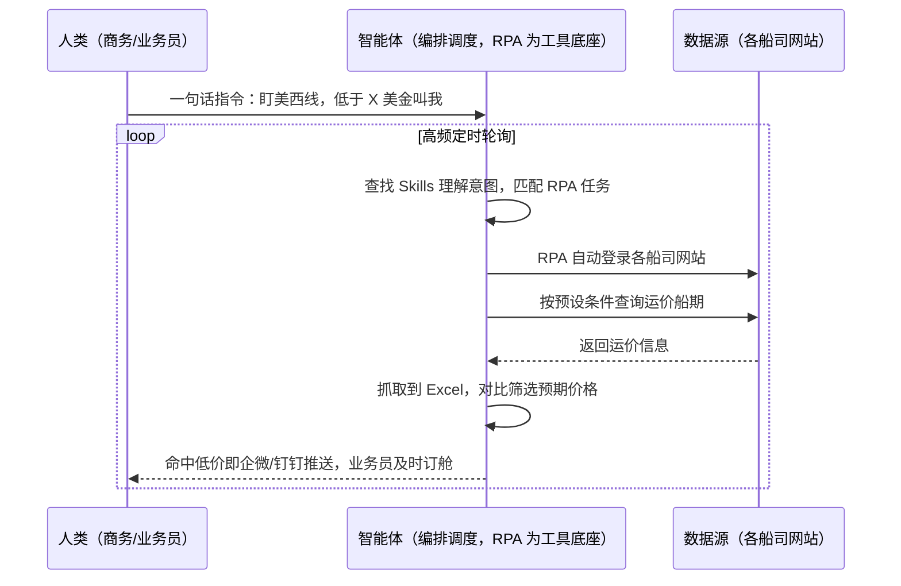
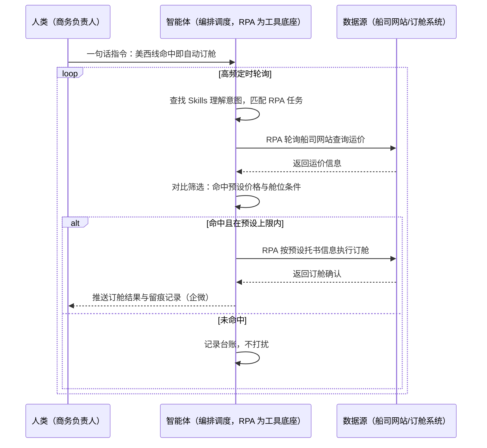

> 为货代/物流公司打造的船司运价查询与自动订舱方案。运费成本是货代运营效益的关键因素，而船公司网站上的船期和运费报价实时变动，人工登录查询受限于人力和查询频率，常因信息滞后错失合适的船期和价格。本方案由智能体调度多个工具执行多船司网站自动查价（抓取运价信息到 Excel）+ 对比筛选符合预期的低价船期 + 企微/钉钉推送业务人员及时订舱（可选自动订舱），输出运价监测台账与低价命中提醒。高频定时执行，全程自动化，命中才打扰。

> Agent 自动化需开通企业功能
> 点击申请1个月免费权限
> [点击申请 →](https://skieer.feishu.cn/share/base/form/shrcnFwMayykP5iaL38fnZKTbrg)

## 一、用户与需求

核心矛盾：

- 运价实时变动盯不住：船公司网站船期和运费报价实时变动，很难订到符合预期的低价船期（案例口径）
- 人工查询频率不够：依赖人工登录船公司网站查价，受限于人力和查询频率，信息滞后（案例口径）
- 错失低价窗口：信息滞后导致错失合适的船期和价格，运营成本白白抬升
- 多船司来回切换：多家船司网站、多起运港/目的港组合，人工轮询工作量爆炸

适用客户：货代公司、海运出口物流商、有直签船司需求的贸易企业（商务/操作/订舱岗）。已用订舱系统的客户以系统订舱、本方案补运价监测与低价提醒；部署后业务人员不需要写代码，一句话下达指令即可执行。

### 1.1 不同类型货代

| 类型 | 选择 | 建议 |
|-|-|-|
| 一级货代（直签船司） | 首选 | 强烈推荐（直签价差敏感，低价窗口就是利润） |
| 二级货代（同行订舱） | 首选 | 强烈推荐（同行比价激烈，信息快就是竞争力） |
| 拼箱/专线庄家 | 次选 | 一般推荐（重点盯核心航线的低价窗口） |

### 1.2 不同航线类型

| 航线 | 最关注维度 | 核心逻辑 |
|-|-|-|
| 美西/美东 | 旺季抢舱 | 旺季舱位紧价格跳涨，低价窗口以小时计 |
| 欧基港 | 运价波动 | 船司频繁调价，报价一周数变 |
| 东南亚 | 高频小柜 | 航次密集查价次数多，人工轮询成本高 |
| 中东/红海 | 附加费变动 | 附加费项多，总价测算口径要拉平 |
| 拉美 | 舱位稀缺 | 舱位与价格强绑定，盯得快才订得到 |
| 澳新 | 季节性波动 | 淡旺季价差大，换季窗口要盯住 |

### 1.3 不同角色用户

| 用户 | 需求 | 问题 | 投入时间（估算） |
|-|-|-|-|
| 商务/销售 | 低价舱位 | 人工盯价频率不够 | 1-2 小时/天刷网站 |
| 订舱操作 | 及时订舱 | 收到消息已是过时价 | 错过窗口重走流程 |
| 运营负责人 | 成本管控 | 运价波动心里没数 | 每周人工汇总比价 |

---

## 二、现在的方法与问题

### 2.1 流程步骤与问题总结

人工方式（无系统辅助）

| 序号 | 步骤 | 现在的方法 | 问题缺陷 |
|-|-|-|-|
| 1 | 登录船司网站 | 人工逐家登录多家船司 | 账号多登录繁琐 |
| 2 | 查询运价船期 | 人工按航线逐条查询 | 查询频率受限（案例口径） |
| 3 | 抄录比价 | 人工记录到 Excel | 格式口径不一，比价费劲 |
| 4 | 筛选判断 | 人工判断是否低价窗口 | 主观判断，标准不统一 |
| 5 | 通知订舱 | 电话/IM 通知业务员 | 信息滞后常错过（案例口径） |
| 6 | 执行订舱 | 人工进系统订舱 | 二次录入易出错 |

系统方式（有订舱/操作系统辅助）

| 序号 | 步骤 | 现在的方法 | 问题缺陷 |
|-|-|-|-|
| 1 | 系统查舱 | 订舱系统查自有合约价 | 船司公开价与合约价要分开盯 |
| 2 | 船司官网比价 | 仍需人工登录船司网站 | 系统替代不了官网实时价 |
| 3 | 汇总判断 | 人工汇总筛选 | 波动快人工跟不上 |
| 4 | 推送订舱 | 人工通知后系统订舱 | 链路长窗口易错过 |

### 2.2 问题分析

人工方式根因

| 序号 | 根因 | 具体表现 |
|-|-|-|
| 1 | 查询频率受限 | 人力有限，做不到高频轮询（案例口径） |
| 2 | 比价口径乱 | 各船司报价结构不一，人工拉平难 |
| 3 | 链路太长 | 查到-通知-订舱三段接力，窗口期耗光 |

系统方式根因

| 序号 | 根因 | 具体表现 |
|-|-|-|
| 1 | 系统只管订舱 | 运价监测不在订舱系统职责内 |
| 2 | 官网价靠人工 | 船司实时报价仍要人刷网站 |
| 3 | 无自动提醒 | 低价命中不能自动到人 |

---

## 三、解决方案

### 3.1 功能概述

为货代/物流公司打造的船

司运价查询与自动订舱方案，一句话调度多船司自动查价 + 低价对比筛选 + 推送提醒（可选自动订舱），输出运价监测台账与低价命中提醒。

一句话下达指令（如「盯一下美西线这周的价格，低于 X 美金马上叫我」），智能体通过查找 Skills 文档库理解意图、匹配 N 个 RPA 自动化任务（航线条件解析→船司网站轮询→运价抓取→对比筛选→命中推送→可选订舱），经 MCP 调度八爪鱼 RPA 自动登录各船司网站，根据预设条件自动查询价格，抓取运价信息到 Excel 中；对比筛选符合预期价格并经企业微信/钉钉推送至相关负责的业务人员及时订舱。全程自动化，运行状态实时反馈，命中才推送。

### 3.2 系统结合

| 要素 | 说明 |
|-|-|
| 客户现有工具盘点 | **无系统客户**：船司官网 + Excel。      
**有系统客户**（主流）：订舱/TMS 系统（订舱执行侧）+ 船司官网（实时运价源）+ 企业微信/钉钉（提醒通道） |
| 数据/能力来源 | 各船司网站运价与船期查询（按航线/箱型/日期条件）；订舱系统的舱位与订单数据 |
| RPA 耦合动作 | 作为 Agent 的工具底座被调度执行：自动登录各船司网站、按预设条件查价、抓取运价信息到 Excel、对比筛选；开启自动订舱开关后按预设舱位与价格上限执行订舱并留痕 |
| 耦合出的新价值 | 单系统给不了的端到端结论：多船司高频轮询 + 低价自动识别 + 提醒/订舱直达执行，**只推送命中预期的低价船期** |

### 3.3 智能体执行流程

一句话下达指令，智能体自动调度。支持**两种执行档位**，部署时按业务习惯选择：

**档位一：监测提醒方式（默认，推送业务人员及时订舱）**

**档位二：自动订舱方式（可选开启，按预设条件执行）**

> Agent 自动化需开通企业功能
> 点击申请1个月免费权限
> [点击申请 →](https://skieer.feishu.cn/share/base/form/shrcnFwMayykP5iaL38fnZKTbrg)

### 3.4 为何这么设计

要同时回答三个问题：**为什么不能只用纯代码 Agent？为什么不能只用纯 RPA？为什么两者要结合？** 本场景的核心是"高频轮询稳定跑、低价识别口径统一、提醒/订舱直达执行"。

#### 1）逐项对比

| 对比维度 | SaaS/API 堆叠（订舱系统+企微） | 纯智能体（智能体写代码） | 智能体+自动化工具（RPA 工具底座） |
|-|-|-|-|
| 实现方式 | 系统管订舱，官网价仍人工盯 | 能写爬虫轮询，但多船司适配全自建 | 多船司查价动作平台级封装 |
| 轮询频率 | 无自动轮询 | 可自建但稳定性看代码质量 | 高频定时，断点续跑 |
| 低价识别 | 人工判断 | 可代码化但口径调整靠开发 | 价格条件配置化，商务可调 |
| 使用成本（总拥有成本） | 系统订阅 + 人工盯价 | 开发维护人力，隐性成本高 | 一份平台订阅跑多流程，单方案边际成本 ≈ 0 |
| 提醒直达 | 无自动提醒 | 可自建推送 | 命中即推企微/钉钉（案例口径） |
| 维护人要求 | 低（但人工量没减） | 规则调整都要开发介入 | 可视化流程，业务自己可改条件 |

#### 2）优劣势说明

|  | SaaS/API 堆叠（订舱系统+企微） | 纯智能体（智能体写代码） | 智能体+自动化工具（RPA 工具底座） |
|-|-|-|-|
| 优势 | 订舱执行系统化；      
合约价口径清晰 | 无订阅费；      
比价逻辑可深度定制 | 多船司高频轮询；      
低价自动识别；      
提醒直达业务员 |
| 劣势 | 官网实时价仍人工盯；      
无自动提醒 | 多船司适配全自建；      
AI 生成代码是生成性的 | 本地电脑运行需保持开机；      
依赖船司网站结构稳定；      
自动订舱有边界（改版/风控需人工兜底） |

**特别提醒**：自动订舱涉及对外商务动作，默认档位为**监测提醒**（推送业务员及时订舱）；自动订舱为可选开关，开启后仅在预设航线/舱位/价格上限内执行并全程留痕，超限一律转人工确认。

#### 3）结论

| 论点 | 说明 |
|-|-|
| 确定性 vs 生成性 | 轮询查价是确定性任务，RPA 行为可预期；生成性代码跑一天 ≠ 跑一年 |
| 资产沉淀 | 登录态、查价流程、比价口径沉淀在平台是活的，换人接手成立 |
| 一个底座跑多流程 | 客户购买 RPA 平台是跑多个流程（运价监测/轨迹同步/对账），本方案只是其中一个，订阅费被摊薄 |
| token 消耗极低 | 查价比价是规则化流水线，不调用大模型；仅命中文案消耗少量 token |
| 窗口期价值 | 低价窗口以小时计，自动轮询把信息滞后成本压到最低 |
| 时间 | 商务要的是"低价自己撞上门"，不是"每天人肉刷船司网站" |

### 3.5 功能清单

| 功能 | 系统 | 功能说明（解决问题） |
|-|-|-|
| 会话/一句话指令 | 智能体 | 1. 理解自然语言意图，查找 Skills 文档库。      
2. 匹配对应 RPA 自动化任务、编排多任务。 |
| 多船司自动查价 | RPA | 自动登录各船司网站，根据预设条件自动查询价格，抓取运价信息到 Excel（案例口径），解决人工轮询频率不够问题。 |
| 运价对比筛选 | 智能体 | 多船司报价口径拉平后对比筛选符合预期的价格，解决人工比价标准不一问题。 |
| 低价命中推送 | 智能体、企微/钉钉 | 命中即推送相关负责的业务人员及时订舱（案例口径），解决信息滞后错失窗口问题。 |
| 自动订舱（可选） | RPA、订舱系统 | 按预设航线/舱位/价格上限执行订舱并留痕，解决接力链路耗时问题；超限转人工确认。 |
| 运价监测台账 | 智能体 | 运价历史曲线与命中记录结构化存储，支撑成本复盘。 |
| 数据资产储存 | 本地电脑、云储存 | 1. Skills 资产：运价监测技能。      
2. 数据储存：运价台账库。      
3. 经验知识库：命中与订舱结果回填。 |

### 3.6 智能体执行落地过程

部署时一次性配置入参（航线清单、船司账号、价格条件、推送群、订舱开关），会话中一句话即可触发，无需重复输入。

**⚠️ 部署前提（不满足则方案无法跑起来）**：①RPA 需部署在**常开电脑/云机**上，并配置漏跑补跑机制；②各船司网站**登录态**需维护，登录失效自动告警；③价格条件与航线口径需与商务确认一次；④企微/钉钉推送群机器人需提前配置；⑤开启自动订舱档位需额外确认托书模板与上限规则；⑥首次配置（账号、条件、口径）需服务方/技术人员介入一次，属实施成本。

#### 1）配置（五步）

| 步骤 | 操作 | 说明 |
|-|-|-|
| 第一步 | 下载八爪鱼 RPA，导入物流货代自动化模板 | 官网免费下载客户端；MCP 工具→添加应用 |
| 第二步 | 开启八爪鱼 RPA 的 MCP 服务端口 | 客户端→API-K→创建 API（名称自定义） |
| 第三步 | 在智能体中添加 MCP Server 连接 | 复制连接配置→智能体连接器→自定义连接器→配置 MCP→粘贴保存 |
| 第四步 | 验证工具列表 | 确认工具全部启用（即八爪鱼客户端内工具） |
| 第五步 | 测试运行效果 | 输入一句话指令，验证查价与命中推送 |

| 类别 | 说明 |
|-|-|
| 智能体 | 主流智能体（支持 MCP 连接、Skills 加载、定时任务）。 |
| 智能体工具 | 1. **执行档位（按业务习惯二选一）**：【监测提醒】查价筛选 + 推送业务员订舱；【自动订舱】预设条件内自动执行并留痕。      
2. 数据取数与自动化执行：八爪鱼 RPA（MCP 协议接入）。      
3. 数据分析：智能体自带。      
4. IM：企业微信/钉钉（MCP 或 webhook 配置）。 |
| 工作知识 | 1. 航线与船司清单。      
2. 价格条件与舱位口径。      
3. 托书模板（自动订舱档位）。      
4. 推送群与接收人。 |
| 本地数据库 | 1. 运价台账库地址。      
2. 命中记录库地址。      
3. 订舱留痕存档地址。 |

#### 2）执行

| 任务 | 产出 | 产出物接收人 |
|-|-|-|
| 接收一句话指令，匹配 RPA 任务 | 任务启动记录 | —— |
| 调用已预设 Skills，编排任务流程 | 任务编排方案 | —— |
| 经 MCP 向八爪鱼 RPA 下发查价任务 | 自动化任务指令 | —— |
| 轮询登录各船司网站查询运价 | 运价原始数据 | —— |
| 抓取到 Excel 并对比筛选 | 低价命中清单 | —— |
| 企微/钉钉推送业务员 | 命中提醒消息 | 商务/业务员 |
| 自动订舱（可选档位） | 订舱确认与留痕 | 商务/操作 |

异常处理：

登录失效 → 自动重试 2 次，仍失败告警推 IM；

某船司查价失败 → 跳过并记录，下一轮自动补查；

运价口径异常（如附加费缺失） → 该条标注"口径不全"，不输出硬结论；

自动订舱执行失败 → 即时告警转人工，已留痕可追溯。

#### 3）结果

| 结果 | 说明 |
|-|-|
| 数据资产 | 运价历史台账（船司/航线/箱型/价格/时间），可复盘可审计。 |
| 分析报告 | 运价监测简报：命中记录/价格曲线/窗口复盘。 |
| Skills | 智能体 Skills：运价监测技能，按航线结构迭代。 |

> Agent 自动化需开通企业功能
> 点击申请1个月免费权限
> [点击申请 →](https://skieer.feishu.cn/share/base/form/shrcnFwMayykP5iaL38fnZKTbrg)

---

## 四、使用前后预估

> 本方案价值 = **多船司高频轮询 → 低价自动识别 → 提醒/订舱直达执行**。把商务从每天刷船司网站的机械活中解放出来，低价窗口自动撞上门。

| 指标 | 人工 | SaaS/API（订舱系统+企微） | 智能体+自动化工具 |
|-|-|-|-|
| 查价频率 | 每日数次（人力受限） | 无自动轮询 | 高频定时轮询 |
| 比价口径 | 各船司人工拉平 | 合约价口径 | 多船司口径自动拉平 |
| 低价识别 | 人工主观判断 | 无 | 预设条件自动命中 |
| 提醒直达 | 电话/IM 接力 | 无自动提醒 | 命中即推企微/钉钉（案例口径） |
| 订舱效率 | 窗口期接力耗时长 | 系统订舱仍靠人触发 | 案例口径：订舱效率提升 100% |
| 人力投入 | 商务每日刷站 1-2 小时 | 人工盯价没减 | 全自动查价，释放人力（案例口径） |
| 方法论 | 在个人手里 | 系统固定口径 | Skills 比价规则资产沉淀 |

**说明**：案例数字来自八爪鱼客户实践（案例口径：自动登录各船司网站按预设条件查价抓取 Excel，对比筛选推送企微/钉钉及时订舱，全自动查价释放人力、订舱效率提升 100%）；本方案为按同口径复刻的实施路径，具体数值随航线数量与轮询频率而异（估算）。

---

## 五、效果证明

> Agent 自动化需开通企业功能
> 点击申请1个月免费权限
> [点击申请 →](https://skieer.feishu.cn/share/base/form/shrcnFwMayykP5iaL38fnZKTbrg)

### 5.1 客户案例

**《货代自动订舱：捕捉低价船期，提升海运出口竞争力》**

> 某货运代理公司专注化工品及危险品海运出口，船公司网站船期与运费报价实时变动，能否及时捕捉低价船期直接关系运费成本与竞争力。

| 效果 | 说明 |
|-|-|
| 提效 | 船期运价查询由人工逐条查询变为批量自动查询。原本需手动登录各船公司网站逐条输入条件，旺季来不及，现在自动登录、自动填充条件、全量抓取。 |
| 降本 | 免除人工抄录价格与船期的重复投入，操作人员投入转向客户报价与舱位协调等重点工作。 |
| 任务 | 自动抓取全量信息（含附加费、截单时间），统一格式记录，数据精准无错。 |
| 任务 | 命中低价船期自动推送，缩短「发现低价 – 完成订舱」的响应窗口。 |

案例详情：[物流|自动订舱：RPA机器人捕捉低价船期订舱，提升海运出口竞争力，货代必看！](https://skieer.feishu.cn/wiki/CExIwDsgviK7zTkmsjfc3SPEnOf)

---

## 六、备注

### 6.1 Agent 支持

本方案不绑定具体智能体，主流 Agent 均可运行（需支持 MCP 连接、技能/Skills 加载与工具调用）：

| Agent/智能体 | 说明 |
|-|-|
| Workbuddy | 本方案运行平台，支持技能/Skills 上传加载、定时任务、MCP 工具调用与表格/报告处理 |
| 豆包（国内·字节） | 国内主流个人智能体，支持技能上传、定时任务与工具调用，上手成本低 |
| 通义千问（国内·阿里） | 支持 Agent 编排与插件生态，集成阿里电商数据能力，适合电商场景 |
| DeepSeek（国内） | 推理能力强、成本低，适合规则打分与归因分析类任务 |
| ChatGPT（国外·OpenAI） | 海外主流通用智能体，支持 GPTs/Agent 模式与工具调用 |
| Claude（国外·Anthropic） | 长文本与结构化分析能力强，原生支持 MCP 连接外部工具 |

### 6.2 名词解释

| 术语 | 说明 |
|-|-|
| 货代 | 货运代理，衔接货主与船司/航司的运输服务中介 |
| 船司 | 船公司（如马士基、达飞、中远海运），海运承运人 |
| 运价 | 船司公布的航线运输报价，含基本运费与附加费 |
| 船期 | 船舶开航与到港计划，低价船期即价格合适的舱位 |
| 订舱 | 向船司预订舱位的操作，凭托书（SO）锁定舱位 |
| 托书 | 订舱委托书，含发货人/收货人/箱型/件数等要素 |
| 附加费 | 运价外的附加项目（如燃油附加费 BA F、旺季附加费 PSS） |
| 低价窗口 | 运价回落且舱位可订的短暂时段 |
| 轮询 | 按固定频率反复查询各船司运价的机制 |
| 口径拉平 | 把各船司不同报价结构换算成可比口径 |
| TMS | 运输管理系统，货代的订单与订舱执行系统 |
| MCP | Model Context Protocol，智能体连接外部工具的标准化通道 |
| 一句话指令 | 用自然语言描述任务，智能体自动翻译为自动化流程 |
| Skills | 智能体可加载的预设技能资产，含流程与知识 |

> Agent 自动化需开通企业功能
> 点击申请1个月免费权限
> [点击申请 →](https://skieer.feishu.cn/share/base/form/shrcnFwMayykP5iaL38fnZKTbrg)

---

原文：[查看原文](https://skieer.feishu.cn/wiki/USVZwpx6KigJRxkPaGnc8SS4nDg)
